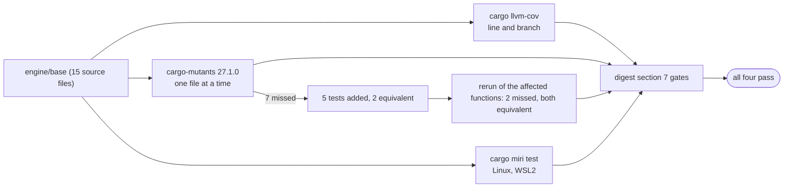

# Phase 1 exit audit: coverage, mutation and Miri of the whole `base` crate `[S]`

Evidence for the end of phase 1, card 1-36, measured on 2026-10-28 on branch `agent/1-36-phase1-exit-audit` (cut from `phase/1`, which holds cards 1-35, 1-37 and 1-41 on top of `main`). It measures the whole of `engine/base` against the quality gates of [rules-digest §7](../rules-digest.md); the values of the gates are in `gates/gates.toml` and are not repeated here. **Nothing was lowered, skipped or waived**: five test gaps found by the mutation run were closed with tests (section 4).

## 1. Summary

| Gate | Measured | Result |
|---|---|---|
| Line coverage, `base` | 96.26% (3,960 lines, stable toolchain); 95.83% on the nightly branch run | pass |
| Branch coverage, `base` | 84.33% (134 branches, 21 missed, nightly `--branch`) | pass |
| Mutation score, all of `base` | 99.75% (813 of 815 testable mutants caught or timed out; 98 unviable are not counted) | pass |
| Miri on the `unsafe` modules and the rest of `base` | clean: 382 unit, 35 integration (11 test binaries) and 3 doc tests, 0 undefined behaviour | pass |

"Pass" means the crate-wide figure meets the gate. Two things are not hidden: single files are lower (section 3, for example `profile.rs` is at 88.46% of its lines, below the new-line level); and the mutation score is a per-file sequence of runs, not one whole-crate run (section 5).

## 2. Method

| Check | Command (from the repository root) | Notes |
|---|---|---|
| Line coverage | `cargo llvm-cov -p base --features profiling --locked --summary-only` | stable toolchain, cargo-llvm-cov 0.9.1; default and `profiling` features together |
| Branch coverage | `cargo +nightly llvm-cov -p base --features profiling --locked --branch --summary-only` | branch coverage needs nightly; the nightly line counts differ slightly from stable |
| Mutation | `cargo-mutants mutants -p base --features profiling -j 1 --no-shuffle --file engine/base/src/<file>.rs` | cargo-mutants 27.1.0, one file at a time, one worker |
| Miri | `cargo +nightly miri test -p base --features profiling --locked` | Linux (`x86_64-unknown-linux-gnu`, WSL2); on the Windows host target Miri reports an error inside the std Windows allocator, so Linux is the Miri platform ([core-runtime](../architecture/core-runtime.md)) |

The machine has 16 GB of memory. Heavy jobs were run one at a time, because two earlier attempts at running Miri and coverage together, and one whole-crate mutation run, were stopped by the host for low memory. That is why mutation ran per file.

## 3. Coverage per file

Stable toolchain, lines:

| File | Lines | Missed | Cover |
|---|---|---|---|
| alloc.rs | 129 | 0 | 100.00% |
| arena.rs | 305 | 21 | 93.11% |
| assert.rs | 20 | 3 | 85.00% |
| log.rs | 117 | 3 | 97.44% |
| map.rs | 414 | 4 | 99.03% |
| math/matrix.rs | 693 | 46 | 93.36% |
| math/quaternion.rs | 608 | 32 | 94.74% |
| math/vector.rs | 484 | 9 | 98.14% |
| pool.rs | 321 | 8 | 97.51% |
| profile.rs | 52 | 6 | 88.46% |
| ring.rs | 165 | 1 | 99.39% |
| rng.rs | 126 | 10 | 92.06% |
| simd/scalar.rs | 101 | 0 | 100.00% |
| simd/sse2.rs | 150 | 0 | 100.00% |
| sparse.rs | 275 | 5 | 98.18% |
| **Total** | **3,960** | **148** | **96.26%** |

(The "Missed" column is the number of lines reported by `llvm-cov report --show-missing-lines`; the cover column is the tool's.)

Branches (nightly): the total is 84.33%. Low single files: `arena.rs` 63.16% (14 of 38 missed), `pool.rs` 84.62%, `simd/sse2.rs` 25.00% (3 of 4 missed). They pass in the aggregate only; the gate is stated for the layer, not per file.

**What the missed lines are.** Every missed line that was inspected is code that tests cannot reach, not a missing test:

- a compile-time `Send` check closure in `profile.rs` (it is type-checked, never called);
- the `const` asserts and the out-of-memory handler in `arena.rs` (`handle_alloc_error`);
- `panic!("fits")` arms and `should_panic` test bodies in several test modules;
- a 6-value reference table in `rng.rs`.

The `math/matrix.rs` lines were not inspected one by one; they were not needed to pass the gate. `profile.rs` is the file added in card 1-35: its 88.46% on stable is below the level of the new-line gate, and the lines are the ones above, so the gap is not fixed with a test; the report states it instead.

## 4. Mutation

Per file, with the counts as cargo-mutants reports them (timeouts count as caught, as in cargo-mutants; unviable mutants do not compile and are not counted in the score):

| File | Mutants | Caught | Timeout | Missed | Unviable |
|---|---|---|---|---|---|
| alloc.rs | 11 | 10 | 0 | 0 | 1 |
| arena.rs | 50 | 28 | 0 | 0 | 22 |
| simd/sse2.rs | 20 | 9 | 0 | 0 | 11 |
| simd/scalar.rs | 39 | 27 | 0 | 0 | 12 |
| pool.rs | 44 | 35 | 0 | 0 | 9 |
| map.rs | 86 | 62 | 12 | 4 | 8 |
| ring.rs | 36 | 30 | 3 | 1 | 2 |
| sparse.rs | 31 | 21 | 0 | 1 | 9 |
| rng.rs | 28 | 21 | 6 | 1 | 0 |
| log.rs | 9 | 6 | 0 | 0 | 3 |
| profile.rs | 7 | 6 | 0 | 0 | 1 |
| math/vector.rs | 32 | 28 | 0 | 0 | 4 |
| math/matrix.rs | 301 | 291 | 0 | 0 | 10 |
| math/quaternion.rs | 219 | 213 | 0 | 0 | 6 |
| assert.rs | 0 | - | - | - | - |
| **First run** | **913** | **787** | **21** | **7** | **98** |

First-run score: 808 of 815 = 99.14%. The three `unsafe` modules (`alloc`, `arena`, `simd/sse2`) had no missed mutant.

**The 7 missed mutants and what happened to them**

| Mutant | Cause | Action |
|---|---|---|
| `map.rs` `hash64`: `^=` to `\|=` | the vectors used small keys, so the first shift is zero | test with keys that have high bits, reference values computed outside the crate |
| `map.rs` `with_capacity`: `EMPTY - 1` to `EMPTY / 1` | the limit cannot be tested through `with_capacity` (it would need about 32 GB) | the clamp became the function `clamped_capacity`, tested on its own |
| `map.rs` `is_empty` returns `true` | only an empty map was asserted | test with one entry |
| `ring.rs` `is_empty` returns `true` | same | test with one value |
| `sparse.rs` `is_empty` returns `true` | same | test with one entry |
| `map.rs` `Handle::hash_key`: `\|` to `^` | **equivalent**: the index fills bits 0-31 and the generation is shifted to bits 32-63, so the operands never share a set bit | none possible; recorded here |
| `rng.rs` `next_f32`: `\|` to `^` | **equivalent**: the exponent bits of 1.0 and the 23 mantissa bits never overlap | none possible; recorded here |

After the five tests and the extraction, the affected functions were mutated again: `ring` 3 of 3 caught, `sparse` 2 of 2 caught, `map` 28 caught, 1 timeout, 2 unviable and one missed (the equivalent `hash_key`), `rng` 7 of 8 caught (the equivalent `next_f32`). Final: 813 of 815 = **99.75%**, with the two misses being equivalent mutants.

## 5. Miri

Clean: `cargo +nightly miri test -p base --features profiling --locked` exited 0 on Linux; 382 unit tests, 35 integration tests in 11 binaries and 3 doc tests passed with no undefined behaviour reported. This covers the three `unsafe` modules (`alloc`, `arena`, `simd/sse2`) and all other tests of the crate. The unit-test line printed an elapsed time that does not match the wall clock of the session (the WSL clock drifted), so no duration is quoted.

## 6. Limits of this audit

- **Branch coverage** exists only on the nightly toolchain; the stable figures are line and region figures.
- **Mutation** was run per file, not in one go (memory), and the 5 fixes were re-checked on the affected functions only, not by a second whole-crate run. The score of 99.75% therefore combines the first run with that re-check.
- **Miri** ran on Linux only; the Windows host target is not usable for it (std allocator), as already recorded in the core-runtime page.
- **`base` is not in the CI `metrics` job**, which measures only the skeleton crate. The audit above was run by hand. Wiring `base` into that job is a change to a workflow file, so it needs a governance card; it is proposed, not done.
- The mutation and coverage figures describe one commit of `base` plus the five added tests; they are not a ratchet baseline.
