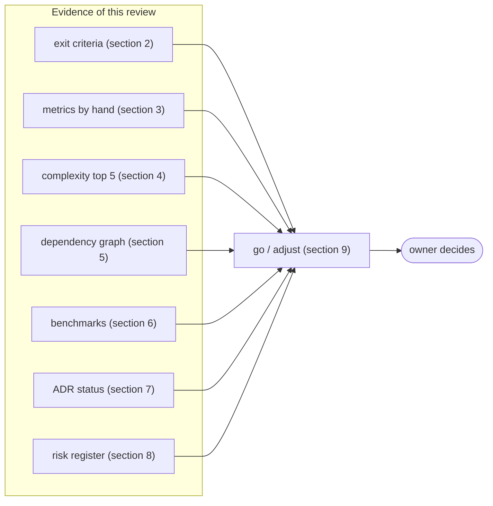
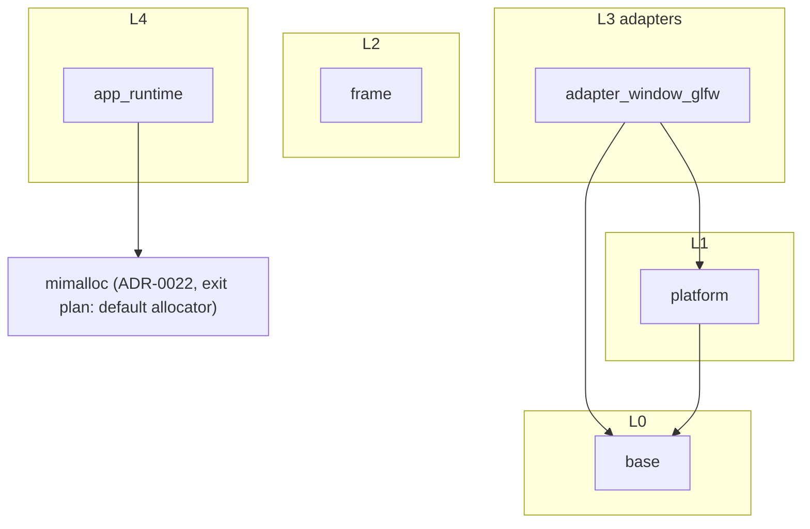

# Phase 2 milestone review `[S]`

Card 2-18, measured on 2026-11-01 and 2026-11-02 on branch `agent/2-18-phase2-milestone-review` (cut from `develop` at `34795a5`, which holds everything of phase 2 including the release v0.3.0 and the G6 record of card 2-17). The roadmap asks for this review at the end of each phase ([roadmap](../workflow/roadmap.md) "Milestone reviews", [quality-metrics §4](../workflow/quality-metrics.md)): metrics against the previous milestone, the five worst functions by complexity, the dependency graph, the benchmark trend, the ADR status, the risk register and a go/adjust decision. **The go/adjust decision is the owner's** (section 9); this page gives the evidence and a recommendation.

**How the numbers were made.** The metric report that the release workflow publishes is still a placeholder ("the metric report is generated in a later phase", v0.2.0 and v0.3.2), and the `ci` `metrics` job measures only the skeleton crate. Every figure below was therefore measured by hand with the tools named in section 3, like the [phase 1 exit audit](phase1-exit-audit.md), which is the previous milestone. Nothing was lowered, skipped or waived.

## 1. Summary

| Question | Answer |
|---|---|
| Are the phase 2 exit criteria met? | Yes, all of the roadmap row; one record is owner-accepted instead of literal (gate G6, section 2). |
| Did a gate fail on phase 2 code? | No gate was lowered. Mutation on phase 2 code: 141 of 152 viable mutants caught (92.8%), the 11 misses are explained in section 3.3; the gate is 80% on changed L0-L2 code. |
| What is the main weakness found? | The quality gates are not measured by CI on the real crates: the metric report is a placeholder and `base`, `platform` and `frame` are not in the `metrics` job. This review measured them by hand. |
| A figure that moved the wrong way? | `base` line coverage reads 84.24% from the tool now against 96.26% in the phase 1 audit with the same command and toolchain. A recount that ignores blank, comment and brace-only lines gives 95.57%. The cause is not established (section 3.2). |
| Recommendation | **Go** to phase 3 once the owner picks from the adjustments in section 9; the first two adjustments make the gates real before more code lands on them. |

## 2. Exit criteria of the phase 2 row

| Roadmap item | Evidence | Result |
|---|---|---|
| Platform port family v0: clock, threads seam, virtual-mount file system (sync and background reads), lifecycle, window/input minimal | `engine/platform` (clock, threads, files, window, events); [platform-ports](../architecture/platform-ports.md) | met |
| **Headless** and a **GLFW-based window/input adapter** on Windows and Linux | `HeadlessWindows` in `platform`; `engine/adapter_window_glfw`; the contract suite passes on Windows (local run) and on Linux (job `glfw_linux`, `xvfb`) | met |
| `std`-backed clock/threads/file seams | `StdClock`, `StdThreads`, `StdFileSystem` | met |
| Frame loop with fixed step | `engine/frame` (`FixedStep`) | met |
| ARM64 CI job + NEON `simd` backend (Q15) | job `arm64` on the hosted `ubuntu-24.04-arm` runner; `base/src/simd/neon.rs` bit-identical to scalar, tests run natively | met |
| Platform contract suite green on both OSes and headless | `ci` jobs for Windows and Linux, job `headless` | met |
| Banned-import + headless-only CI jobs green | `gates` (arch-check), job `headless` (no `adapter_*` or `app_*` in the graph) | met |
| Engine/game swap-diff = 0 when the second OS adapter lands (port files excluded, N-4) | `tools/swap-diff`: 0 engine/game files, one port revision ([platform-ports §14](../architecture/platform-ports.md)) | met |
| Gate G6 FFI ([ADR-0001](../decisions/adr-0001-language-evaluation.md): one call each to Win32 and POSIX, "monotonic time, open file", hand-written, inside an adapter, passing the contract test) | `dynlib.rs` library loading on both OSes; the ADR's example calls go through `std`. **Owner accepted this as the evidence (option 1, 2026-11-01).** | met by owner decision, not literally |
| Window/input `stable` only after a native adapter (D-5) | no native adapter yet | not due; the ports stay `experimental` |

Releases: v0.3.0 (the phase batch), then v0.3.1 and v0.3.2 for later cards. Cards 2-1 to 2-18 (2-18 is this one).

## 3. Metrics against the previous milestone

The previous milestone is phase 1 (release v0.2.0, [phase 1 exit audit](phase1-exit-audit.md)). Phase 1 measured the `base` crate only; phase 2 added `platform`, `frame`, `adapter_window_glfw` and one `base` backend, so rows are given per crate.

### 3.1 Size, tests, unsafe

| Metric | Phase 1 (audit, `base`) | Now |
|---|---|---|
| Source lines `base` | 3,960 counted lines (llvm-cov) | 6,973 file lines in 19 files (includes tests and comments) |
| Source lines `platform` / `frame` / `adapter_window_glfw` | - | 2,979 (12 files) / 234 (2) / 1,376 (3) |
| Tests, `base` | 417 unit and integration (382 + 35; the audit also ran 3 doc tests) | 422 unit and integration (387 + 35; `cargo llvm-cov` does not run doc tests), 0 failed |
| Tests, whole workspace (`cargo test --workspace --locked`, Windows, run twice with the same count) | - | 586 passed, 0 failed, 0 ignored |
| Change since v0.2.0 | - | 28 engine files, +5,291 / -5 lines |
| `unsafe` lines (budget tool, layers 0-2) | 55 (the count before `neon.rs`, from platform-ports §13) | 71 of 8,695 code lines (0.82%), 0 violations; the 16 new lines are `neon.rs` |
| Skipped tests | 0 | 0 |

The 586 also counts the GLFW adapter tests that need a display and the library: without them they print `not run: device not set up` and return ([platform-ports §13](../architecture/platform-ports.md)), so a green count alone does not prove the adapter on a machine without a display.

### 3.2 Line coverage

Command, from the repository root: `cargo llvm-cov -p <crate> --features profiling --locked --summary-only` (stable 1.94.1, cargo-llvm-cov 0.9.1, Windows).

| Crate | Lines (tool) | Missed | Cover | Phase 1 audit |
|---|---|---|---|---|
| `platform` | 1,653 | 90 | **94.56%** | - |
| `frame` | 124 | 1 | **99.19%** | - |
| `base` | 4,562 | 719 | **84.24%** | 96.26% |
| `base`, recount | 3,067 | 136 | **95.57%** | - |

The gate for L0-L2 is 90% lines (new lines 95%, [rules-digest §7](../rules-digest.md)); `platform` and `frame` pass, `base` passes only on the recount.

**The `base` discrepancy, stated as it is.** The tool's `base` total is 84.24% now and was 96.26% in the audit with the same command and toolchain. The first clue is the denominator: the audit counted 3,960 lines in `base`, the tool counts 4,562 now (+602), while the only `base` source changes since then are `simd/mod.rs` (+12 lines) and `neon.rs` (328 lines, AArch64 only, not compiled here); `map.rs`, `ring.rs` and `sparse.rs` have not changed since the audit commit. The per-line report shows why the total fell: in the generic-heavy files (`map.rs`, `ring.rs`, `sparse.rs`) the tool counts doc-comment lines, blank lines, `impl` headers and closing braces as lines with execution count 0 (for example `map.rs` lines 73-80). The recount (`covparse.py`-style script, kept outside the repository: it drops lines that are blank, comments, attributes or brace-only before counting) removes those and gives 95.57%. **Why the tool's figures differ from the audit is not established** (the audit's flags, filters or tool version may have differed; they were not recorded); the recount is my heuristic, not a gate figure, and the real `base` unit and integration tests all pass (422). It is recorded as risk R-23 (section 8).

### 3.3 Mutation

Command: `cargo mutants -p <crate> --file <file> -j 1 --no-shuffle --timeout 120`, cargo-mutants 27.1.0 (installed for this review, with the owner's agreement), one file at a time. Timeouts count as caught, unviable mutants are not counted, as in the phase 1 audit.

| File | Viable | Caught | Timeout | Missed |
|---|---|---|---|---|
| `frame/src/fixed_step.rs` | 22 | 22 | 0 | 0 |
| `platform/src/clock.rs` | 12 | 10 | 1 | 1 |
| `platform/src/threads.rs` | 6 | 6 | 0 | 0 |
| `platform/src/window.rs` | 9 | 9 | 0 | 0 |
| `platform/src/vpath.rs` | 19 | 19 | 0 | 0 |
| `platform/src/files.rs` | 3 | 3 | 0 | 0 |
| `platform/src/platform.rs` | 0 | - | - | - (6 mutants, all unviable) |
| `platform/src/error.rs` | 1 | 1 | 0 | 0 |
| `platform/src/headless.rs` | 24 | 22 | 1 | 1 |
| `platform/src/memory_files.rs` | 15 | 10 | 5 | 0 |
| `platform/src/std_files.rs` | 23 | 17 | 6 | 0 |
| **Implementation files (above)** | **134** | **119** | **13** | **2** |
| `platform/src/contract.rs` (test-support) | 18 | 8 | 1 | 9 |
| **All** | **152** | **127** | **14** | **11** |

Score: implementation files 132 of 134 = **98.5%**; including the contract helper file 141 of 152 = **92.8%**. Gate: 80% on changed L0-L2 code.

**The 11 misses**

| Mutant | Reading |
|---|---|
| `clock.rs:96` `<` to `<=` in `StdClock::sleep` | equivalent in effect: at equality the remaining time is zero and the loop only runs one more round; no test can see it with a nanosecond clock |
| `headless.rs:134` `\|` to `^` in `native_token` | **equivalent**: the generation is shifted into bits 32-63 and the index fills bits 0-31, so the operands never share a set bit (same shape as the two equivalent misses of phase 1) |
| `contract.rs:180` three mutants of `round % 2 == 1` in `pump_is_bounded` | a real weakness of the test helper: changing which rounds pop the queue leaves the suite green |
| `contract.rs` six functions replaced by `()` (`files_contract`, `synchronous_reads`, `background_read_matches`, `background_read_errors`, `read_ids_end_when_taken`, `empty_and_overlapping_reads`) | a real gap: an empty contract helper still passes, because no test runs the suite against a deliberately broken adapter and expects it to fail |

The contract suite is the product that adapters are judged by ([rules-digest §3](../rules-digest.md): contract suites 100% per adapter). Its helper functions were not tested against a faulty implementation, so they are only as strong as the adapters that ran them. This is the main finding of the mutation run and is an adjustment candidate in section 9.

**Timeouts.** 14 mutants timed out (120 s) and are counted as caught: `memory_files.rs` 5, `std_files.rs` 6, `clock.rs` 1, `headless.rs` 1, `contract.rs` 1. They are mutants that stop a background read or the I/O loop from finishing, so the test waits. That is how a hang is caught, but it is slow: the two file-system files took 11 and 13 minutes.

**Not mutated.** `neon.rs` (it compiles only for AArch64; the host here is x86-64), the `simd/mod.rs` edit, and the adapter crate (layer 3: the mutation gate is for L0-L2 changed code, [rules-digest §7](../rules-digest.md)).

### 3.4 Other gates

| Gate | Result |
|---|---|
| Clippy clean, 0 warnings | the Clippy run for section 4 finished with no warning other than the requested complexity lint; the by-hand `ci` run on the card 2-16 branch (run 41347373254, before its merge) was green |
| Dependency rule and banned imports | `gates` and `headless` jobs green in that same by-hand run |
| Miri on changed `unsafe` | not re-run in this review; `neon.rs` is `cfg(target_arch = "aarch64")`, so Miri on x86-64 does not see it. The NEON code runs natively in job `arm64` (tests, not Miri) |
| Replay hash, determinism | no simulation code yet (physics is phase 4) |
| Review report present | `reviews/` holds 2-1 to 2-11, 2-13, 2-15 and 2-16; the other phase 2 cards (2-12, 2-14, 2-17) were documentation or dependency-version changes without a report; 0 open blocker/major in those present |

## 4. Five worst functions by complexity

Measured with `clippy::cognitive_complexity` at threshold 0 (all functions scored, `cargo clippy -p base -p platform -p frame -p adapter_window_glfw --all-targets`; about 1,240 functions scored, test functions and test-support code included). The gate fails above 20.

| Rank | Score | Function | File |
|---|---|---|---|
| 1 | 10 | `synchronous_reads` (contract suite) | `engine/platform/src/contract.rs:269` |
| 1 | 10 | `the_units_multiply_like_hamilton_said` (test) | `engine/base/src/math/quaternion.rs:353` |
| 1 | 10 | `Glfw::bind` (production code) | `engine/adapter_window_glfw/src/glfw.rs:144` |
| 4 | 9 | `window_lifecycle` (contract suite) | `engine/platform/src/contract.rs:133` |
| 4 | 9 | `direct_calls_are_forwarded_and_counted_on_this_thread` (test) | `engine/base/src/alloc.rs:243` |
| 4 | 9 | `only_drive_and_unc_paths_count_as_full_paths` (test) | `engine/adapter_window_glfw/src/dynlib.rs:180` |

The worst score is 10 against a fail limit of 20; nothing is near the limit. Clippy's cognitive-complexity lint is one of the measures; cyclomatic complexity and nesting have no tool of their own in the repository yet, they are enforced through the Clippy limits in `clippy.toml`.

## 5. Dependency graph

From `cargo tree --depth 1 --edges normal` and the layers of `gates/architecture.toml`:

Every edge points to the same or a lower layer; `frame` depends on nothing, `app_runtime` only on the allocator crate. No cycle, no layer violation (the arch-check in `gates` agrees on every merge). The only third-party crate in the engine graph (`cargo tree --depth 1`) is `mimalloc`, with its own `libmimalloc-sys` below it; the GLFW adapter has no crate dependency for GLFW (the library is loaded at run time through `dynlib.rs`).

## 6. Benchmark trend

No benchmark was run or recorded in phase 2, and the repository holds no performance baseline for phase 2 code. The only recorded series is phase 1: [simd-benchmark](simd-benchmark.md) and [allocator-benchmark](allocator-benchmark.md). Its own limits section says the result "may differ on ARM64 with NEON (phase 2)": the NEON speed-up is **not measured**. The hosted ARM64 job runs tests, not the benchmark, and a hosted runner is not a stable machine for a performance number. The PR benchmark gate (instruction counts, warn 5%, fail 10%) has nothing to compare for phase 2 code yet. This is an adjustment candidate (section 9), not a gap in an exit criterion.

## 7. ADR status

| ADR | Status | Phase 2 effect |
|---|---|---|
| 0001 language | decided by owner | gate G6 recorded (section 2) |
| 0002 style | proposed | confirmed by the arch-check and the swap-diff on the real adapter; stays proposed until phase 6 |
| 0005 abstraction mechanism | proposed | the platform ports use coarse virtual boundaries; no overhead benchmark yet |
| 0007 determinism | decided by owner | no simulation code yet; the clock and `FixedStep` are the only time source, tested |
| 0008 external dependencies | decided by owner | `dynlib.rs` loads GLFW at run time; no GLFW crate; `THIRD_PARTY.md` lists it |
| 0010 toolchain | proposed | ARM64 in CI is now real (hosted runner, no emulation) |
| 0014 platform abstraction | proposed | Windows + Linux + Headless exercised by one contract suite: the rule of two for the OS family is met for window/input; files, clock and threads have one std implementation per port, not two real adapters |
| 0020 delivery pipeline | proposed (in use) | the develop-branch workflow (cards 1-38, 2-9) is part of it; one incident, section 8 |
| 0022 allocator | decided by owner | unchanged |

No ADR was added or changed in phase 2 (they are governance files and no governance task touched them). The index entries for ADR-0003 (ECS storage) and ADR-0004 (job system) wait for their spikes in phases 4 and 7, and ADR-0009 (shader strategy) for the phase 3 spike.

## 8. Risk register

The register is [open-questions-and-risks §B](../open-questions-and-risks.md); the same card updates it.

| Risk | Change | Evidence |
|---|---|---|
| R-12 cost of wrapping | reduced | phases 0-2 (foundation) are done; the next phase gives the first visible result (triangle, sprite) |
| R-13 ports over-fitted to Windows | **reduced, mitigation shown** | second OS family (Linux, GLFW under `xvfb`) and Headless pass one contract suite; the real adapter found one contract assumption that was Windows-shaped (the 64 by 48 window) and the contract was fixed; swap-diff 0 |
| R-9 toolchain gaps | reduced (evidence here; no register edit) | hand-written bindings in `dynlib.rs` worked on both OSes (G6); `cargo-mutants` runs but needs 11-13 minutes on the two file-system files |
| R-20 merge-and-deploy blast radius | **materialised once, repaired after the fact** | PR #88 (card 2-6) was merged into `develop` with `governance-guard` red because merging is policy on the Free plan; it was fixed afterwards and recorded as a rule: all checks must read SUCCESS before `gh pr merge`. Separately (cards 2-7, 2-13), the unsafe-budget gate read from `main` could not accept a new unsafe file and its entry together; the `pending` flag solved it and was removed again in 2-15 |
| R-22 allocator evidence | partly reduced | ARM64 CI now exists, but the allocator comparison on ARM64 has not been repeated |
| R-18 unverified AI code | watch (evidence here; no register edit) | the mutation run found six contract helpers that no test fails on when emptied (section 3.3) |
| **R-23 (new)** | **Gates not measured by CI on the real crates:** the release metric report is a placeholder, the `metrics` job measures the skeleton only, and the `llvm-cov` line figure for `base` changed from 96.26% to 84.24% while the counted line total grew from 3,960 to 4,562 (section 3.2). Gate values are asserted by tools and by hand, not by a recurring job on `base`, `platform` and `frame` | H likelihood, M impact; mitigation: governance card to run coverage and mutation on those crates in the `metrics` job and publish the report, and to settle the `llvm-cov` counting question |
| **R-24 (new)** | **CI minutes on the Free plan** (2,000 minutes a month, Windows counts double): ARM64 and Linux jobs were added in phase 2; the hosted ARM64 runner's billing is unmeasured | M, M; mitigation: `ci` runs only on `main` and by hand ([delivery-pipeline](../workflow/delivery-pipeline.md)); measure the monthly use before phase 3 adds render jobs |

## 9. Go / adjust

**Recommendation: go.** The exit criteria are met, no gate was lowered, and the one risk that materialised (a merge with a red check, on `develop`) was repaired afterwards and turned into a rule. The owner picks which adjustments to make first; none is started by this review and no card was created for them.

| # | Adjustment (candidate) | Why | Class |
|---|---|---|---|
| A1 | Run coverage and mutation on `base`, `platform` and `frame` in the `metrics` job and replace the placeholder metric report; settle why `llvm-cov` counts non-code lines | R-23: the gates are only hand-measured | governance (workflow, gate configuration) |
| A2 | Contract-suite self-test: a deliberately broken adapter per port that the suite must fail | section 3.3: six helper functions pass when emptied | ordinary (tests in `platform`) |
| A3 | Measure the NEON speed-up natively and record it with the SIMD benchmark | section 6: Q15 asks for it and nothing is measured | ordinary (spike) |
| A4 | Measure the monthly Actions minutes before phase 3 adds jobs | R-24 | none (a measurement) |
| A5 | A native window/input adapter next to GLFW is the condition for `stable` (D-5); decide when | the ports stay `experimental` until then | owner roadmap decision |

## 10. Limits of this review

- **Coverage** is one run on Windows with the stable toolchain; branch coverage was not measured (it needs nightly); the Linux and ARM64 figures were not taken.
- The coverage **recount** is a heuristic of this review (section 3.2), not the tool's number and not a gate figure.
- **Mutation** ran per file and was not repeated; the 14 timeouts count as caught; `neon.rs`, the adapter and the `simd/mod.rs` edit were not mutated.
- **Miri** was not run in this review; **benchmarks** were not run (section 6).
- The complexity scores are Clippy's cognitive-complexity measure only.
- The workspace test count includes tests that skip themselves when no display or GLFW library exists.
- No independent measurement of the Actions minutes was taken (R-24).
