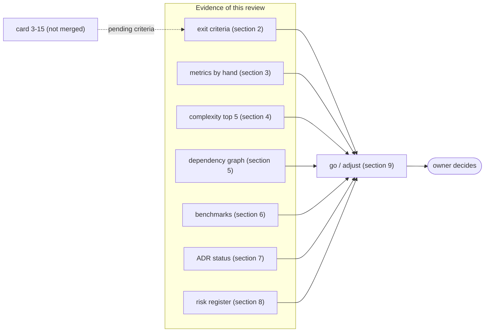
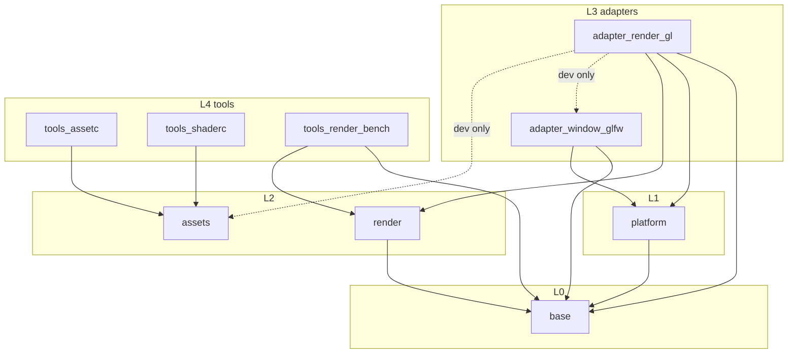

# Phase 3 milestone review `[S]`

Card 3-14, measured on 2026-11-02 on branch `agent/3-14-phase3-milestone-review` (cut from `develop` at `2cc9bea`, which holds cards 3-1 to 3-13; card 3-7 and card 3-12 reached `develop` through `main`). **Card 3-15 (the sample application that draws a triangle and then sprites, and the GL image test) is not merged yet.** Every criterion that needs it is marked *pending* in section 2, not met, and this review has to be completed or repeated for that part when 3-15 lands. The roadmap asks for this review at the end of each phase ([roadmap](../workflow/roadmap.md) "Milestone reviews", [quality-metrics §4](../workflow/quality-metrics.md)): metrics against the previous milestone, the five worst functions by complexity, the dependency graph, the benchmark trend, the ADR status, the risk register and a go/adjust decision. **The go/adjust decision is the owner's** (section 9); this page gives the evidence and a recommendation.

**How the numbers were made.** The metric report that the release workflow publishes is still a placeholder, and the `ci` `metrics` job measures only the skeleton crate ([phase 2 milestone review](phase2-milestone-review.md), risk R-23). Every figure below was therefore measured by hand with the tools named in section 3, like the phase 2 review, which is the previous milestone, or read from a recorded `reviews/3-*.md` file and then named as such. A figure that is an estimate or a heuristic says so. Nothing was lowered, skipped or waived. Machine: Windows 11, rustc 1.94.1, cargo-llvm-cov 0.9.1, cargo-mutants 27.1.0, an Intel Iris Xe GPU (`GL_VERSION "4.5.0 - Build 30.0.101.2079"`).

## 1. Summary

| Question | Answer |
|---|---|
| Are the phase 3 exit criteria met? | Not all yet. The port, the command stream, the Null and OpenGL 4.5 devices, the render graph, the golden stream test, the frame benchmark and the Null-only build are met (section 2). **The visible result (triangle, then sprites on screen) and the image test are pending on card 3-15.** |
| Did a gate fail on phase 3 code? | No gate was lowered. Mutation on phase 3 code: in the files re-run for this review, 563 of 570 viable mutants were caught (98.8%); in the L0-L2 files (`render`, `assets`) 485 of 486 (99.8%), the one miss being the known equivalent mutant. The 7 misses are explained in section 3.3; the gate is 80% on changed L0-L2 code. |
| What is the main weakness found? | The tool-gated tests of `tools_shaderc` never compare the golden shader file with real tool output in CI, because no workflow installs the shader tools or sets `DUCK_REQUIRE_SHADER_TOOLS=1` (review 3-11, major 2); and the shader tools and a GPU run were checked on Windows only. Both are governance items (section 9). |
| A figure that moved the wrong way? | None in phase 3 code. The unexplained `adapter_window_glfw` test failure (`the_framebuffer_matches_the_size_times_the_scale`) is in a crate phase 3 did not touch (section 3.4). Separately, the `base` coverage anomaly of the phase 2 review did not reproduce: 99.02% now, section 3.2. |
| Recommendation | **Go** to phase 4 in principle, but **complete card 3-15 first**: the phase has not shown its visible result yet. The owner picks from the adjustments in section 9; the first ones make the shader-tool evidence real in CI. |

## 2. Exit criteria of the phase 3 row

The roadmap row: "Render vertical slice, 2D only (M3; includes the shader toolchain spike, Q25, ADR-0009, and the asset format decision, D-6 ...) | render port v0, command stream, Null + OpenGL 4.5 adapters, render graph v0, GLFW window+triangle -> 2D sprite batcher on an orthographic camera (same port/graph as future 3D). The textured mesh with depth moved to phase 6 | contract suite passes on Null+GL; golden command-stream tests; frame benchmark scene; Null-only CI build green". The operating rules add the early visible result (rule 3: window, clear colour, triangle by the end of phase 3), and the design note ([render-port-v0 §9](../architecture/render-port-v0.md)) adds an image test.

| Roadmap item | Evidence | Result |
|---|---|---|
| Render port v0, command stream | `engine/render` (`IRenderDevice`, handles, descriptions, `CommandStream` with encoder and decoder; review 3-2) | met |
| Null adapter | `render::null::NullDevice` with validation (review 3-3) | met |
| OpenGL 4.5 adapter | `engine/adapter_render_gl`: context and clear colour (3-9), device (3-10); a window gets a 4.5 core context and clears, reads back and presents | met |
| Render graph v0 | `render::graph` (review 3-4), recorded into the command stream by the benchmark scene | met |
| Contract suite passes on Null and GL | `render::contract` runs on the Null device and, as `render_device_contract`, on `GlDevice`: passed on the owner's Intel Iris Xe (Windows, `DUCK_REQUIRE_GL=1`, 11 tests in `tests/device.rs`, reproduced in this review) and on Linux Mesa llvmpipe in a hand-started `ci` run (run 41515435424, branch `agent/3-11-shaderc`, 11 device tests, `GL_VERSION "4.5 (Core Profile) Mesa 26.0.8-1ubuntu0.3"`). On `develop` itself the `gl_linux` job ran once, at `111dad5` (run 41508615478, adapter part 1 only: 24 unit and 2 integration tests passed, same Mesa 4.5 core string); the device contract on Linux has run only in the branch run | met (two real GPU-class devices; the CI proof is a by-hand run on a branch) |
| Golden command-stream tests | `engine/render/golden/basic_scene.txt` compared with the dump of a recorded scene (`dump.rs`, 3-3/3-4) | met |
| Frame benchmark scene | `engine/tools_render_bench`: 4096 sprites, 8 textures, CPU stages and allocator calls (3-13); wall time, report only, GPU time not measured | met (not yet an instruction-count gate, section 6) |
| Null-only CI build green | `headless` job (no `adapter_*` or `app_*` crate in the graph) covers `render`; the same `cargo tree --exclude 'adapter_*' --exclude 'app_*'` check was run here: 0 such crates (section 5); the `headless` job was green in the by-hand runs 41515435424 and 41508615478 | met |
| Shader toolchain spike and ADR-0009 (Q25) | [shader-toolchain-spike](shader-toolchain-spike.md) (3-6), [ADR-0009](../decisions/adr-0009-shader-toolchain.md) decided by the owner (3-7); `IShaderCompiler` and the `dshd` format in `tools_shaderc` and `assets` (3-11) | met, with a correction owed (combined sampler, section 9) |
| Asset format decision (D-6) | `dtex` v0 reader in `assets`, `tools_assetc` converter (3-8). Input is PNM and PAM; **PNG input is not built** (needs a decoder dependency, a governance step) | met differently (the format exists; PNG is deferred) |
| GLFW window and **triangle** on screen | the window and clear colour work (3-9). A triangle is drawn **into a texture** and read back in the GL device tests (3-10), and the generated sprite shader is run on the GPU (3-11). A triangle in a window through a sample application is card 3-15 | **pending 3-15** |
| **2D sprite batcher on an orthographic camera**, sprites on screen | the batcher, camera and `Mat4::orthographic_rh` are built and tested (3-5), and recorded in the benchmark scene; sprites **drawn on screen** are card 3-15 | built; the on-screen part **pending 3-15** |
| Image test (offscreen sprite scene compared with a reference, design note §9) | not built; it is the second part of 3-13/3-15 | **pending 3-15** |
| Early visible result (operating rule 3) | clear colour in a real window is shown (3-9); the triangle and sprites are not yet | **pending 3-15** |

Cards 3-1 to 3-13 are merged into `develop` (3-7 and 3-12 are governance cards that went to `main` first). No release has been cut for phase 3: the latest tag is v0.4.2 and `develop` has not been released ([delivery-pipeline](../workflow/delivery-pipeline.md)).

## 3. Metrics against the previous milestone

The previous milestone is phase 2 ([phase 2 milestone review](phase2-milestone-review.md)). Phase 3 added six crates and changed `base` by two small additions (`Handle::from_raw`, `Mat4::orthographic_rh`: 2 files, +123 / -1 lines). Rows are given per crate.

### 3.1 Size, tests, unsafe

Lines are file lines (blank, comment and test lines included), counted with a script over `*.rs` under each crate; "of which test files" counts files under `tests/`, `examples/` and files named `tests.rs`, so inline `#[cfg(test)]` modules stay in the other column (a heuristic).

| Crate (layer) | Files | File lines | of which test files | Tests passed |
|---|---|---|---|---|
| `render` (L2) | 24 | 6,267 | 2,930 | 132 (130 unit, 2 allocation) |
| `assets` (L2) | 5 | 1,504 | 735 | 42 |
| `tools_assetc` (L4) | 11 | 949 | 502 | 37 (36 unit, 1 binary) |
| `tools_shaderc` (L4) | 20 | 2,847 | 1,280 | 82 (76 unit, 6 binary), 1 ignored |
| `tools_render_bench` (L4) | 6 | 938 | 90 | 34 (13 + 12 + 9) |
| `adapter_render_gl` (L3) | 18 | 4,673 | 1,086 | 49 (35 unit, 2 + 11 + 1 integration) |
| **Phase 3 crates** | 84 | 17,178 | - | 376 |

`git diff --shortstat e1b9ba1..HEAD` over the six crate folders (e1b9ba1 is the phase 2 exit commit): 95 files, +17,336 lines, 0 removed; `base` over the same range: 2 files, +123 / -1. For reference, in phase 2: `base` 6,973 file lines in 19 files, `platform` 2,979, `frame` 234, `adapter_window_glfw` 1,376 (phase 2 counted `src` only); the table above counts everything under each crate folder, so it is not like-for-like with those figures.

| Metric | Phase 2 review | Now |
|---|---|---|
| Tests, whole workspace (`cargo test --workspace --locked`, Windows, no GLFW library and no shader tools) | 586 passed, 0 failed, 0 ignored | **968 passed, 0 failed, 1 ignored** (the ignored test sleeps and runs only as the child of the timeout test) |
| Same, with the GLFW library, `DUCK_REQUIRE_GL=1` and the shader tools (`DUCK_REQUIRE_SHADER_TOOLS=1`) | - | 967 passed, **1 failed**, 1 ignored; the failure is `adapter_window_glfw` `the_framebuffer_matches_the_size_times_the_scale` (section 3.4); no `not run` line was printed |
| `unsafe` lines (budget tool, layers 0-2) | 71 of 8,695 code lines (0.82%) | **71 of 15,226 code lines (0.47%)**, 0 violations: render and assets add no `unsafe` |
| `unsafe` in layer 3, `adapter_render_gl` (not in the L0-L2 budget) | - | 6 files with `unsafe` (`api.rs`, `dynlib.rs`, `gl.rs`, `glx.rs`, `lookup.rs`, `wgl.rs`); by grep 105 lines with `unsafe {` and 111 lines with `unsafe extern`, `unsafe impl` or `unsafe fn` (mostly function-pointer types), 111 lines with `SAFETY` |
| Skipped tests | 0 | 0 skipped; 1 `#[ignore]` (the sleeping child process of the timeout test) |

**Not-run outputs.** In the run without the GLFW library and the tools, 23 test outputs print `not run: device not set up (GLFW: not found)` and 7 lines print `not run: tool not set up` (variants included), and the test still counts as passed. So the 968 is not proof of the GL device or of the shader-tool golden comparison; the second row, with the device and the tools, is. This is how CI looks too: no workflow sets `DUCK_REQUIRE_SHADER_TOOLS`, and only the `gl_linux` job sets `DUCK_REQUIRE_GL`.

### 3.2 Line coverage

Command, from the repository root with the device and tools set up: `cargo llvm-cov -p <crate> --locked --summary-only --json` (stable 1.94.1, cargo-llvm-cov 0.9.1, Windows); the figures are the line counts of the crate's own files (`engine/<crate>/`) summed from the report. Inline test modules count as lines, as they did in phase 2.

| Crate | Lines (tool) | Missed | Cover | Lowest files |
|---|---|---|---|---|
| `render` | 1,700 | 22 | **98.71%** | `contract.rs` 97.3%, `graph.rs` 97.8% |
| `assets` | 411 | 1 | **99.76%** | `dtex.rs` 99.3% |
| `tools_assetc` | 242 | 1 | **99.59%** | `pnm.rs` 99.1% |
| `tools_shaderc` | 827 | 21 | **97.46%** | `main.rs` 88.9%, `external.rs` 89.8%, `tools.rs` 94.1% |
| `tools_render_bench` | 522 | 77 | **85.25%** | `main.rs` 69.8% (76 of the 77 missed lines: the `main`, report printing and environment code) |
| `adapter_render_gl` | 1,530 | 85 | **94.44%** | `device.rs` 89.1%, `api.rs` 89.5% (with the GPU) |
| `base` (phase 1 audit and phase 2 comparison) | 3,964 | 39 | **99.02%** | `assert.rs` 85.0%, `profile.rs` 92.0%, `arena.rs` 93.7% |

The gate for L0-L2 is 90% lines (new lines 95%, [rules-digest §7](../rules-digest.md)): `render`, `assets` pass. The tools are layer 4 and the adapter layer 3, outside that gate; they are reported for information. `adapter_render_gl` is covered only when a device and the GLFW library exist, as here: without them most of `device.rs` does not run. The `base` row was measured with and without `--features profiling` and read 3,964 lines and 99.02% both ways.

**The `base` anomaly of the phase 2 review did not reproduce.** The phase 2 review measured `base` at 4,562 counted lines and 84.24% with the command `cargo llvm-cov -p base --features profiling --locked --summary-only`, against 3,960 lines and 96.26% in the phase 1 audit, and could not explain it. Here the same command gives 3,964 lines and 99.02%, in a fresh worktree of `develop`. The line total is close to the phase 1 audit's 3,960 (the two states of `base` differ, so the 4-line difference is not explained here and is not broken down). So the phase 2 figure was likely a property of that measurement environment (for example a stale build directory), **not established**; this review did not look for the cause. R-23 stays open for the other reason (the gates are not measured by CI), see section 8.

### 3.3 Mutation

Command: `cargo mutants -p <crate> --file <file> -j 1 --no-shuffle --timeout 60`, cargo-mutants 27.1.0, one file at a time, re-run in this review for the files below. Timeouts count as caught, unviable mutants are not counted, as in the previous reviews. Gate: 80% on changed L0-L2 code.

Re-run in this review (2026-11-02, on the code of `develop`):

| File | Viable | Caught | Timeout | Missed |
|---|---|---|---|---|
| `render/src/sprite.rs` | 66 | 66 | 0 | 0 |
| `render/src/camera.rs` | 48 | 48 | 0 | 0 |
| `render/src/graph.rs` | 83 | 83 | 0 | 0 |
| `render/src/stream.rs` | 103 | 102 | 0 | 1 |
| `assets/src/dtex.rs` | 60 | 57 | 3 | 0 |
| `assets/src/dshd.rs` | 126 | 126 | 0 | 0 |
| **L0-L2 files (above)** | **486** | **482** | **3** | **1** |
| `adapter_render_gl/src/table.rs` (L3) | 25 | 23 | 0 | 2 |
| `adapter_render_gl/src/mapping.rs` (L3) | 13 | 13 | 0 | 0 |
| `tools_render_bench/src/scene.rs` (L4) | 46 | 42 | 0 | 4 |
| **All re-run** | **570** | **560** | **3** | **7** |

Score: L0-L2 files 485 of 486 = **99.8%**; all re-run files 563 of 570 = **98.8%**. Unviable mutants (not counted): 3, 1, 12, 15, 2, 10, 4, 2 and 5 in the order of the table. Not re-run: `null.rs`, `null/validate.rs`, `dump.rs`, `contract.rs`, `tools_assetc`, `tools_shaderc`, the rest of `tools_render_bench`, and the adapter's FFI files.

**The 7 misses**

| Mutant | Reading |
|---|---|
| `stream.rs:495` `\|` to `^` in `decode_pass` | **equivalent**, the same survivor as in reviews 3-2 to 3-4: `FLAG_COLOR` and `FLAG_DEPTH` are disjoint bits |
| `table.rs:44` `-` to `+` and `+` to `*` in `Table::grow_to` | **equivalent in behaviour**, as recorded in review 3-10: the expression is only the `try_reserve` size hint, a wrong hint changes capacity, not results |
| `scene.rs:37` `/` to `*` in `ASPECT = 16.0 / 9.0` | the aspect of the camera does not change the pinned bytes (accepted in review 3-13) |
| `scene.rs:63` `*` to `+` and `*` to `/` in `make_sprite` (`rng.next_f32() * TAU`) | a **real small gap not named in review 3-13**: the sprite angle value is pinned by no hash (the vertex hash uses the unrotated scene because `sin_cos` differs per platform, the stream does not contain angles); the rotation test checks only that rotation changes the bytes. A rotated-sprite test with a tolerance would close it |

**Recorded in the cards (not re-run here).** These numbers were taken from `reviews/3-*.md` and show the closing state of each card:

| Card | Crate / files | Recorded result |
|---|---|---|
| 3-2 | `render` `stream.rs` | 103 mutants: 90 caught, 12 unviable, 1 missed (`FLAG_COLOR \| FLAG_DEPTH`, disjoint bits: equivalent) |
| 3-3 | `render` whole crate | first full run 9 missed; 8 closed with tests; reruns of `null.rs`, `null/validate.rs`, `contract.rs`: 0 missed; the only survivor is the equivalent `\|` / `^` |
| 3-4 | `graph.rs`, `stream.rs`, `dump.rs`, `null/validate.rs` | 11 missed at first, closed; rerun of `graph.rs` 0 missed; the other files not rerun |
| 3-5 | `camera.rs`, `sprite.rs`, `Mat4::orthographic_rh` | 2 missed, closed; `sprite.rs` and `orthographic_rh` rerun 0 missed; `camera.rs` not rerun after a doc-only edit |
| 3-8 | `dtex.rs`; `tools_assetc` | `dtex.rs` rerun 0 missed (57 caught, 2 unviable, 3 timeouts); `tools_assetc` rerun 0 missed (89 caught, 6 unviable, 5 timeouts) |
| 3-9 | `version.rs`, `lookup.rs`, `context.rs`, `gl.rs` | `version.rs`, `lookup.rs` 0 missed; 49 mutants in the last run: 42 caught, 3 unviable, 4 missed (`present -> true` equivalent when the OS succeeds, `take_error -> 0` and others, explained in the review) |
| 3-10 | `table.rs`, `mapping.rs`, `null.rs` | 44 mutants: 36 caught, 6 unviable, 2 missed (`Table::grow_to` size hint: equivalent); `null.rs` changed lines 12 mutants, 10 caught, 2 unviable, 0 missed; `device.rs`, `exec.rs`, `api.rs`, `records.rs` need a driver and were not mutated |
| 3-11 | `dshd.rs`; `tools_shaderc` | `dshd.rs` rerun 0 missed (126 caught, 10 unviable); `tools_shaderc` first run 229 mutants, 15 missed and 5 timeouts, closed; the changed files then had 1 missed, closed; remaining timeouts are loop-advance mutants |
| 3-13 | `tools_render_bench` (4 files) | 97 caught, 15 missed, 8 unviable; 4 closed by new tests; the rest accepted (printing and environment code, two `rep > 0` variants, the aspect constant); not re-run after the last tests |

The adapter's FFI modules (`device.rs`, `exec.rs`, `api.rs`, `records.rs`) are not covered by mutation: a mutant there needs a GPU to be judged, and the mutation gate is for L0-L2 changed code ([rules-digest §7](../rules-digest.md)). The GPU tests exercise them (coverage 89% to 90% in the table above).

### 3.4 Other gates

| Gate | Result |
|---|---|
| Clippy clean, 0 warnings | not re-run as a gate in this review; the cards record Clippy `--all-targets` clean for Windows and `x86_64-unknown-linux-gnu`, and the complexity run of section 4 finished without any warning other than the requested lint |
| Dependency rule and banned imports | the `gates` job was green in the by-hand runs 41508615478 (develop) and 41515435424 (branch `agent/3-11-shaderc`); the headless graph check is repeated in section 5 |
| Miri on changed `unsafe` | not run in this review. `render` and `assets` have no `unsafe`; the adapter's `unsafe` is FFI to a driver, which Miri cannot run |
| Replay hash, determinism | no simulation code yet (physics is phase 4). The benchmark scene pins an FNV-1a hash of the vertex bytes and of the stream bytes; see the D2 note in section 8 |
| Review report present | `reviews/` holds 3-1 to 3-13 (all thirteen merged cards; 3-6 and 3-7 are a spike and a governance card, 3-12 a workflow), each states 0 open blocker/major (3-11 states 0 with one major owed to a governance card, the CI shader-tool variable); this card adds 3-14 |
| **A failing test** | `adapter_window_glfw` test `the_framebuffer_matches_the_size_times_the_scale` fails with the GLFW library present (it prints `scale: 1.25` with a 200 by 100 window whose framebuffer is also 200 by 100, where the test expects the scaled size). It was first recorded in review 3-11 ("untouched crate, depends on the display scale"); review 3-10 records it failing in two later runs after passing earlier on the same machine. The crate was not touched by phase 3. **The cause is not established**; one reading is a process that is not DPI aware on a display with a 125% scale, which is a guess. It is not skipped or changed here |

## 4. Five worst functions by complexity

Measured with `clippy::cognitive_complexity` at threshold 0 (`CLIPPY_CONF_DIR` pointing to a scratch `clippy.toml`, the repository file untouched), `cargo clippy -p render -p assets -p tools_assetc -p tools_shaderc -p tools_render_bench -p adapter_render_gl --all-targets --locked`: 1,904 distinct functions scored (the six crates and their dependencies, test functions and test-support code included). The gate fails above 20.

| Rank | Score | Function | File |
|---|---|---|---|
| 1 | 15 | `header_and_record_layout_is_fixed` (test) | `engine/assets/src/dshd/tests.rs:104` |
| 2 | 14 | `surfaces_frames_and_resize` (test) | `engine/render/src/null/tests.rs:388` |
| 3 | 12 | `round_trip_of_a_vertex_and_fragment_pair` (test) | `engine/assets/src/dshd/tests.rs:56` |
| 3 | 12 | `encoder_refuses_what_the_reader_would_refuse` (test) | `engine/assets/src/dshd/tests.rs:136` |
| 5 | 10 | `texture_contract` (contract suite) | `engine/render/src/contract.rs:137` |

Four more functions also score 10 (a tie for rank 5): `Glfw::bind` (production code of the phase 2 GLFW adapter, pulled in as a dependency), `header_layout_is_fixed` in `dtex/tests.rs:36`, `arrays_and_objects` in `json/tests.rs:79`, and `a_window_gets_a_core_context_that_clears_reads_back_and_presents` in `adapter_render_gl/tests/clear_colour.rs:55`. Reading the ranked list by hand (inline `#[cfg(test)]` modules make a file-based filter imperfect), every function scoring 7 or more is a test or a contract helper except `Glfw::bind`; the worst production function written in phase 3 is `put_pass` in `render/src/stream.rs:163` with 6. Nothing is near the fail limit of 20. Only the Clippy cognitive-complexity measure was taken.

## 5. Dependency graph

From `cargo tree --depth 1 --edges normal` and the layers of `gates/architecture.toml`:

Every edge points to the same or a lower layer. `assets` depends on no crate; `render` only on `base`. **No third-party crate was added in phase 3**: the only third-party crate in the engine graph is still `mimalloc` (with `libmimalloc-sys`) on normal (non-build) edges; its build dependencies are not counted here. The adapter loads the OpenGL library and the GLFW library at run time, and the shader tools run as child processes of `tools_shaderc`. The two dev-only edges of `adapter_render_gl` (to `adapter_window_glfw` and `assets`) matter for the headless build: the headless job excludes `adapter_*`, and `cargo tree --workspace --exclude 'adapter_*' --exclude 'app_*' --locked` printed 0 lines naming an `adapter_` or `app_` crate. The review of card 3-11 records that a first placement of the sprite-shader test inside `tools_shaderc` broke the hand-run headless job and was moved to the adapter's tests for that reason.

## 6. Benchmark trend

The only earlier series are phase 1: [simd-benchmark](simd-benchmark.md) and [allocator-benchmark](allocator-benchmark.md); phase 2 recorded none. Phase 3 adds `tools_render_bench`, the CPU frame: 4096 sprites (seeded `Pcg32`), 8 textures, 8 layers, a 1280 by 720 Null surface, stages `prepare`, `encode`, `record`, `submit`. It is a wall-time report; **it is not an instruction-count gate**: the repository has no instruction-count tooling for benchmarks, and the PR benchmark gate (warn 5%, fail 10%, [rules-digest §7](../rules-digest.md)) has nothing registered for it.

Release build, Windows x86-64, Intel Family 6 Model 154, rustc 1.94.1, three consecutive runs of `target/release/tools_render_bench` with default arguments (15 repetitions of 200 frames after one warm-up repetition) taken in this review, on an otherwise idle machine. Scene: 4096 sprites, 64 batches (draw calls), 3,722 stream bytes, 327,680 vertex bytes.

| Stage | Median ns, run 1 / 2 / 3 | Min ns (range of 3 runs) | p90 ns (range of 3 runs) | Allocator calls |
|---|---|---|---|---|
| prepare (sort, stage, batch) | 217,054 / 216,124 / 223,295 | 210,032 to 214,636 | 231,582 to 245,231 | 0 |
| encode (vertex bytes) | 7,692 / 8,038 / 8,130 | 7,613 to 7,676 | 7,816 to 9,516 | 0 |
| record (graph + stream) | 1,005 / 1,069 / 994 | 994 to 1,015 | 1,018 to 1,091 | 0 |
| cpu frame (composed, not the sum) | 228,512 / 226,430 / 227,595 | 221,714 to 223,950 | 239,497 to 259,248 | 0 |
| submit (Null device) | 7,734 / 7,640 / 7,642 | 7,589 to 7,600 | 7,722 to 8,130 | 0 |

**Wall times vary.** Within these three runs the composed CPU frame median moved by 0.9% (226,430 to 228,512 ns) and the p90 of the composed frame by up to 8.2% (the encode p90 spans 22%, 7,816 to 9,516 ns). Review 3-13 recorded one earlier run of the same binary on the same machine with a prepare median of 353,904 ns, against 218,668 ns in its main run, and 216,124 to 223,295 ns here: so between sessions the variation is far larger than the 5% and 10% bands of the benchmark gate. Numbers are comparable only inside one session. The figures recorded in review 3-13 (composed frame median 234,486 ns) are within about 3% of these, a coincidence of two quiet sessions and not a trend.

**Zero allocations per warm frame.** The `tools_render_bench` frame test asserts zero allocator calls for the whole CPU frame after warm-up (counting allocator, per-thread counters; `tests/frame.rs`), and the report prints 0 for each stage. The `render` crate has two further no-allocation tests (graph and a 512-sprite frame, review 3-5). The GL device itself is not under an allocation test.

**What is not measured.** GPU time (Null device); a Linux or ARM64 run of the benchmark; any run on a stable, dedicated machine; the cost of the GL device per draw (the cards mark a state cache as "measure later"). There is no earlier frame to compare with, so there is no trend yet, only a first point.

## 7. ADR status

| ADR | Status | Phase 3 effect |
|---|---|---|
| 0001 language | decided by owner | unchanged |
| 0002 style | proposed | ports and adapters held: the GL adapter took the native token, `render` has no OS dependency; stays proposed until phase 6 |
| 0005 abstraction mechanism | proposed | the render port is a coarse virtual boundary (`dyn IRenderDevice`, one stream per frame); no overhead benchmark against a raw API yet |
| 0006 render port shape and first backends | proposed (order decided by owner, Q8) | Null and OpenGL 4.5 exist; the rule of two for the render port needs the Vulkan backend (phase 6) |
| 0007 determinism | decided by owner | the benchmark's rotated sprites use `f32::sin_cos`, which is not bit-identical across platforms; the pinned hash is therefore taken on an unrotated scene (section 8) |
| 0008 external dependencies | decided by owner | no new crate; glslang, SPIRV-Cross and DXC are T2 tools; `THIRD_PARTY.md` still lists them as `planned` (section 9) |
| **0009 shader strategy** | **decided by owner, toolchain decided on 2026-11-02 (card 3-7)** | GLSL 450, glslang, SPIRV-Cross, DXC at D3D12. Built and used in 3-11. **A correction is owed**: section 2.1 says a texture and a sampler are separate bindings, but SPIRV-Cross drops the binding of a separate pair in OpenGL GLSL, so the shader uses a combined `sampler2D` |
| 0010 toolchain | proposed | unchanged |
| 0014 platform abstraction | proposed | the GL adapter uses the native token of the window port; no change |
| 0020 delivery pipeline | proposed (in use) | the develop-branch workflow carried 13 cards; two governance cards (3-7 and 3-12) went through `main` first and were merged into `develop` |
| 0022 allocator | decided by owner | unchanged |

No ADR was added in phase 3: ADR-0009 moved from "spike pending" to decided and its record page `adr-0009-shader-toolchain` is new. ADR-0004 (job system) and ADR-0003 (ECS storage) still wait for their spikes in phases 4 and 7. "Decided by owner" in the table is used loosely for the ADRs the index marks decided, amended or narrowed by the owner (0007, 0008); the literal "decided by owner" status is on 0001, 0009 and 0022.

## 8. Risk register

The register is [open-questions-and-risks §B](../open-questions-and-risks.md); the same card updates the rows named "edited" below.

| Risk | Change | Evidence |
|---|---|---|
| R-2 leaky abstraction (port shaped by one backend) | **unchanged, watch (no register edit)** | the real backend is OpenGL only; the Null device validates the port, but Vulkan (phase 6) is the real test. Two points already show GL shape: the vertex-buffer offset and texture row order (GL bottom-up) are handled in the adapter, and the shadow validator is in the GL device |
| R-3 abstraction overhead | **first data point, no verdict** | the CPU side of a 4096-sprite frame costs about 0.23 ms (median of the composed frame, three runs, section 6) on a Null device; the cost of the port against a raw API is not measured |
| R-4 shader toolchain dependency | **reduced (edited)** | the toolchain is decided and works end to end on Windows (spike, ADR-0009, `tools_shaderc`, a generated shader runs on the GPU). Still open: the golden comparison is not run in CI, the Linux path of the tool never ran, and the combined-sampler correction is owed |
| R-7 TDD on GPU feels impractical | **reduced, mitigation shown (edited)** | the Null device, the golden stream dump and the shared contract suite carried the work; the GL device was test-driven against a real GPU and against llvmpipe in CI; the FFI parts of the adapter have no red-first evidence of their own (review 3-9) |
| R-8 benchmark noise | **materialised on the first benchmark (edited)** | review 3-13 saw prepare medians of 353,904 ns in one run and 218,668 ns in another on one machine; here the prepare medians of three quiet runs span 3.3% and the composed frame medians 0.9%, so the large noise is between sessions (section 6); wall time is not a gate, and an instruction-count measure is a precondition |
| R-9 toolchain gaps | watch (no register edit) | `cargo-mutants` cannot judge FFI modules without a GPU; FFI to OpenGL and WGL/GLX is hand-written and worked on Windows and on Mesa |
| R-12 cost of wrapping | **reduced (edited)** | phase 3 delivered the first GL-backed window; the visible triangle and sprites remain (3-15) |
| R-18 unverified AI code | watch (no register edit) | mutation found real test gaps again (3-8 to 3-13, each closed in its card); a lesson: a test that was silently rewritten to a literal letter did not test the escape it named (3-11) |
| R-20 merge and deploy blast radius | no new incident in phase 3 | all PRs merged with green checks per the recorded rule; the shader-tool major was held back on purpose as a governance item rather than patched in a workflow |
| R-21 cross-platform bit identity | **a first data point (edited)** | a hand-started `ci` run showed a pinned vertex hash differing on Linux x86-64 and AArch64: `f32::sin_cos` is not bit-identical across platforms (review 3-13). **Hashes of rotated sprites are not pinned across platforms.** The benchmark was changed to pin an unrotated scene; this is the benchmark, not the physics crate, so D2 is not breached, but any later sprite golden with rotation will meet the same issue |
| R-23 gates not measured by CI on the real crates | **partly changed (edited)** | this review again measured everything by hand. The `base` coverage figure did not reproduce the phase 2 anomaly (99.02%, section 3.2). The metric report is still a placeholder |
| R-24 CI minutes | open, **unmeasured** | phase 3 added the `gl_linux` job (Ubuntu, 1x) to the by-hand runs; the monthly Actions use was not measured in this review |
| **R-25 (new)** | **Evidence that stays on one developer machine:** the GL device, the shader tools and the generated shader were verified on Windows with one Intel GPU; Linux ran the GL device only on llvmpipe in a hand-started CI run; the shader tools never ran on Linux; Y direction and depth range of generated shaders are unverified on a GPU; the shader-tool tests pass without the tools in CI | M likelihood, M impact; mitigation: governance card for CI to install the pinned tools and set `DUCK_REQUIRE_SHADER_TOOLS=1`, a depth-tested and Y-direction image test in card 3-15, a second GPU vendor when available |

Findings that are not register rows but belong in the owner's picture:

- **llvmpipe offers OpenGL 4.5 core on the hosted Linux runner** (the open question O7 of the design note is answered by this evidence; the O7 row in `render-port-v0` still reads as a choice and is not edited here): `GL_VERSION "4.5 (Core Profile) Mesa 26.0.8-1ubuntu0.3"` on Ubuntu 26.04.1 with `xvfb`, and the adapter tests passed there (run 41515435424). The by-hand run on `develop` at `111dad5` (41508615478) also got a 4.5 core context and passed the part 1 tests; the device contract (`tests/device.rs`) on Linux has run only in the branch run. A hand-started run on `develop` as it is now has not been done.
- **PNG input** is deferred: the converter reads PNM and PAM only.
- **Robust buffer access:** indexed draws are not bounds-checked against the vertex buffer (undefined in OpenGL without robust access; deliberately documented, not fixed, review 3-10).
- The register edits made by this card are those marked "edited" above, and R-25 is added.

## 9. Go / adjust

**Recommendation: go to phase 4 once card 3-15 is merged and its criteria are checked.** All exit criteria of the roadmap row are met except the items pending on card 3-15; two are met with caveats (the shader toolchain, with a correction owed, and the asset formats, with PNG deferred), and the contract proof on Linux is a branch run. No gate was lowered; the risk that materialised is the expected benchmark noise, and one data point for R-21 and one unexplained test failure are on record. The one thing that is not done is the visible result: a triangle and then sprites on screen, and the image test. The owner picks which adjustments to make; none is started by this review and no card was created for them.

| # | Adjustment (candidate) | Why | Class |
|---|---|---|---|
| A1 | Finish card 3-15 (sample application: triangle, then sprites; GL image test with a reference and tolerance) and repeat sections 2, 3.1 and 6 of this review for it | the visible-result and image-test criteria are pending | ordinary |
| A2 | CI installs the pinned shader tools and sets `DUCK_REQUIRE_SHADER_TOOLS=1` | review 3-11 major 2: the golden `sprite.dshd` is never compared with real tool output in CI | governance (workflow) |
| A3 | `THIRD_PARTY.md` rows for glslang and SPIRV-Cross from `planned` to `in tree` (DXC stays planned until D3D12) | the tools are in use since 3-11 | governance (`THIRD_PARTY.md` structure) |
| A4 | Correct ADR-0009 section 2.1 and the spike page: SPIRV-Cross drops separate texture and sampler bindings, so `sprite.frag` uses a combined `sampler2D` | review 3-11 | governance (ADR); the spike page is a wiki edit |
| A5 | Wiki as-built follow-up for `render-port-v0` sections 6 to 8 (the GL device as built: shadow validator, GLSL 450 source as the shader blob with entry `main`, texture rows in GL order, one window per device, `NullDevice::bookkeeping_only`; `tools_shaderc`; the `dtex` and `dshd` formats) and `ports-and-adapters`/README rows | reviews 3-8, 3-10, 3-11 list the differences: the `dtex` header order is magic, version, pixel format, flags, width, height, mip count (the page lists width and height before the format) and the flags byte holds the sRGB bit; `IShaderCompiler` lives in `tools_shaderc` because `assets` (L2) cannot depend on `render`; `ports-and-adapters` has no row for the render adapter | ordinary (wiki) |
| A6 | PNG input for `tools_assetc` through a pinned third-party decoder, dev-time only | deferred in 3-8 | governance (`THIRD_PARTY.md` row, new dependency) |
| A7 | Robust buffer access for indexed draws: a context flag in `wgl.rs`/`glx.rs` and a field in `RenderCaps` | review 3-10 major 2, decided deliberately not to fix | ordinary, Class 2 (a port change) |
| A8 | Investigate the failing `adapter_window_glfw` test `the_framebuffer_matches_the_size_times_the_scale` with `DUCK_REQUIRE_GLFW=1` | unexplained, in a crate phase 3 did not touch; it does not show in CI today because the GLFW tests skip without the library | ordinary |
| A9 | Register `tools_render_bench` in `gates/gates.toml` `[benchmark]` and CI once an instruction-count measure exists | review 3-13: wall time varies by more than the 5% and 10% bands | governance (gate configuration) |
| A10 | Verify the SPIRV-Cross arguments (no `--flip-vert-y`, no `--fixup-clipspace`) on a GPU: Y direction and depth range of the generated vertex shader | review 3-11: only the colour path was drawn on a GPU | ordinary (a depth and orientation image test, can sit in 3-15) |
| A11 | A hand-started `ci` run on `develop` after `main` is merged into it, so that `gl_linux` runs with the adapter in the workspace | the only Linux GL evidence is a branch run | none (a run) |
| A12 | Rotated-sprite goldens: decide how to pin them across platforms (the facade for `sin_cos` is a physics-phase item, D2 is opt-in and physics only) | R-21 data point | owner decision |
| A13 | Measure the monthly Actions minutes (R-24) | phase 3 added a Linux GL job | none (a measurement) |

## 10. Limits of this review

- **Card 3-15 is not merged.** The visible result, the sample application and the image test are not evaluated, and the benchmark and coverage figures do not include them.
- **Coverage** is one run on Windows with the stable toolchain; branch coverage was not measured; `platform` and `frame` were not re-measured; Linux and ARM64 figures were not taken. The adapter's coverage needs a device.
- **Mutation** was re-run per file for the files in section 3.3 only; the other figures are copied from the cards' reviews. Timeouts count as caught. The FFI modules of the adapter were not mutated.
- **Clippy** and **Miri** were not re-run as gates; the complexity scores are the cognitive-complexity measure only.
- **Benchmark** numbers are wall time from one process run on a shared development machine and are not comparable with other days.
- **GPU evidence** comes from one Intel Iris Xe on Windows and from llvmpipe on Linux in a hand-started run on a branch, not on `develop`.
- The test count includes tests that skip themselves when no display or tool exists; the second row of section 3.1 is the one with them set up.
- No independent measurement of the Actions minutes was taken (R-24).
