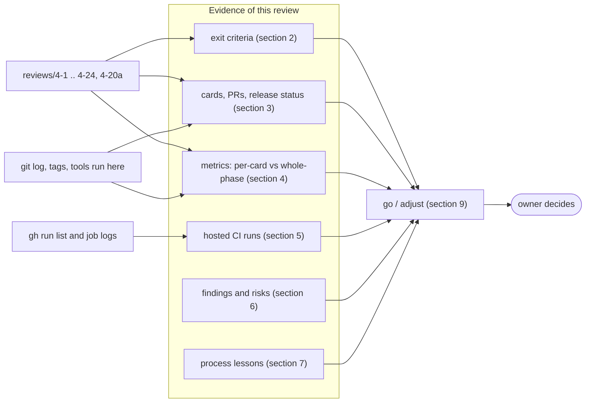
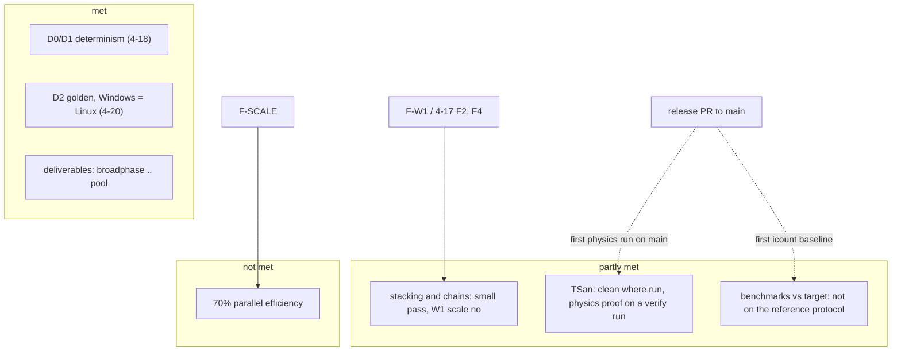

# Phase 4 milestone review `[S]`

Card 4-25, written on 2026-11-07 on branch `agent/4-25-phase4-exit` (cut from `develop` at `ac94fb3`, which holds cards 4-1 to 4-24; `main` is at `16ef6c1`, tag v0.6.8). The roadmap asks for this review at the end of each phase ([roadmap](../workflow/roadmap.md) "Milestone reviews", [quality-metrics §4](../workflow/quality-metrics.md)), and the design note names card 4-25 as the exit record ([physics-and-jobs-v0 §9](../architecture/physics-and-jobs-v0.md)). It follows the form of the [phase 3 review](phase3-milestone-review.md). **The go/adjust decision, and whether the phase 4 umbrella card is done, are the owner's** (section 9); this page gives evidence and a recommendation, and does not close anything.

**How the numbers were made.** As in phases 2 and 3, the release metric report is a placeholder, so there is no whole-phase measurement of coverage or mutation. Most figures below are **per-card evidence**: they were read from `reviews/4-*.md` and the benchmark report, and are marked *recorded, not re-run*. This machine has little free memory, and `cargo test -p physics` and the mutation tools are too heavy for it, so no test, coverage or mutation run was repeated for this card. What was **computed or looked up for this page** is marked *measured here*: file and line counts, the unsafe-budget tool, the architecture check, the git history and tags, and the hosted CI runs and their job logs read with `gh`. Nothing was lowered, skipped or waived, and no governance file was edited.

## 1. Summary

| Question | Answer |
|---|---|
| Are the phase 4 exit criteria met? | **Mostly, with named exceptions.** Met: the deliverables (broadphase, narrowphase, Soft-Step-style solver, islands, sleeping, colouring, joints, `IScheduler` and the work-stealing pool, the determinism harness, the Clippy bans, the D2 facade and golden job), D0 and D1 determinism, D2 across Windows and Linux on the hosted runners, the scaling benchmark as a tool. **Partly met:** stacking and chain stability (small stacks and chains up to about 30 links pass; the full W1 pyramid and long chains do not), the parallel and SIMD solve (built, bit-identical, slower than serial), TSan clean (clean on a hosted run that had the physics crate; on `main` the physics part is "not run" until the release), benchmarks against target. **Not met:** the 70% parallel-efficiency target of the vision page (measured 0.31 to 0.34 at 4 workers; the parallel solve is slower than serial on the bench scene). Details in section 2. |
| Did a gate fail on phase 4 code? | No gate was lowered, skipped or waived. Two things were red once and fixed: the `ci` TSan job was red on hosted runs of its own card before it was right (runs 42291419609, 42291505758 and 42292192221, section 5), and one timing test of `jobs` failed once under TSan and passed on rerun (section 6). |
| Main weaknesses found | (1) **Solver stability at scale** (F-W1, and 4-17 findings F2 and F4): a 990-box pyramid drifts 0.2473 m, a column topples from 13 boxes, a 1:100:1:100 column collapses. (2) **Parallel overhead** (F-SCALE): parallel slower than serial, efficiency about 0.2 to 0.34, replay hash identical. (3) **Evidence limits**: no whole-crate coverage or mutation run, W1 timing not on the reference-machine protocol, perturbed floating-point control state never tested, TSan, the golden job and the instruction-count gate cannot run their physics part on `main` before the release PR. |
| A figure that moved the wrong way? | The W1 median is 2.258 ms (2.232 ms with sleeping on) against the provisional 2.0 ms, about 13% over (recorded in 4-22, not judged: loaded laptop, Balanced power plan; and the scene does not stand). The determinism target takes 46 to 149 s (174 to 236 s on a loaded machine before the matrix was cut, review 4-18) on Windows against the 60 s test-time target of card 4-18. |
| Recommendation | **Phase 4 done with named exceptions**, as a recommendation only: accept the exit with F-W1 and F-SCALE as named open findings that the owner either schedules as bug-fix cards or carries into phase 5/7 decisions. Three of the exceptions need an owner decision (section 9). Phase 5 is not started. |

## 2. Exit criteria of the phase 4 row

The roadmap row: "Physics, dimension-generic core instantiated for 2D (Q3; ADR-0018 spike first), plus the job system (with its deterministic scheduler and the scheduler spike) | broadphase, narrowphase, Soft-Step-style solver, graph-coloured parallel solve, sleeping, determinism harness (with Clippy `disallowed-methods` for the physics crate; the D2 facade with own math functions, the golden-hash file `gates/golden/physics-replay.toml` and the Windows and Linux golden-hash job, opt-in feature, v0.36), `IScheduler` + work-stealing pool | stacking/chain stability scenes pass; D0+D1 determinism tests pass; replay hash identical across runs and thread counts on each platform (D0/D1); TSan clean; scaling benchmark; benchmarks vs target". The row does not mention ARM64.

### 2.1 Deliverables

| Deliverable | Evidence | Result |
|---|---|---|
| Spikes first: ADR-0018 (physics core) and ADR-0004 (scheduler) | spike pages 4-2 and 4-5, ADRs by governance cards 4-3 (#127) and 4-6 (#124); decided by the owner in session | met |
| `IScheduler`, deterministic inline and test schedulers | `engine/jobs`, 4-4 (#121): mutation 62 of 73 mutants caught, 11 unviable, 0 missed; line coverage 99.20% (recorded) | met |
| Work-stealing pool | 4-7 (#125): lock-free Chase-Lev deques, contract suites at 1, 2, 3, 4 and 7 workers, Miri by hand on the one `unsafe` module, mutation 152 of 155 (98.1%) where 86 of the kills are timeouts (a hung worker counts as a failed run, weaker evidence than an assertion; 62 were caught by a failing assertion), coverage 98.0% (recorded) | met |
| Physics crate, handles, bodies, state hash | 4-10 (#129): coverage 99.16% lines, mutation 0 missed after fixes (recorded) | met |
| Broadphase | 4-11 (#130): mutation 269 of 278 detected (96.8%; 88.8% if the 22 timeouts count as misses; recorded) | met |
| Narrowphase and manifolds | 4-12 (#131): 259 of 261 (99.2%, recorded) | met |
| Soft-Step-style solver | 4-13 (#132): the checkpoint pyramid of 10 rows (55 boxes) settles at step 19, max drift 0.0171 m; mutation all viable caught after fixes (recorded) | met for the checkpoint scene; see 2.2 for scale |
| Islands, sleeping, graph colouring | 4-14 (#133): 227 of 229 caught, the two survivors argued equivalent (recorded) | met |
| Parallel colour solve and SIMD path equal to scalar bit for bit | 4-15 (#134): bit-identical in the matrix tests; no speed-up claimed (recorded) | built; **slower than serial** (F-SCALE) |
| Joints (revolute, distance) and the chain scene | 4-16 (#135): mutation 407 of 411 (99.0%, recorded); joints are solved serially, not coloured | met |
| Determinism harness | 4-18 (#137): 10 scenes under 39 execution configurations, no nondeterminism, seven broken solver variants and five faulty schedulers caught (recorded) | met |
| Clippy `disallowed-methods` for `physics` | 4-19 (#138, governance, v0.6.5), `lint-profile` check | met |
| D2 facade, golden file, Windows and Linux job | 4-8 (#126) facade `base::dmath` (mutation 515 of 537, 95.9%, 22 survivors argued equivalent, recorded); 4-20 (#139) and 4-20a (#140): 12 scenes, 200 hashes in `gates/golden/physics-replay.toml` (measured here: 200 hash lines, 12 scene names) | met; see 2.3 for the hosted proof |
| Floating-point control helper | 4-9 (#128): `base::fpenv`, 44 of 45 caught on the code compiled for x86-64 (97.8%); counting the AArch64 and fallback mutants as missed, 44 of 54 (81.5%) (recorded) | met on x86-64; AArch64 module not exercised by any recorded run (section 6) |
| Benchmark tool, scaling scene, instruction-count investigation | 4-22 (#143): mutation 107 of 107 viable in three files; not run for the other files (recorded) | met |
| Instruction-count gate (conditional, O11) | 4-23 (#144, governance, v0.6.8): job `physics_icount` | built and proven on hosted runs; not live on `main` (section 5) |
| First physics sample (conditional, O8) | 4-24 (#145) | built; owner watched it in a real window and approved it (stated in the task brief of this card; no repository record, and review 4-24 says the author could not open a window) |

### 2.2 Exit criteria

| Criterion | Evidence | Result | Owner decision needed |
|---|---|---|---|
| Stacking scenes pass | 4-17 (#136): 34 tests; pyramids of 5 and 10 rows (15 and 55 boxes), columns of 2 to 10, mass ratios 1:10 and 1:100 in short columns, 8 properties on 25 scenes pass, on Windows and Linux with the feature on and off (recorded). **Not at W1 scale:** pyramid of 20 rows drifts 0.0527 m (bound 0.05), a column of 11 drifts 0.0516, columns of 13 and more topple (13: 8.7 m), a 1:100:1:100 column collapses (2.2 m). 4-22 (#143) adds the 990-box W1 pyramid: max drift 0.2473 m, settled drift (displacement between step 100 and 300) 0.1492 m, final speed 0.0370 m/s; rows 10 yes, 20 / 30 / 44 no (recorded in `docs/budgets/physics-benchmark-4-22.md`). The 4-17 tests keep these as `findings.rs` tests that go red if the solver improves | **partly met** (small stacks only) | yes: fix the solver, change the criterion, or accept (F-W1, section 6) |
| Chain stability scenes pass | 4-16/4-17: hanging chain, whips of 20 and 30 links, end weights 1:10 and 1:100, bridge with load: pass. Limits: a chain of 50 links stretches 0.318 m under its own weight (hinge error 0.0115 m), a heavy bridge load is still settling at 480 steps (settled at 1200) (recorded) | **partly met**: chains up to about 30 links hold the bounds; three pre-stated bounds are missed and kept as finding tests (F3 and F3b: 50 links stretch, F5: heavy bridge load still settling at 480 steps) | no, unless a longer chain is wanted |
| D0 + D1 determinism tests pass | 4-18: all 10 scenes bit-identical to the scalar serial reference under 39 configurations (worker counts, schedulers, chunk sizes, lanes), including reversed and shuffled test schedulers (recorded). Hosted run 42289238133 (`develop`): the Ubuntu job `build, test, fmt, clippy` ran the `determinism` target (20 tests, with the 4 golden tests) and `stability` (34), 0 failed; the Windows job of the same run succeeded (its log was not opened) (measured here) | **met** | no |
| Replay hash identical across runs and thread counts on each platform | the same tests, at 1 to 7 workers, Windows and Linux (WSL locally; hosted Ubuntu and Windows in the run above). The within-run rule of the digest is what is checked; a perturbed floating-point control register on the caller was **not** tested (needs a helper in `base`, section 6) | **met**, with that gap | proposal in section 6 |
| D2: identical physics results on Windows and Linux x86-64 (opt-in; digest section 5) | run 42289238133: both `D2 golden hashes (windows-latest / ubuntu-latest, feature on)` jobs succeeded and their steps `Compare with the golden file of main` ran (measured here); 4-20a recorded 212 data lines identical between Windows and WSL Ubuntu, and 55 of 200 hashes differ with the feature off on Linux, so the check discriminates (recorded) | **met** on hosted runners | no |
| TSan clean | 4-21 (#141): verify run 42294083684 (`agent/4-21-tsan-verify`, never a PR): job success, 30 min, physics present, 136 tests (determinism 20, joints 64, parallel 15, parallel_allocation 3, stability 34), no `WARNING: ThreadSanitizer`. The job is green on `main` runs 42300081897 and 42300090598 (physics absent there). On `main` today the physics part prints `not run: physics crate absent` (measured here, job `ThreadSanitizer` of run 42355800159, as are all three physics jobs) | **partly met**: clean where it ran; the proof for physics exists on one verify branch run and will run on `main` only after the release PR | no |
| Scaling benchmark | `tools_physics_bench` (4-22): serial and pool at 1, 2, 4, 6 workers, scalar and lanes, replay hash equal on every row. The vision page target is parallel efficiency of 70 percent up to N cores, a target of the vision page (CPU scaling row), not a gate (N = 4 by O10). Measured: serial scalar 2.2 ms, pool at 1 worker 4.3 ms, 4 workers (lanes) 2.97 ms, efficiency 0.31 to 0.34; 6 workers 3.3 ms, efficiency 0.22 (scalar) and 0.20 (lanes). Cause inside the staged path **not profiled**. The 4-22 numbers are from the development laptop, not the reference protocol | **built: met. Target: not met** | yes (F-SCALE) |
| Benchmarks vs target (W1, 2.0 ms median) | median 2.258 ms (sleeping off) and 2.232 ms (on), p95 2.58 and 2.48 ms, 990 boxes, one thread, release; budget printed, not judged. The workload definition in `docs/budgets` still names "10 velocity and 4 position solver iterations", which this solver does not have; option O9 (rewrite as 4 sub-steps, 1 relax) was never answered in the repository and the budget file was not edited | **not measured on the reference-machine protocol; value above the provisional budget; scene does not stand** | yes (O9, and W1 meaning) |

### 2.3 Other statements the phase made

| Statement | Evidence | Result |
|---|---|---|
| Zero heap allocations per step on hot paths (per-thread counters) | `parallel_allocation`, `joint_allocation` test targets exist and ran in the hosted run (measured here, names in the CI log); 4-7 has 4 no-allocation tests for the pool; 4-24 has a warm-frame test (recorded) | met by tests; the allocation count of the pool's worker threads is not covered by the calling-thread counter (4-10 states it) |
| `unsafe` budget | measured here: `unsafe_budget.py` gives **84 unsafe of 40,092 code lines (0.21%), 0 violations**. The 84 is the figure 4-9 already recorded on a smaller tree; phase 4 added `jobs/pool/erased.rs` (1 `unsafe` line) and `base/fpenv.rs` (4); `physics` adds none | met |
| Architecture rules | measured here: `arch_check.py --config gates/architecture.toml`: 22 crates, 0 violations | met |
| Miri on changed `unsafe` | 4-7 ran Miri by hand (nightly, `-p jobs --lib -- pool::`, 55 tests, no undefined behaviour; two pool tests are `ignore`d under Miri and the rendezvous test was not shown clean under Miri); 4-9 says Miri is not applicable to `fpenv` (it cannot run the `stmxcsr`/`ldmxcsr` assembly); `ci.yml` has no Miri job | partly met (by hand, once) |
| ARM64 | the roadmap row for phase 4 does not mention it; the digest says ARM64 is **not gated** for D2. The phase 2 hosted ARM64 job did run clippy and `cargo test --workspace --exclude adapter_*` natively on `develop` in run 42289238133 and succeeded (it compiled and ran the `physics` unit tests; I did not check which integration targets it ran). No ARM64 golden comparison exists; the AArch64 branch of `fpenv` is not shown exercised by any log I read | not required; partly exercised |

## 3. Cards, pull requests and release status

State is taken from git (merged PRs on `develop` and `main`) and tags, **not from the Trello board, which was not read** for this page. Phase cards 4-1 to 4-24 are merged; 4-25 is this card; 4-26 (public-visibility governance card) is out of scope. Loops are the independent-review fix loops the review file records; "n/r" means the file does not give a count.

| Card | Delivers | PR | Class | Loops | Release |
|---|---|---|---|---|---|
| 4-1 | design note | #119 | 1 | 1 | v0.6.0 (release PR #123, 2026-11-03) |
| 4-2 | ADR-0018 spike | #120 | spike | 1 | v0.6.0 |
| 4-3 | ADR-0018 | #127 | 3 | n/r | v0.6.3 |
| 4-4 | `jobs` v0 | #121 | 2 | 1 | v0.6.0 |
| 4-5 | scheduler spike | #122 | 2 | 1 | v0.6.0 |
| 4-6 | ADR-0004 | #124 | 3 | 1 | v0.6.1 |
| 4-7 | work-stealing pool | #125 | 3 + 2 | 2 passes | v0.6.2 |
| 4-8 | math facade, feature | #126 | 2 | n/r | develop only |
| 4-9 | FP control helper | #128 | 3 + 2 | 2 | v0.6.4 |
| 4-10 | physics crate | #129 | 2 | 1 (2 blockers, 3 majors) | develop only |
| 4-11 | broadphase | #130 | 2 | 1 | develop only |
| 4-12 | narrowphase | #131 | 2 | 1 | develop only |
| 4-13 | soft-step solver | #132 | 2 | 1 | develop only |
| 4-14 | islands, sleeping, colours | #133 | 2 | n/r | develop only |
| 4-15 | parallel and SIMD solve | #134 | 2 | 2 | develop only |
| 4-16 | joints | #135 | 2 | 2 | develop only |
| 4-17 | stability scenes | #136 | 1-2 | 2 (7 majors, then 4) | develop only |
| 4-18 | determinism harness | #137 | 2 | n/r | develop only |
| 4-19 | Clippy bans | #138 | 3 | 1 (2 majors) | v0.6.5 |
| 4-20 | golden file, D2 job | #139 | 3 | 1 (1 blocker) | v0.6.6 |
| 4-20a | golden recorder (ordinary half of 4-20) | #140 | 2 | with 4-20 | develop only |
| 4-21 | TSan job | #141 | 3 | 1 | v0.6.7 |
| 4-22 | benchmark tool | #143 | 2 | 1 | develop only |
| 4-23 | instruction-count gate | #144 | 3 | 1 (the file also mentions "docs of loop 2") | v0.6.8 |
| 4-24 | falling boxes sample | #145 | 2 | 1 | develop only |
| 4-25 | this review | this PR | 1 | see `reviews/4-25.md` | not released |

Governance cards went to `main` first and each merge cut a patch tag (v0.6.1 to v0.6.8); `develop` merged `main` in afterwards. **`origin/develop` is 20 commits ahead of `main` and `main` is 0 ahead of it** (measured here, `git rev-list --count`). The `physics` crate, `base::dmath`, `tools_physics_bench` and `app_physics_sample` are therefore **not on `main` yet**; only `engine/physics/clippy.toml` is (measured here: `git ls-tree` of `origin/main`). A release PR of `develop` into `main` is the owner's call ([delivery-pipeline](../workflow/delivery-pipeline.md)).

### 3.1 Plan against actual

| Item | Plan (design note §9, §11) | Actual |
|---|---|---|
| Cards | 4-2 to 4-25 proposed, "22 to 25 cards against 15 in phase 3" | 25 numbered cards (4-1 to 4-25) plus 4-20a = 26 card PRs including this one; 25 PRs merged, one release PR (#123) |
| Governance cards (owner declared) | 4-3, 4-6, 4-19, 4-20, 4-21, 4-23 and the unsafe-budget rows of 4-7 and 4-9 | exactly those; 4-20 needed an ordinary companion PR (4-20a) because the crate lives on `develop` only |
| Conditional cards | 4-23 (O11) and 4-24 (O8) cut first when behind | both done (the owner took them); nothing from the cut order was cut |
| Cut items inside cards | cut order: sample, joints beyond revolute, gate registration, then SIMD | joints beyond revolute and distance not built; SIMD built (a safe `F32x4` path, no hand-written intrinsic path); the sequential-impulse fallback (O2b) was not needed |
| Iterations rule (roadmap rule 2: stop at about twice the planned iterations) | about 25 cards | 26 card PRs; fix loops 1 or 2 per card where recorded; none reached the limit of 3; so the rule did not trigger |
| Checkpoint after 4-13 | go/cut decision on the first settling pyramid | met (55-box pyramid settles at step 19, review 4-13); the owner continued |
| Rework | n/a | resumed agents and rate-limit pauses are **not recorded in any `reviews/4-*.md`** (searched); this page cannot give counts. Recorded rework: 4-10 loop 1 had 2 blockers; 4-17 had 7 + 4 majors and rescoped (column 20 to 10, 20-row pyramid moved to findings, disclosed); 4-20 loop 1 found a wrong recorder path that would have made the job red for good; the 4-21 job needed 7 red or cancelled hosted runs before it was right |

```mermaid
flowchart LR
  subgraph v060["released in v0.6.0 (PR #123)"]
    c1["4-1"]; c2["4-2"]; c4["4-4"]; c5["4-5"]
  end
  subgraph gov["governance, to main, patch tags"]
    g6["4-6 v0.6.1"]; g7["4-7 v0.6.2"]; g3["4-3 v0.6.3"]; g9["4-9 v0.6.4"]
    g19["4-19 v0.6.5"]; g20["4-20 v0.6.6"]; g21["4-21 v0.6.7"]; g23["4-23 v0.6.8"]
  end
  subgraph dev["on develop only (20 commits ahead of main)"]
    o8["4-8"]; o10["4-10 .. 4-18"]; o20a["4-20a"]; o22["4-22"]; o24["4-24"]
  end
  v060 --> gov --> dev
  dev -. release PR, owner's call .-> main(["main"])
```

## 4. Metrics

### 4.1 What the gates measured, and how

**Per-card evidence** (recorded in the reviews, *not re-run here*): line coverage and cargo-mutants per changed file, the 4 deliberate FAIL lines of the local gates, Clippy for Windows and `x86_64-unknown-linux-gnu`, workspace tests. **Whole-phase measurement: none.** The release metric report does not measure these crates, so there is no whole-crate coverage or mutation run of `physics`, `jobs` or the new `base` modules in this review; the per-card numbers cover only the files each card changed, and several cards say which files were not mutated (4-4: all done; 4-7: all of `pool/*.rs`; 4-22: four files not mutated; 4-24: six files not mutated; 4-8: `matrix.rs` and `quaternion.rs` not re-mutated; 4-16: `world.rs`, `solver.rs`, `islands.rs` changed lines not mutated separately; 4-17 and 4-18: tests only, no mutation).

| Metric | Per-card evidence (recorded) | Whole-phase |
|---|---|---|
| Line coverage | jobs 99.20% (4-4), 98.0% (4-7); physics 99.16% (4-10, before review fixes); `base` 98.1% (4-8, whole crate, the only whole-crate figure) | not measured for `physics`, `jobs` as a whole after 4-24 |
| Mutation on changed L0-L2 code (gate 80%) | 4-4 0 missed; 4-7 98.1% (mostly timeout kills); 4-8 95.9%; 4-9 97.8% (x86-64 code); 4-10 100%; 4-11 96.8%; 4-12 99.2%; 4-13 all viable caught after fixes; 4-14 99%; 4-15 17 of 19 in the diff plus 0 missed in `stage.rs`/`execution.rs`/`lanes.rs` (one of the two misses a real gap, closed); 4-16 99.0%; 4-22 all viable in 3 files | not measured |
| Branch coverage | nowhere (needs nightly; 4-4, 4-10 say so) | not measured; digest gate is 80% |
| `unsafe` | measured here: 84 of 40,092 code lines (0.21%), 0 violations | this is a whole-workspace measurement |
| Architecture / banned imports | measured here: 22 crates, 0 violations; hosted `gates` job green in every run of section 5 | whole workspace |
| Allocation | per-thread counters in tests (4-7, 4-10, 4-15, 4-16, 4-24) | per-test, not a phase figure |
| Determinism | D0, D1 (4-18), D2 golden: 12 scenes, 200 hashes | the hosted runs of section 5 |
| Skipped tests | the cards report none; the hosted logs show the `determinism` and `stability` targets with 0 failed | not counted workspace-wide here |
| Complexity top 5 | not run for this review (the phase 3 review ran Clippy cognitive complexity at threshold 0; this was too heavy for this machine) | not measured |

### 4.2 Size (measured here, counted by a script over `*.rs`; `#[test]` attributes counted, so property tests and macros are undercounted)

| Crate | Files | File lines | `#[test]` attributes |
|---|---|---|---|
| `jobs` (L1, 4-4, 4-7) | 17 | 3,081 | 102 |
| `physics` (L2) | 89 (src 37, tests 52) | 24,895 (src 13,502, tests 11,393) | 561 (src 291, tests 270) |
| `tools_physics_bench` (L4) | 16 | 2,174 | 55 |
| `app_physics_sample` (L4) | 15 | 2,406 | 60 |
| `base::dmath` | 7 | 1,228 | 19 |
| `base::fpenv.rs` | 1 (+ `fpenv/tests.rs`) | 413 | 0 in the file |
| spike crates `tools_physics_spike`, `tools_scheduler_spike` (throw-away) | 9, 14 | 1,869, 2,285 | 8, 30 |
| Whole workspace | 338 | 73,146 | 1,860 |

`git diff --shortstat a0af0e0 origin/develop` (a0af0e0 is the v0.5.0 phase 3 release): 252 files, +48,298 / -78 lines, all kinds of file (code, wiki, reviews, tools, workflows).

### 4.3 Never measured on the whole crate

Whole-crate line and branch coverage of `physics` and `jobs`; whole-crate mutation of `physics` (the per-file runs left out several files, listed above); Miri on `fpenv` and on the AArch64 module; the ARM64 behaviour of `fpenv` (its AArch64 mutants were counted as missed in 4-9); branch coverage anywhere; TSan on the serial `physics` unit tests (4-21 ran only the targets that start worker threads); a run of the benchmark tool on the reference machine under its protocol, on Linux or on ARM64; the stability scenes with the feature off on a CPU without FMA (4-17 states the numbers can differ there, and thin margins could flip).

## 5. Hosted CI evidence (measured here with `gh run list` and job logs)

`ci` runs only on `main` and by hand ([delivery-pipeline](../workflow/delivery-pipeline.md)), so a physics run on a hosted runner needs a branch that has both the crate and the new jobs. The runs that matter:

| Run | Ref | What it shows |
|---|---|---|
| 42289238133 | `develop` at `d01dbe4` (by hand) | all 13 jobs success. First hosted proof of D2: both `D2 golden hashes` jobs ran `Compare with the golden file of main` and passed; the Ubuntu job ran `determinism` (20 tests) and `stability` (34) with 0 failed; the ARM64 job ran clippy and tests natively |
| 42294083684 | `agent/4-21-tsan-verify` (branch + `develop`, never a PR) | ThreadSanitizer job success, 30 min, physics present, 136 tests, no race (recorded in 4-21) |
| 42299121077 | `agent/4-21-tsan` (by hand) | all 14 jobs success; physics absent from that tree |
| 42291419609, 42291505758, 42292192221, 42292876071 | `agent/4-21-tsan` | red or cancelled while the job was being got right (YAML scalar, `panic_abort`, deprecation under `-D warnings`); fixed by the final workflow |
| 42318330639, 42318443688, 42318560084 | `agent/4-23-bench-gate-verify` | the instruction-count gate: pass +0.00% (162,567,125 instructions on both trees), red at +49.13% (above the 10% fail band), warning at +6.55%; the red run is the intended proof that the gate fails |
| 42319403165 | `agent/4-23-bench-gate` | green after one rerun: the first attempt had `tsan` red on `pool::tests::as_many_tasks_as_threads_run_at_the_same_time` |
| 42355798617, 42355800159 | `main` at `16ef6c1` (push and by hand) | green; the three physics jobs report `not run`: D2 `physics crate absent`, TSan the same for physics, `physics_icount` prints the notice `not run: physics benchmark tool absent` |

Consequence: until the release PR, **`main` is green for physics-related jobs because they are skipped by design** (the digest allows "not run" only while neither `main` nor the pushed commit has the crate). The first release will be the first time the D2 job, the TSan physics run (about 30 minutes of Ubuntu) and the instruction-count job (first run: "no baseline, recorded only") run on `main`.

## 6. Open findings and risks

Each item was checked against the repository on 2026-11-07 (`ac94fb3`) before it was listed; "verified" says how.

| # | Finding / risk | Status checked | Proposed decision or card |
|---|---|---|---|
| F-W1 | Solver stability at scale. The 990-box W1 pyramid does not stay standing (max drift 0.2473 m, settled drift 0.1492 m, still moving at 0.037 m/s); 4-17 F2: a column stands to 10 boxes and topples from 13; F4: a 1:100:1:100 column collapses. 4-17 F1 says a reading of W1 as "from the settled position" would pass at 20 rows (displacement from step 100 to 300 is 0.0049 m) and that a higher contact stiffness helps (hertz 45 gives 0.0345, 60 gives 0.0471 at 20 rows, measured once, not kept); but at 44 rows even the settled displacement is 0.1492 m, so the second reading alone does not rescue W1 | verified in `docs/budgets/physics-benchmark-4-22.md` and `reviews/4-17.md` | **Owner decision:** (a) a solver bug-fix card (more relax passes, a mass-ratio-aware softness, stiffness; its tests exist as `findings.rs`), (b) reading of W1 ("from rest" vs "from start") and O9 (iteration wording), edited in `docs/budgets` only by an approved change, (c) accept W1 at 10 rows for now |
| F-SCALE | Parallel solve slower than serial on the bench scene (efficiency 0.2 to 0.34, hash identical). Cause not profiled; the staged path copies constraints and bodies per pass and scatters serially (4-15 said so) | verified in 4-22 and 4-15 | Proposed card: profile the staged path, then change grain or the staging; the exit target 70% stays open until then |
| Perturbation helper | the harness cannot put the caller in a non-default floating-point state: `FpEnv::with_rounding` and friends are `#[cfg(test)]` inside `base` (verified in `engine/base/src/fpenv.rs`), and `std::arch`/assembly is allowed only in `base` | verified | Proposed card (Class 2, `unsafe`, may need a `gates/unsafe-budget.toml` row, so governance for that row): a `base` test helper that sets MXCSR/FPCR for a scope |
| Test time | the determinism target takes 46 to 149 s (174 to 236 s on a loaded machine before the matrix was cut, review 4-18) on Windows debug against the 60 s target of card 4-18 (idle first run 46 to 62 s; loaded 149 s; Linux 52 s) | recorded in 4-18 | owner: accept, or shrink the matrix test (about 130 s of the 149 s), or run it in release |
| Red D2 job after a re-record | the golden file is read from `main`, the code reaches `main` by release; an intended change of physics results is two steps and the D2 job on `main` is red between them (4-20, consequence 4) | by design, never happened yet; no re-record has been needed | process note for the next intended change; proposal: do the re-record PR immediately before the release PR |
| Stale text | (1) `Tree::structure_hash` doc link: `engine/physics/src/core/world.rs:469` links [`Tree::structure_hash`] but `Tree` is not imported in that file (verified by reading the `use` lines; `cargo doc` was not re-run, 4-12 recorded the warning). (2) Q20 in `wiki/open-questions-and-risks.md` line 17 still says "ADR-0018 spike still decides before phase 4, fallback C": the spike (4-2) and ADR-0018 (4-3) are done. (3) the digest and `tools` text say "PR benchmark gate on instruction counts" (digest section 7 line 45), but the gate runs on `main` pushes and by hand, i.e. on the release PR event, not on card PRs into `develop` | (1), (2), (3) verified in the files | (1) and (2) ordinary small cards (doc comment; risk-register note). (3) **governance**: the digest is a protected file; proposal: "benchmark gate (instruction counts, on the release PR)" in a governance card; not edited here |
| Flaky timing test | `pool::tests::as_many_tasks_as_threads_run_at_the_same_time` (`engine/jobs/src/pool/tests.rs:535`) failed once in `tsan` of run 42319403165 and passed on rerun and in other runs; with TSan the rendezvous of N tasks on N threads can time out | verified (test exists; failure recorded in 4-23) | ordinary card: make the rendezvous wait longer or deterministic; it is a test of "workers help", not to be removed |
| Gates not live on `main` | D2, TSan-physics and the instruction-count job run on `main` only after the release; `physics_icount` has no baseline on its first run | verified (run 42355800159) | owner: choose when to release; after it, start `ci` by hand on `main` and read the three jobs once |
| CI minutes (R-24) | TSan about 30 min Ubuntu once the crate is on `main`; D2 on Windows is billed about 1.67 times; `ci` runs only on `main` and by hand | recorded in 4-21 and 4-20, not re-measured | owner: restrict TSan to `parallel` and `joints` if the budget needs it (4-21 left the choice) |
| Leftover agent worktrees | 29 worktrees under `.claude/worktrees` (this card's included) and 114 `origin/agent/*` branches | verified with `git worktree list` and `git branch -r` | housekeeping card, owner's call; nothing was deleted here |
| Single-machine evidence (R-25) | W1 and scaling wall times are from the development laptop on the Balanced plan; no Linux or hosted wall time; the instruction count is Linux x86-64, serial only | recorded | run the report once on the reference protocol before any budget is judged |
| ARM64 | `fpenv` AArch64 module and its mutants are not shown exercised; no ARM64 determinism claim is made | recorded in 4-9; digest says not gated | none required; mention at phase 5/7 if ARM64 matters |
| CCD and long chains | no continuous collision detection (a very fast body can embed; 4-13); long chains stretch (F3) | recorded | feature cards when a sample needs them |

## 7. Lessons for the process

- **Governance split.** Eight governance cards went to `main` first and each cut a tag, while ordinary cards waited on `develop`; the cost was a merge-main-into-`develop` commit per governance card (six since v0.6.0 in the history) and one companion PR (4-20a). The benefit was that gate changes reached `main` without waiting for the physics code. Review 4-19 simulated the merge of `main` into `develop` and found one conflict in `wiki/README.md` (adjacent changelog lines), which this card and any parallel governance card can meet again (this card uses v1.03).
- **Jobs that cannot run before the release.** Three gates prove themselves on throw-away verify branches (4-21, 4-23) because the crate is not on `main`. That worked, but the proof lives in run URLs, not in `main` history; the first release run needs reading by hand (section 5).
- **CI minutes.** Every hosted proof cost minutes; the run list shows 7 red or cancelled runs for card 4-21 and 3 for 4-23 (one of them red on purpose, to prove the gate fails) and the decision to keep only one job on verify branches. The 30-minute TSan job is the largest single item.
- **Machine limits.** This machine has little free memory: 4-20 and 4-22 skipped or limited mutation runs for that reason, and the full local gates take about an hour (4-24). Rate limits and resumed agents were mentioned in the card brief but are not in the review files, so they are not analysed here.
- **Evidence discipline paid off.** Reviewers found real defects in nearly every card (banned names in tests in 4-10, a stale-speed limit bug in 4-16, a wrong recorder path in 4-20, tests that could not go red in 4-16 and 4-17). The 4-17 decision to keep findings as tests that go red when the solver improves stopped the stability criterion from being quietly weakened; the rescoping that did happen (column 20 to 10) was disclosed.
- **TDD deviations** are stated in the reviews: tests written together with code in places (4-9, 4-12, 4-14), red shown by sabotage or mutation instead; the hash-pin tests of 4-13 were re-pinned at the first contact step (steps 1 to 45 unchanged).
- **CRLF and edit pitfalls.** Not recorded in the reviews; the golden checker and the icount parser test CRLF input (4-20a, 4-23). This page's own files are written with LF.

## 8. ADR and decision status

| Item | Status |
|---|---|
| ADR-0018 dimension-generic physics core | accepted by the owner (4-3, #127); the code follows it: a narrow `Dim` trait, `d2` instance, no `d3` yet |
| ADR-0004 job system | accepted by the owner (4-6, #124); built in 4-7 (lock-free deques, spin-then-park, fibers excluded) |
| ADR-0007 determinism levels | D2 opt-in was decided before phase 4 (v0.36); the feature is built and gated (4-8, 4-20) |
| O1 to O12 of the design note | O1, O2a, O3 to O8, O10 to O12 appear to have been followed as recommended as far as the as-built notes show (spike first, Soft-Step solver, `std`-only candidates, no fibers, threads through `IThreads`, revolute and distance joints, sample taken, N = 4 workers with 1, 2, 4, 6 reported, gate conditional and built, D2 in the exit); O7 (no concurrent queries) was not re-checked in the code. **O9 (W1 solver wording) was never answered in the repository** |
| Digest changes in the phase | section 5 updated by 4-19 and 4-20 (Clippy bans, stored golden hash, per its status line); not edited here |

## 9. Go / adjust: recommendation for the owner

**Recommendation: phase 4 is done with named exceptions.** The engine has a deterministic 2D physics module (bodies, shapes, broadphase, narrowphase, soft-step solver, sleeping, colouring, joints, a debug-draw port), a job system with a lock-free work-stealing pool, a determinism harness that held on every variant tried, a D2 golden hash identical on hosted Windows and Linux, a TSan run without races, a benchmark tool and a conditional instruction-count gate, and a sample that the owner is said to have watched in a real window (from the task brief of this card, not recorded in the repository). The exceptions are the ones the evidence names: W1-scale stability (F-W1, 4-17 F2/F4), the parallel overhead (F-SCALE and the 70% target), benchmark judgement on the reference protocol, and the physics gates that cannot run on `main` before the release. The alternative reading, "not done", is defensible if the owner holds the stacking criterion and the 70% target as hard exit criteria; the cheapest way to settle that is decision 1 below.

The owner decides; nothing here moves a card.

| # | Decision | Options |
|---|---|---|
| 1 | Does the stacking criterion mean W1 scale? | (a) yes: open a solver bug-fix card (F-W1, F2, F4) and keep phase 4 open for it; (b) no: accept 10-row pyramids and 10-box columns, close it, record the limit in the roadmap and R-5 |
| 2 | Parallel efficiency | (a) profile and fix before phase 5; (b) carry as an open finding to the phase 7 integration; (c) revise the 70% target after a reference-machine run |
| 3 | W1 definition (O9) and the reading of "rest position" | approve a rewrite of the solver-iteration wording and the drift reading in `docs/budgets`, or leave as is |
| 4 | Release | when to open the release PR `develop` to `main` (one PR, merge commit with `Release-Batch:`), and whether to run `ci` by hand on `main` right after it |
| 5 | Governance proposals (no card created) | digest wording "PR benchmark gate" (§7); optionally a TSan scope reduction; any `gates/unsafe-budget.toml` row for the FP-perturbation helper |
| 6 | Small cards worth creating | the stale doc link, Q20 note, the flaky `jobs` timing test, worktree and branch housekeeping, the FP-perturbation helper, the determinism test-time cut |
| 7 | Phase 5 | no go has been given and none is assumed; no phase 5 work was started |

## 10. Not verified in this review

- No test, coverage, mutation, Miri or benchmark run was repeated; all such figures are recorded in the cards and the 4-22 report.
- The Trello board state of the cards.
- The Windows `build, test` job log of run 42289238133 (job success only); which integration targets the ARM64 job ran.
- The owner's approval of the sample (taken from the task brief of this card).
- Rate-limit and resumed-agent counts (not in the repository).
- The `cargo doc` warning (read from the source and review 4-12, not re-run).
- Mermaid syntax: read by the author and the reviewer, not rendered.
