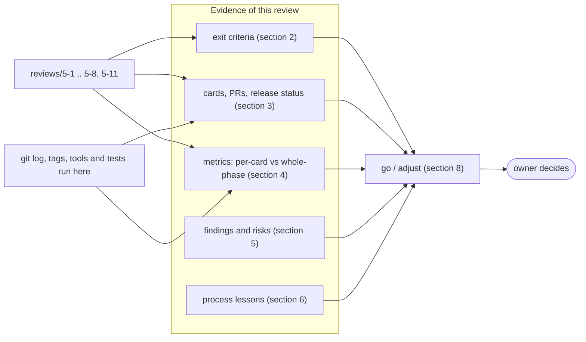
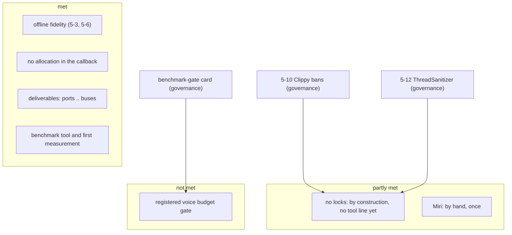
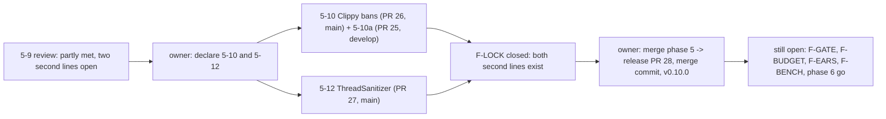

# Phase 5 milestone review `[S]`

> **Update (card 5-13, 2026-11-09):** this page records the state at the time of the review. What happened afterwards (cards 5-10 and 5-12 done, the release v0.10.0, the findings that closed) is in [section 10](#10-status-after-the-review-card-5-13). Sections 1 to 9 are left as written.

Card 5-9, written on 2026-11-09 on branch `agent/5-9-phase5-exit` (cut from `develop` at `bc2c962`, which holds cards 5-1 to 5-8 and 5-11; `main` is at `0584d2d`, tag v0.9.2). The roadmap asks for this review at the end of each phase ([roadmap](../workflow/roadmap.md) "Milestone reviews", [quality-metrics §4](../workflow/quality-metrics.md)), and the design note names card 5-9 as the exit record ([audio-port-v0 §9](../architecture/audio-port-v0.md)). It follows the form of the [phase 4 review](phase4-milestone-review.md). **The go/adjust decision, and whether the phase 5 umbrella card is done, are the owner's** (section 8); this page gives evidence and a recommendation, and does not close anything.

**How the numbers were made.** As in earlier phases the release metric report is a placeholder, so there is no whole-phase measurement of coverage or mutation. Coverage and mutation figures are **per-card evidence**, read from `reviews/5-*.md` and marked *recorded, not re-run*. What was **computed for this page** is marked *measured here*: the test run of the four audio crates, file and line counts, the unsafe-budget tool, the architecture check, git history and tags, and the hosted runs read with `gh`. Nothing was lowered, skipped or waived, and no governance file was edited.

## 1. Summary

| Question | Answer |
|---|---|
| Are the phase 5 exit criteria met? | **Mostly, with named exceptions.** Met: the deliverables (device port, Null, Offline and miniaudio adapters, mixer, WAV decoder, buses), offline fidelity tests, the real-time-safety tests for allocation, the voice-count benchmark as a tool with a first measurement, and a sample that plays on a real device. **Partly met:** the "no locks in the callback" proof (by construction and by review, and a lock-free queue, but the Clippy ban list and the ThreadSanitizer run are two governance cards not yet done: 5-10 and 5-12). **Not met:** a registered voice budget gate (a number is proposed, the gate is a governance step); the port is still `experimental`, by design (one real adapter, no native one). |
| Did a gate fail on phase 5 code? | No gate was lowered, skipped or waived. Every card from 5-2 to 5-8 had an independent review, and its findings were fixed before the merge (section 3); 5-1 was documentation only and had none. |
| Main weaknesses found | (1) **Evidence limits:** one machine (Windows) for the real device and for every timing, no Linux run of any audio code, no ARM64 run, no listening verdict recorded. (2) **Two real-time safeguards are missing a second line:** Clippy `disallowed-types` and ThreadSanitizer (cards 5-10 and 5-12 are open). (3) **Not on `main` yet:** none of the audio code is on `main`; only governance steps are. |
| A figure that moved the wrong way? | None. The first benchmark gives 16.3% of one core for 1,024 voices, with 0 allocator calls per block; no earlier figure to compare with. |
| Recommendation | **Phase 5 done with named exceptions**, as a recommendation only: accept the exit with the two missing second lines and the missing budget gate as open items that the owner either schedules (5-10, 5-12, a benchmark-gate card) or carries into phase 6. Decisions in section 8. Phase 6 is not started. |

## 2. Exit criteria of the phase 5 row

The roadmap row: "Audio | device port, **miniaudio stopgap adapter** + Null + Offline adapters (native WASAPI at the replacement milestone, Q4), mixer, WAV decoder, buses | offline fidelity tests; real-time-safety tests (no alloc/locks in callback); voice-count benchmark". The row does not mention Linux or ARM64.

### 2.1 Deliverables

| Deliverable | Evidence | Result |
|---|---|---|
| Design note before code | 5-1 (#14): `audio-port-v0`, options O1 to O8 (recorded) | met |
| Device and decoder ports, Null and Offline adapters, contract suite | 5-2 (#15): 40 tests; mutation 67 of 68, the one miss equivalent; the contract suite is itself tested with eight deliberately faulty devices (recorded) | met |
| Mixer: voices, resampler, ramps | 5-3 (#16): 177 mutants, 172 caught, 0 missed; chunk independence at 1, 7, 255, 256, 257 and 1,000 frames gives identical bits (recorded) | met |
| WAV decoder from scratch | 5-4 (#17): 97 mutants, 90 caught, 1 timeout, 0 missed; every prefix of a good file is an error; 12,000 random mutations never panic (recorded) | met |
| Lock-free queues and the game-side API | 5-5 (#19) with the budget row first by governance 5-11 (#18): `base::spsc`, 4 unsafe lines; Miri on the queue tests; 20,000 voices across two threads, each reported once (recorded) | met; ThreadSanitizer not run (5-12) |
| Buses and the resampler bound | 5-6 (#20): a bus tree of up to 16, mute, ramps; linear resampler measured at 55.6 dB (1 kHz, rate 1.1) and 26.3 dB (8 kHz), pinned by tests (recorded) | met |
| miniaudio stopgap adapter | 5-7 (#22) with the governance step first (#21): contract suite passes on the real Windows device, restart and drop-while-started tested; header pinned by SHA-256 (recorded) | met on Windows; not run elsewhere |
| Voice-count benchmark and audio sample | 5-8 (#23): see section 2.2 | met as tools; gate not registered |

### 2.2 Exit criteria

| Criterion | Evidence | Result | Owner decision needed |
|---|---|---|---|
| Offline fidelity tests | sine voice equals the analytic sine, pan law and gain closed forms, loop point, pitch, bit-equality of a bus-less mixer with the direct sum, chunk independence (5-3, 5-6, recorded). *Measured here:* `cargo test -p audio -p adapter_audio_miniaudio -p tools_audio_bench -p app_audio_sample`, 22 test targets, **224 passed, 0 failed, 0 ignored** | **met** | no |
| Real-time safety: no allocation in the callback | counting allocator with per-thread counters on the mixer (5,000 blocks, 5-3), the bus tree (3,000 blocks, 5-6), the engine processor (4,000 blocks, 5-5), the WAV decoder's over-cap path (5-4), the miniaudio callback path (5-7) and the benchmark itself: 0 allocator calls per block at 64, 256 and 1,024 voices (5-8) (recorded) | **met**, on the calling thread (the counters are per thread) | no |
| Real-time safety: no locks in the callback | no lock in the mixer by construction; the engine talks to it only through the lock-free queue; the miniaudio callback uses `try_lock` and writes silence when it cannot take the slot, counting an underrun (5-7). **Not enforced by a tool:** the Clippy `disallowed-types` list for the crate (`Mutex`, `RwLock`, `Condvar`, `mpsc`) is card 5-10, a governance task, not done; the ThreadSanitizer job does not cover the queue or the engine tests (card 5-12, not done) | **partly met** | yes: declare 5-10 and 5-12 as governance tasks, or accept the first line only |
| Voice-count benchmark | `tools_audio_bench` (5-8): first measurement on Windows, release, scalar, one run: 64 voices 54.8 µs per 256-frame block (1.03% of one core), 256 voices 217.8 µs (4.08%), 1,024 voices 870.6 µs (16.32%); linear, about 0.85 µs per voice and block. All voices read one shared sound, so it is a cache best case (recorded) | **built and measured: met. Budget gate: not met** | yes: a budget of "1,000 voices take less than a quarter of one core" is proposed; registering it in `gates/benchmarks.toml` is a governance task |
| Heard through a real device | the sample played a 400 ms and a 600 ms tone on the Windows default device and exited 0 (5-8, recorded); the contract suite and an engine sound ran on the real device (5-7). **No human listening verdict is recorded in the repository** | **machine-checked: met. Listening: not recorded** | optional: say whether you heard it |

### 2.3 Other statements the phase made

| Statement | Evidence | Result |
|---|---|---|
| Zero heap allocations per block on hot paths | see 2.2 | met by tests |
| `unsafe` budget | *measured here:* `unsafe_budget.py` gives **88 unsafe of 45,300 code lines (0.19%), 0 violations**. Phase 5 added 4 lines in `base/src/spsc.rs` (the budget row is 30, to be lowered to 4 by a governance step) and the `unsafe` of `ffi.rs` in the miniaudio adapter, all inside allowed modules, each with a `// SAFETY:` comment | met |
| Architecture rules | *measured here:* `arch_check.py --config gates/architecture.toml`: 27 crates, 0 violations | met |
| Miri on changed `unsafe` | 5-5 ran it by hand on the queue (two threads) and on the engine tests (two float-equality tests fail under Miri by design; a teardown report in the counting allocator that is not in the new code); 5-7 says Miri cannot run foreign code (`ffi.rs`); `ci.yml` has no Miri job | partly met (by hand) |
| Port status | the audio port stays `experimental`: window, input and audio become `stable` only after a native adapter exists (digest section 2). One real adapter (miniaudio) exists; the native WASAPI adapter is the exit plan | by design |
| Supply chain | the miniaudio header is fetched over https, pinned by URL and SHA-256, verified in the cache and again after the copy into the build folder; `THIRD_PARTY.md` row and a test that the manifest agrees with it (5-7, recorded) | met |
| Linux and ARM64 | not in the roadmap row; no audio code was run on either; the Linux jobs of the release PR will report "not run" for the real-device tests (no sound card) | not required; not exercised |

## 3. Cards, pull requests and release status

State is taken from git (merged PRs on `develop` and `main`) and tags, **not from the Trello board**, which was read only to find the card text. The findings column counts what the independent review of each card reported; the review files do not record loop counts. All eight audio cards were ordinary cards into `develop`; the `develop` workflow has no hosted CI, so the evidence is the local gates and the review file.

| Card | Delivers | PR | Class | Findings of the independent review | Release |
|---|---|---|---|---|---|
| 5-1 | design note | #14 | 1 | none (docs; owner reads) | not released |
| 5-2 | audio crate, ports, Null, Offline | #15 | 2 | 1 major, 9 minor, fixed | not released |
| 5-3 | mixer core | #16 | 2 | 1 major, 10 minor, fixed | not released |
| 5-4 | WAV decoder | #17 | 2 | 0 major, minors fixed | not released |
| 5-11 | unsafe-budget row (governance, to `main`) | #18 | 3 | owner-declared | on `main` |
| 5-5 | queues and engine API | #19 | 2 | 0 major, minors fixed | not released |
| 5-6 | buses and resampler bound | #20 | 2 | 0 major, minors fixed | not released |
| (5-7 step) | architecture edge, `THIRD_PARTY.md` row, fetch helper (governance, to `main`) | #21 | 3 | owner-declared | on `main` |
| 5-7 | miniaudio adapter | #22 | 2 | 0 major, minors fixed | not released |
| 5-8 | benchmark and sample | #23 | 2 | 3 major, 6 minor, fixed | not released |
| 5-9 | this review | this PR | 1 | see `reviews/5-9.md` | not released |
| 5-10, 5-12 | Clippy bans; ThreadSanitizer (governance) | not started | 3 | | |

*Measured here:* `origin/develop` is 10 commits ahead of `main` (`git rev-list --count origin/main..origin/develop`); `engine/audio/` has no file on `origin/main` (`git ls-tree`). The audio crates, the miniaudio adapter and the two L4 programs reach `main` with the next release PR, which is the owner's call ([delivery-pipeline](../workflow/delivery-pipeline.md)). Hosted CI has never run on any audio code: the Linux jobs, the ARM64 job, the architecture and unsafe gates on the release PR will be the first.

### 3.1 Plan against actual

| Item | Plan (design note §9) | Actual |
|---|---|---|
| Cards | 5-2 to 5-9, eight | 5-1 to 5-9 plus governance 5-11 and the unnumbered governance step of 5-7 (PR #21); 5-10 and 5-12 created and not done |
| Governance cards | likely: the unsafe-budget row, `THIRD_PARTY.md`, the benchmark gate, the Clippy bans | 5-11 and the 5-7 step done by owner declaration; the Clippy bans (5-10), ThreadSanitizer (5-12) and the benchmark gate not done |
| Options for the owner | O1 to O8 | O5 answered (a `cc` crate in `build.rs`); the others followed as recommended as far as the as-built sections show |
| Iterations rule (roadmap rule 2: stop at about twice the planned iterations) | 8 cards | 5-1 to 5-9 (one more than planned: the design note) plus governance 5-11 and the unnumbered 5-7 step; the review files give no loop counts; nothing suggests the rule triggered |
| Cut items | cut order: second audio backend first | not needed; the second device backend stays possible in phase 6 |

## 4. Metrics

### 4.1 What the gates measured, and how

**Per-card evidence** (recorded in the reviews, *not re-run here*): line coverage by `cargo llvm-cov`, cargo-mutants per changed file, Clippy `-D warnings` with `cargo fmt` and `cargo doc -D warnings`, and the workspace tests. **Whole-phase measurement: none.** The release metric report does not measure these crates.

| Metric | Per-card evidence (recorded) | Whole-phase |
|---|---|---|
| Line coverage | `audio` crate 97.79% (5-4, 26 of 1 179 lines missed), 97.43% (5-5), about 97% (5-6); `spsc.rs` 98.67%; `engine.rs` about 95%; adapter `shared.rs` 100%, `lib.rs` 96.3%, `source.rs` 98.3%, `manifest.rs` 100%, `ffi.rs` 93.1% | not measured for the audio crates after 5-8 |
| Mutation on changed L0-L2 code (gate 80%) | 5-2 67/68; 5-3 172/172 viable; 5-4 90 + 1 timeout of 91; 5-5 `spsc.rs` 24 + 6 timeouts of 30 viable, `engine.rs` 33 of 33; 5-6 23 of 25; 5-7 32 of 33 and 50 of 50; the misses are argued equivalent in each review | not measured |
| Mutation on L4 code (no gate) | 5-8: sample 41 of 47 viable detected (39 caught, 2 timeouts, 6 missed), bench 74 of 81; the misses are glue that prints and equivalent mutants | not gated |
| Branch coverage | nowhere (needs nightly options) | not measured; digest gate is 80% |
| Tests | *measured here:* 224 passed, 0 failed, 0 skipped in the four audio crates | workspace-wide not counted here |
| `unsafe` | *measured here:* 88 of 45,300 code lines (0.19%), 0 violations | whole workspace |
| Architecture / banned imports | *measured here:* 27 crates, 0 violations | whole workspace |
| Allocation | per-thread counters in tests (5-3 to 5-8) | per test |

### 4.2 Size (measured here, counted by a script over `*.rs`; `#[test]` attributes counted, so property-style tests and macros are undercounted)

| Crate | Files | File lines | `#[test]` attributes |
|---|---|---|---|
| `audio` (L2) | 24 | 5,784 | 172 |
| `adapter_audio_miniaudio` (L3) | 9 | 1,197 | 29 |
| `tools_audio_bench` (L4) | 3 | 424 | 14 |
| `app_audio_sample` (L4) | 3 | 478 | 9 |
| `base::spsc` | 1 | 171 | in `base/tests/spsc.rs` |
| Whole workspace | 393 | 84,894 | 2,174 |

The adapter also holds a C shim (`duck_miniaudio.c`, six functions) and the pinned header, which is fetched at build time and is not in the repository.

### 4.3 Never measured

Whole-crate branch coverage; whole-crate mutation of the audio crates in one run; Miri on `ffi.rs`; ThreadSanitizer on the queue and the engine; any run on Linux or ARM64; the benchmark on a second machine, with a noise figure, with many different sounds (cache), or through the engine path with the queue; latency; a release-mode run of the decoder's mutation loop; a 32-bit target.

## 5. Open findings and risks

Each item was checked against the repository on 2026-11-09 (`bc2c962`) before it was listed.

| # | Finding / risk | Status checked | Proposed decision or card |
|---|---|---|---|
| F-LOCK | The "no locks" rule has no tool line: `engine/audio/clippy.toml` does not exist and the `tsan` job runs only `jobs` and `physics` | verified: no such file in the tree; `ci.yml` job `tsan` read in 5-5 | governance cards 5-10 and 5-12 exist and wait for the owner's declaration; they need a hosted `ci` run on a branch |
| F-GATE | The voice budget is not a gate: `gates/benchmarks.toml` has no audio row | verified in the 5-8 review | governance card: register a budget of one quarter of a core for 1,000 voices (the measurement is 16.3%, so about 1.5 times headroom), after a second-machine run if the owner wants one |
| F-BUDGET | The `spsc.rs` unsafe budget row is 30 lines for 4 used | verified: 88 unsafe in total, 4 in `spsc.rs` | lower the row to 4 in a governance step, together with 5-12 |
| F-LINUX | No audio code has run on Linux or ARM64 | verified: no hosted run of any audio commit; the release PR runs the Ubuntu jobs, where the real-device tests report "not run" | read the release PR jobs once; the ALSA/Pulse backends through miniaudio are untested |
| F-EARS | No recorded listening check; the sample's tone passed through the Windows device and exited 0 | 5-8 review | optional: the owner runs `app_audio_sample` and says what was heard |
| F-BENCH | One machine, one run, no noise figure; cache best case; scalar | stated in wiki section 18 | add the second-machine and many-sounds runs before the budget is made a gate |
| F-OVERHEAD | The mixer visits every slot each block and an idle bus costs a pass (16 buses at most) | 5-3 and 5-6 reviews; the benchmark shows linear cost with no need yet | revisit only if a measurement calls for it |
| F-RACE | Two cold-cache builds can fetch the miniaudio header at the same time and both rename into the cache; the loser's file is verified and the build goes on; not covered by a test | 5-7 review | low priority; a lock file or retry if it ever shows |
| F-MIRI | Two engine tests compare floats bit for bit and fail under Miri by design; the counting allocator reports at teardown under Miri on Windows | 5-5 review | keep; if a Miri job is ever added, mark them |
| F-FEATURES | Streaming music, Ogg, Opus, FLAC, spatial audio, effects on buses, device selection, more than two channels, a runtime sound format | listed as not settled in the design note | phase 6 or later cards when a sample needs them |

## 6. Lessons for the process

- **Per-card governance split worked.** Two governance steps went to `main` first (5-11, 5-7's) and unblocked the ordinary cards that followed; each cost one hand-started `ci` run. Two more are still waiting on a declaration (5-10, 5-12) and one on a proposal (the benchmark gate), so a phase can end with its second line of defence still open.
- **Independent review kept finding real defects.** 5-2: a contract suite that accepted faulty devices; 5-3: a harness that could not see a drop inside `render`; 5-7: a Null backend that would have let a machine without a sound card "open"; 5-8: a device left started after an error and a fixed pump count that timed long files out. All were fixed before the merge.
- **Mutation testing drove refactors.** In 5-8 several functions were pulled out of `main` so a test could pin them; the misses that remain are glue and equivalent mutants, each named.
- **Wrong statements were corrected in the open.** Reviews 5-2 and 5-3 first said no coverage tool was installed; 5-4 measured it and corrected both.
- **No hosted proof.** `develop` runs no CI, so nothing audio has been through a hosted run yet. That is the policy (CI budget), and the cost is that the first hosted result will arrive with the release PR.

## 7. ADR and decision status

| Item | Status |
|---|---|
| ADR-0013 audio pull model, audio thread outside the job system | followed; the engine processor runs only in the device callback |
| Q4 miniaudio stopgap with a named replacement | adapter built (`THIRD_PARTY.md` row, exit plan: native WASAPI); the replacement milestone is open |
| O1 to O8 of the design note | O5 answered (a `cc` crate in `build.rs`); the rest as recommended: commands to the audio thread, device rate with resampling, no streaming, refuse when full, own constant-power pan, linear resampler |
| Digest changes in the phase | none; not edited here |

## 8. Go / adjust: recommendation for the owner

**Recommendation: phase 5 is done with named exceptions.** The engine can decode a WAV file, mix up to its voice limit with gain, pan, pitch and buses, drive the mixer from a game thread through a lock-free queue with no allocation in the callback, and play through a real Windows device by way of a pinned third-party library behind a port we own. A thousand voices cost about a sixth of one core on the one machine measured. The exceptions are what the evidence names: no tool line yet for the no-locks rule (5-10, 5-12), no registered budget gate, nothing run on Linux, and the port staying `experimental` until a native adapter exists. The alternative reading, "not done", is defensible if the owner holds the real-time rule's second lines as part of the exit; the cheapest way to settle that is decision 1.

The owner decides; nothing here moves a card.

| # | Decision | Options |
|---|---|---|
| 1 | The second lines of the real-time rule | (a) declare governance tasks 5-10 and 5-12 now (each: a branch to `main`, one hand-started `ci` run); (b) carry them to phase 6; (c) accept the first line only |
| 2 | The voice budget | (a) a governance card to register "1,000 voices under a quarter of one core" now; (b) first a run on a second machine and with many sounds, then register |
| 3 | The `spsc.rs` budget row (30 to 4) | bundle with 5-12, or leave |
| 4 | Release | when to open the release PR `develop` to `main` (one PR, merge commit with `Release-Batch:`), and whether to run `ci` by hand on `main` right after it, to read the first hosted audio results |
| 5 | Listening check | run `app_audio_sample` and tell me whether the tone was clean |
| 6 | Phase 6 | no go has been given and none is assumed; no phase 6 work was started |

## 9. Not verified in this review

- No coverage, mutation, Miri, or benchmark run was repeated; those figures are recorded in the cards. Only the test run of the four audio crates (224 passed) was repeated here.
- The Trello board state of the cards.
- Anything on Linux or ARM64.
- Whether a person heard the sample.
- Mermaid syntax: read by the author, not rendered.

## 10. Status after the review (card 5-13)

Written on 2026-11-09 after the owner declared cards 5-10 and 5-12 as governance tasks and asked for the phase to be released. Documentation only; sections 1 to 9 above are not rewritten, because they are the record of what the evidence said on the day.

| Item | State now | Evidence |
|---|---|---|
| Decision 1 (second lines of the real-time rule) | answered: option (a), both declared as governance tasks | cards 5-10 and 5-12 |
| 5-10 Clippy bans for the audio crate | done, on `main` | PR 26; `engine/audio/clippy.toml`; the `lint-profile` tool tests pin the ban set; [reviews/5-10](../../reviews/5-10.md) |
| 5-10a (companion) | done: an audio test used a `Mutex`, replaced by a lock-free log | PR 25; [reviews/5-10a](../../reviews/5-10a.md) |
| 5-12 ThreadSanitizer for the queue and the audio engine tests | done, on `main` | PR 27; [reviews/5-12](../../reviews/5-12.md) |
| Decision 4 (release) | answered: released | release PR 28, merge commit `fc3c384` with `Release-Batch: 2026-11-09`, tag v0.10.0; `develop` is equal to `main` again |
| F-LOCK | **closed** | both lines exist; the first hosted ThreadSanitizer run on the real tree passed (run 42666048599) |
| F-LINUX | **partly closed** | the same run built, linted and tested the audio crates on Ubuntu and on the ARM64 runner, all green. The real-device path (ALSA or Pulse through miniaudio) is still not exercised: the device tests report "not run" there |

**Still open, unchanged from section 5:** F-GATE (no registered voice budget), F-BUDGET (the `spsc.rs` row is 30 for 4 used), F-EARS (no recorded listening check), F-BENCH, F-OVERHEAD, F-RACE, F-MIRI, F-FEATURES. Owner decisions 2 (budget route), 3 (the budget row), 5 (listening check) and 6 (phase 6) are open; phase 6 is not started.

**Process note.** The hosted check `trusted-pr-gates` ended in `startup_failure` three times on the release PR (and once on the PR of 5-12) with no job and no log, then passed on the fourth try after the PR was closed and reopened. The cause was not found. If it returns, retriggering by closing and reopening the PR is what worked; this is an observation, not a diagnosis.
