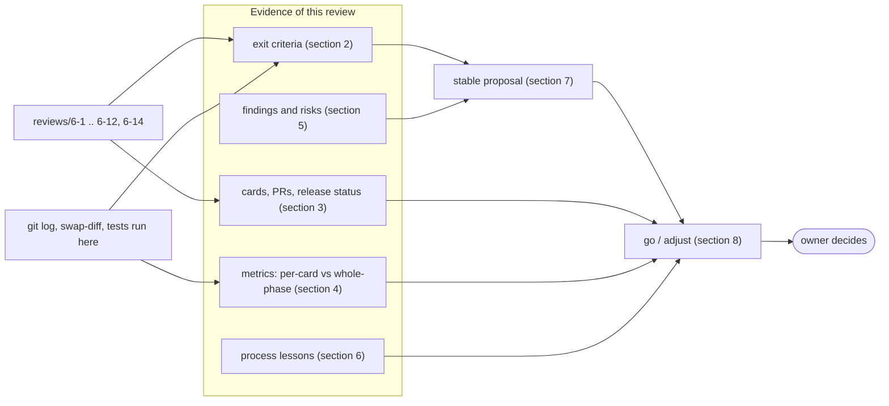
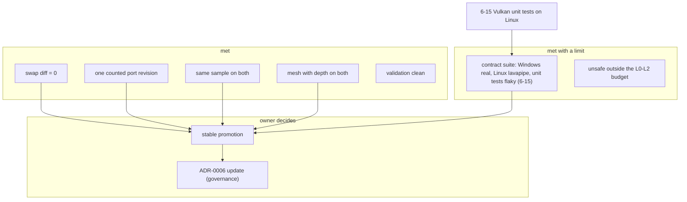
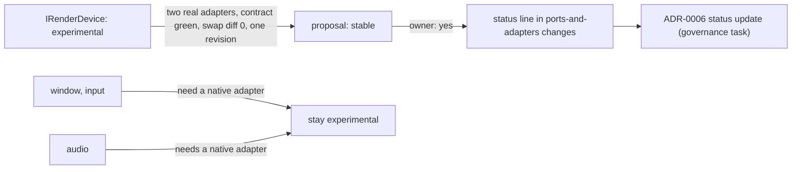
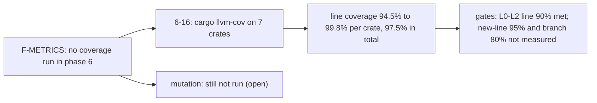
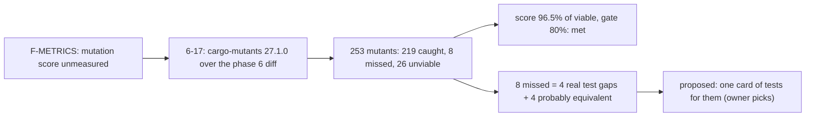

# Phase 6 milestone review `[S]`

> **Update (card 6-16, 2026-11-13):** line coverage of the phase 6 crates was measured afterwards. The result is in [section 10](#10-status-after-the-review-card-6-16); sections 1 to 9 are left as written, so they still say that no coverage figure existed on the day of the review.

> **Update (card 6-17, 2026-11-13):** mutation testing of the changed L0-L2 code was run afterwards, see [section 11](#11-mutation-testing-card-6-17).

Card 6-13, written on 2026-11-11 on branch `agent/6-13-phase6-exit` (cut from `develop` at `c88693d`, which holds cards 6-1 to 6-12 and 6-14; `main` is at the release of phase 5 plus the governance steps). The roadmap asks for this review at the end of each phase ([roadmap](../workflow/roadmap.md) "Milestone reviews", [quality-metrics §4](../workflow/quality-metrics.md)); the design note names card 6-13 as the exit record and the `stable` proposal ([vulkan-and-mesh-v0 §7](../architecture/vulkan-and-mesh-v0.md)). It follows the form of the [phase 5 review](phase5-milestone-review.md). **The go/adjust decision, the `stable` promotion, the ADR-0006 update and whether the phase 6 umbrella card is done are the owner's** (section 8); this page gives evidence and a recommendation, and closes nothing.

**How the numbers were made.** As in earlier phases the release metric report is a placeholder, so there is no whole-phase measurement of coverage or mutation. **Unlike phase 5, no coverage or mutation figure exists for any phase 6 card:** the reviews 6-2 to 6-14 each say coverage, mutation, Miri and benchmarks were not run locally. Other per-card statements are marked *recorded* (taken from the review file, not re-run). What was **computed for this page** is marked *measured here*: the test run of the phase 6 crates, the swap-diff tool over the fixed range, the unsafe-budget tool, the architecture check, git history. Nothing was lowered, skipped or waived, and no governance file was edited.

## 1. Summary

| Question | Answer |
|---|---|
| Are the phase 6 exit criteria met? | **Met on the roadmap row's four criteria, with named limits; the `stable` promotion is pending.** Swap diff = 0 for engine and game code over the measured range; the contract suite passes on Null, OpenGL and Vulkan; the sprite sample runs on both without a change; a textured mesh with depth runs on both; the render port has had exactly one counted revision (6-2). **Limits:** "same contract suite green on both" is shown on Windows with real devices and on Linux with a software Vulkan device (lavapipe) only; the Vulkan adapter's fake-driver unit tests fail at random on Linux (card 6-15, open); no native window or input adapter exists, so those ports stay `experimental`. |
| Did a gate fail on phase 6 code? | No gate was lowered, skipped or waived. Every code card had an independent review; its blockers and majors were fixed before the merge (section 3). One major is **tracked, not fixed**: `vk_linux` is red at random until 6-15 lands (6-12 review). |
| Main weaknesses found | (1) **Linux Vulkan unit tests unstable** (6-15), which also reddens the Ubuntu `g1` job on the release PR. (2) **About 19,000 lines and about 280 `unsafe` blocks in the Vulkan adapter sit outside the `unsafe` budget**, which covers L0 to L2 only. (3) **The tool cannot see a render-port revision**; the one counted revision is a statement by the owner's rule, not a measurement. (4) **Evidence on one real machine** (Windows) for every real-device result. (5) **No coverage or mutation run for any phase 6 card** (F-METRICS). |
| A figure that moved the wrong way? | None. The sprite golden command stream is unchanged by the Vulkan work (section 2.2). |
| Recommendation | **Phase 6 done with named limits**, and **promote the render port (`IRenderDevice` and the render graph) to `stable`**, as a recommendation only. The promotion needs two owner decisions that are not mine: the status change itself, and the ADR-0006 update (a governance task). Window and input stay `experimental`. Details in sections 7 and 8. Phase 7 is not started. |

## 2. Exit criteria of the phase 6 row

The roadmap row: "Prove Flexibility | **Vulkan adapter** (second real render backend); **textured mesh with depth on both backends**; possibly second audio device backend | **swap diff = 0** for engine and game code (port files excluded, at most one counted port revision, N-4); same contract suite green on both; same sample app runs unchanged on GL and Vulkan; port promoted to `stable`". The second audio backend was "possibly" and was not done.

### 2.1 Deliverables

| Deliverable | Evidence | Result |
|---|---|---|
| Design note before code | 6-1 (#34): `vulkan-and-mesh-v0`, options O1 to O6; the review found 2 blockers and 3 majors, all fixed in the note (recorded) | met |
| The one render-port revision | 6-2 (#35): depth in the pass, the pipeline and the barrier, on Null and GL first; byte-identity tests for streams without depth (recorded) | met; 1 revision |
| Mesh frontend | 6-3 (#36): perspective camera, cube, `mesh_scene` golden stream (recorded) | met |
| SPIR-V output of the shader tool | 6-4 (#37): `shaderc --backend spirv`, `dshd` backend value 1 (recorded) | met |
| Availability spike | 6-5 (#38): Vulkan on the hosted images and on the developer machine; the review corrected 3 majors in the report (recorded) | met |
| Vulkan adapter | 6-6 (#39) loader, instance, device; 6-7 (#40) surface, swapchain; 6-8 (#41) memory sub-allocator, buffers, textures; 6-9 (#42) frames, passes, barriers; 6-14 (#43) SPIR-V shaders, pipelines, descriptors, draws | met |
| Sprite sample on Vulkan | 6-10 (#44): `--backend gl\|vulkan`, same code, alpha blend fix found by the shared image test (recorded) | met |
| Mesh sample on GL and Vulkan | 6-11 (#45): `app_mesh_sample`, two-cube image test shared by both adapters, validation layer clean on Vulkan (recorded) | met |
| Vulkan in CI and the swap-diff record | 6-12 (#46, governance, to `main`): `vk_linux` job with lavapipe, swap-diff step over the fixed range (recorded) | met; see 6-15 |
| Second audio device backend | not started | not done ("possibly" in the row) |

### 2.2 Exit criteria

| Criterion | Evidence | Result | Owner decision needed |
|---|---|---|---|
| Swap diff = 0 for engine and game code | *Measured here* (the tool is the trusted one from this tree; the range is the same one the `gates` job of `ci` records): `03f7f47350e07b30c21b8ba7517059afca9d7536` to `86b1120409f99174ae9ec0f09fd3d8e887281c1b` gives **adapter 55, composition_root 20, ports 0, plumbing 2, non_code 10, engine_game 0**, against `max_engine_game_files = 0` | **met** | no |
| At most one counted port revision | 6-2 is the only card that changed the render port files (`desc.rs`, `device.rs`, `stream.rs`, the contract); the golden files `engine/render/golden/` changed only in 6-3 (the mesh scene was added) and 3-3 (the sprite scene, phase 3). The tool lists only `platform` files as ports, so it does not count this revision: the count is by git history and the owner's rule (design note §5) | **met by history, not by the tool** | optional: a governance card to teach the tool the render port files |
| Same contract suite green on both | the suite runs on Null, GL (6-6 and earlier) and Vulkan with no case added inside the range (6-9, 6-14). *Measured here:* the phase 6 test set (33 test targets, with `DUCK_REQUIRE_GL`, `DUCK_REQUIRE_VK` and `DUCK_REQUIRE_SHADER_TOOLS` set to 1) gives **761 passed, 0 failed, 1 ignored**. Real devices on Windows; on Linux lavapipe passed every real-device test on throwaway branches, not yet on `main` (6-12, recorded). The fake-driver unit tests of the Vulkan adapter fail at random on Linux (6-15) | **met on Windows with real devices; met on Linux for the real-device tests; the unit tests on Linux open** | yes: schedule 6-15 before the release PR |
| Same sample app runs unchanged on GL and Vulkan | sprite sample: the same engine and sample code with `--backend gl\|vulkan` (6-10); the golden command stream is byte for byte unchanged; the image test runs once per backend. Mesh sample: same (6-11) | **met** | no |
| Textured mesh with depth on both backends | `app_mesh_sample`: image test with two cubes, one in front of the other, passes on GL and on Vulkan (6-11, recorded); the Null device checks the depth texture, pipeline and bindings | **met** | no |
| Validation clean | the sprite and mesh samples ran on a real window with the Vulkan validation layer checked after every frame (6-10, 6-11, recorded); the `vk_linux` job installs the layer and its real-device tests pass (6-12). The 6-14 review says the layer was absent when that card was written; it is installed since | **met** | no |
| Port promoted to `stable` | **proposal only**, section 7 | pending the owner | **yes** |

### 2.3 Other statements the phase made

| Statement | Evidence | Result |
|---|---|---|
| `unsafe` budget | *measured here:* `unsafe_budget.py` gives **88 unsafe of 46,962 code lines (0.19%), 0 violations**. The tool covers L0 to L2; the Vulkan adapter is L3, so its `unsafe` is outside the budget. *Measured here:* `engine/adapter_render_vk` has about 18,970 lines of Rust and about 283 `unsafe {` blocks; every block has a `// SAFETY:` comment as the review of each card checked | met by rule; **a limit of the tool** |
| Architecture rules | *measured here:* `arch_check.py`: 29 crates, 0 violations; the backend is chosen only in `engine/app_*` | met |
| Zero heap allocations per frame on hot paths | the draw path of the Vulkan device reuses its capacity (6-9, 6-14); no counting-allocator test of the Vulkan frame is recorded | **not shown for Vulkan** |
| Supply chain | the adapter loads the system Vulkan loader at run time and declares only bindings, pinned and listed (`THIRD_PARTY.md`, T1-bindings); no new GPL/AGPL code | met |
| Linux and ARM64 | Linux: lavapipe on the hosted Ubuntu runner, the real-device tests pass; ARM64: not exercised for Vulkan | partly |

## 3. Cards, pull requests and release status

State is taken from git (merged PRs on `develop` and `main`), **not from the Trello board**, which was read only to find the card text. The findings column counts what the independent review of each card reported (from the review files; they do not all record loop counts). All cards but 6-12 were ordinary cards into `develop`, where no hosted CI runs, so the evidence is the local gates and the review file; 6-12 was governance, to `main` first, with one hand-started `ci` run.

| Card | Delivers | PR | Class | Findings of the independent review | Release |
|---|---|---|---|---|---|
| 6-1 | design note | #34 | 1 | 2 blocker, 3 major, 5 minor, fixed | not released |
| 6-2 | port revision 1 (depth) | #35 | 2 | 0 major, 3 minor | not released |
| 6-3 | mesh frontend | #36 | 2 | 0 major, 5 minor | not released |
| 6-4 | SPIR-V output | #37 | 2 | 0 major, 4 minor, 3 nit | not released |
| 6-5 | Vulkan availability spike | #38 | 1 | 3 major, 6 minor, corrected | not released |
| 6-6 | adapter: loader, instance, device | #39 | 2 | 0 major, 8 minor | not released |
| 6-7 | adapter: surface, swapchain | #40 | 2 | 1 blocker, 2 major, 7 minor, fixed | not released |
| 6-8 | adapter: memory, buffers, textures | #41 | 2 | 1 major, 5 minor, fixed | not released |
| 6-9 | adapter: frames, passes, barriers | #42 | 2 | 3 major, 4 minor, fixed | not released |
| 6-14 | adapter: shaders, pipelines, draws | #43 | 2 | 2 major, 5 minor, fixed | not released |
| 6-10 | sprite sample on Vulkan | #44 | 2 | 0 major, 3 minor | not released |
| 6-11 | mesh sample | #45 | 2 | 0 major, 6 minor, 4 nit | not released |
| 6-12 | Vulkan CI job, swap-diff record (governance, to `main`) | #46 | 3 | 1 major tracked as 6-15 | on `main` |
| 6-13 | this review | this PR | 1 | see `reviews/6-13.md` | not released |
| 6-15 | Vulkan unit tests on Linux | not started | 2 | | |

All work cards from 6-2 to 6-14 are on `develop`; only 6-12 is on `main`. The Vulkan adapter, the mesh sample and the mesh frontend reach `main` with the next release PR, which is the owner's call ([delivery-pipeline](../workflow/delivery-pipeline.md)). **Hosted CI has never run the Vulkan adapter on `main`**: the release PR will be the first full run, and it will be red on the Ubuntu jobs unless 6-15 is in the same batch (section 5, F-VKUNIT).

### 3.1 Plan against actual

| Item | Plan (design note §8) | Actual |
|---|---|---|
| Cards | 6-1 to 6-13 | 6-1 to 6-13 plus 6-14 (the Vulkan adapter was split once more: shaders and draws) and 6-15 (the Linux unit-test finding); 6-12 was governance |
| Governance steps | the CI job and the swap-diff record | 6-12, one step, declared by the owner; the ADR-0006 update is still to come |
| Options for the owner | O1 to O6 | followed as recommended; O4 (a) is used in section 7 for the compiler path; O6 (lavapipe in CI) was shown to work by 6-5 and built in 6-12 |
| Iterations rule (roadmap rule 2: stop at about twice the planned iterations) | 13 cards | 14 work cards and one open finding card; nothing suggests the rule triggered |
| Cut items | cut order: second audio backend first | the second audio backend was not started; nothing else was cut |

## 4. Metrics

### 4.1 What the gates measured, and how

**Per-card evidence** (recorded in the reviews, *not re-run here*): Clippy `-D warnings` with `cargo fmt` and `cargo doc -D warnings`, and the workspace tests. **Line coverage and mutation testing were not run for any phase 6 card at the time of the review** (coverage was measured afterwards, section 10), so the digest gates for mutation score on changed L0-L2 code and for line coverage have no phase 6 measurement at all; this is the weakest point of the evidence (F-METRICS). **Whole-phase measurement: none.** The release metric report does not measure these crates.

| Metric | Per-card evidence (recorded) | Whole-phase |
|---|---|---|
| Mutation on changed L0-L2 code (gate 80%) | **not run** for 6-2, 6-3 (`render`) and 6-4 (`assets`, `tools_shaderc`) | not measured |
| Adapter code (L3) | the Vulkan adapter is tested against a scripted fake driver and, where a device exists, against the real one; the fake-driver unit tests are 287 to 288 in the crate (the reviews of 6-10 and 6-14 differ by one) | no coverage figure for L3 |
| Branch coverage | nowhere (needs nightly options) | not measured; digest gate is 80% |
| Tests | *measured here:* 761 passed, 0 failed, 1 ignored over the 33 targets of the phase 6 crates and samples | workspace-wide not counted here |
| `unsafe` | *measured here:* 88 of 46,962 L0-L2 code lines (0.19%), 0 violations; adapter outside the budget | L0-L2 only |
| Architecture / banned imports | *measured here:* 29 crates, 0 violations | whole workspace |
| Swap diff | *measured here:* engine_game 0 over `03f7f47..86b1120` | the fixed range |

### 4.2 Never measured

Whole-crate mutation or coverage of the Vulkan adapter; allocation counts of the Vulkan frame; a benchmark of Vulkan against OpenGL (the phase has no performance criterion); Miri on the adapter (it calls foreign code); ThreadSanitizer on the frames-in-flight code; a Vulkan run on ARM64; a run on a second physical GPU or a second vendor; a window resize or a minimise under a validation layer beyond the tests of 6-7 and 6-11.

## 5. Open findings and risks

Each item was checked against the repository on 2026-11-11 (`c88693d`) before it was listed.

| # | Finding / risk | Status checked | Proposed decision or card |
|---|---|---|---|
| F-VKUNIT | The fake-driver unit tests of `adapter_render_vk` fail at random on Linux under lavapipe runners; the cause is not diagnosed. Real-device tests pass | verified in the 6-12 review; card 6-15 in Backlog | start 6-15 and land it in the same release batch as 6-12, or the release PR has a red `vk_linux` and a red Ubuntu `g1` |
| F-UNSAFE | The Vulkan adapter has about 283 `unsafe {` blocks and 19,000 lines that the unsafe-budget tool does not see (L0-L2 only) | verified here | owner choice: leave it, or a governance card for an adapter budget row |
| F-PORTS | `gates/swap-diff.toml` lists only `platform` files as ports; a render port revision is invisible to the tool | design note §5, 6-2 review | optional governance card to list the render port files (and then count 6-2 as the one revision) |
| F-FIXEDRANGE | The `gates` step of `ci` measures a fixed range of two develop commits; it stays valid only while both commits are reachable (a squash of `develop` would break it) | 6-12 review | keep merge commits for `develop` into `main`; revisit if the history is ever rewritten |
| F-BINDINGS | A draw with changed bindings is limited to 1,024 per frame; descriptors for unbound slots are not written; the SPIR-V descriptor type is not checked against the asset | open minors of 6-9 and 6-14 | cards when a sample needs more |
| F-SEMA | A semaphore after a failed acquire is not recycled | open minor of 6-9 | fix with the next adapter card |
| F-MESH | `MeshSample` has no `destroy`, resizes in two steps (not atomic) and leaves test-support objects alive | open minors of 6-11 | fix when the sample becomes a template for a game |
| F-FLAG | The "missing value" message of the argument parser does not name the flag | open minor of 6-10 | one-line fix, any later card |
| F-METRICS | No coverage or mutation run exists for any phase 6 card; the mutation gate on changed L0-L2 code (6-2, 6-3, 6-4) is unmeasured | reviews 6-2 to 6-14 say "not run locally" | run `cargo llvm-cov` and `cargo mutants` on the changed `render`, `assets` and `tools_shaderc` files in a follow-up card before the release PR, or accept the gap |
| F-DEVICES | One physical machine for every real-device figure; one Vulkan implementation on Linux (lavapipe), no hardware driver on Linux | verified | accept; a second machine is a follow-up if the owner wants one |
| F-AUDIO | The second audio device backend was not built; window, input and audio stay `experimental` | roadmap row says "possibly" | decide in phase 7 planning |

## 6. Lessons for the process

- **The split of the adapter into small cards worked.** Five cards (6-6 to 6-9, 6-14) each ended with a runnable result and an independent review; reviews found a real blocker in the swapchain (6-7), three majors in the frame code (6-9) and a quadratic walk on untrusted SPIR-V (6-14), all before the merge.
- **Preparing the engine side first paid off.** Putting the port revision, the mesh frontend and the SPIR-V output before the measured range made "swap diff = 0" a real statement: the Vulkan range changed no engine or game file.
- **A shared image test found a bug in the sprite sample path** (alpha blend, 6-10) that the Null device and the contract suite could not see.
- **Governance steps cost a hosted run each.** 6-12 needed a hand-started `ci` run and a corrected pull request body (the `Governance task` line); both were ordinary friction, not defects.
- **No hosted proof on the final tree.** `develop` runs no CI (CI budget), so the Linux result of the adapter on the whole workspace will first appear on the release PR.
- **A finding was kept visible, not hidden.** The unstable Linux unit tests were reported as a major with its own card, not retried away.

## 7. Proposal: promote the render port to `stable`

Rule ([ports-and-adapters](../architecture/ports-and-adapters.md) section 4 "Port design rules", rule of two): a port stays `experimental` until two real adapters pass its contract suite; for the compiler path the second path must be demonstrable (O4 (a) for phase 6: SPIR-V direct next to SPIR-V converted to GLSL). Window, input and audio need a native adapter as well.

| Condition | Evidence | Met |
|---|---|---|
| Null adapter | present since phase 3 | yes |
| Contract suite | one suite, run on Null, GL and Vulkan, no case added inside the swap-diff range | yes |
| Two real adapters | OpenGL 4.5 (phase 3) and Vulkan 1.3 (phase 6), both pass the suite on a real device on Windows | yes |
| Second compiler path | GLSL for GL, SPIR-V for Vulkan from the same sources, by the `shaderc` tool (6-4, 6-11) | yes (O4 (a)) |
| Swap diff = 0 | section 2.2 | yes |
| At most one counted revision | 6-2 | yes |
| A sample unchanged across backends | 6-10, 6-11 | yes |
| 3D capability of the port | mesh with depth on both (6-11) | yes |
| Linux real-device evidence | lavapipe passes the real-device tests; the unit tests are unstable (F-VKUNIT) | yes, with the limit |
| A native adapter (window, input, audio only) | not applicable to the render port | n/a |

**Recommendation: promote, once 6-15 is in the release batch.** `stable` means a change to the port needs an ADR and counts as a breaking change for the adapters, so the cost of promoting too early is the cost of the next revision. The one revision already made shows the port could be extended with depth without touching samples. The things most likely to need another revision are named: more than one vertex slot, compute, and multisampling (design note §5). The alternative, keeping `experimental` until D3D12 is added, is defensible if the owner wants a third API to test the port; the cost is that the status says less than the evidence supports.

**What I did not change.** The status line in `ports-and-adapters.md` and ADR-0006 are not edited here: the status change is the owner's decision, and ADRs are governance files, which change only in a task the owner declares as governance. If the owner says yes, the next card is a governance task with two edits: the status of the render port, and the ADR-0006 "status" update (accepted, port stable on the date, evidence: this page).

## 8. Go / adjust: recommendation for the owner

**Recommendation: phase 6 is done with named limits.** The same engine and sample code now run on two graphics APIs, a spinning textured cube with depth runs on both, the contract suite passes on three devices (Null, OpenGL, Vulkan), and adding Vulkan changed no engine or game file. The limits are what the evidence names: the Linux unit-test instability (6-15), the adapter's `unsafe` outside the budget, the one machine for real-device figures, and the second audio backend not built.

The owner decides; nothing here moves a card.

| # | Decision | Options |
|---|---|---|
| 1 | Render port `stable` | (a) promote now, by a governance task (status line and ADR-0006); (b) promote after 6-15 is merged; (c) keep `experimental` until a third API |
| 2 | Card 6-15 | start it now so it lands in the same release batch as 6-12 (recommended), or accept a red Linux unit-test job on the release PR |
| 3 | Adapter `unsafe` budget | (a) leave; (b) a governance card for a budget row for `adapter_render_vk` |
| 4 | Render port files in the swap-diff tool | (a) leave; (b) a governance card to list them as ports |
| 5 | Release | when to open the release PR `develop` to `main` (one PR, merge commit with `Release-Batch:`), and whether to run `ci` by hand on `main` right after it |
| 6 | Second audio backend | phase 7 planning, or a card now |
| 7 | Phase 7 | no go has been given and none is assumed; no phase 7 work was started |

## 9. Not verified in this review

- No coverage, mutation, Miri or benchmark run was repeated; no such figure exists for phase 6 (section 4.1). Only the test run of the phase 6 crates and samples (761 passed), the swap-diff tool, the unsafe-budget tool and the architecture check were repeated here.
- The Trello board state of the cards.
- Any run on ARM64 or on a second GPU.
- That the `ci` run on `main` will be green: it has not run on the whole phase.
- Mermaid syntax: read by the author, not rendered.

## 10. Status after the review (card 6-16)

Written on 2026-11-13, documentation only. The owner asked to run coverage ("let's run coverage"), which was finding F-METRICS. Mutation testing was **not** run and is still open.

**How it was measured.** `cargo llvm-cov -p render -p assets -p tools_shaderc -p adapter_render_gl -p adapter_render_vk -p app_mesh_sample -p app_sprite_sample --locked` at `develop` `81b3c11`, on the Windows developer machine, with `DUCK_REQUIRE_GL`, `DUCK_REQUIRE_VK` and `DUCK_REQUIRE_SHADER_TOOLS` set to 1 so the real-device tests ran and could not be skipped. 762 tests passed, 0 failed. Lines are `cargo llvm-cov` line counts of the files under `engine/`.

| Crate | Layer | Lines covered / counted | Line coverage | Region coverage |
|---|---|---|---|---|
| `assets` | L2 | 499 / 500 | 99.8% | 96.7% |
| `render` | L2 | 1,909 / 1,932 | 98.8% | 97.6% |
| `tools_shaderc` | L4 (tool) | 935 / 961 | 97.3% | 95.2% |
| `adapter_render_vk` | L3 | 7,727 / 7,881 | 98.0% | 96.6% |
| `adapter_render_gl` | L3 | 1,498 / 1,568 | 95.5% | 93.3% |
| `app_mesh_sample` | L4 | 240 / 250 | 96.0% | 88.5% |
| `app_sprite_sample` | L4 | 1,192 / 1,261 | 94.5% | 92.3% |
| **All seven** | | 14,000 / 14,353 | **97.5%** | |

**Against the gates.** The L0-L2 line gate is 90% ([gates](../../gates/gates.toml) `coverage.line_min`): `assets` and `render`, the two phase 6 crates in L0-L2, are above it. Two files with 30 or more lines are below that figure, for reference only (the gate applies to L0-L2, and both are L3 or L4): `app_sprite_sample/src/app.rs` 81.1% (33 lines missed) and `adapter_render_gl/src/device.rs` 89.1% (43 lines missed); both are real-device or window code. **Not measured:** the new-line gate (95%, needs a diff against a base), the branch gate (80%) and mutation score on changed L0-L2 code (80%).

**Limits of this measurement.** One machine and one operating system: the Linux code paths (the Xlib surface, the stand-in display) were not run here, so their lines count as the Windows build sees them (not at all). It measures the whole crates, not only the lines changed in phase 6. Line coverage says a line ran, not that a test would notice if it were wrong; that is what the mutation score is for.

**F-METRICS now.** Half closed: line coverage exists and is high. Mutation testing of the changed L0-L2 code (`render`, `assets`, `tools_shaderc`) is still not run, so the 80% mutation gate remains unmeasured for phase 6.

## 11. Mutation testing (card 6-17)

Written on 2026-11-13, measurement and documentation only; no code or test was changed. The owner asked to run mutation testing ("run mutation testing"), the other half of finding F-METRICS.

**How it was measured.** `cargo mutants -p render -p assets -p tools_shaderc -p base --in-diff <phase 6 diff> --jobs 3` at `develop` `8f1db42`, on the Windows developer machine, with the shader tools available. The diff is `git diff ebdf119 HEAD` over `engine/render/src`, `engine/assets/src`, `engine/tools_shaderc/src` and `engine/base/src`: mutants are made only on lines that phase 6 added or changed. cargo-mutants reported **253 mutants in 8 minutes: 219 caught, 8 missed, 0 timeouts, 26 unviable** (a mutant that does not compile is not counted).

| | Count |
|---|---|
| Caught | 219 |
| Missed | 8 |
| Timeouts | 0 |
| Unviable (do not compile) | 26 |
| **Score** (caught / (caught + missed + timeouts)) | **96.5%** (219 of 227) |

**Against the gate.** The mutation gate on changed L0-L2 code is 80% (digest section 7; `mutation.score_min` in [gates](../../gates/gates.toml)): **met**.

**The eight missed mutants.** Judged by reading the code and the tests (not proved by a run). Four are probably equivalent, because `Mat4::perspective_rh` ends with `matrix.is_finite().then_some(matrix)`: a zero field of view, a zero aspect or a far plane equal to the near plane makes the matrix non-finite, so it is rejected there even when the earlier check is loosened. Four are real test gaps.

| Mutant | Where | Judgement |
|---|---|---|
| `>` to `>=` on `fov_y > 0.0`, `aspect > 0.0` and `far > near` (three mutants) | `Mat4::perspective_rh` (`base/src/math/matrix.rs`, lines 291, 293, 295) | probably equivalent: the final finiteness check rejects those inputs anyway. A test with fov 0, aspect 0 and far equal to near would still pin the intent, cheaply |
| `||` to `&&` between `!near.is_finite()` and `!far.is_finite()` | `matrix.rs:296`, column 63 | probably equivalent: a non-finite near or far plane gives a non-finite matrix, rejected by the final check |
| `||` to `&&` between `!aspect.is_finite()` and `!near.is_finite()` | `matrix.rs:296`, column 42 | **real gap**: an infinite aspect gives a zero `focal / aspect`, which is finite, so the call would return a matrix; no test passes an infinite aspect |
| delete `-` in `-forward.y` | `Mat4::look_at_rh`, the view matrix third column (`matrix.rs:321`) | **real gap**: no test looks along a direction with a non-zero vertical part, so the sign is never checked |
| `||` to `&&` in `desc.depth.test \|\| desc.depth.write` | `validate_pipeline_layout` (`render/src/null.rs:136`) | **real gap**: no test has a pipeline that only tests depth, or only writes it, with no depth format |
| delete field `backbuffer` | `PassState::begin` (`render/src/null/validate.rs:209`) | **real gap**: `backbuffer` is the surface size `(u32, u32)`, default `(0, 0)`; after the first `begin` a second pass on the backbuffer would be checked against `(0, 0)`. A test needs two passes on the backbuffer in one frame |

**Limits of this measurement.** Windows only. `--in-diff` mutates changed lines only, not the rest of these crates. The L3 adapters and the L4 samples are not mutated (no gate covers them). Mutation score says the tests notice a changed line, not that the tests are good. The survivors above are the evidence of what the tests do not pin; each is cheap to pin.

**F-METRICS now.** Closed as a measurement: coverage (section 10) and mutation (this section) both exist and meet their gates. **New finding F-MUTGAPS:** four real test gaps (infinite aspect, the look-at sign, depth test or write alone, backbuffer size across two passes) and four probably-equivalent misses; proposed as one small card that adds tests for them (class 2, because `base` is public API), if the owner wants it.
