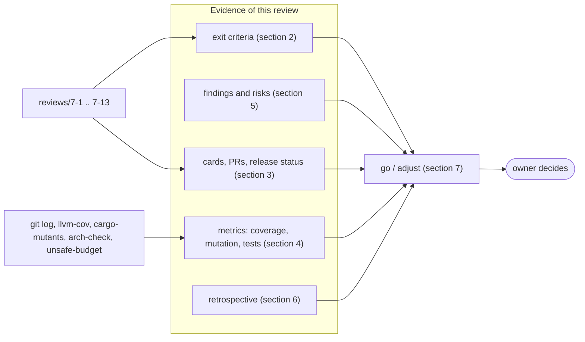
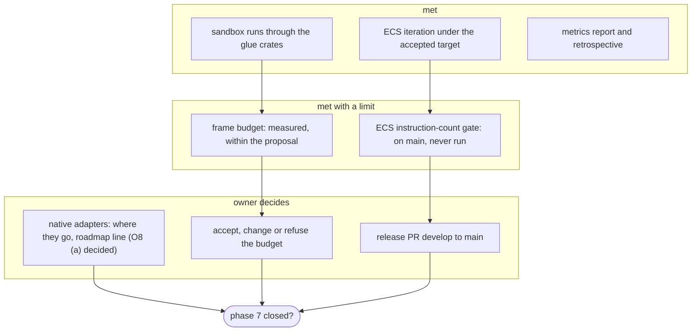
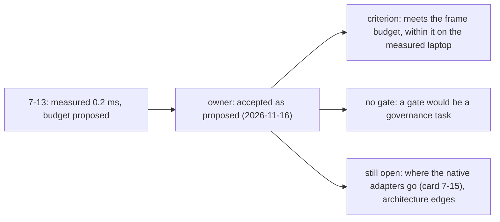

# Phase 7 milestone review `[S]`

> **Correction (card 7-17, 2026-11-16):** this page said the option chosen for O8 was not recorded. It is: Backlog card 7-15 records that the owner accepted O8 (a), the native Win32 and audio adapters are not in phase 7. The statements about the native adapters are corrected in place (rows of sections 1, 2, 3.1, 5 and 7, the flowcharts and section 9; retrospective point 4 is rewritten as a new lesson). The budget card of the update below is numbered 7-16.

> **Update (card 7-16, 2026-11-16):** the owner accepted the frame budget as proposed. Sections 1 to 8 are left as written, so they still call it a proposal; the exit criterion "meets the frame budget" is now read against the accepted numbers, see [section 9](#9-status-after-the-review-card-7-16).

Card 7-14, written on 2026-11-16 on branch `task/7-14-phase7-exit` (cut from `develop` at `8389ea4`, which holds cards 7-1 to 7-13). The roadmap asks for this review at the end of each phase ([roadmap](../workflow/roadmap.md) "Milestone reviews", [quality-metrics §4](../workflow/quality-metrics.md)); the design note names card 7-14 as the exit record, with coverage and mutation runs as done for phase 6 ([ecs-and-sandbox-v0](../architecture/ecs-and-sandbox-v0.md) section 5). It follows the form of the [phase 6 review](phase6-milestone-review.md). **Whether phase 7 is done, the frame budget, where the native adapters go, and the release are the owner's** (section 7); this page gives evidence and a recommendation and closes nothing.

**How the numbers were made.** As in earlier phases the release metric report is a placeholder, so there is no whole-phase measurement from the pipeline. Statements marked *recorded* are taken from the review file of a card and were not re-run. Statements marked *measured here* were computed for this page on 2026-11-16 on the Windows developer machine: the test run with line coverage of nine crates, the mutation run over the phase 7 diff, the unsafe-budget tool, the architecture check and git history. Nothing was lowered, skipped or waived, and no governance file was edited.

## 1. Summary

| Question | Answer |
|---|---|
| Are the phase 7 exit criteria met? | **Mostly met, with two decisions for the owner and one run still to come.** The ECS is built and measured (0.42 to 0.72 ns per entity per frame against the accepted target of 1.0 ns), the sandbox builds and runs frames through ECS, scene, input and three glue crates (headless, and timed on OpenGL; interactive play with a mouse and an audio device is not verified), and its frame costs about 0.2 ms of CPU. **Open:** the frame budget is a proposal that the owner has not accepted, the hosted instruction-count gate of the ECS has never run (its crate is not on `main`), and the native Win32 and audio adapters were not built: the owner accepted on 2026-11-14 (O8 (a), recorded on Backlog card 7-15) that they are not in phase 7, but the roadmap line "before phase 7 closes" has not been changed yet. |
| Did a gate fail on phase 7 code? | No gate was lowered, skipped or waived. Every code card had an independent review and its blockers and majors were fixed before the merge (section 3): two blockers (7-3: links to a page not yet on `main`; 7-7: a hang on a hand-made loop) and thirteen majors over cards 7-1 to 7-13. |
| Main weaknesses found | (1) **Hosted CI has not run any phase 7 code**: `develop` has no CI, so Linux, the ECS instruction-count gate and the coverage job first run on the release PR (F-HOSTED). (2) **Evidence from one machine** for every timing. (3) **The frame budget is unaccepted and unenforced** (F-BUDGET). (4) **Native adapters out of phase 7 by decision (O8 (a)); the roadmap line and where they go are still open** (F-NATIVE). (5) Three groups of tests were written together with the code and have no red run (section 6). |
| A figure that moved the wrong way? | None. Phase 7 added no `unsafe` to layers 0 to 2: 88 blocks, as at the phase 6 review, and the share fell from 0.19% to 0.16% only because the code grew. |
| Recommendation | **Phase 7 done with named limits**, once the owner decides the frame budget and where the native adapters go (section 7). The release PR `develop` to `main` carries 11 phase 7 cards (12 with this one) and is the first hosted run of this code. Phase 8 is not started. |

## 2. Exit criteria of the phase 7 row

The roadmap row: "ECS + scene + input mapping, then the integration sample | **ECS (after the storage spike) and scene/input mapping are built here, when the sample needs them (D-8)**; small playable **2D physics sandbox** sample (Q20, owner) using ECS + 2D physics + 2D render + audio | ECS iteration benchmark vs target; meets frame budget on reference machine; full metrics report; retrospective". The roadmap's scope-control rule 2 (a different rule from the operating rule 2 on iterations) adds a target (not a gate): native Win32 and audio adapters replace the stopgaps "before phase 7 closes".

### 2.1 Deliverables

| Deliverable | Evidence | Result |
|---|---|---|
| Design note before code | 7-1 (#54): `ecs-and-sandbox-v0`, choices O1 to O8 (the review found 1 major, fixed in the note) | met |
| ECS storage chosen by a measurement | 7-2 (#55): archetype tables, sparse sets and a hybrid, safe and type-erased columns; tables chosen, type erasure no win (recorded) | met |
| ADR for the storage | 7-3 (#56, governance, to `main`): ADR-0003, archetype tables with safe typed columns, no `unsafe` | met |
| ECS | 7-4 (#57) entities, tables, command buffer; 7-5 (#58) typed queries, declared access, parallel iteration | met |
| ECS benchmark registered | 7-6 (#59, governance, to `main`): `[ecs_icount]` in `gates/benchmarks.toml`, job `ecs_icount` in `ci` | met on `main`; **not yet run** (section 2.2) |
| Scene | 7-7 (#60): transforms, hierarchy, depth-first world transform update | met |
| Input mapping | 7-8 (#61): key codes, actions, contexts, per-frame state | met |
| Glue crates | 7-9 (#62) `frame` phases and `sync_physics`; 7-10 (#63) `RenderScene` and `sync_render`; 7-11 (#64) `sync_audio` | met |
| Playable 2D physics sandbox | 7-12 (#65): `app_sandbox`, golden stream, replay hash, allocation test | met; one scene, no audio device in the window run |
| Frame budget measured and proposed | 7-13 (#66): about 0.2 ms CPU per sandbox frame; the proposal is in the design note | measured; **proposal not accepted** |
| Native Win32 and audio adapters | out of phase 7 by the owner's choice O8 (a) of 2026-11-14 (Backlog card 7-15 is to change the roadmap line); not built | **not done, as decided** |

### 2.2 Exit criteria

| Criterion | Evidence | Result | Owner decision needed |
|---|---|---|---|
| ECS iteration benchmark vs target | Target: serial query iteration at most 1.0 ns per entity per frame for one, two and three components (proposed by 7-5, accepted by the owner with 7-7). *Recorded* (7-5): 0.42 to 0.72 ns on 100,000 entities, one thread, release, Windows, load not controlled; a pool of 2 workers 0.26 to 0.35. The instruction-count gate of 7-6 is on `main` but its job says "not run" until `tools_ecs_bench` reaches `main` | **met on one machine; the hosted gate has not run** | no (it runs on the release PR) |
| Meets the frame budget on the reference machine | The budget is the proposal of 7-13: OpenGL mean at most 0.5 ms and p99 at most 1.0 ms, Null mean at most 0.2 ms, the ECS path adds at most 25 us per frame. *Recorded* (7-13): OpenGL sandbox frame mean 207.9 us, p99 470 us, max 917 us; Null 84.8 us; the ECS path adds 5 to 10 us. Measured on a laptop (i7-12700H, Windows 11, release); the design note calls the owner's machine the reference, and nobody has confirmed that this laptop is it | **within the proposal, which is not accepted** | **yes**: accept, change or refuse; and confirm the machine |
| Full metrics report | Section 4: line coverage and mutation of the phase 7 crates, tests, `unsafe`, architecture | **met for this page** | no |
| Retrospective | Section 6 | **met** | no |
| Native adapters before the phase closes (a target, not a gate) | none built; window, input and audio ports stay `experimental`; O8 (a) put them outside phase 7, and the roadmap text still says "before phase 7 closes" | **not met as the text stands; out of phase 7 by decision** | **yes**: where they go and the roadmap line (section 7) |

### 2.3 Other statements the phase made

| Statement | Evidence | Result |
|---|---|---|
| `unsafe` budget | *measured here:* `unsafe_budget.py` gives **88 unsafe of 54,376 code lines (0.16%), 0 violations**. `ecs` has none (ADR-0003 option A); the type-erased variant of the spike uses `unsafe` inside a tool crate (`tools_ecs_spike`), which is not engine code | met |
| Architecture rules | *measured here:* `arch_check.py`: 38 crates, 0 violations; physics does not know the ECS (the forbidden edge stands). `render -> ecs` and `audio -> ecs` are not forbidden by the gate (found in 7-10 and 7-11, no action taken) | met; see F-EDGES |
| Zero heap allocations per frame on hot paths | counting-allocator tests in `ecs`, `scene`, `input`, the three glue crates and the sandbox: a warm frame makes no allocator call on the calling thread (recorded). Frames that spawn may allocate: the ECS has no reserve call (7-13) | met for warm frames; see F-SPAWN |
| Determinism (D0, D1) | the sandbox replay hash is equal across runs and at one and four workers (7-12); the ECS tests run with the reversed and shuffled schedulers and compare results (7-5) | met on one machine; D2 is physics only and unchanged |
| Physics free of the ECS | `sync_physics` is the only code that knows both (7-9); arch-check refuses a temporary `physics -> ecs` edge (recorded) | met |
| Supply chain | no new external dependency in phase 7 | met |

## 3. Cards, pull requests and release status

State is taken from git (merged PRs), **not from the Trello board**. Findings are what the independent review of each card reported (from the review files). 7-3 and 7-6 were governance cards: they went to `main` first and `develop` merged `main` in. All others were ordinary cards into `develop`, where no hosted CI runs, so their evidence is the local gates and the review file.

| Card | Delivers | PR | Class | Findings of the independent review | Release |
|---|---|---|---|---|---|
| 7-1 | design note | #54 | 1 | 0 blocker, 1 major, 5 minor, 2 nit, fixed | not released |
| 7-2 | ECS storage spike | #55 | 2 | 3 major, 6 minor, fixed | not released |
| 7-3 | ADR-0003 (governance) | #56 | 3 | 1 blocker, 2 major, 3 minor, fixed | on `main` |
| 7-4 | `ecs` part 1 | #57 | 2 | 0 major, 6 minor | not released |
| 7-5 | `ecs` part 2, queries | #58 | 2 | 0 major, 8 minor | not released |
| 7-6 | ECS gate (governance) | #59 | 3 | 0 major, 4 minor | on `main` |
| 7-7 | `scene` | #60 | 2 | 1 blocker, 2 major, 6 minor, fixed (2 reviews) | not released |
| 7-8 | `input` | #61 | 2 | 0 major, 9 minor, 5 nit | not released |
| 7-9 | `frame`, `sync_physics` | #62 | 2 | 1 major, 8 minor, nits, fixed | not released |
| 7-10 | `RenderScene`, `sync_render` | #63 | 2 | 0 major, 2 minor, 3 nit | not released |
| 7-11 | `sync_audio` | #64 | 2 | 1 major, 2 minor, 2 nit, fixed | not released |
| 7-12 | `app_sandbox` | #65 | 2 | 2 major, 7 minor, 5 nit, fixed | not released |
| 7-13 | frame budget measurement | #66 | 1 | 1 major, 4 minor, 4 nit, fixed | not released |
| 7-14 | this review | this PR | 1 | see `reviews/7-14.md` | not released |

`develop` is 13 commits ahead of `main` and `main` has nothing `develop` lacks. The ECS, scene, input, the glue crates, the sandbox and the benchmark crate reach `main` with the next release PR, which is the owner's call ([delivery-pipeline](../workflow/delivery-pipeline.md)). **Hosted CI has never run this code**: the release PR will be the first full run, including the `ecs_icount` job, which today states "not run" while its crate is absent from `main`.

### 3.1 Plan against actual

| Item | Plan (design note section 6) | Actual |
|---|---|---|
| Cards | 7-1 to 7-14 | the same 14 cards, no card added and none cut |
| Governance steps | 7-3 and 7-6, owner-declared | both done as planned |
| Options for the owner | O1 to O8 | accepted by the owner on 2026-11-14 (changelog v1.46); the changelog says only "accepted choices O1-O8", but the Backlog card 7-15 records that the owner accepted O8 (a): the native adapters are not in phase 7 (this page first said the option was not recorded; corrected by card 7-17). The roadmap line change is still to do |
| Iterations rule (roadmap operating rule 2: stop at about twice the planned iterations) | 14 cards | 14 cards, one fix loop at most per card; nothing suggests the rule triggered |
| Cut items | none named | none |

## 4. Metrics

### 4.1 What was measured, and how

**Per-card evidence** (*recorded*, not re-run): Clippy `-D warnings`, `cargo fmt`, the workspace tests, the architecture check and the local gates, and a mutation run of the card's crate for 7-4, 7-5, 7-7, 7-8, 7-9, 7-10 and 7-11. **Line coverage was not measured for any phase 7 card** (the reviews say so); it is measured once here.

**Line coverage, measured here.** `cargo llvm-cov -p ecs -p scene -p input -p frame -p sync_physics -p sync_render -p sync_audio -p app_sandbox -p tools_ecs_bench --locked --summary-only` at `develop` `8389ea4`: **339 tests passed, 0 failed, 0 ignored.** Lines are `cargo llvm-cov` line counts of the files under `engine/`.

| Crate | Layer | Lines covered / counted | Line coverage | Region coverage |
|---|---|---|---|---|
| `ecs` | L1 | 1,016 / 1,026 | 99.0% | 94.9% |
| `scene` | L2 | 219 / 220 | 99.5% | 96.5% |
| `input` | L2 | 304 / 306 | 99.3% | 99.3% |
| `frame` | L2 | 164 / 165 | 99.4% | 99.3% |
| `sync_audio` | L2 | 89 / 89 | 100.0% | 100.0% |
| `sync_physics` | L2 | 108 / 119 | 90.8% | 90.3% |
| `sync_render` | L2 | 54 / 58 | 93.1% | 95.1% |
| `app_sandbox` | L4 | 884 / 920 | 96.1% | 91.6% |
| `tools_ecs_bench` | L4 (tool) | 158 / 260 | 60.8% | 56.9% |
| **All nine** | | 2,996 / 3,163 | **94.7%** | |

**Against the gates.** The L0 to L2 line gate is 90% (`coverage.line_min` in [gates](../../gates/gates.toml)): all seven L1 and L2 crates are above it. `render` (the `RenderScene` change of 7-10) is not in the run, so its share is not measured. One file with 30 or more lines has the lowest coverage, for reference (L4 tool, no gate): `tools_ecs_bench/src/report.rs`, 0 of 63 lines, the text output of the benchmark command, run by hand and by the gate. **Not measured:** the new-line gate (95%, needs a diff against a base) and the branch gate (80%, needs nightly options).

**Mutation, measured here.** `cargo mutants -p ecs -p scene -p input -p frame -p sync_physics -p sync_render -p sync_audio -p render -p base --in-diff <phase 7 diff> --jobs 4` at `develop` `8389ea4`, where the diff is `git diff f380cc9^ HEAD` over the `src` folders of those crates (mutants are made only on lines that phase 7 added or changed; `base` and `render` have few). cargo-mutants reported **545 mutants in 20 minutes: 439 caught, 2 missed, 0 timeouts, 104 unviable** (a mutant that does not compile is not counted). **Score 99.5% (439 of 441)** against the gate of 80% (digest section 7; `mutation.score_min` in [gates](../../gates/gates.toml)): **met**. The two missed are `<` to `<=` at `engine/ecs/src/world.rs` lines 326 and 329 in `two_mut`; they are the two equivalent mutants already judged in the 7-4 review (with equal indices both forms give `None` through the length of the split slice), so there is no new test gap. The run is whole-crate for the new crates, so it repeats and extends the per-card runs; it does not cover `app_sandbox` (L4, no gate) nor the L1 `jobs` crate.

| Metric | Per-card evidence (recorded) | Whole-phase (measured here) |
|---|---|---|
| Mutation on changed L0 to L2 code (gate 80%) | `ecs` 98% (7-4), 98.8% (7-5); `scene` 44 of 44 viable (7-7); `input` 105 of 105 (7-8); `sync_physics` and `frame` 86 of 86 (7-9); `sync_render` 19 of 19 (7-10); `sync_audio` 28 of 28 (7-11) | 545 mutants, 439 caught, 2 missed (equivalent), 104 unviable: **99.5%** |
| Line coverage | not measured per card | 94.7% over nine crates (table above) |
| Tests | per card in the reviews | 339 passed in the nine crates above |
| `unsafe` | none in `ecs`, `scene`, `input`, `frame`, `sync_*`, `app_sandbox` | 88 of 54,376 L0 to L2 code lines (0.16%), 0 violations |
| Architecture / banned imports | 0 violations per card | 38 crates, 0 violations |
| Benchmarks | ECS iteration (7-5), frame budget (7-13) | one machine, section 2.2 |

### 4.2 Never measured

Branch coverage and the new-line coverage gate; mutation of the L4 `app_sandbox` crate as a whole (12 mutants survive in the runs of 7-12, stated there: the window path, `Renderer::resize`, two refused-cue counters that cannot be reached, and `set_execution`); any Linux or ARM64 run of phase 7 code; the `ecs_icount` gate on a hosted runner; a second machine for any timing; GPU time and the wait for the present call in the frame budget; a sandbox with more than 83 entities; Miri (there is no `unsafe` to run it on).

## 5. Open findings and risks

Each item was checked against the repository on 2026-11-16 (`8389ea4`) before it was listed.

| # | Finding / risk | Status checked | Proposed decision or card |
|---|---|---|---|
| F-HOSTED | No hosted CI has run phase 7 code. The release PR is the first Linux run, the first `ecs_icount` run, the first hosted coverage run | `develop` runs only `pr-title` and `governance-guard`; `tools_ecs_bench` is not on `main` | open the release PR when the owner decides; read a red job as a stop and fix it before merge |
| F-BUDGET | The frame budget is a proposal; nothing enforces it | design note, section 4 "Frame budget"; no entry in `gates/benchmarks.toml` | owner accepts, changes or refuses; a gate would be a governance task |
| F-NATIVE | The native Win32 and audio adapters are out of phase 7 by O8 (a) (2026-11-14); the roadmap text still says "before phase 7 closes"; window, input and audio ports stay `experimental` | design note O8; Backlog card 7-15 | owner: say where the adapters go (a later phase or cards); card 7-15 then changes the roadmap line (governance) |
| F-EDGES | `render -> ecs` and `audio -> ecs` are not refused by `gates/architecture.toml` (only `physics -> ecs` is a forbidden edge); the glue crates are the intended place for those edges | found in 7-10 and 7-11; arch-check gives 0 violations | optional governance card to forbid them |
| F-SPAWN | A frame that spawns may allocate: the ECS has no reserve call. Warm frames do not | 7-13 review | add `reserve` when a sample needs it |
| F-SINGLE | One scene, 83 entities, one machine, no audio device in the window run, no GPU time | 7-12 and 7-13 reviews | a second machine and a larger scene are follow-ups if the owner wants them |
| F-LINEAR | `set_parent` appends by walking the siblings (linear in their number); no tail pointer | 7-7 review | add a tail pointer when a measurement asks |
| F-SERIAL | Systems run one after the other; only iteration inside a query is parallel (O6 (a)) | design note O6 | a scheduler design note in a later phase |
| F-INPUT | The Linux scancode table and the extended Windows keys were not run on hardware | 7-8 review | when a Linux window adapter exists |
| F-NOREDRUN | Three groups of tests were written together with the code and have no red run: the `frame` phase tests (7-9), the 13 tests of the 7-7 fix loop and the `measure` tests (7-13); each is stated in its review, and mutation shows the 7-7 and 7-9 ones bite | reviews 7-7, 7-9, 7-13 | none; a process note (section 6) |
| F-TOOLCOV | `tools_ecs_bench` is 60.8% covered; its report formatting is run only by hand | measured here | accept; a tool of L4, no gate |

## 6. Retrospective

**What worked**
- **Measure first, then decide.** The storage spike (7-2) chose archetype tables on numbers and showed that type erasure gave no win, so `ecs` has no `unsafe` at all. Dirty flags for transforms were dropped on a probe (7-7) and the sandbox measurement (7-13) confirmed it: the whole transform update costs 6.7 us.
- **The order of the cards.** Spike, ADR, ECS, scene and input, glue, sandbox, measurement. The ADR and its `unsafe` budget decision came before the first `ecs` PR, as the 7-1 review asked.
- **Independent review found a blocker or a major on six of the code cards (7-2, 7-7, 7-9, 7-11, 7-12, 7-13).** One code blocker (7-7: the claim "the links always form a forest" was false and a hand-made loop hung `update`; fixed by bounding every walk and reporting `BrokenHierarchy`), and majors in 7-1, 7-2 (3), 7-3 (2), 7-7 (2), 7-9, 7-11, 7-12 (2) and 7-13. The 7-13 major mattered for the owner: the first comparison favoured the sandbox by run order, and the report now gives a range.
- **Mutation per card caught gaps early.** First runs missed: 8 (7-5), 5 (7-8), 3 plus a hang (7-9), 1 (7-10), 1 plus 4 hangs (7-7). Each was fixed with a test and the run repeated.
- **Narrow glue crates.** The three `sync_*` crates are small (58 to 119 lines each) and physics stayed free of the ECS.

**What did not work, or cost more than it should**
- **No hosted proof.** `develop` has no CI (budget), so coverage was not measured per card and Linux results arrive only at the release.
- **Tests written with the code** in three places (F-NOREDRUN). The reviews state it; it is a departure from the TDD rule, not a waiver.
- **A claim written before it was checked.** The 7-7 draft said the hierarchy was a forest "for certain"; a reviewer broke it in minutes. Claims about guarantees need a test that tries to break them before they enter a page.
- **A comparison that was not fair by default** (7-13): debug drawing on in one side, and order bias. Both were found by review, not by the first measurement.
- **Governance cards twice** (7-3, 7-6) cost the main-first path and a merge of `main` into `develop` each.

**What to change**
1. Write the claim and the test that tries to break it in the same step, before the claim goes into a page.
2. For any measurement that compares two paths, state the fairness controls (same settings, alternating order) in the test list, not after the review.
3. Run coverage and mutation for the whole phase at the exit review as done here, and ask each library card for its own mutation run (done for every new library crate of the phase).
4. When a choice such as O8 (a) moves work out of a phase, change the roadmap line in the same step, not after the phase closes.

## 7. Go / adjust: recommendation for the owner

**Recommendation: phase 7 is done with named limits.** An entity-based sandbox now runs on top of physics, render and audio only through three glue crates, the ECS is under its accepted iteration target, the sandbox frame is about 1.2% of a 60 Hz frame on the measured machine, and the metrics of the phase are measured and above the gates. The limits are what the evidence names: one machine, no hosted run yet, the budget unaccepted when this was written, and the roadmap line for the native adapters not yet changed.

The owner decides; nothing here moves a card.

| # | Decision | Options |
|---|---|---|
| 1 | Frame budget (O4) | (a) accept as proposed: OpenGL mean at most 0.5 ms and p99 at most 1.0 ms, Null mean at most 0.2 ms, the ECS path at most 25 us more than the direct sample; (b) change the numbers; (c) refuse. Also confirm that the measured laptop is the reference machine. Enforcement would be a later governance task |
| 2 | Native Win32 and audio adapters (O8) | **Decided: (a), not in phase 7 (2026-11-14).** Open: where they go (a later phase or cards) and the roadmap line, changed by a governance task (Backlog card 7-15) |
| 3 | Release | when to open the release PR `develop` to `main` (13 commits, 11 phase 7 cards plus this one, one PR, merge commit with `Release-Batch:`), and whether to run `ci` by hand on `main` right after it. This is the first hosted run of the phase 7 code (F-HOSTED) |
| 4 | Architecture edges | (a) leave `render -> ecs` and `audio -> ecs` as they are; (b) a governance card to forbid them |
| 5 | Phase 7 umbrella card | done now, or after the release PR merges |
| 6 | Phase 8 | no go has been given and none is assumed; no phase 8 work was started |

## 8. Not verified in this review

- No benchmark was repeated: the ECS and frame-budget figures are the *recorded* ones of 7-5 and 7-13.
- No Linux, ARM64 or second-machine run of any phase 7 code, and no hosted run.
- Branch coverage and the new-line coverage gate (section 4.1); line coverage of the `RenderScene` change in `render`.
- That the machine of 7-13 is the owner's reference machine.
- Interactive play of the sandbox: the window path needs a display and an audio device, and no review records a run by hand with the mouse and keyboard.
- The Trello board state of the cards.
- Mermaid syntax: read by the author, not rendered.

## 9. Status after the review (card 7-16)

Written on 2026-11-16, documentation only. After the release of phase 7 (v0.13.0) the owner accepted the frame budget exactly as proposed in card 7-13: on the OpenGL device the CPU time of one frame call has a mean of at most 0.5 ms and a p99 of at most 1.0 ms, on the Null device a mean of at most 0.2 ms, and the ECS path adds at most 25 us per frame to the direct sample with its debug drawing off. The numbers are recorded in [ecs-and-sandbox-v0](../architecture/ecs-and-sandbox-v0.md) section 4.

**Against the exit criterion.** Measured on the laptop of card 7-13: OpenGL mean 207.9 us and p99 470 us, Null mean 84.8 us, ECS path +5 to 10 us: all inside the accepted caps. The criterion is **met on that laptop**. The owner did not separately confirm the laptop as the reference machine and did not name another one. **Limits unchanged:** nothing enforces the budget, GPU time and the wait of the present are not budgeted, and only a scene of 83 entities on one machine was measured. F-BUDGET (section 5) now reads: accepted, not enforced. Of the decisions in section 7, number 1 is now made and number 3 (the release) is done, as v0.13.0; number 2 is decided as O8 (a) and only where the adapters go is open, number 5 (umbrella card) was done on the owner's order of 2026-11-16 ("move phase 7 umbrella card to Done"), and number 4 (architecture edges) is still the owner's.
