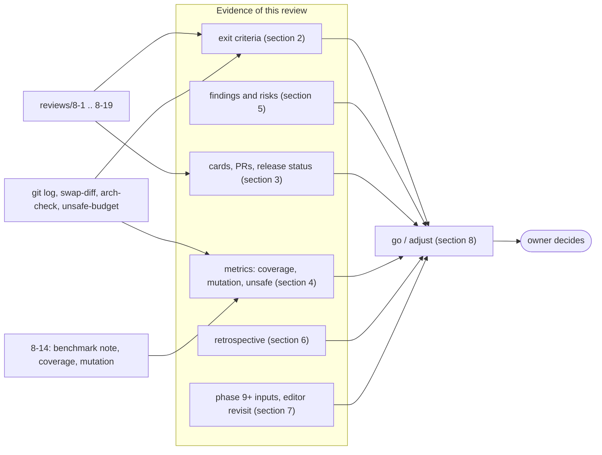
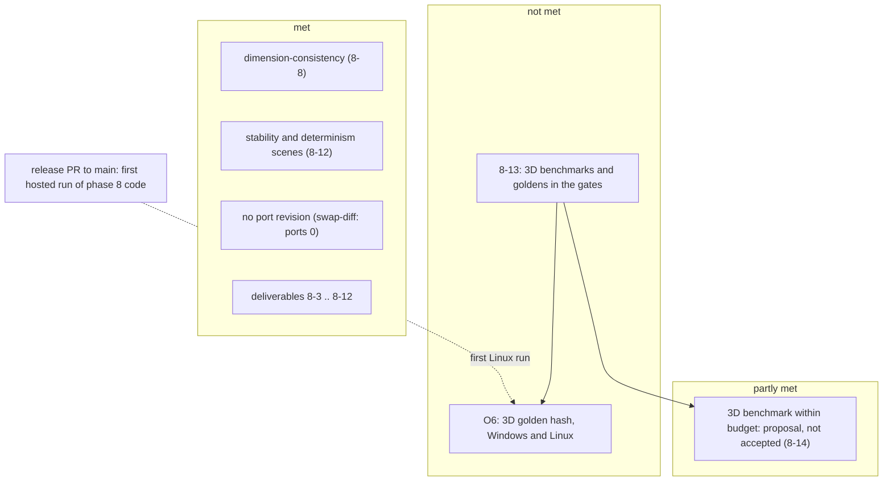

# Phase 8 milestone review `[S]`

Card 8-15, written on 2026-11-19 on branch `docs/8-15-phase8-exit` (cut from `develop` at `2f373ea`, which holds the phase 8 cards 8-1 to 8-12, 8-14, 8-17, 8-18 and 8-19). The roadmap asks for this review at the end of each phase ([roadmap](../workflow/roadmap.md) "Milestone reviews", [quality-metrics §4](../workflow/quality-metrics.md)); the design note names card 8-15 as the exit record and adds the inputs for phase 9+ and the editor question ([phase8-3d-v0](../architecture/phase8-3d-v0.md) section 7). It follows the form of the [phase 7 review](phase7-milestone-review.md). **Whether phase 8 is done, the 3D budget, card 8-13 (governance), the release and what phase 9 is are the owner's** (section 8); this page gives evidence and a recommendation and closes nothing.

**How the numbers were made.** As in earlier phases the release metric report is a placeholder, so there is no whole-phase measurement from the pipeline. Statements marked *recorded* come from the review file of a card (`reviews/8-*.md`) or from the 8-14 note and were not re-run for this page. Statements marked *measured here* were computed for this page on 2026-11-19 on the Windows developer machine: the swap-diff tool, the architecture check, the unsafe-budget tool and git history. Line coverage and the mutation figures of the 8-19 files were measured the same day by card 8-14 (*recorded from 8-14*). No test, coverage or mutation run was repeated here. Nothing was lowered, skipped or waived, and no governance file was edited.

## 1. Summary

| Question | Answer |
|---|---|
| Are the phase 8 exit criteria met? | **Mostly met, with one governance card not done and one budget not accepted.** Met: the `D=3` physics instance (bodies, sphere, box, capsule and convex hull shapes, contact solver, joints, islands, sleeping, parallel solve), the lit mesh frontend on the existing render port, the 3D scene and glue, the 3D sandbox, the dimension-consistency tests, the 3D stability and determinism scenes, and no port revision. **Open:** the 3D benchmark budget is a proposal (8-14) that the owner has not accepted, and nothing enforces it, because card 8-13 (register the 3D benchmarks and the golden hashes; governance) was not started. Without 8-13 no hosted gate covers a 3D benchmark or a 3D golden hash, and the cross-platform determinism of `d3` (choice O6 (a)) is **not proven on any second platform**. |
| Did a gate fail on phase 8 code? | No gate was lowered, skipped or waived. Every code card had an independent review and its blockers and majors were fixed before the merge (the last fix loop was not re-reviewed on 8-7, 8-9, 8-10, 8-18 and 8-19, and the review files say so): one blocker (8-5: a hull far from the origin could panic) and majors on ten of the sixteen merged cards (section 3). |
| Main weaknesses found | (1) **No hosted run of any phase 8 code and no cross-platform golden hash** (F-HOSTED, F-GOLDEN). (2) **3D benchmark budget unaccepted and unenforced** (F-BUDGET). (3) **Cost and quality of the 3D solver**: a 3D box costs about 8 times a 2D box per step, the lane path gains nothing, a capsule in the mixed pile rocks for thousands of steps (F-COST, F-CAPSULE; cards 8-22, 8-21). (4) **Evidence from one machine** for every timing. (5) **Two mutants survive in the card 8-19 files** and no mutation run covers the phase in one piece (F-MUT, card 8-23). |
| A figure that moved the wrong way? | None against a gate. `unsafe` stayed at 88 blocks (0.13% of 70,354 code lines, down from 0.16%); phase 8 added none. The 3D cost per body is about 8 times the 2D one (8-14), which is a finding, not a gate. |
| Recommendation | **Phase 8 done with named limits**, once the owner decides the budget and whether card 8-13 is declared a governance task (section 8). Phase 9 is not started. |

## 2. Exit criteria of the phase 8 row

The roadmap row: "**3D** (committed, sequenced after 2D) | `D=3` instantiation of the physics core (quaternions, inertia tensor, GJK/EPA/SAT, 3D manifolds, joints); 3D render features on the existing port (perspective camera, meshes, depth, basic lighting/materials); 3D sample | **dimension-consistency tests** (2D instance vs 3D constrained to a plane, short non-chaotic scenes with stated tolerances) pass; 3D stability + determinism scenes; 3D benchmark scenes within budget; swap-diff still 0 for render/platform ports".

### 2.1 Deliverables

| Deliverable | Evidence | Result |
|---|---|---|
| Design note before code, owner choices O1 to O9 | 8-1 (#72) and 8-17 (#73): the owner accepted all recommendations on 2026-11-17 | met |
| 3D core spike (trigger check of ADR-0018) | 8-2 (#74): the `D=3` stack on the real core; two majors on reproducibility claims, fixed | met |
| `physics::d3` bodies, quaternions, inertia, integration, state hash | 8-3 (#75): inertia is diagonal only, no gyroscopic term (stated limit) | met |
| Shapes and narrowphase: sphere, box, capsule; SAT and clipping; AABB; 3D debug draw | 8-4 (#76): `manifold.rs` 0 missed; survivors in `box_box.rs` judged (recorded) | met |
| Convex hull, GJK and EPA | 8-5 (#77): three fix loops, one blocker and majors fixed; thin hulls are an accepted limit: at 0.1% thickness random plates are refused at about 5% (8 points) up to 95% (64 points), and below about 0.05% a wrong volume can be accepted without an error (up to 70% in the reviewer's probe) | met, with that limit |
| Contact solver with friction, warm starting, sleeping, islands | 8-6 (#78): `constraint.rs` 109 mutants, 7 missed then killed, one survivor judged equivalent by reasoning in `solver/mod.rs` `write_back` (recorded; 8-14 later found a `write_back` mutant it could not judge, see section 4.1) | met |
| Joints: ball-and-socket, hinge with limits, distance | 8-7 (#79): three fix loops (the most the rules allow); a body tiny for its arm diverges above a mass ratio of about 1000 to 5000 (stated limit); motors and springs left to card 8-20 | met, with limits |
| Hull contact manifolds with up to four points | 8-18 (#80): `face_clip.rs` 84.5% of viable mutants caught (186 caught, 34 missed), `clip.rs` 89% (recorded) | met |
| Graph-coloured parallel contact solve | 8-19 (#82): bit-identical to the serial reference at 1 and N threads; mutation: see section 4.1 | met |
| Lit mesh frontend on the existing port | 8-9 (#83): `render` lit and shapes 207 of 207 viable caught (recorded); the uniform layout changed in 8-11 (two blocks, not three) | met, no port revision |
| `Transform3D`, hierarchy, `sync_physics::d3`, `sync_render` mesh snapshot | 8-10 (#84): transform, hierarchy and sync files all viable caught (recorded) | met |
| 3D sandbox (ECS, glue, orbit camera, lit shader, image test on OpenGL and Vulkan) | 8-11 (#85): golden stream, replay hash at 1 and 4 threads, zero allocations per warm frame; mutation all caught but 3 (sandbox) and 4 (renderer), judged equivalent or glue (recorded) | met; no person looked at the picture |
| Dimension-consistency tests | 8-8 (#81): `tests/dimension_consistency.rs`, short non-chaotic scenes with stated tolerances (recorded; no engine code changed, so no mutation run) | met |
| 3D stability, determinism and bench scenes | 8-12 (#86): six judged scenes, replay at 1 and N threads, SIMD equals scalar | met, with the mixed-pile limit (section 5) |
| 3D benchmark measurement, proposed budget, coverage and mutation | 8-14 (#87): `docs/budgets/physics-benchmark-8-14.md` | measured; **budget proposed, not accepted** |
| Registration of the 3D benchmarks and golden hashes in the gates | 8-13 (governance) | **not done** |
| Optional mesh file format `dmesh` | 8-16 (choice O5 (a): generated primitives only) | not started, as allowed |

### 2.2 Exit criteria

| Criterion | Evidence | Result | Owner decision needed |
|---|---|---|---|
| Dimension-consistency tests pass | 8-8, `tests/dimension_consistency.rs` (recorded; not re-run for this page) | **met** | no |
| 3D stability and determinism scenes | 8-12 (recorded) and 8-14 (measured, same day): the six scenes plus the 1,015-box pyramid; the standing scenes end at rest (the large pyramid moves 0.0197 m at most, settled drift 0.0016 m), the piles stay in the box, the chain keeps its links, every scene hashes the same twice (D0) and at 1, 2, 4 workers with and without SIMD (D1; SIMD equals scalar). Limit: the sphere pile needs a stand-in for rolling resistance to sleep, and the mixed pile is asked only to settle (under 0.25 m/s at step 800), not to rest | **met, with the limits named** | no |
| 3D benchmark scenes within budget | 8-14: the 3D benchmark scenes are measured (large pyramid 18.6 ms serial, 11.6 ms on 4 workers; 91-box pyramid 1.28 ms; mixed pile 0.51 ms) on the owner's laptop, not under the reference protocol. The proposed budget (W4 at most 21 ms, W4p at most 13 ms, W4s at most 1.5 ms, W4m at most 0.6 ms) has not been accepted, and no gate holds it | **within the proposal; the proposal is not accepted and not enforced** | **yes**: accept, change or refuse (O9 (a)); and declare 8-13 if the gate is wanted |
| Swap-diff still 0 for render and platform ports | *Measured here*: `swap_diff.py --config gates/swap-diff.toml --base v0.14.0 --head develop`: adapter files 0, **port files 0** (no port revision), composition root 30, plumbing 2, non-code 19, engine and game 76. The tool prints `FAIL` because its limit on engine and game files is 0, a rule written for a card that adds a backend; phase 8 adds engine code by definition. The 76 files include 2D files (`d2` debug draw and solver, `core/soft.rs`, moved shared maths), the render contract suite (`render/src/contract.rs`, new lit cases) and one docs file; read as the roadmap means it (no port and no adapter file touched), the criterion is met, but the owner may want to look at the contract-suite change | **met in its meaning; the tool's verdict is FAIL** | **yes**: confirm this reading, or ask for the tool to be taught the difference (a governance task) |
| Full metrics report and retrospective (standard) | Section 4 and section 6 | **met for this page** | no |

### 2.3 Other statements the phase made

| Statement | Evidence | Result |
|---|---|---|
| Zero heap allocations per frame in the 3D step and the sample | tests exist: `d3_no_allocation`, `d3_parallel_allocation`, `scene` and glue `no_allocation_3d` tests, and the sandbox warm-frame test (recorded). Not covered: joints in the parallel path (8-19 states it); a frame that spawns a piece (the ECS grows) | met by tests, with those gaps |
| `unsafe` budget | *Measured here*: **88 unsafe of 70,354 code lines (0.13%), 0 violations**. Phase 8 added none (the phase 7 review had 88 of 54,376) | met |
| Architecture rules | *Measured here*: `arch_check.py --config gates/architecture.toml`: **39 crates, 0 violations** (38 at the phase 7 review; the new one is `app_sandbox3d`) | met |
| Physics stays free of the ECS | arch-check (forbidden edge `physics -> ecs`) and the glue crates `sync_physics` and `sync_render` are the only code that knows two modules | met |
| Cross-platform determinism of `d3` (O6 (a): the feature and a golden hash on Windows and Linux) | **no golden file entry for 3D, no Linux run of any 3D code**; the 3D physics reviews (8-3 to 8-7, 8-18) say so, and the others say no Linux run. The `d3` code was written for the feature (facade functions, no `libm` in the physics crate's own source; arch-check scans it) but the claim is not proven | **not met until card 8-13** |
| Miri on changed `unsafe` | no `unsafe` was added | not applicable |

## 3. Cards, pull requests and release status

State is taken from git (merged PRs on `develop`), **not from the Trello board**. Findings are what the independent review of each card reported (from the review files). All cards below were ordinary cards into `develop`, where no hosted CI runs, so their evidence is the local gates and the review file. The release `v0.14.0` is the base of phase 8; `develop` is **16 commits ahead** of it.

| Card | Delivers | PR | Class | Independent review: findings | Loops | Release |
|---|---|---|---|---|---|---|
| 8-1 | design note | #72 | 1 | 2 majors, minors, nits, fixed | 1 | not released |
| 8-17 | owner choices recorded | #73 | 1 | 2 minors, 1 nit | 1 | not released |
| 8-2 | 3D core spike | #74 | 1 | 2 majors, minors, nits, fixed | 1 | not released |
| 8-3 | `d3` bodies | #75 | 2 | 2 majors, minors and nits, fixed | 1 | not released |
| 8-4 | shapes, narrowphase, debug draw | #76 | 2 | 0 major, minors and nits (limits documented) | 1 | not released |
| 8-5 | convex hull, GJK and EPA | #77 | 2 | **1 blocker**, majors, minors, over three reviews | 3 | not released |
| 8-6 | contact solver | #78 | 2 | 0 major, minors and nits (limits documented) | 1 | not released |
| 8-7 | joints | #79 | 2 | majors in loops 1 to 3 (a hinge limit blew up to NaN; a small body on a long arm diverged; an antiparallel hinge flipped) | 3 | not released |
| 8-18 | hull manifolds | #80 | 2 | 2 majors (box-box 35 to 40% slower; a fitted face 20 to 30 times slower on round hulls), fixed | 1 | not released |
| 8-8 | dimension-consistency tests | #81 | 1 | 0 major, minors on comments | 1 | not released |
| 8-19 | coloured, parallel contact solve | #82 | 2 | 0 major, 4 minors (a buffer sized by a huge chunk), fixed | 1 | not released |
| 8-9 | lit mesh frontend | #83 | 2 | 1 major (an untested tie-break), minors | 1 | not released |
| 8-10 | `Transform3D`, glue, mesh snapshot | #84 | 2 | 2 majors (a 3D child under a 2D parent; an overflowing view-projection), fixed | 1 | not released |
| 8-11 | 3D sandbox | #85 | 2 | 0 major, 2 minors, fixed | 1 | not released |
| 8-12 | stability, determinism and bench scenes | #86 | 1 | 3 majors (magic numbers, `unwrap_or`: fixed; a loose pile test: kept on purpose and stated) | 1 | not released |
| 8-14 | 3D benchmark, budget proposal, coverage, mutation | #87 | 1 | 1 major (untabulated figures), 3 minors, fixed | 1 | not released |
| 8-15 | this review | this PR | 1 | see `reviews/8-15.md` | | not released |
| 8-13 | 3D benchmarks and goldens in the gates | | 3 | not started (owner must declare it) | | |
| 8-16 | `dmesh` (optional) | | 2 | not started | | |
| 8-20 | joint motor and spring | | 2 | not started; follow-up of 8-7 | | |
| 8-21, 8-22, 8-23 | capsule contacts, solver cost, two mutants | | | created 2026-11-19 from the findings of 8-12 and 8-14; not started | | |

`develop` holds 16 phase 8 commits that `main` does not. The 3D physics, the lit frontend, the glue and the sandbox reach `main` with the next release PR, which is the owner's call ([delivery-pipeline](../workflow/delivery-pipeline.md)). **Hosted CI has never run this code**: the release PR will be the first full run, including the Linux jobs and the `ecs_icount` job. It would **not** run any 3D benchmark or 3D golden hash, since those were never registered (8-13).

### 3.1 Plan against actual

| Item | Plan (design note section 7) | Actual |
|---|---|---|
| Cards | 8-1 to 8-16 (16 cards) | 8-17 added the same day (record the owner's choices); 8-18 split from 8-5 (hull manifolds, owner's choice of 2026-11-17); 8-19 and 8-20 added as follow-ups (owner decision of 2026-11-18: serial solver first, then parallel; joints with limits only); 8-21 to 8-23 created after the findings of 8-12 and 8-14. 16 cards are merged, 3 of the plan are open (8-13, 8-15, 8-16) |
| Governance step | 8-13, owner-declared, main first | not declared, not done |
| Optional card | 8-16 | not started, as O5 (a) allows |
| Order | 8-13 before 8-14 | 8-14 was done first: the card text says "After 8-13", but the measurement does not need the registration; the owner was told, and 8-14 changed nothing in `gates/` |
| Options for the owner | O1 to O9 | accepted on 2026-11-17 ("accept all recommendations") |
| Iterations rule (roadmap operating rule 2: stop at about twice the planned iterations) | 16 cards | 19 cards worked or created by the end of the build (8-1 to 8-19), 23 with the findings cards; about 1.2 to 1.4 times the plan. Two cards used three fix loops (8-5, 8-7). The rule did not trigger |
| Cut items | triangle meshes first, then others (operating rule 6) | none cut by hand; triangle meshes were never in scope (O2 (b)) |

## 4. Metrics

### 4.1 What was measured, and how

**Per-card evidence** (*recorded*, not re-run): Clippy `-D warnings`, `cargo fmt`, the crate tests, the architecture check, the local gates, and a mutation run of the card's files for every library card except 8-8 (tests only), 8-12 and 8-14 (dev tool) and 8-19, whose own run was stopped for memory.

**Line coverage, recorded from 8-14** (`cargo llvm-cov --summary-only -p physics -p sync_physics -p sync_render -p scene -p frame -p render -p input`, `develop` before the 8-14 merge): **19,176 lines, 1,372 missed, 92.85%** against the gate of 90% for L0 to L2. Every phase 8 file of `physics/src/d3` is above the gate and the per-file figures are in the 8-14 note; `core/colouring.rs` 100%; `render/lit.rs` 98.21%; `render/mesh_scene.rs` 100%; `sync_render/d3.rs` 97.67%. The weakest phase 8 files are glue: `sync_physics/d3.rs` 91.26%, `sync_physics/attach.rs` 90.16%, `sync_physics/error.rs` 78.57%, `sync_render/error.rs` 57.14% (error types). The run did **not** include `app_sandbox3d` or `tools_physics_bench` (layer 4, no gate).

**Mutation** (gate: 80% of viable mutants caught on changed L0 to L2 code):

| Where | Result | Source |
|---|---|---|
| 8-3 aabb, shape, mod | all caught after fixes | recorded |
| 8-4 `manifold.rs`; `box_box.rs` | 0 missed; survivors judged | recorded |
| 8-6 `constraint.rs` | 109 mutants, 7 missed then killed, 1 equivalent survivor | recorded |
| 8-7 `solver/joint.rs` | survivors killed on reruns | recorded |
| 8-18 `face_clip.rs`; `clip.rs` | 84.5% (186 caught, 34 missed); 89% | recorded |
| 8-9 `render` lit and shapes | 207 of 207 viable | recorded |
| 8-10 transform, hierarchy, sync | all viable caught | recorded |
| 8-11 orbit, controls, spawn, mesh, session, lit; sandbox; renderer | all caught; sandbox all but 3; renderer all but 4 (equivalent or glue) | recorded |
| 8-19 `colouring.rs`; `constraint.rs`; `stage.rs`; `mod.rs` | 66 of 66; 97 of 97; 18 of 19; 58 of 59 viable: **239 of 241 (99.2%)** | recorded from 8-14 (run there, after the first run of `mod.rs` had left the joint tests out) |

Two survivors remain in the 8-19 files: `stage.rs` `has_room` to `true` (unreachable by construction, **not proven**) and `solver/mod.rs` `write_back` `||` to `&&` (**open, not judged equivalent**); both are on card 8-23. **No run covers the phase in one piece** (the cards were run file by file, some in shards, because of memory), and the per-card figures were taken on different days at different code states.

| Metric | Per-card evidence (recorded) | Whole-phase |
|---|---|---|
| Mutation on changed L0 to L2 code (gate 80%) | the lowest are the 8-18 files (84.5% and 89% of viable) | **not measured in one piece** |
| Line coverage | not measured per card | 92.85% over seven crates (8-14) |
| Tests | per card in the reviews | **not counted for this page** |
| `unsafe` | none added in phase 8 | *measured here*: 88 of 70,354 L0 to L2 code lines (0.13%), 0 violations |
| Architecture and banned imports | 0 violations per card | *measured here*: 39 crates, 0 violations |
| Size of the phase | | *measured here*: `git diff --shortstat v0.14.0 develop -- engine`: 105 files, +24,247 and -348 lines (includes tests and the shader assets) |
| Benchmarks | 8-14 | one machine, one run of 30 iterations, not the reference protocol |

### 4.2 Never measured

Branch coverage and the new-line coverage gate (the first needs nightly options, the second a base diff); mutation of `app_sandbox3d` as a whole, of the dev tool, and of `sync_physics/d3.rs` in one run; any Linux or ARM64 run of phase 8 code; any hosted run; a 3D golden hash on any platform; a second machine for any timing; the reference machine under its protocol; the picture of the 3D sandbox as a person sees it (the image test checks the shader's arithmetic and ordering only); joints in the parallel solver path with the allocation counter; the Vulkan device running the window loop of the sandbox (the image test only).

## 5. Open findings and risks

Each item was checked against the repository on 2026-11-19 (`2f373ea`) before it was listed.

| # | Finding / risk | Status checked | Proposed decision or card |
|---|---|---|---|
| F-HOSTED | No hosted CI has run phase 8 code. The release PR is the first Linux run of it | `develop` runs only `pr-title` and `governance-guard` | open the release PR when the owner decides; read a red job as a stop |
| F-GOLDEN | No 3D golden hash and no Linux run: O6 (a) is chosen but unproven; the 3D benchmarks are not registered | `gates/golden/physics-replay.toml` and `gates/benchmarks.toml` have no 3D entries | card 8-13 (governance, owner declares it, main first) |
| F-BUDGET | The 3D budget (W4, W4p, W4s, W4m) is a proposal and nothing enforces it | `docs/budgets/physics-benchmark-8-14.md` section 5 | owner accepts, changes or refuses; the gate is part of 8-13 |
| F-COST | A 3D box costs about 8 times a 2D box per step (18.4 us against 2.2 us, two different scenes); one thread cannot solve 1,015 boxes inside one 60 Hz frame (18.6 ms) | 8-14 note, section 4 | card 8-22 (profile first) |
| F-LANES | The SIMD lane path gains nothing in 3D (19.6 ms against 18.1 ms scalar), equal at every worker count | 8-14 note, section 3 | card 8-22 |
| F-POOL | The pool pays only on a scene of about a thousand boxes (4 workers: 11.6 ms against 18.1 ms; 6 workers no better, not pinned); on small scenes the efficiency is 0.14 to 0.50 | 8-14 note, section 3 | rule of thumb recorded; choose the pool by scene size in a sample |
| F-CAPSULE | A capsule in the mixed pile rocks at about 0.1 m/s until about step 3600; the pile test asks for settling only; there is no rolling resistance in the solver | 8-12 review; a probe, not a test | card 8-21 |
| F-MUT | Two surviving mutants in the 8-19 files; no whole-phase mutation run; branch coverage never measured | 8-14 note, section 6 | card 8-23 |
| F-HULL | Convex hulls: thin hulls: random plates at 0.1% thickness are refused at 5% (8 points) to 95% (64 points), and below about 0.05% a wrong volume or mass can be accepted silently; hull contacts overlap more than boxes and a stacked hull sinks; contact points hop between steps on round hulls; hard 4 to 2 point switch at 1.8 degrees | reviews 8-5, 8-6, 8-18 | accept for v0; revisit when a sample needs thin or round hulls |
| F-JOINT | A body tiny for its arm (mass ratio above about 1000 to 5000) can diverge, and `World::step` can end finite and huge; no motors or springs; hinge limits only | review 8-7 | card 8-20 for motors and springs; a speed or position bound is a later change |
| F-INERTIA | The inertia tensor is diagonal and there is no gyroscopic term, so a spinning asymmetric body does not tumble as a real one | review 8-3 | known limit; revisit when a sample shows it |
| F-SWAPDIFF | The swap-diff tool cannot tell a backend swap from a phase that adds engine code: it prints FAIL on phase 8 although ports and adapters are untouched | measured here | owner: accept the reading, or a governance task to teach the tool |
| F-SINGLE | One machine, one run per figure, the Balanced power plan, not pinned, no second machine | 8-14 note, section 1 | a first run on the reference machine under its protocol before the budget binds |
| F-NOVIEW | No person has looked at the 3D picture, and interactive play of the sandbox was not recorded (the window run only shows frames drawn without a GL error) | review 8-11 | the owner runs the sample once and says what is wrong |
| F-SPAWN | A frame that spawns a piece allocates (the ECS grows); warm frames do not | review 8-11 | add a reserve call when a sample needs it (as in phase 7) |

## 6. Retrospective

**What worked**
- **A spike first.** The 3D core spike (8-2) checked the `Dim` trait of ADR-0018 on real code before any card started; the spike report is the record.
- **Splitting the hard parts.** The hull manifolds (8-18) and the parallel solve (8-19) were taken out of 8-5 and 8-6 by the owner's choice; each then had its own measurement and its own review, and 8-18 and 8-19 each had a speed regression or limit found and fixed (box-box 35 to 40% slower, a buffer sized by a huge chunk).
- **Independent review found something on nearly every code card.** One blocker (8-5), and majors on 8-1, 8-2, 8-3, 8-5, 8-7, 8-9, 8-10, 8-12, 8-14 and 8-18. The most valuable were behavioural: a hinge limit that blew up to NaN, a joint that flipped half a turn, a 3D child silently left without a world transform, a view-projection that overflowed.
- **Measuring before saying.** 8-14 gave the owner numbers where earlier cards had only "not measured": the pool pays at a thousand boxes and not below, the lanes do not help, and a 3D box costs 8 times a 2D one.
- **Mutation per card caught test gaps early**, and the restart of a run with the right test files (8-14) turned five apparent survivors into one.

**What did not work, or cost more than it should**
- **The governance card was left to last.** Nothing in phase 8 runs on a hosted runner, so no Linux result, no golden hash and no instruction-count gate exists for 3D, and the choice O6 (a) stays a claim. The order in the design note (8-13 before 8-14) was not kept.
- **Memory.** The machine could not run a whole-crate mutation or the 8-19 run in one piece; the evidence for the parallel solve arrived two cards late (8-14) and the figures are file by file.
- **I called a card unblocked before reading its text** (8-14: "after 8-13"). The owner was told as soon as it was found; the lesson is to read the card text, not the summary, before saying what blocks it.
- **Scripted text edits that silently did nothing** after the formatter had reflowed the file, in this phase's work (not recorded in a review file except as vacuous tests in 8-8). The habit that works is to assert that a replacement happened.
- **Tests written together with the code in places** (the 8-11 sandbox tests are said to have thinner red evidence than the layout change); the reviews state it.
- **Claims that outran the evidence**: 8-2 (iteration counts not reproducible), 8-12 (the 3600-step sleep is a probe, not a test), 8-14 (small-scene scaling figures not tabulated). Each was caught by the independent review and corrected in the page.

**What to change**
1. Run the governance card that registers a phase's benchmarks and goldens **before** the measurement card, or accept in the design note that the exit is "within a proposal" and say so in the criteria.
2. Ask each solver card for its own whole-file mutation run in shards at once, so no card ends without a score (8-19).
3. When a card text names a predecessor, read it before stating what blocks the card.
4. Put the `--test` list of every mutation run in the card's evidence, so a survivor can be told apart from a test left out of the run.

## 7. Phase 9+ inputs and the editor revisit

The roadmap row for phase 9+ is "D3D12/Metal, asset pipeline/streaming, hot-reload modules, scripting, **editor/tools (descoped for v0, Q10; revisit at the phase-8 review)**", decided at the phase 8 review. This page gives the inputs; it decides nothing.

**What phase 8 changes for each item**

| Item | What phase 8 shows |
|---|---|
| Hardening of 3D (before expanding) | the open findings of section 5: 8-13 (gates, golden hashes, Linux), 8-21 (capsules), 8-22 (cost), 8-23 (mutants), 8-20 (joint motors and springs). They make the 3D claim of "deterministic across platforms" and "within budget" true rather than proposed |
| Asset pipeline and meshes | 3D content is generated primitives only (O5 (a)); the first real model needs a file format (card 8-16, `dmesh`, or an importer); hulls from files would hit the thin-hull limit of F-HULL |
| D3D12 and Metal | the render port took the lit frontend with **no revision**; the lit uniform layout needed two blocks because the shader tool accepts one block per module, so a second backend will meet the same tool limit; widening the tool is a governance change |
| Scripting and hot reload | not touched by phase 8; the ECS and the glue crates are the integration points the earlier phases built, and phase 8 used them unchanged |
| Native adapters (card 7-15) | still `experimental` ports; phase 8 did not need them |
| Editor and tools | see below |

**Editor revisit.** The editor was descoped for v0 by the owner (Q10): "not a priority; keep the door open". Phase 8 gives two facts for the revisit. First, the 3D sandbox already has what a minimal viewer needs (an orbit camera, entities with transforms, a lit scene, debug draw for physics, a golden-stream test; the physics debug-draw trait exists from 8-4), and none of it depends on an editor. Second, the editor-readiness rules (the editor-readiness rules of the architecture overview) were not exercised by phase 8 as far as the review files show: no card needed reflection or serialisation of components, which an editor would (my reading of the reviews, not a check). **A recommendation, not a decision: keep the editor descoped.** The next work with value is the hardening above, then one decision on assets (a file format or an importer), since an editor without assets to edit has little to show. If the owner wants an editor in some form, the cheapest first step is a small read-only tool inside the sandbox (an entity list and a transform inspector), which needs component reflection that does not exist yet and would be the first thing to design.

## 8. Go / adjust: recommendation for the owner

**Recommendation: phase 8 is done with named limits.** A lit 3D sandbox now runs on `physics::d3`, `render` and the scene, joined only by the glue crates, with no port revision, no `unsafe` and no gate lowered; the stability, determinism and dimension-consistency scenes pass; and the cost of the 3D step is measured. The limits are what the evidence names: no hosted or Linux run and no 3D golden hash (F-GOLDEN), the budget proposed and not accepted (F-BUDGET), one machine, and a solver that costs eight times the 2D one per body.

The owner decides; nothing here moves a card.

| # | Decision | Options |
|---|---|---|
| 1 | 3D benchmark budget (O9 (a)) | (a) accept as proposed (W4 at most 21 ms, W4p at most 13 ms, W4s at most 1.5 ms, W4m at most 0.6 ms); (b) change the numbers; (c) refuse. A first run on the reference machine would confirm them |
| 2 | Card 8-13 (governance: 3D benchmarks and golden hashes in the gates) | (a) declare it now (main first, then `develop` merges `main`); (b) leave it until after the release; (c) drop the cross-platform claim for `d3` (changing O6) |
| 3 | The swap-diff reading (F-SWAPDIFF) | (a) accept that "ports 0, adapters 0" is the criterion; (b) a governance task to teach the tool the difference |
| 4 | Release | when to open the release PR `develop` to `main` (16 phase 8 commits plus this one, one PR, merge commit with `Release-Batch:`), and whether to run `ci` by hand on `main` right after it. It is the first hosted run of the phase 8 code (F-HOSTED), and would show no 3D benchmark and no 3D golden |
| 5 | Open findings | which of 8-20, 8-21, 8-22, 8-23 and 8-16 to schedule, and in which order, before or after phase 9 starts |
| 6 | Editor and phase 9 (section 7) | (a) keep the editor descoped (recommended) and harden 3D first; (b) hardening and an asset decision in parallel; (c) another direction |
| 7 | Phase 8 umbrella card | done now, or after the release PR merges |
| 8 | Phase 9 | no go has been given and none is assumed; no phase 9 work was started |

## 9. Not verified in this review

- No test, coverage, mutation or benchmark was repeated: the figures are the recorded ones of the cards and of 8-14 (the 8-14 coverage run was made on `develop` before 8-14 merged; the phase 8 code did not change in that card).
- Whether the whole suite passes at this commit: not run for this page (the cards ran their crates; the full workspace run belongs to the release PR).
- No Linux, ARM64, second-machine or hosted run of any phase 8 code.
- The Trello board state of the cards.
- That the owner's laptop is the reference machine (the reference-machine file names it, the protocol was not followed).
- The count of tests of the phase; the sizes of the review "findings" in section 3 were read from the review files and summarised, not recounted line by line.
- Mermaid syntax: read by the author, not rendered.
