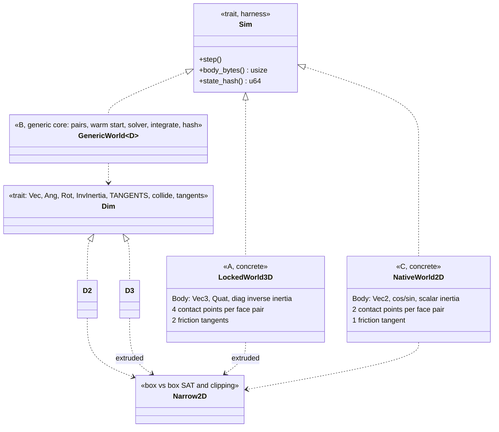
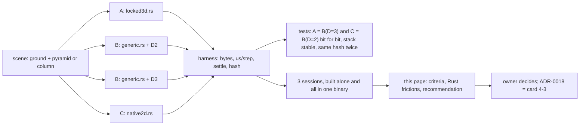

# Physics core spike: locked-axis 3D, dimension-generic core, native 2D `[S]`

Evidence for ADR-0018 (dimensionality of the physics core), card 4-2, run on 2026-11-03. It answers the question the [phase 4 design note](../architecture/physics-and-jobs-v0.md) (O1) and [physics §4](../architecture/physics.md) leave open: is option B (a dimension-generic core, 2D = the `D=2` instance, owner's default, Q20) worth its cost in Rust compared with option A (a 3D world with locked axes) and option C (separate 2D and 3D code)? Nothing is adopted here; the decision and the ADR text are card 4-3, a governance task.

The harness is throw-away code in `engine/tools_physics_spike` (layer 4 by the `tools_*` glob, `publish = false`, no third-party dependency, no `unsafe`, workspace lints respected). It is dev-time only and is not part of the engine.

## 1. Summary

1. **Option A is the wrong default for a 2D-first engine.** Running the same pyramid of 55 boxes, the locked-axis 3D world needs 80 bytes per body against 44, 128 bytes per contact against 88, and about **550 us per step against 60 us (9 times) when each variant is built alone, but against 267 to 289 us for the native 2D code (about 2 times) when the variants share one binary** (a build effect of unknown cause that also hit the hand-written 2D code, section 3.1; the 3D variants measured the same in both). The honest range is 2 to 9 times. Part of that is the extruded face contact (4 points instead of 2); per contact point, built alone, it is still 4.6 times slower (1.41 us against 0.31 us). Bytes and contact counts do not depend on the build. The narrowphase of A in this spike is the 2D one on the projected boxes, so A's real cost with a true 3D box-box manifold would be higher, not lower.
2. **Option B costs 1 to 5% at run time (built alone) and no body size.** The generic core at `D=2` is within 3 to 5% of the hand-written 2D code (61.6 to 63.1 us against 60.0 to 60.1 us, built alone) and stores the same 44 bytes per body; at `D=3` it is within 1 to 4% of the hand-written 3D code and bit-identical in its results (state hash equal after 120 steps, a test). The price is not speed: it is 16 more bytes per contact (fixed tangent slots), a trait with 15 methods, and the Rust frictions of section 5.
3. **The code saved by sharing is real but small at this size.** The shared skeleton (`generic.rs`, 265 lines) is 75% of the 2D instance and 63% of the 3D instance outside the narrowphase; but B (D=2 and D=3, 741 lines with the narrowphase) is only 49 lines (6%) smaller than two native solvers plus the common narrowphase (790 lines). The spike has no broadphase tree, islands, sleeping or colouring, which are the parts [physics §4](physics.md) calls shared, so it understates the saving; it also has no real 3D narrowphase, which is the part that is not shared, so it understates the specialised side as well.
4. **Compile time does not separate the options.** A clean build of the crate takes 0.60 to 0.64 s (release) for any one variant, 0.81 s for all four, 0.52 s for the shared narrowphase alone, with `base` already built. At 250 to 750 lines nothing can be said about a full engine.
5. **All variants settle**, in a pyramid of 55 boxes and a column of 10 boxes after 300 steps (5 s): penetration below 4 mm, drift below 17 mm, pyramid rest speed 0, column creeping at 3.6 to 9.7 mm/s (10 solver iterations are not enough to freeze a 10-box column). The comparison is therefore between stacks that stand.
6. **Recommendation (the owner decides):** keep option B as the default, with a narrow `Dim` trait, and treat option C as the cheap fallback. Do not take A. Section 7.

## 2. What was run

| item | detail |
|---|---|
| Scene | a ground box (100 x 1) and either a **pyramid of 10 rows** (55 boxes, 1 x 1 m, density 1, pitch 1.05 m, boxes exactly touching vertically) or a **column of 10 boxes**; gravity -9.81 m/s^2; friction 0.5 |
| Solver (the same in every variant) | brute-force pair loop in a fixed order; box-box SAT with clipping (own code after the structure of Box2D-Lite); sequential impulses with accumulated impulses, warm starting by pair and point index, velocity bias 0.2/dt with 0.01 m slop; **10 iterations**, fixed step 1/60 s, `f32`, semi-implicit Euler |
| A: locked-axis 3D | concrete types. `Vec3` position and velocities, `Quat`, diagonal inverse inertia in the body frame with the X and Y entries zero (the locked rotation axes), 3D cross products, two friction tangents. The narrowphase is the 2D one on the projection (valid because the only rotation is about Z), and each planar point becomes two points at the ends of the depth: the four points a face contact of two real boxes gives |
| B: generic core | `World<D: Dim>`; `D2` (`Vec2`, scalar angle, `[cos, sin]`, scalar inertia, one tangent) and `D3` (the same 3D types as A, so the locked scene runs on the 3D instance too) |
| C: native 2D | concrete 2D types, the code a separate 2D library would have |
| Timing | wall time (`Instant`) on one Windows 11 dev machine, release build, median of 15 repetitions of the mean time per step over 300 steps after 300 warm-up steps; 3 sessions. **Each variant was also built and run alone** (Cargo features), see section 3 |
| Compile time | `cargo clean -p tools_physics_spike` then `cargo build`, 5 repetitions per cell, `base` already built, wall time |
| Lines | non-blank, non-comment lines outside test modules, counted by a script |
| Tests | 8 unit tests: narrowphase manifold and separation, tangent basis, every variant settles (column of 10, pyramid of 8), same scene twice gives the same state hash, B at D=2 equals C and B at D=3 equals A bit for bit after 120 steps, a dropped box lands and stops |
| Not run | any real 3D narrowphase, broadphase tree, islands, sleeping, colouring, joints, threads, SIMD, Linux, ARM |

## 3. Results

### 3.1 Size and speed (Windows, release)

Pyramid of 10 rows (55 dynamic boxes). Step times are microseconds per step, median of 15 repetitions; the range over the 3 sessions of that median is given. "Alone" means the variant was built into its own binary with the other variants compiled out.

| variant | bytes/body | bytes/contact | contact points | us/step, built alone (3 sessions) | us/step, all in one binary (3 sessions) |
|---|---|---|---|---|---|
| A locked-axis 3D | 80 | 128 | 390 | 549 to 557 | 541 to 553 |
| B generic, D=3 (the same scene) | 80 | 128 | 390 | 556 to 577 | 2594 to 2666 |
| B generic, D=2 | 44 | 104 | 195 | 61.6 to 63.1 | 291 to 319 |
| C native 2D | 44 | 88 | 195 | 60.0 to 60.1 | 267 to 289 |

Derived (built alone): A against C 9.1 times; per contact point A 1.41 us, C 0.31 us (4.6 times); B(D=3) against A 1.013 to 1.036 times over the three sessions; B(D=2) against C 1.03 to 1.05 times. In the all-in-one binary: A against C 1.9 to 2.1 times, and C against its own built-alone time 4.5 to 4.8 times. Individual repetitions are noisy upward (maximum of a session up to 3.9 ms for the 3D variants, from other load on the machine); the minimum and the median agree to a few percent in the built-alone runs.

**The all-in-one numbers are not trustworthy and are reported only as a warning.** With all four variants in one binary, B(D=2), C and B(D=3) run 4.5 to 5.2 times slower than built alone, while A is unchanged, in all three sessions. The hand-written C is affected as much as the generic B, so this is not an effect of generics. The arithmetic is identical (the state hashes are bit-equal), so it is a code-generation or layout effect of the build; the cause was not found. Single exploratory runs whose outputs were not kept as files: `codegen-units=1` (B(D=3) 1219 us), `#[inline(always)]` on `math3` (1105 us), `#[inline(never)]` on the solver phases (1145 us) and `#[inline(always)]` on the impulse helpers (1508 us) did not remove it for B(D=3); timers around the phases made it disappear (which also hides it); marking the shared narrowphase `collide` `#[inline(never)]` in the alone builds changed nothing (C 59.5 us, B(D=2) 61.3 us). The practical consequence: a hot loop has to be benchmarked in the binary it ships in, and a comparison must not rest on one binary that contains all candidates. Because the cause is unknown, 9 times is the built-alone figure and 2 times the all-in-one figure; neither is proven to be the true one.

Column of 10 boxes (10 dynamic bodies): built alone, C 5.9 to 6.2 us, B(D=2) 6.0 to 6.4 us; A 244 to 302 us and B(D=3) 246 to 261 us. The 3D columns are far slower per contact point (about 6 us) than the 3D pyramid (1.4 us) for a reason not found (no subnormal numbers were present in the stored body state of A when checked, but intermediate values were not inspected and flush-to-zero was not tried). In one exploratory build (A alone, with `collide` marked `#[inline(never)]`) the same column ran in 56 us, so the 3D column time varies by 4 to 5 times between builds of identical arithmetic. This column timing is not used for any conclusion.

### 3.2 Does the stack settle (the fairness check)

State after 300 steps (5 s), identical in every session (the simulation is deterministic).

| scene | variant | contact points | max penetration | max speed | max spin | max drift from start |
|---|---|---|---|---|---|---|
| pyramid | A and B(D=3) | 390 | 3.2 mm | 0 | 0 | 6.1 mm |
| pyramid | B(D=2) and C | 195 | 2.6 mm | 0 | 0 | 6.7 mm |
| column | A and B(D=3) | 40 | 2.6 mm | 9.7 mm/s | 1.4 mrad/s | 14.3 mm |
| column | B(D=2) and C | 20 | 3.6 mm | 3.6 mm/s | 0.5 mrad/s | 16.6 mm |

A equals B(D=3) and C equals B(D=2) to the last digit, as the bit-equality tests say. The 2D and 3D pairs differ slightly because the 3D face contact has twice as many points; both stand. The unit tests require penetration below 5 cm, speed below 5 cm/s and drift below 10 cm after 300 steps and pass in every variant.

### 3.3 Code

Lines outside test modules.

| part | lines | used by |
|---|---|---|
| `narrow2d.rs` (box-box SAT and clipping) | 230 | all (the 3D variants through the extrusion) |
| `native2d.rs` (C: world, solver) | 242 | C |
| `locked3d.rs` (A: world, solver) | 249 | A |
| `math3.rs` (quaternion step, inertia product, friction basis, extrusion) | 69 | A, B(D=3) |
| `generic.rs` (B: `Dim`, body, contact, world, solver) | 265 | B |
| `dims.rs` (`D2`) | 90 | B(D=2) |
| `dims3.rs` (`D3`) | 87 | B(D=3) |

| layout | total including the narrowphase |
|---|---|
| C for 2D plus A as the 3D code (option C of physics §4: two libraries) | 242 + 249 + 69 + 230 = **790** |
| B with `D2` and `D3` | 265 + 90 + 87 + 69 + 230 = **741** (6% less) |
| B with `D2` only | 265 + 90 + 230 = 585 |
| A alone (everything in 3D) | 249 + 69 + 230 = 548 |
| C for 2D only | 242 + 230 = 472 (B with `D2` only is 113 lines, 24%, larger: the price of the trait when 3D is not yet needed) |

Shared fraction of the dimension-specific code, without the narrowphase: the generic core is 75% of the 2D instance (265 of 355) and 63% of the 3D instance (265 of 421). `native2d.rs` and `locked3d.rs` are two copies of one algorithm (the same functions in the same order, 242 and 249 lines); that duplication is what the generic core removes, at the price of the 177 lines of `dims.rs` and `dims3.rs` and the trait declaration. The crossover is near here; a real engine adds shared parts (tree, islands, colouring, sleeping, events) that grow the shared side, and adds real 3D manifold code that is specialised either way.

### 3.4 Compile time

Clean build of `tools_physics_spike` only, `base` already built, wall seconds, median of 5.

| profile | narrowphase only | A | B(D=2) | B(D=3) | C | all four |
|---|---|---|---|---|---|---|
| dev | 0.54 | 0.70 | 0.73 | 0.73 | 0.72 | 0.92 |
| release | 0.52 | 0.61 | 0.60 | 0.64 | 0.60 | 0.81 |

## 4. Criteria from the design note

The design note and physics §4 name what to measure and give no thresholds; the verdicts below are this page's reading.

| criterion | A: locked-axis 3D | B: generic core | C: separate 2D (and 3D) |
|---|---|---|---|
| Bytes per body (2D scene) | 80 (1.8 times the 2D body) | 44 at `D=2`, 80 at `D=3` | 44 |
| Bytes per contact | 128 | 104 at `D=2` (16 more than C: two tangent slots), 128 at `D=3` | 88 |
| Step time, pyramid (built alone) | about 550 us | 61.6 to 63.1 us at `D=2` (+3 to 5% over C), 556 to 577 us at `D=3` | 60 us |
| Code shared 2D/3D | all of it, by construction | 265 lines of core, 63% to 75% of the dimension-specific code | none beyond the narrowphase here |
| Total lines | 548 | 741 (both instances) | 790 (both) |
| Compile time | 0.61 s | 0.60 to 0.64 s | 0.60 s |
| Rust feasibility | trivial | works, with four frictions (section 5) | trivial |
| Stack settles | yes | yes | yes |
| Rule "specialise rather than branch on D" (physics §4) | not applicable | held: no `if D == 2` anywhere; everything that differs sits behind a `Dim` method | held |

## 5. Rust feasibility of option B (review-v0.10 B14), with evidence

Everything below was met while writing the harness; items 1, 2 and 3 were reproduced on `rustc 1.94.1` in four one-file tests (item 1 twice: associated constant and const-generic arithmetic). Items 4 to 6 are observations, not reproductions.

1. **An associated constant cannot size an array.** `struct Contact<D: Dim> { jt: [f32; D::TANGENTS] }` fails with "generic parameters may not be used in const operations". The harness reserves `MAX_TANGENTS = 2` slots in every contact and loops `0..D::TANGENTS`; the 2D instance pays 16 bytes per contact (104 against 88) and the warm-start cache entries are larger. The same limit applies to const-generic arithmetic: `[f32; N * (N + 1) / 2]` (a symmetric tensor) fails with the same error, so a design based on `const D: usize` cannot size its storage.
2. **There is no specialisation.** A `Vec<const N: usize>` with a generic `cross` and a second `impl Vec<3>` with a 3D `cross` fails with "duplicate definitions with name `cross`" (E0592), so a number-based design cannot give shared code a default that 3D overrides. Together with item 1 (storage cannot be sized from `N`), the straightforward design is a trait with associated types (`Vec`, `Ang`, `Rot`, `InvInertia`) and methods (`torque`, `spin_velocity`, `apply_inverse_inertia`), not a number. That is what `Dim` is: 15 methods and 4 associated types, of which `D2` takes 90 lines and `D3` 87.
3. **`#[derive(Clone, Copy)]` on a struct with associated-type fields adds the bound `D: Copy`.** `Body<D>` could not be copied from a slice until `Clone` and `Copy` were written by hand (`impl<D: Dim> Copy for Body<D> {}`); the same applies to every generic data struct. Reproduced: E0507, "`Body<D>` does not implement `Copy`".
4. **Generic arithmetic is written through operator bounds.** `D::Vec` needs `Add + Sub + Neg + Mul<f32>`, and `f32 * D::Vec` needs a `where f32: Mul<D::Vec, Output = D::Vec>` clause repeated on each generic function (legal, not tried), so the code reads `v * s`; every call into the dimension is `D::something(...)`, which makes the solver harder to read than the concrete version (265 against 242 lines). This is a readability cost, not a compile error.
5. **Run-time cost is small, code generation is fragile.** Built alone, B is within 1 to 5% of the concrete code; in one binary with the other variants B and C were both 4.5 to 5.2 times slower for a reason not found (section 3.1). Monomorphisation gave the same results bit for bit.
6. **Compile time:** no measurable cost at this size (section 3.4). A full engine would instantiate `World<D2>` and `World<D3>` and double the compiled solver; that is also what option C does with two crates.

The ergonomics are acceptable, not pleasant: the trait is the cost. A narrower trait (vector and angular operations, narrowphase, body construction) with the world code generic is workable; pushing more into `Dim` (shapes, joints) would turn the generic part into a thin wrapper and is the "over-engineering" the rule in physics §4 warns about.

## 6. Method and what makes the comparison fair

- One algorithm, one set of constants, one narrowphase; the variants differ only in the types and in the 3D contact count. A and B(D=3) and C and B(D=2) are bit-identical pairs (tests), so any timing difference inside a pair is code generation, not different work.
- A's narrowphase is a **lower bound** on the cost of a locked-axis 3D engine: a real one tests 15 axes and builds face and edge manifolds. This favours A, and A is still 9 times slower built alone (about 2 times in the all-in-one binary, section 3.1).
- A is given a fair 3D solver (general quaternion rotation of the inertia, two tangents, four points), not a deliberately slow one; lock handling is a zero in the inverse inertia, as an allowed-DOF mask does in a real engine. The linear Z velocity is not masked; it stays zero because no impulse has a Z component.
- Each variant was timed built alone because the all-in-one binary changed B and C by 4.5 to 5.2 times. The weak spot is the timing itself: identical arithmetic ran that much slower in one build than in another, so ratios are only as good as the build they come from.
- Pair rejection uses the bounding radius `half.length()`; in the 3D variants it includes the depth (reach 0.87 against 0.71 in 2D), so A and B(D=3) pass slightly more pairs to the narrowphase. A and B collect contact points in a reused `Vec`, C returns a fixed array; B(D=2) and C are within 3 to 5%, so this is small. A and B(D=3) use a diagonal inertia in the body frame, not a general 3x3 tensor.
- The scene is small (55 bodies) and the pair loop is brute force, so absolute numbers say nothing about a full engine; the ratios say how the layouts compare on identical work.

## 7. Recommendation for the owner

| option | when it is the better choice |
|---|---|
| **B, generic core with a narrow `Dim` trait (recommended, keeps the default of Q20)** | the engine will have both 2D and 3D physics (owner: both). Measured: no body-size penalty and 1 to 5% step time (built alone) against hand-written code, 63% to 75% of the dimension-specific solver code shared, bit-identical results across the instances (true here only because both instances run the same extruded narrowphase). Costs: the trait (about 180 lines of per-dimension glue at this size), 16 bytes per contact unless the tangent slots are made smaller, and the Rust frictions of section 5 |
| C, two libraries (fallback) | the generic core grows `if`-like branches or the `Dim` trait passes about 30 methods; or phase 8 shows that 3D needs a different solver structure. Cost: the 242-line solver is written twice (790 lines against 741 here) |
| A, locked-axis 3D | only if the engine were 3D-only and 2D a convenience. Measured: 2 to 9 times the step time (build dependent, section 3.1) and 1.8 times the body size for the 2D scene, and it forces a robust 3D narrowphase before phase 4 can show a stack, which is what "2D first" is meant to avoid |

Points for card 4-3 (the ADR, a governance task that needs the owner's declaration):

- Keep the layout of one `physics` crate with modules `core`, `d2`, `d3` ([design note, section 1](../architecture/physics-and-jobs-v0.md)): compile time gives no reason to split, so no governance edit to the layer table is needed.
- Keep `Dim` narrow, and make the number of friction tangents and contact points part of the instance, not a fixed array in the shared contact (or accept the 16 bytes).
- Benchmark each instantiation in its real binary (section 3.1) and make that a criterion of the physics benchmark card, not only the 2D one.
- The dimension-consistency test of physics §4 (a planar scene in `D=3` against `D=2`) is already shown here for a stacking scene to be bit-equal only because the two paths are the same code with a deliberate extrusion; with a real 3D narrowphase it must be a tolerance test on short scenes, as physics §4 says.
- The soft-step solver (ADR-0012, O2 of the design note) was not tried; this spike used sequential impulses with warm starting. The layout question does not depend on it, but the iteration cost does.

## 8. Not verified

- Only one machine, one operating system (Windows), three sessions; no Linux, no ARM. Wall time includes whatever else the machine was doing; maxima of single repetitions up to 3.9 ms show that.
- The all-in-one slowdown of B and C (4.5 to 5.2 times) is unexplained and the exploratory runs behind section 3.1 were not kept as files; so is the high cost per contact of the 3D column. No absolute or ratio figure here is more reliable than that build-to-build variation.
- No real 3D box-box narrowphase, no tree broadphase, no islands, sleeping, colouring, joints, shapes other than boxes, no threads and no SIMD: the saving from sharing in a full engine and the SIMD fit of a 44-byte body against an 80-byte body (the reason Box2D v3 keeps body state small) are not measured.
- Soft-step or sub-stepping solver not tried; the stability result is for sequential impulses with 10 iterations and a 55-box pyramid. Taller stacks, high mass ratios and chains were not run.
- Compile time of a full engine is not predicted by a 750-line crate; the figures exclude `base`.
- Line counts are a script count of non-blank, non-comment lines; the "shared" percentages are of those counts, not a semantic measure.
- Coverage and mutation testing are not meaningful for throw-away harness code and were not run; the sanity tests above are the only tests.
