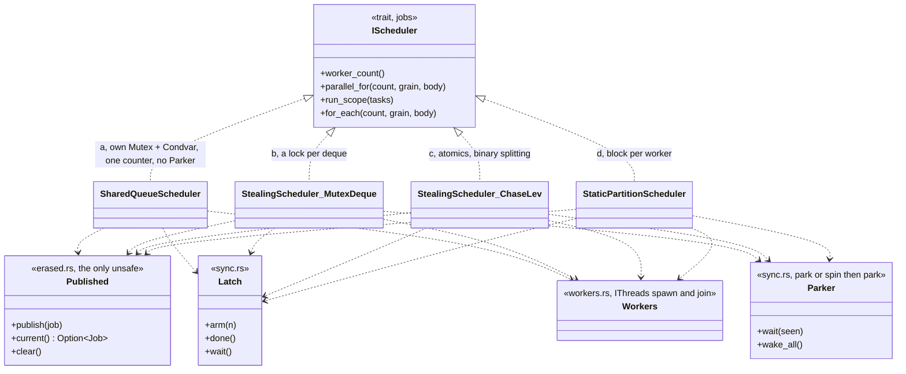
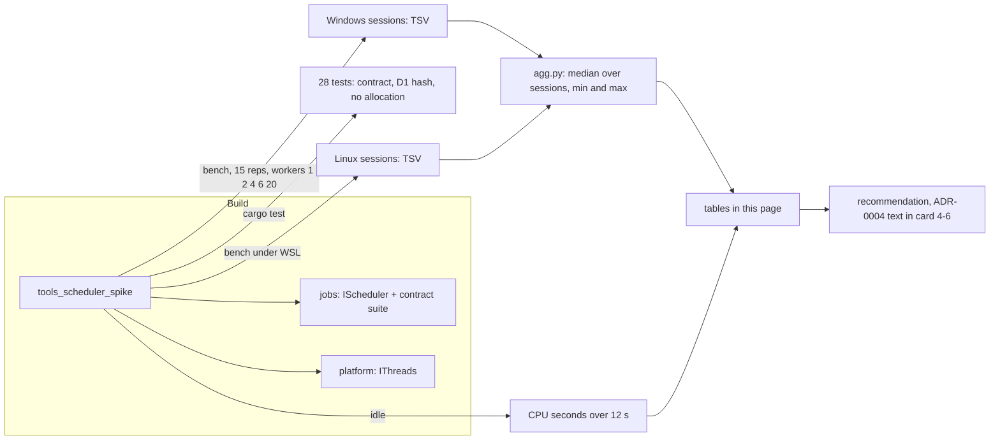

# Scheduler spike: four std-only work distribution candidates behind `IScheduler` `[S]`

Status: card 4-5, evidence for ADR-0004 (the ADR text is card 4-6). Class 2 (concurrency, `unsafe`). Throw-away harness `engine/tools_scheduler_spike` (layer 4 tool, `publish = false`, `std` only, no third-party dependency). Design note: [physics-and-jobs-v0](../architecture/physics-and-jobs-v0.md) section 4. Review: `reviews/4-5.md`.

## 1. Summary

Four schedulers were built from `std` only, each implementing the `IScheduler` port of the `jobs` crate (card 4-4) and each passing the existing contract suite (`scheduler_contract`, `order_independence_contract`) at 1, 2, 3, 4 and 7 workers: (a) one shared queue with `Mutex` and `Condvar`; (b) per-worker mutex-protected stealing deques; (c) per-worker lock-free Chase-Lev deques; (d) a static partition. Threads come from the platform `IThreads` seam (O5), so the Null platform refuses a pool and the seam is exercised. Four synthetic workloads (tiny jobs, balanced, imbalanced, sequential fork-joins) were run at 1, 2, 4, 6 and 20 (machine) workers, on Windows (6 sessions parking, 3 spinning) and on Linux under WSL (3 sessions parking, 1 spinning).

What the evidence says, on one machine and synthetic work:

- **D1 holds for all four.** The output hash was identical across candidates, worker counts, runs and both operating systems' sessions (0 cells with a different hash, 0 bad runs in every session). Chunk results are pure functions of the index range, as the design note requires.
- **Join latency separates the candidates in park mode; throughput on balanced work does not.** On balanced medium jobs (a), (b) and (c) are within 4% of each other up to 6 workers (static partition 4 to 9% behind). On the sequential fork-join loop (a physics step is exactly this) the lock-free deques (c) have the lowest latency in park mode from 4 workers up; Linux, 24 trivial items per call, 4 workers: (a) 15.9 us, (b) 5.4 us, (c) 1.9 us, (d) 22.9 us per call. **A large part of that is the wait policy, not the deque**: workers of (b) and (c) scan for work for about 128 steps (64 spins then 64 yields) after each call before they park, which (a) and (d) do not do. With that scan removed (section 3.4a), (b) and (c) fall to the level of (a) on Linux: 16.4 and 15.7 us per call at 4 workers. With a spin budget given to (d), it is ahead of (c) on Linux at 4 workers (1.3 us against 2.1 us on w4a).
- **Tiny jobs need a grain.** One index per job (grain 1) costs 12 to 29 ns per index with a single worker for (a), (b) and (c) on Linux (inline: 3.9 ns), 57 to 96 ns for (a) with 2 or more workers and 20 to 87 ns for (b); (c) falls to 3.2 ns per index at 6 workers. (a) takes one item per lock round trip and never batches a claim, which is a handicap of the textbook form. With a grain of 64 indices all candidates are within 1 to 3 ns per index of inline; parallelism helps (b) and (c) at every worker count, (a) and (d) up to 6 workers, and not at 20.
- **Static partition is the fastest dispatch at 1 and 2 workers and the worst under imbalance** (2.6 to 4 times slower than (a) on workload 3 at 4 or more workers) and, with a spinning wait, collapses when the worker count exceeds the free cores.
- **A fork-join that carries only microseconds of work does not pay.** Linux, 24 trivial items (about 1.4 us of work): inline 58 ns per call is below every candidate at every worker count (best parallel: (c) 1.1 us at 2 workers). On a dependent-phase loop of 7.7 us per phase, in park mode (c) is the only candidate that gains at 4 or more workers (1.9 times at 4); (d) gains 1.8 times at 2 workers in park mode and 2.3 times at 4 with a spin budget on Linux.

**Recommendation (for the owner, section 8): candidate (c), lock-free per-worker deques with stealing, with an explicit bounded spin-then-park wait (the post-call scan that the measurement depended on, made a stated policy) and with the physics step batched so each fork-join carries well over 10 us of work (a rule of thumb, no break-even was measured).** The ADR text is card 4-6. The `unsafe` cost of (c) is the same one line of lifetime erasure that every candidate needs; the lock-free deque itself is safe code on `AtomicU64` slots.

## 2. What was run

| item | detail |
|---|---|
| Candidates | (a) `SharedQueueScheduler`: a `Mutex` around the next chunk counter, a `Condvar` for idle workers. (b) `StealingScheduler<MutexDeque>`: per-worker deque in a `Mutex`, owner pushes and pops at the back, thieves take the front. (c) `StealingScheduler<ChaseLevDeque>`: the Le et al. C11 formulation over 64 `AtomicU64` slots, no lock. (d) `StaticPartitionScheduler`: worker `k` runs block `k` of equal size, no stealing. A fifth kind, the inline scheduler of card 4-4, is the 1-thread baseline |
| How (b) and (c) split | lazy binary splitting: a range is packed into one `u64`; a worker that holds a range larger than the grain pushes the upper half on its own deque and keeps the lower half; thieves steal the oldest (largest) range. Every push is by the deque's owner, which is what Chase-Lev requires, and the depth is at most about 33 so the capacity of 64 never limits the chunk count |
| Same for all | the calling thread works too (so N workers means N-1 spawned threads plus the caller); a `Latch` counts items done and gives the join its happens-before edge; the borrowed closure is published to the workers as a raw pointer to the stack-held job, dereferenced only while a worker holds an item not yet counted done, and the call returns only when the latch is zero; zero allocation after construction, checked by a counting allocator on the calling thread |
| Waiting | park (default): idle workers sleep on a `Condvar` with a generation counter. Spin: `--spin 20000` spins up to 20000 iterations before parking. The caller waits a short spin (2000 iterations) then parks |
| Threads | through `platform::threads::IThreads` (`StdThreads` for the runs, `NullThreads` in a test that expects a pool of 2 to fail and a pool of 1 to work). Gaps found: no affinity, no priority, no stack size control |
| Workloads | w1 `tiny`: 65536 indices of 4 `burn` iterations (about 4 ns), grain 1, 8 calls per run; w1b the same at grain 64; w2 `balanced`: 2048 indices of 6000 iterations (about 6 us), grain 1; w3 `imbalanced`: 256 indices, the first 8 cost 400000 iterations, the rest 8000, grain 1; w4a `dispatch`: 2000 calls of `for_each` over 24 trivial items, grain 1 (join latency); w4b `phases`: 100 dependent phases of 512 indices, grain 8, each phase reads the previous one's output |
| Unit in the tables | nanoseconds per index (w1, w1b, w2, w3), per call (w4a), per phase (w4b). Lower is better. The cell is the median over repetitions of one session; the table shows the median over sessions and, in brackets, the lowest and highest session median |
| Timing | wall time (`Instant`) on one machine with 20 logical cores, release build, 15 repetitions after 2 warm-up runs per cell. Windows 11: 6 park sessions and 3 spin sessions. Linux: Ubuntu under WSL2 on the same machine, 3 park sessions, 1 spin session. Sessions are separate process runs |
| D1 check | every run digests the output slots with FNV-1a; each cell compares the hash of every run with the first one, and the report prints the number of cells whose hash differs from the inline reference. Result: 0 in every session |
| Idle CPU | process CPU time over a 12 s window in which the pool is idle after one warm-up call, 6 workers (Windows only, resolution about 16 ms) |
| Tests | 15 unit tests (deque semantics, exactly-once under 3 thieves, packing, latch and parker, work tiling, a chunk size does not change a result) and 13 integration tests (the contract suites for every candidate at 1, 2, 3, 4 and 7 workers and in spin mode, order independence against the inline scheduler, workload hashes equal across candidates, a nested call returns `Busy`, `NullThreads`, zero allocations on the calling thread). 90 repeated runs of the test binaries on Windows and one full run on Linux, all green. Red evidence: with `block_bounds` deliberately broken so the static partition covered too few items, 5 contract tests failed; restored afterwards |
| Not run | ThreadSanitizer, Miri, any real physics work, any other machine, ARM |

## 3. Results

All numbers are wall time on one 20-logical-core machine and are in ns (per index, call or phase as stated). **The Windows numbers are noisy**: the inline baseline of the same workload moved by up to 2.3 times between sessions (w4a; w2 by 1.5 times, 16.5 to 25.5 us per index across Windows sessions, against a steady 7.75 us on Linux), so treat small Windows differences as noise. Linux sessions were steadier and are used for the comparisons below; Windows is given for completeness and agrees on the orderings of the findings except these: on tiny jobs (c) is 12 ns per index at 4 workers on Windows against 3.5 ns inline, not at inline level; on imbalance (c) is slower than (b) at 4 workers on Windows; the ablation of section 3.4a has no clear direction there.

### 3.1 Linux (WSL), park, 3 sessions

Median over sessions, session range in brackets, workers across.

| w1 tiny, ns per index | 1 | 2 | 4 | 6 | 20 |
|---|---|---|---|---|---|
| inline | 3.9 | | | | |
| a shared queue | 12.8 | 56.6 | 92.6 | 95.9 | 94.9 |
| b mutex deques | 29.0 | 87.4 | 58.9 | 39.2 | 20.1 |
| c lock-free | 12.2 | 7.8 [7-22] | 3.8 [4-16] | 3.2 [3-11] | 3.6 [3-7] |
| d static | 4.2 | 2.2 | 1.6 | 1.4 | 2.7 |

| w1b tiny, grain 64, ns per index | 1 | 2 | 4 | 6 | 20 |
|---|---|---|---|---|---|
| inline | 2.4 | | | | |
| a | 2.3 | 1.6 | 1.6 | 2.2 | 3.3 |
| b | 2.7 | 1.7 | 1.2 | 1.0 | 2.5 |
| c | 2.6 | 1.4 | 1.0 | 0.7 | 0.6 |
| d | 2.4 | 1.3 | 1.1 | 1.1 | 2.6 |

| w2 balanced, ns per index | 1 | 2 | 4 | 6 | 20 |
|---|---|---|---|---|---|
| inline | 7753 | | | | |
| a | 7788 | 4032 | 2155 | 1537 | 750 |
| b | 7860 | 3969 | 2118 | 1490 | 729 |
| c | 7788 | 3943 | 2095 | 1481 | 729 |
| d | 7824 | 3946 | 2174 | 1612 | 974 [973-1539] |

| w3 imbalanced, ns per index | 1 | 2 | 4 | 6 | 20 |
|---|---|---|---|---|---|
| inline | 26485 | | | | |
| a | 26208 | 13518 | 7379 | 5322 | 4617 |
| b | 26440 | 14400 | 8491 | 6956 | 6213 |
| c | 26424 | 14618 | 8116 | 7042 | 5705 |
| d | 27305 | 21274 | 18986 | 18420 | 18567 |

| w4a dispatch (join latency), ns per call of 24 trivial items | 1 | 2 | 4 | 6 | 20 |
|---|---|---|---|---|---|
| inline | 58 | | | | |
| a | 413 | 1308 | 15867 | 32512 | 144962 |
| b | 877 | 2498 | 5431 | 8623 | 45873 |
| c | 526 | 1099 | 1919 | 2827 | 5223 |
| d | 71 | 384 | 22930 | 39518 | 154012 |

| w4b phases, ns per phase (512 indices, grain 8) | 1 | 2 | 4 | 6 | 20 |
|---|---|---|---|---|---|
| inline | 7683 | | | | |
| a | 8139 | 6064 | 16393 | 32424 | 144662 |
| b | 9212 | 6974 | 8189 | 12130 | 65243 |
| c | 8493 | 4843 | 3971 | 4323 | 7312 |
| d | 7223 | 4324 | 25648 | 41020 | 153135 |

Speedup over inline on w2 (balanced) from the table: (c) 1.97 times at 2 workers, 3.70 at 4 (93% efficiency), 5.23 at 6 (87%), 10.6 at 20 (53% of 20 logical cores; the machine has fewer physical cores, so this is not a clean efficiency). (a) and (b) are within 4% of (c) up to 6 workers, (d) 4 to 9% behind.

### 3.2 Windows 11, park, 6 sessions

Selected cells (full tables are in the raw TSV files, which are not committed; the harness reproduces them). Same units.

| cell | workers | a | b | c | d | inline |
|---|---|---|---|---|---|---|
| w1 tiny | 4 | 115 | 114 | 12.0 | 6.1 | 3.5 |
| w1b grain 64 | 4 | 4.0 | 3.6 | 2.5 | 4.1 | 6.3 |
| w2 balanced | 4 | 5753 | 5509 | 5900 | 9019 | 18602 |
| w2 balanced | 6 | 3805 | 3872 | 3784 | 5983 | |
| w3 imbalanced | 4 | 21794 | 23718 | 26177 | 47616 | 69617 |
| w4a dispatch | 4 | 7537 | 9585 | 3094 | 11890 | 298 |
| w4a dispatch | 6 | 9293 | 14711 | 3816 | 20406 | |
| w4a dispatch | 20 | 65771 | 18570 | 4134 | 67065 | |
| w4b phases | 4 | 18158 | 20150 | 11164 | 23330 | 18690 |
| w4b phases | 6 | 28779 | 22614 | 11598 | 31705 | |

### 3.3 Waiting: park against spin

Windows, 3 spin sessions (20000 iterations before parking), same cells.

| cell | a | b | c | d |
|---|---|---|---|---|
| w4a dispatch, 4 workers (park) | 7537 | 9585 | 3094 | 11890 |
| w4a dispatch, 4 workers (spin) | 7747 | 10989 | 2820 | 3075 |
| w4a dispatch, 6 workers (spin) | 8964 | 14827 | 3582 | 6036 |
| w4a dispatch, 20 workers (spin) | 65538 | 19070 | 3844 | **1572138** |
| w4b phases, 4 workers (spin) | 17316 | 20614 | 9777 | 13380 |
| w4b phases, 20 workers (spin) | 53279 | 31632 | 10485 | **1720031** |

Spinning cuts the join latency of (d) at 4 workers from 11.9 us to 3.1 us, and at 20 workers (more spinners than free cores) it costs 1.5 ms per call on Windows, 23 times its own park value (67 us) and 511 times its spin value at 4 workers. (c) is nearly unchanged by spinning on Windows, which is what its built-in post-call scan predicts (section 3.4a). Linux, one spin session, shows the same pattern for (d): 1.3 us at 4 workers, 2.9 us at 6, 429 us at 20 workers (2.8 times its park value of 154 us). On Linux with spin, (d) is faster than (c) at 4 workers on both w4a (1276 against 2121 ns) and w4b (3311 against 4336 ns), so the park-mode advantage of (c) is not a property of the deques alone. This is one session on each OS; the direction is clear and the exact values are not.

Idle CPU (Windows, 6 workers, 12 s window, pool idle): 0.000 to 0.047 CPU seconds for (a), (b), (c) and (d) parked, that is a fraction of one core's time, within the 16 ms resolution of the process timer; (c) with `--spin 20000` also 0 to 0.031 s, because the spin is bounded and the workers park after it. A pool that never parks was not built, so the idle cost of an unbounded spin is not measured.

### 3.4a Ablation: the post-call scan of (b) and (c) (park, 3 sessions each)

Workers of (b) and (c) do not park the moment a call has no work left: they scan the other deques for up to 128 steps (64 spins, then 64 `yield_now`) and only then wait on the `Parker`. (a) and (d) park at once. The table is the same harness with that scan set to 0 for (b) and (c); only w4a and w4b were run (ns per call or phase).

| cell | workers | b with scan | b no scan | c with scan | c no scan |
|---|---|---|---|---|---|
| Linux w4a | 4 | 5431 | 16379 | 1919 | 15684 |
| Linux w4a | 6 | 8623 | 33048 | 2827 | 31544 |
| Linux w4b | 4 | 8189 | 29270 | 3971 | 27969 |
| Linux w4b | 6 | 12130 | 45140 | 4323 | 44116 |
| Windows w4a | 4 | 9585 | 3317 | 3094 | 1754 |
| Windows w4a | 6 | 14711 | 5921 | 3816 | 10406 [3191-41471] |
| Windows w4b | 4 | 20150 | 16296 | 11164 | 28199 [6931-32178] |

On Linux the scan is the whole effect: without it (b) and (c) are as slow as (a) (15.9 us at 4 workers) and the lock-free deque gives no join-latency advantage. On Windows the ablation is noisy (session ranges of 3 to 13 times) and shows no clear direction, so no claim is made from it. The scan is a bounded spin-then-yield wait; the recommendation relies on it and therefore states it as a policy. The reverse ablation (the same scan given to (a) and (d)) was not run.

### 3.4 Code

| candidate | file | lines (non-blank, non-comment, outside tests, approx.) | `unsafe` |
|---|---|---|---|
| shared | `erased.rs`, `job.rs`, `sync.rs`, `workers.rs` | common to all | 1 `unsafe fn`, 4 `unsafe` blocks in total in the crate (1 in `erased.rs`, 1 each at the three `current()` call sites), all with `// SAFETY:` |
| a | `shared_queue.rs` | smallest | none beyond the shared one |
| b, c | `stealing.rs`, `deques.rs` | one scheduler generic over `Deque` | none beyond the shared one; the Chase-Lev deque is safe code |
| d | `static_partition.rs` | small | none beyond the shared one |

The crate is 1879 lines in `src/` (unit tests and the harness `main` included) and 173 more in `tests/contract.rs`.

## 4. Criteria from the design note

The design note names what to measure and gives no thresholds ([physics-and-jobs-v0](../architecture/physics-and-jobs-v0.md) section 4, O3, O10); the readings below are this page's.

| criterion | a shared queue | b mutex deques | c lock-free deques | d static partition |
|---|---|---|---|---|
| Balanced medium jobs, scaling to 6 workers (Linux) | 84% at 6 | 88% at 6 | 88% at 6 | 81% at 6 |
| Imbalanced jobs | best at 4 to 20 workers on Linux | 15 to 35% slower than a | 10 to 32% slower than a | 2.6 to 4 times slower than a: no rebalancing |
| Many tiny jobs (grain 1) | 15 to 25 times slower than inline at 2+ workers | 5 to 22 times slower | at inline level from 4 workers | fastest, but only because the block split costs nothing |
| Join latency, 4 workers, park (b and c include the post-call scan, section 3.4a) | 15.9 us | 5.4 us | 1.9 us | 22.9 us |
| Same, spin 20000 (Linux, 1 session) | 16.2 us | 5.0 us | 2.1 us | 1.3 us |
| Same, without the scan (Linux) | 15.9 us | 16.4 us | 15.7 us | 22.9 us |
| Sequential dependent fork-joins per phase, 4 workers (inline 7.7 us) | 16.4 us, slower than inline | 8.2 us, slower | 4.0 us, 1.9 times faster | 25.6 us, slower |
| D1 (output hash) | equal | equal | equal | equal |
| Idle CPU (parked) | about 0 | about 0 | about 0 | about 0 |
| Behaviour when workers exceed free cores with spin | n/a (parks) | n/a | bounded spin, fine | collapses (1.5 ms per call) |
| `unsafe` beyond the shared erasure | none | none | none | none |
| Complexity | lowest | low | medium (a deque with memory orderings to review) | lowest |

The efficiency in the first row is the speedup over the single-worker run of the same candidate divided by the worker count, taken from the w2 table (for example (c): 7788 / 1481 / 6 = 87.6%; the Linux column header says 6 workers, so 6 threads on 20 logical cores).

## 5. Findings

1. **The shared erasure is the only `unsafe` any candidate needs.** Lock-free is possible in safe Rust here because the deque slots are `AtomicU64` (a packed range, not a pointer to a closure). The cost is that the job closure itself is erased once, in `erased.rs`, under a three-point protocol (the caller publishes and arms the latch; a thread dereferences only while holding an item not yet counted done; the caller returns only after the latch reaches zero). The design note's estimate of "`unsafe` for lifetime erasure plus the lock-free deque" (section 8) was too high: only the first is needed.
2. **Binary splitting removes the seeding problem.** Chase-Lev allows only the owner to push. Seeding all chunks from the caller would have forced a handshake; splitting the range puts every push on the owner's own deque and gives thieves the largest ranges first. The splitting is eager (a range is always split down to the grain, each upper half pushed), which is why one-index jobs cost a push and a pop each.
3. **A late worker is harmless by construction.** A worker that wakes after the call has finished finds no item to hold, so it never reads the published pointer. The tests exercise this only incidentally (calls of 1 item, 7 workers); nothing forces a late wake. **Soundness depends on abort-on-panic**: `panic = abort` is set in the workspace profiles but `cargo test` unwinds, and a panic in the caller's own item would leave workers holding a dangling pointer, while a panic in a worker would hang the caller in the latch.
4. **The first run of the harness was unfair to (b) and (c)** and was discarded: the calling thread, after finishing its own share, spent time in the idle scan loop, which inflated the dispatch latency of exactly the two stealing candidates. The caller now has patience 0 (it goes straight to the latch), workers keep the scan loop (64 spins then 64 yields). **The scan is also an advantage of (b) and (c) over (a) and (d) in park mode**, found in the independent review and measured in section 3.4a: it is a bounded spin-then-yield wait that (a) and (d) were not given, so the park-mode tables compare wait policies as much as data structures. All numbers on this page are from the fixed harness.
5. **Per-job overhead decides tiny jobs, and grain removes it.** At grain 1 the shared queue (a) pays a lock round trip per index (13 ns single worker, 95 ns at 6 workers because the lock bounces between cores); (c) pays about 12 ns single worker on Linux. At grain 64 every candidate is within about 1 ns per index of inline and parallel runs scale. The physics should pick the grain by the cost of an item, not leave it at 1.
6. **Join latency of (a) and (d) grows with the worker count; the cause was not isolated.** In the shared queue it is 15.9 us at 4, 32.5 us at 6, 145 us at 20 on Linux. Plausible causes, none tested: every woken worker takes the one queue mutex that the caller uses for each claim (contention), and the cost of waking sleeping threads. In (d) the caller waits for every worker, so one slow wake delays the join. (c) wakes the same workers, but its workers are mostly not asleep (the scan, section 3.4a) and the caller does not wait for a worker that holds no item.
7. **Static partition fails exactly where the design note says it would**: imbalanced work (all 8 heavy items fall into block 0), and it needs a spin to be competitive on short jobs, which then collapses when oversubscribed. With a spin budget and enough free cores it matched or beat (c) on short dependent phases (Linux, 4 workers), so it is a reference, not a strawman.
8. **Short fork-joins do not pay.** A call whose items together take about 1.4 us (w4a) is faster inline (58 ns) than on any pool, because waking a thread costs more than the work. A 7.7 us phase (w4b) gains 1.9 times at 4 workers with (c) only. The physics design must therefore batch: one `parallel_for` per colour or per phase over many constraints, never one per body. The break-even work per fork-join was not measured; the data points are 1.4 us (loses) and 7.7 us (1.9 times at 4 workers).
9. **Platform seam.** `IThreads::spawn` with a name and a boxed `FnOnce + Send + 'static`, and `join`, were enough. Missing, and not needed by the spike: thread affinity, priority, stack size. They will be needed for a production pool (audio and render threads in particular) and are a port change for a later card.
10. **Noise.** Windows runs on a machine with 20 logical cores and background load: the inline baseline of one cell moved up to 2.3 times between sessions (Windows inline w4a is 298 ns against 58 ns on Linux), and single cells have session maxima up to 3.6 times their median. Orderings that held in all sessions are stated as findings; small differences on Windows are not.

## 6. Method and what makes the comparison fair

- Same job description (`Job::Loop`, `Job::Scope`), same `burn` workload code, same chunk function, same latch and the same erasure in every candidate; they differ only in how items reach threads.
- Same worker count rule for all: N workers means the caller plus N-1 threads, and the caller goes straight to the latch after its share in every candidate; only the workers of (b) and (c) scan.
- The wait policy parameter (park, or spin with the same iteration budget) is shared by all four, **but (b) and (c) also scan for about 128 steps before parking, in both modes, which (a) and (d) do not** (section 3.4a). This is a known asymmetry of the park-mode tables.
- The result of every run is checked: a candidate that gives another hash fails the run, so no candidate can be fast by skipping work.
- Order of cells inside a session is fixed; sessions are separate processes; the median is taken inside a session and across sessions, and the extremes are printed so noise is visible.
- Counting allocator on the calling thread: zero allocations in a call after construction for every candidate (worker threads were not counted).

## 7. What this does not settle

- The workloads are synthetic. Real physics (narrowphase with variable pair costs, island solving with colours, memory-bound constraint loops) may change which wins on imbalance; (a) won imbalance on Linux here, a result that favours a single shared counter when items are few and heavy.
- The grain and the spin budget are in iterations, not time.

## 8. Recommendation for the owner

Choose **(c) lock-free per-worker deques with stealing** as the first real scheduler (card 4-7), with these terms for the ADR (text in card 4-6):

1. The wait policy is a stated bounded spin-then-yield-then-park, because the measured advantage of (c) in park mode is that post-call scan (section 3.4a); the budget is chosen by time, not by a fixed count, and there is never an unbounded spin and never a spin when the worker count exceeds the free cores (the collapse of (d) at 20 workers). The ADR should also say that (d) with a spin budget matched (c) on short phases on Linux, so the wait policy is a decision of its own.
2. The physics step is batched so each fork-join carries well over 10 us of work (rule of thumb, not measured); the grain is chosen from the item cost.
3. One `unsafe` module, `erased.rs`-style, with the protocol above, in the allowlist with a budget of a few blocks, with an abort-on-unwind guard (soundness depends on it, finding 3), a review of the memory orderings and TSan on Linux nightly.
4. Keep the inline scheduler as the Null and test path, and the shuffled and reversed test schedulers for the order-independence contract.
5. Defer the platform seam gaps (affinity, priority, stack size) to a port change when a production pool needs them.

Not recommended: (a) because its join latency grows with workers (145 us at 20) and it is slowest on tiny jobs (with the caveat that it claims one item per lock and was given no batching and no scan); (b) because a lock per deque gives (c)'s structure at higher cost (5.4 against 1.9 us per call at 4 workers on Linux with the scan; the two are equal without it); (d) except as a reference.

If the owner prefers the least risk and the smallest code, (b) is the fallback: it is the same structure as (c) with a lock in place of the atomics, it passed the same tests, and its loss is latency only. This is a choice between memory-order review of the lock-free deque and a measured 2.8 to 3 times higher join latency with the scan (equal without it).

## 9. Not verified

- **The scan asymmetry is only half ablated**: the scan was removed from (b) and (c), but not added to (a) and (d), and the Windows ablation is noisy. Whether (a) and (d) would match (c) in park mode with the same scan is untested (the Linux spin run of (d) suggests yes for (d)).
- **Soundness needs abort-on-panic**, not enforced by the crate (finding 3).
- **No ThreadSanitizer and no Miri run.** The nightly toolchain is not set up here, and the design note (section 6) asks for TSan on Linux nightly for the real pool. The memory orderings in `deques.rs` and `sync.rs` were reasoned from the C11 formulation and checked by the exactly-once stress test, not by a model checker. The three-point protocol of `erased.rs` is argued, not proven.
- One machine with 20 logical cores (physical core count and hybrid core effects not controlled); the thread scheduler of Windows and of WSL2 both matter. No native Linux, no ARM, no machine with few cores (a two-core hosted CI runner, where the pool behaves differently).
- Synthetic workloads only; no real physics step.
- The Windows numbers are noisy, as stated; Linux has 3 park sessions and 1 spin session, so spin results on Linux are one session.
- Idle CPU was measured on Windows only, at the 16 ms resolution of process times, and only for a bounded spin.
- The cache effects of false sharing between deques and result slots were not studied (the deques are not padded to cache lines; the result slots are `AtomicU64` in one array).
- Power state, frequency scaling and turbo were not controlled.
- The thread counts above 20 and oversubscription by other processes were not measured.
- Panics in a job are not covered (`panic = abort` is the policy; the harness has no unwinding path).
