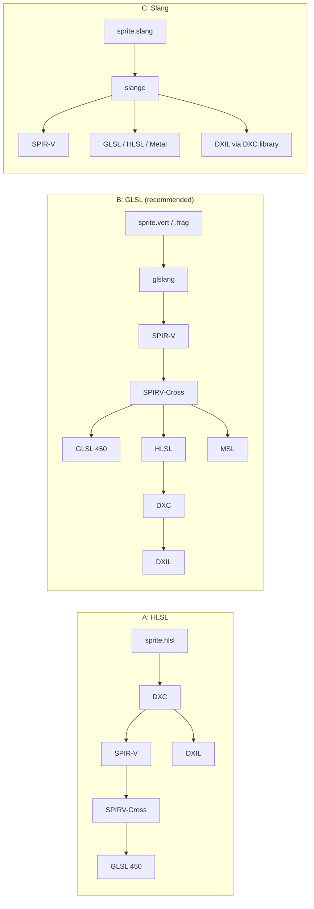

# Shader toolchain spike: HLSL + DXC, GLSL + glslang + SPIRV-Cross, Slang `[S]`

Evidence for ADR-0009 (the shader toolchain), card 3-6, run on 2026-11-02. It answers the question left open by [render-port-v0](../architecture/render-port-v0.md) (O4: no triangle before this spike): which build-time tool turns one shader source into SPIR-V (Vulkan), GLSL 450 (OpenGL 4.5), DXIL (D3D12) and later MSL (Metal). Nothing is adopted here; the choice is the owner's and is recorded by card 3-7.

## 1. Summary

1. **All three pipelines compile the same sprite shader (vertex + fragment, one uniform block, one texture and sampler) to every target we need.** 23 compile steps ran, 23 succeeded. DXIL from all three passes the DXC validator (`dxv`, "Validation succeeded"). Outputs of DXC, glslang and Slang for the same stage are byte-identical between Windows and Linux (checked for vertex SPIR-V of all three and DXIL of DXC).
2. **Speed does not separate them.** One compile takes 20 ms (DXC), 90 to 100 ms (glslang) or about 190 ms (Slang), process start included. A sprite shader set is a handful of compiles, a build-time cost of seconds.
3. **What separates them is where the source language comes from and what each leaves in the generated GLSL.** HLSL through DXC and SPIRV-Cross yields GLSL with `row_major` layouts and a matrix workaround helper (a matrix-convention risk nobody has run on a GPU). GLSL through glslang and SPIRV-Cross round-trips cleanly (the regenerated GLSL recompiles to the same 1404-byte SPIR-V). Slang's GLSL output carries `#line` directives and mangled names but is valid.
4. **Recommendation (the owner decides):** pipeline B, GLSL 450 Vulkan-style source, glslang to SPIR-V, SPIRV-Cross to GLSL 450 (and later MSL), DXC only for DXIL when the D3D12 backend exists. Reasons: the first backend is OpenGL 4.5 and its source language is GLSL; the Vulkan-style binding model is the neutral one; every tool is Apache-2.0 or permissive; the only rejected risk is that HLSL and Slang authors get no first-class language. Pipeline A (HLSL + DXC) and C (Slang) are the alternatives, section 6.

## 2. What was run

| item | detail |
|---|---|
| Source | `tools/shader-spike/shaders/`: the same sprite shader in HLSL, GLSL 450 (Vulkan-style set and binding) and Slang; plus a broken variant of each (undefined name and vector-size mismatch) for error messages |
| Harness | `tools/shader-spike/run.py`, dev-time only, not run by CI, not part of the engine. One checking run per step, then 15 timed runs, median wall time including process start, output size |
| Tools | DXC v1.9.2609, glslang 16.6.0, Slang v2026.20, SPIRV-Cross tag `vulkan-sdk-1.4.363.0` (built from source in 48 s, dev machine only). The three prebuilt tools were downloaded into the git-ignored folder `target/shader-spike` (owner decision O8) and their SHA-256 checked against the digests GitHub shows for the release assets; all matched |
| Machine | one Windows 11 machine; Linux ran in WSL2 on the same machine (prebuilt Linux release archives of DXC, glslang, Slang; SPIRV-Cross not built there) |
| Not tested | shaderc (no release binaries, wraps glslang), any GPU or driver, DXC reflection through its API |

## 3. Results

Median of 15 runs, Windows, milliseconds (process start included).

| step | A: DXC | B: glslang | C: Slang |
|---|---|---|---|
| source to SPIR-V, vertex | 20 | 92 | 193 |
| source to SPIR-V, fragment | 20 | 99 | 190 |
| source to DXIL, vertex | 21 | 28 (through generated HLSL) | 200 |
| SPIR-V to GLSL 450 (SPIRV-Cross) | 10 | 24 | direct, 192 |
| SPIR-V to HLSL / MSL (SPIRV-Cross) | - | 25 / 22 | direct HLSL 192, Metal 185 |
| reflection | SPIRV-Cross JSON, 10 | SPIRV-Cross JSON, 22 | `-reflection-json` 190 |

Vertex SPIR-V size: DXC 1104 bytes, glslang 1404, Slang 1064. DXIL about 4.2 KB from all three.

## 4. Criteria from the design note

| criterion | A: HLSL + DXC | B: GLSL + glslang + SPIRV-Cross | C: Slang |
|---|---|---|---|
| Build time | fastest (20 ms) | 25 to 100 ms per step | about 190 ms per step |
| SPIR-V (Vulkan) | direct | direct | direct |
| GLSL 450 (OpenGL) | via SPIRV-Cross; contains `layout(row_major)`, `v * M`, `spvWorkaroundRowMajor` helper; unverified on a GPU | via SPIRV-Cross; clean names kept; regenerated GLSL recompiles to identical SPIR-V | direct; `#line` noise, mangled names; valid |
| DXIL (D3D12) | direct, native | via generated HLSL then DXC; validates | direct, through the DXC library (needs it on the path); validates |
| MSL (Metal, later) | via SPIR-V and SPIRV-Cross (not run) | SPIRV-Cross, ran | direct, ran |
| Reflection | SPIRV-Cross JSON (inputs with locations, uniform blocks with size, set, binding); DXC API blob not tried | same | richest: struct fields, offsets, sizes (18 KB JSON) |
| Error messages | clang style with caret | terse one line (`ERROR: file:5: 'undefined_name' : undeclared identifier`) | rustc style with underline, best |
| Licence (output use in a closed-source product) | LLVM Release (UIUC/NCSA) plus Microsoft terms | Apache-2.0 (glslang, SPIRV-Cross; GitHub shows NOASSERTION for glslang because of several licences, recheck at ADR time) | Apache-2.0 with LLVM exception plus bundled notices (MIT, BSL-1.0, CC-BY-4.0, Unlicense, NCSA) |
| Maintenance (last 12 months, GitHub) | 7 releases, active | glslang 6 releases; SPIRV-Cross no GitHub releases, tagged with the Vulkan SDK, last commit 2026-10-28 | 54 releases, about weekly |
| Footprint on disk | 74 MB | glslang 68 MB + SPIRV-Cross 3 MB (+ DXC 74 MB only with D3D12) | 182 MB |
| Linux | release archive, ran | release archive, ran; SPIRV-Cross builds from source | release archive, ran (see section 5) |

No GPL or AGPL was seen in the shipped licence files. This is a reading of the files, not legal advice.

## 5. Findings worth knowing

- **Slang on Linux:** the archive contains symbolic links that the Windows `tar` could not create. The Linux compiler ran in WSL2 once real files replaced the links. A CI job on Linux would extract the archive natively and not meet this.
- **Slang on Windows:** DXIL output loads `dxcompiler` from the path. With DXC absent from the path the step fails. Stage was given once (`-profile`), giving it twice ("stage specified more than once") is an error.
- **DXC and OpenGL:** DXC targets Vulkan SPIR-V first; going on to GL 4.5 goes through SPIRV-Cross and its matrix workaround. The column-major matrix with `mul(view_proj, v)` in our HLSL is correct under DXC's default; whether the generated GLSL is correct at run time is not established.
- **Binding model:** the GLSL source uses set and binding numbers (uniform buffer binding 0; texture binding 0 and sampler binding 1 in the fragment shader). SPIRV-Cross emits GL 4.5 `binding` qualifiers from them, which matches the plan to bind through slots in the GL adapter.
- **Determinism of the tools:** outputs were byte-identical between Windows and Linux for the four compared files; repeated runs on one machine were not compared byte for byte beyond that.

## 6. Recommendation for the owner

| option | when it is the better choice |
|---|---|
| **B, GLSL + glslang + SPIRV-Cross (recommended)** | the first backend is OpenGL 4.5, authors write GLSL; small tools (about 70 MB); clean round trip; DXC joins only when D3D12 is built |
| A, HLSL + DXC | the owner wants HLSL as the authoring language (D3D12 is the main target); fastest compiles; GLSL output needs a GPU check of the matrix workaround first |
| C, Slang | the owner wants one language for all backends and the best diagnostics, and accepts a 182 MB, fast-moving tool (weekly releases) and its DXC dependency for DXIL |

All three keep the shader compiler behind `IShaderCompiler` as a build-time tool (digest section 3); switching later changes the tool and the shader sources, not the runtime. ADR-0009 and the `THIRD_PARTY.md` rows (tier T2, dev-time tools) are card 3-7, a governance task that needs the owner's declaration.

## 7. Not verified

- No shader was run on a GPU or driver; the correctness of the generated GLSL (especially the DXC route's matrix handling) is untested.
- One machine, one run session; Linux only in WSL2; SPIRV-Cross was not built on Linux, shaderc was not tested.
- DXC reflection through its API, glslang `-q` reflection (needs linking), Metal output quality (compiled, not inspected) and the pixel-stage outputs beyond size were not examined.
- Licence reading is of the shipped files only.
- Timings include process start and are for a tiny shader; large shaders were not measured.
