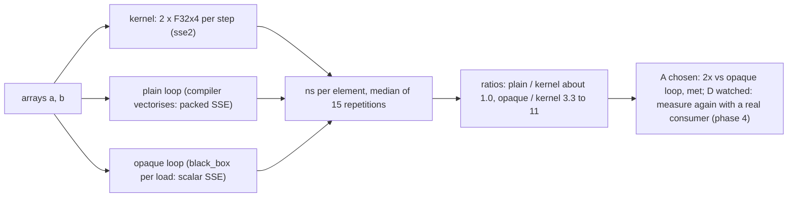

# SIMD benchmark: the 8-lane kernel against scalar loops `[S]`

Evidence for gate G4 of [ADR-0001](../decisions/adr-0001-language-evaluation.md) section 6 (card 1-33), run on 2026-10-27. G4 says the 8-wide `f32` add, mul and min kernel must be at least 2 times faster than its scalar version on the reference machine, factor to be refined after the first measurement. The owner chose: measure first, then decide the threshold. **This page reports numbers only; no gate and no threshold is added.**

## 1. Summary

1. **Against a plain scalar loop the kernel is not 2 times faster; it is about equal.** The compiler turns the plain loop into packed SSE code itself (confirmed in the generated assembly, section 4). Ratio plain loop time / kernel time, medians of three runs: between 0.92 and 1.21 on both operating systems, all three operations.
2. **Against a scalar loop that the compiler cannot vectorise, the kernel is 3.3 to 11 times faster,** depending on array size (section 3). This is an **upper bound**: `black_box` on each loaded value forces a store and a reload per operand, so part of the gap is that overhead and not scalar against vector arithmetic. No baseline without such overhead was built.
3. Therefore the G4 factor of 2 is **reachable only against the opaque baseline, and the plain loop is the honest baseline** for code written without `F32x4`. The decision on what G4 should compare is for the owner (section 6).
4. The two `F32x4` per step add no measurable cost over the compiler's own vectorisation: the abstraction is free here, and its value is a guaranteed vector form (and bit-identical results, tested elsewhere), not a speedup over what the compiler finds.

## 2. Method

- Crate `engine/tools_simd_bench` (layer 4, a dev tool, safe Rust, 12 tests). `--release`, default `opt-level 3`, no `target-cpu` flag, so the baseline x86-64 target with SSE2 only.
- Three loops over `f32` arrays, `out = op(a, b)`, for `add`, `mul` and `min`:
  - **kernel**: 8 elements per step, two `F32x4` (`base::simd::F32x4`, the `sse2` backend);
  - **plain loop**: one element at a time, written naturally, left to the optimiser;
  - **opaque loop**: the same, but every loaded value goes through `std::hint::black_box`, so it stays scalar (at the price of a spill and reload per operand, see the summary).
- Results of the three are tested on 40 elements to be bit-identical (`min` is `a < b ? a : b`, the definition of `F32x4::min`).
- Two array sizes: 1,024 elements (4 KiB per array, fits L1) and 262,144 elements (1 MiB per array, 3 MiB for the three, L2 or L3). Each repetition handles 16,777,216 elements; one warm-up repetition, then 15 timed ones; the table takes the median of those, and each cell is the median of three program runs.
- Machine: Intel Core i7-12700H, 20 logical CPUs, Windows 11, and Linux (Ubuntu in WSL2, a virtual machine) on the same machine. Not a named reference machine; not a quiet machine (the single runs vary by about 10-20%).

## 3. Results (nanoseconds per element; ratio = loop time / kernel time, above 1 means the kernel is faster)

| op | elements | OS | kernel | plain loop | opaque loop | plain / kernel | opaque / kernel |
|---|---|---|---|---|---|---|---|
| add | 1,024 | Windows | 0.064 | 0.074 | 0.553 | 1.16 | 8.64 |
| mul | 1,024 | Windows | 0.059 | 0.062 | 0.511 | 1.05 | 8.66 |
| min | 1,024 | Windows | 0.052 | 0.061 | 0.576 | 1.17 | 11.08 |
| add | 262,144 | Windows | 0.198 | 0.183 | 0.658 | 0.92 | 3.32 |
| mul | 262,144 | Windows | 0.198 | 0.190 | 0.679 | 0.96 | 3.43 |
| min | 262,144 | Windows | 0.212 | 0.196 | 0.714 | 0.92 | 3.37 |
| add | 1,024 | Linux | 0.050 | 0.057 | 0.480 | 1.14 | 9.60 |
| mul | 1,024 | Linux | 0.048 | 0.057 | 0.534 | 1.19 | 11.12 |
| min | 1,024 | Linux | 0.047 | 0.057 | 0.472 | 1.21 | 10.04 |
| add | 262,144 | Linux | 0.191 | 0.187 | 0.748 | 0.98 | 3.92 |
| mul | 262,144 | Linux | 0.202 | 0.198 | 0.740 | 0.98 | 3.66 |
| min | 262,144 | Linux | 0.194 | 0.194 | 0.734 | 1.00 | 3.78 |

At 262,144 elements all three loops are partly limited by memory, which is why the opaque ratio shrinks to 3.3-3.9 there; the 1,024-element rows show the compute cost.

## 4. Does the compiler vectorise the scalar loop? Yes

Assembly of the release build (`cargo rustc --release -- --emit asm`, Windows, per generated closure): the kernel closure holds 6 packed instructions (`addps`, `mulps` or `minps`); the plain loop holds 2 packed instructions plus 1 scalar one (a vectorised main loop and a scalar remainder); the opaque loop holds only the scalar instruction (`addss`, `mulss`, `minss`). So the plain loop is auto-vectorised on this target, and the measured equality is explained by both hot loops being packed SSE code (the kernel is unrolled differently; the loop bodies were not compared instruction by instruction). Linux was not disassembled; its timings match Windows.

## 5. Limits

- One machine, one CPU generation, SSE2 only (no AVX2, which a wider backend could use and the compiler could too with `target-cpu`). Linux ran in a virtual machine. The result may differ on ARM64 with NEON (phase 2).
- A pure streaming kernel (two loads, one store per element) is the easy case for the optimiser. Code with dependencies between lanes, conditionals, or data in awkward layouts may not auto-vectorise, and there the kernel can win; this benchmark does not cover it.
- No consumer exists yet (the gate text asks for a kernel and a consumer); this is a micro-benchmark.
- Timing noise of about 10-25% between single runs (one run gave 0.77 for `add` at 1,024 elements where the median of three gives 1.16); read the plain / kernel ratios as "about 1, between 0.8 and 1.2", not as a ranking.

## 6. Decision (owner, 2026-10-27, card 1-34): option A, with an eye on option D

The owner chose **A**: G4 stays as written in ADR-0001, a 2x speedup against a scalar loop the compiler does not vectorise (the opaque loop), which the kernel meets (3.3 to 11, an upper bound). **D is watched:** when a real consumer exists (physics, phase 4) the kernel is measured there against the plain loop, and G4 is revisited if the abstraction does not pay. Not done by this record: no CI check for A is built and no gate configuration or ADR text changes; either would be a separate governance task if the owner asks. Until then G4 is verified by running `tools_simd_bench` by hand.

| option | what G4 would mean | consequence |
|---|---|---|
| **A (chosen)** | Keep 2x against the opaque loop | passes (3.3 to 11, an upper bound), but compares with code nobody would write |
| B | 2x against the plain loop | fails today (0.92 to 1.21); the abstraction would not justify itself by speed |
| C | Replace speed by a guarantee: the kernel is vector code in every build (checked by a test on the assembly or on `target-cpu` changes) and equal to scalar in bits | matches what the evidence shows the abstraction gives |
| **D (watched)** | Revisit G4 when a real consumer exists (physics, phase 4) and measure there | no change now |

