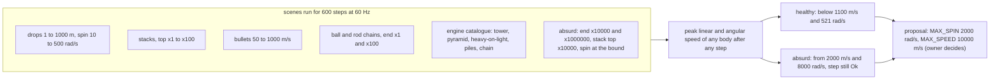
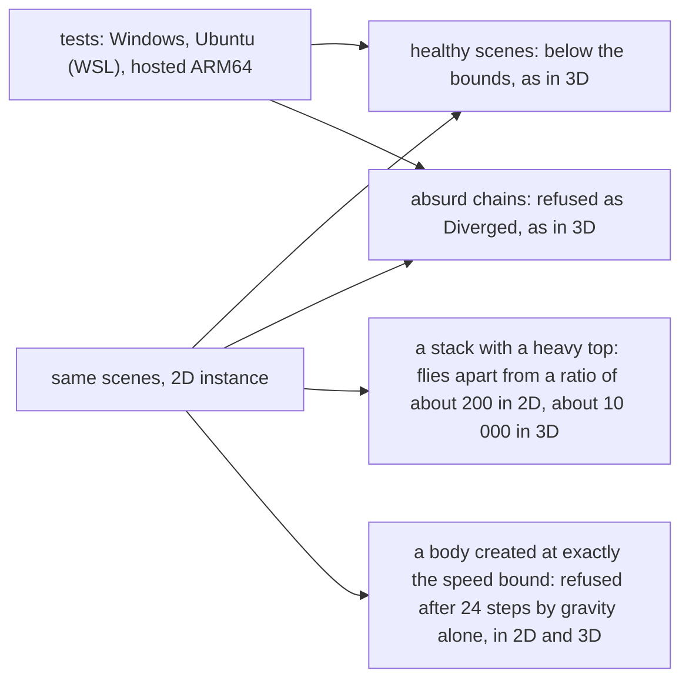
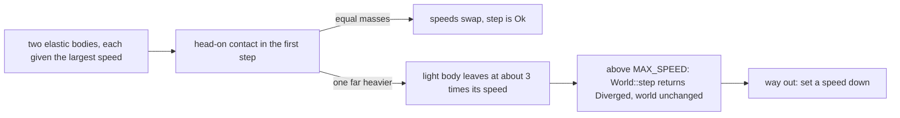
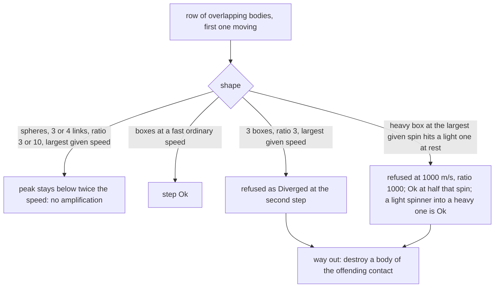
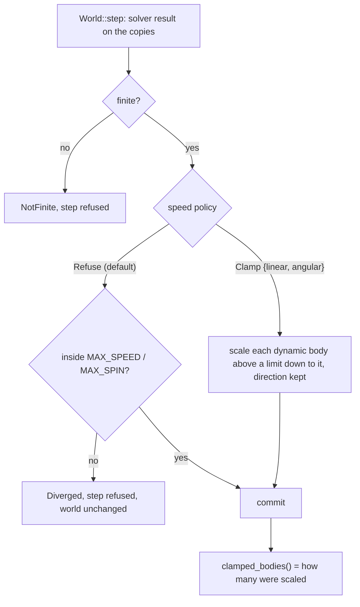
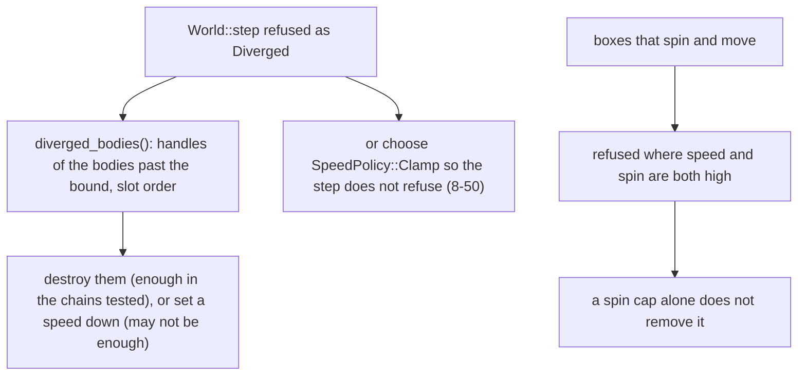
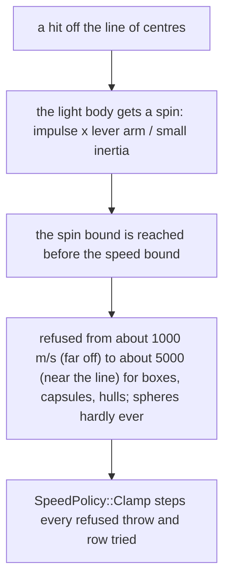
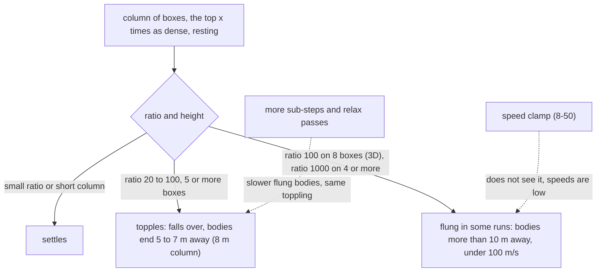

# Speed bounds scan: what 3D scenes reach, and which absurd states stay below `MAX_SPEED` and `MAX_SPIN`

Measurement of card 8-37 (Class 1: tests and a report; no constant of the engine is changed), run on 2026-11-19. It follows card 8-25, which gave `World::step` a refusal (`PhysicsError::Diverged`) for a step that would leave a body faster than `MAX_SPEED` or `MAX_SPIN`, both chosen at 1e5 and not measured, and card 8-36, which refuses such a speed at the call. The question: where do healthy scenes end, where do absurd ones start, and does the bound sit between them?

**Adopted by the owner on 2026-11-20 (card 8-41):** `MAX_SPIN` 2000 rad/s and `MAX_SPEED` 1e4 m/s. The proposal below is kept as it was written (including "a hundred times the catalogue", which is about four hundred times); the numbers measured here are the old behaviour (bounds of 1e5), which the tests of `d3_speed_scan.rs` now check the other way round (the absurd chains are refused).

## 1. Result in five lines

1. **The engine's own scenes are slow.** The six judged scenes of the catalogue peak at 24.2 m/s (the chain, fastest) and 42.1 rad/s; the piles at 7.5 m/s and 19.7 rad/s; the standing scenes below 0.4 m/s. Sleeping on or off changes nothing.
2. **Healthy scenes a game can make stay below 1100 m/s and 521 rad/s** (healthy here means: a speed given at the start of up to 500 rad/s and 1000 m/s, bodies otherwise at rest or falling; a game that starts bodies spinning at 1000 rad/s has a factor of two to the proposed bound, not four, and spins of 10 000 rad/s and bullets of 3000 m/s and more are counted as absurd starts, not healthy scenes), the largest being a 1000 m/s bullet (1004.6 m/s after the hit) and a rod chain of six links with a heavy end of density 100 (521 rad/s).
3. **Absurd but finite states exist and `step` returns `Ok` for them.** Ball and rod chains with an end 10 000 or a million times as dense as the links (far beyond the mass ratio the joint docs give) reach 1991 to 4262 m/s and **8058 to 27 778 rad/s** with no error: the bound of 1e5 does not see them. A stack of eight boxes with a top 10 000 times as dense flies apart (a body 385 m from the origin, 87 m/s): no speed bound sees that either.
4. **The spin separates healthy from absurd, the linear speed does not.** Healthy spins stop at 521 rad/s, absurd ones start at 8058: a spin bound between them (proposal 2000) has a factor of about four to each side, for the healthy scenes as defined in item 2. Healthy linear speeds reach 1005 m/s and absurd ones start at 1991 m/s: the gap is a factor of two, and a real bullet may be faster than 1000 m/s.
5. **A body given the largest allowed spin turns a 3 m fall into about 10 400 m/s** (the spin throws it off the floor), finite, allowed and absurd; a bound of 10 000 m/s refuses it.

## 2. Measurements

Peak of any dynamic body after any step, 600 steps, one thread, sleeping off, Windows x86-64. The 3D scenes are in `engine/physics/tests/d3_speed_scan.rs`; the catalogue peaks are `no_scene_blows_up` and `no_scene_spins_wildly` in `engine/tools_physics_bench/tests/scenes3d.rs`. **Which numbers are pinned by a committed test:** the healthy scenes (below half the proposed bounds), the absurd chains (before card 8-41: spin above the proposed bound and no refusal; now: refused as `Diverged`), the spin at the bound (before card 8-41: speed above half the proposed bound; now: below half the speed bound) and the catalogue spin below 100 rad/s; the other rows, the 385 m figure and the exact peaks come from a scratch version of the scan (600 steps; the committed catalogue test runs 400) and are not pinned. Numbers were identical with `cross-platform-determinism` on and off on this machine, and the catalogue with sleeping on and off (scratch); Linux x86-64 (Ubuntu under WSL2) ran the same tests green with the feature on and off. The exact numbers of the chaotic scenes were not compared across the two systems, which is why the tests use wide margins.

| scene | peak m/s | peak rad/s | step result |
|---|---|---|---|
| drop from 1, 10, 100, 1000 m | 3.1, 13.6, 44.1, 98.1 | 0.06 to 1.7 | Ok |
| drop with spin 10, 100, 1000 rad/s | 6.7, 14.0, 111 | 10, 100, 1000 | Ok |
| drop with spin 10 000 and 99 999 rad/s | 676, 10 409 | 10 000, 99 999 | Ok |
| stack of 8, top x1, x10, x100, x1000 | 2.5, 2.5, 11.3, 9.3 | 0.1, 0.3, 10.6, 12.1 | Ok |
| stack of 8, top x10 000 | 86.7 | 15.7 | Ok, a body reached 385 m from the origin |
| bullet 50, 300, 1000, 3000, 10 000 m/s | 50, 315, 1005, 3002, 10 000 | 13.7 at 50, else 0.01 | Ok |
| ball chain, 3 links, end x1, x100 | 9.7, 39.3 | 29.4, 86.5 | Ok |
| ball chain, 6 links, end x1, x100 | 15.7, 40.0 | 48.1, 107 | Ok |
| rod chain, 3 links, end x1, x100 | 10.6, 57.6 | 41.4, 251 | Ok |
| rod chain, 6 links, end x1, x100 | 17.3, 89.8 | 55.2, 521 | Ok |
| ball chain, end x10 000 and x1 000 000 (3 and 6 links) | 1991 to 4262 | 8058 to 11 535 | Ok |
| rod chain, end x10 000 and x1 000 000 (3 and 6 links) | 2360 to 3459 | 8245 to 27 778 | Ok |

Catalogue (scratch run, 600 steps): tower 0.24 m/s, pyramid 0.02, heavy-on-light (density ratio 20) 0.31, sphere pile 5.9, mixed pile 7.5, chain 24.2; spins 0.04, 0.02, 0.33, 17.6, 19.7, 42.1 rad/s. The large pyramid (not in the judged six) 0.16 m/s and 0.08 rad/s.

## 3. What the established engines use

From the search done for card 8-36 (their documentation, see that review): Jolt keeps a per-body maximum linear and angular velocity that its setters clamp (the default values were not in the search results and are **from memory, unconfirmed**: about 500 m/s and about 47 rad/s, which is an eighth of a turn per step at 60 Hz), PhysX defaults to a maximum angular velocity of 100 rad/s and an effectively unlimited linear one, Box2D and Unity 2D limit the translation per step. None of them refuses a step. Their spin limits are lower than the proposal below by a factor of twenty to forty, because they are meant to keep a game stable, while ours is meant to catch a blow-up; the data above would pass 100 rad/s for the catalogue and for chains with an end as dense as the links, but not for a chain with a heavy end of density 100, which reaches 107 to 521 (no end of density 10 was measured).

## 4. Proposal (the owner decides; nothing here changes the constants)

| constant | now | proposed | why |
|---|---|---|---|
| `MAX_SPIN` | 1e5 rad/s | **2000 rad/s** | four times the fastest healthy scene (521) and four times below the slowest absurd one (8058); 33 radians (five turns) per step at 60 Hz, which is already meaningless for a body without continuous rotation |
| `MAX_SPEED` | 1e5 m/s | **1e4 m/s** | ten times a fast bullet and a hundred times the catalogue; catches the spin-throws-the-body case (about 10 400 m/s); does not separate the chains (the linear speed is not the discriminator) |

Alternatives: keep 1e5 (catches only a blow-up that is already total), or a lower linear bound near 1500 m/s that catches every absurd chain measured but leaves a factor of 1.5 above a 1000 m/s bullet and 1.3 below the slowest absurd chain. Neither is proposed.

A change of the constants is Class 2 (public constants of a physics crate) and an ordinary card, with the tests of `d3_speed_scan.rs` then flipping: the chain scenes become `Diverged` (the second test says so), the healthy scenes stay `Ok`. Tighter bounds also refuse a body created or set above them (card 8-36), so any sample or test that sets a speed above the new bounds must change. The workspace was run with the adopted constants by card 8-41 (all tests green).

## 5. What this does not show

- **A blow-up that is not fast.** The stack with a top 10 000 times as dense ends at 87 m/s with a body 385 m away: no bound on speed sees it; a position or energy check would (card 8-39; section 12 measures where stacks fail and why a check is not recommended).
- **2D.** The core is shared and the bounds are the same; the scenes were first run in 3D only, and card 8-40 ran them in 2D (section 6).
- **Other platforms.** The 3D scan ran on one Windows machine and one Ubuntu on the same machine; the chaotic scenes differ in detail between machines, so the tests assert margins, not values. Card 8-40 added a hosted ARM64 run (section 6).
- **Contact-only blow-ups at healthy mass ratios were not found** in the scenes tried (bullets, drops, piles), and a stack with a heavy top is **not** a healthy scene beyond a small ratio: it topples from a ratio of about 20 to 50 (section 12, which corrects the earlier reading of stacks up to x100 as healthy). That is the absence of a finding in these scenes, not a proof.
- **The scenes were chosen, not drawn from a game**; a game with another scale (a flying wheel, a spinning propeller at 3000 rad/s) may need a bound above 2000, which is why the bound is a proposal.

## 6. The same scenes in 2D, and on ARM64 (card 8-40)

Measured on 2026-11-20 with `engine/physics/tests/d2_speed_scan.rs` (the scenes of section 2 in the 2D instance, 600 steps, the bounds of card 8-41), Windows x86-64. Peaks of any dynamic body; "reach" is the farthest a body got from the origin.

- **Healthy scenes agree.** Drops, spins up to 500 rad/s, bullets up to 1000 m/s and chains with a heavy end of 1 or 100 times stay below half of each bound, and are never refused; the largest 2D values are the bullet at 1004.6 m/s (the speed it was given) and a rod chain with six links and a heavy end of 100 at 288 rad/s (3D: 521). A body spun at the bound (2000 rad/s) ends at 353 m/s.
- **The absurd chains are refused, as in 3D.** All eight (hinge or rod, three or six links, heavy end 10 000 or a million times) end `Diverged` after 96 to 177 steps; the peaks seen before the refusal are 1174 to 1800 rad/s.
- **A difference: the stack with a heavy top.** In 2D a stack of eight squares with a top 100 times as dense falls over (a reach of 7.8 m is about the height of the stack; I first wrote that it stays together, which section 12 corrects) and at every ratio tried from 200 to 5000 it came apart or tumbled: reach 29 m at 200, 81 m at 500, 80 m at 1000, 233 m at 2000, 23 m at 5000, not growing with the ratio (a stack is 8 m high; the speed peaks stay below 45 m/s, so no speed bound sees it). In 3D the same scene stays within 18 m up to a top of 5000 times and flies apart only at 10 000 (385 m, section 2). Results at single ratios are chaotic, so the threshold is "between 100 and 200 in 2D", not a value. This belongs to card 8-39 (section 12).
- **A body created at exactly the bound is refused soon after, with no contact.** A bullet given exactly `MAX_SPEED` is accepted by `create_body`, flies past the stack without touching it, and the step is refused (`Diverged`) after 24 steps, in 2D and in 3D. The cause, found by the independent review of this card: the check compares the squared speed with the squared bound, gravity adds a small vertical speed, and in single precision the sum passes the bound by one representable step; a bullet at 9900 m/s or less is not refused. (I first wrote that the contact result was above the bound; that was wrong, there is no contact.) Resolved by card 8-46 (owner choice, 2026-11-20): `create_body` and the setters now accept at most half of each bound (`MAX_GIVEN_SPEED`, `MAX_GIVEN_SPIN`), so every speed that can be given can be stepped; the step bounds did not change.
- **ARM64.** The 2D and 3D speed scan tests ran on the hosted `ubuntu-24.04-arm` job of a hand-started `ci` run of the card's branch and passed. The tests assert margins, so this says the scenes stay inside them there, not that the values equal those of x86-64; the numbers above are from Windows. The same two test files also passed on Ubuntu x86-64 under WSL. The 2D test also asserts the reach of the healthy stacks (within 30 m); the 3D test has no such assertion.

## 7. A collision can still pass the bound, and that is kept (card 8-47)

Found by the independent review of card 8-46 and checked here in 2D and 3D by `engine/physics/tests/collision_speed_edge.rs`. The room that card 8-46 leaves between the given limits (`MAX_GIVEN_SPEED`, `MAX_GIVEN_SPIN`) and the step bounds covers gravity, damping and forces. It does not cover every collision.

- **What happens.** Two elastic balls (restitution 1) overlapping a little, going at each other, each at the largest given speed: with equal masses the step is `Ok`; with one body 10, 1000 or a million times denser the step returns `Diverged`, in 2D and in 3D, and the world is left unchanged (state hash and step count). The same collision at 1000 m/s is `Ok` and the light body leaves at almost three times its speed (2.996 times with a 1000 times heavier partner, 2.64 with a 10 times heavier one), which is the physics of an elastic bounce off a body that hardly moves, so the refusal is the bound doing its job and not a solver fault.
- **Owner decision (2026-11-20): keep the bound as a ceiling and document it.** Rejected: a quarter instead of a half (my reasons, not the owner's: the accepted range would shrink a second time, and a chain of collisions might pass any fixed fraction, which card 8-48 then tried and did not find for spheres: see section 8) and clamping what a contact gives (it would hide the blow-up the refusal exists to show, and it changes the solver).
- **What a game does.** Keep given speeds well below the limit when bodies of very different mass can meet head-on, or keep the mass ratio moderate; when the step answers `Diverged`, set a speed down (`set_linear_velocity`, tested) or destroy a body (the rule of `PhysicsError::Diverged`, not tested here) and step again. The rustdoc of `MAX_GIVEN_SPEED` states the edge and that of `PhysicsError::Diverged` gives the way out.
- **What the tests do not show.** Only head-on spheres and circles were tried (bodies of other shapes, chains of three bodies and contacts with spin were not; the 3 times of the refused case is inferred from the lower-speed case, not observed, because the refused step leaves the world unchanged); and the scene needs the bodies to overlap at the start, because at these speeds the engine has no continuous collision detection and a body skips a contact that starts further than one step away (an effect of speed, not new, not part of this card).

## 8. Chains, boxes and spin at the top of the given range (card 8-48)

Measured on 2026-11-20 with `engine/physics/tests/collision_scenes_edge.rs` (and one more test in `collision_speed_edge.rs`), in 2D and 3D, on rows of overlapping bodies in contact from the first step. These are observations of a solver that resolves the contacts of a step together, not promises.

- **The chain hypothesis of section 7 is not supported for spheres.** Chains of three and four spheres, ratios 3 and 10 between neighbours, the heaviest at the largest given speed: the largest speed seen is up to about 1.8 times the starting speed (ratio 10; about 1.4 for ratio 3), asserted only as below twice it, and no step is refused. The second hit does not add to the first because all contacts of a step are solved together. A quarter of headroom was therefore not needed for these scenes; the owner's decision of section 7 stands (section 7's own list of what was not tried is the state before this card).
- **Boxes are the fragile case, and only at the top of the range.** Chains of three and four boxes at 1250 m/s step (ratios 3 and 10). At the largest given speed a chain of three boxes of ratio 3 is refused at the second step in 2D and in 3D, with the peak before it still inside the bound (so the refused step is where a contact threw a speed over); in the scan a chain of three boxes at half that speed (2500 m/s) was also refused in 2D, not pinned.
- **Spin makes it worse.** Pinned: a box 1000 times heavier than its target, spinning at the largest given spin (1000 rad/s) and moving at 1000 m/s into a light box at rest, is refused in 2D and 3D; at half that spin it steps (ratios 100 and 1000); and a light box spinning at the largest given spin into a heavy one at rest steps at 500, 1000 and 2500 m/s. **Scan only, not pinned** (a different scene: two boxes moving at each other, spinning in opposite directions, the light one at the given speed): with a partner 100 or 1000 times heavier it was refused at 1000 m/s in 2D and 3D, and at 500 m/s in 3D (2D stepped); with spin 500 or less none of the cases tried was refused. Spheres at the largest given spin do not gain spin from a hit (peak within 1% of the given spin).
- **The three times holds close to the refused speed.** At 3300 m/s with a partner 1000 times heavier the light sphere leaves at more than 2.9 times its speed and below the bound, in 2D and 3D (the 15 000 m/s of the same hit at the largest given speed cannot be seen, because the refused step leaves the world unchanged).
- **The way out needs the right body.** `Diverged` names no body. In the refused chain of three boxes, destroying the fast first body does not help (the other two already carry the speed and meet, and the step is refused again); destroying the middle or the last body does (tested, 2D and 3D). The rustdoc of `Diverged` now says so.
- **Not tried.** Hulls and capsules; a box thrown at an angle; rows with more than four links; contacts with friction set away from the default; the 2D value of the half-speed box chain is a scan result and not a test.

## 9. An opt-in clamp, and what other engines do (card 8-50)

- **What other engines do** (read from their documentation on 2026-11-20; Bullet not confirmed): [Jolt](https://jrouwe.github.io/JoltPhysics/class_body_creation_settings.html) gives every body a maximum linear and angular velocity and clamps to it; [PhysX](https://nvidia-omniverse.github.io/PhysX/physx/5.4.1/_api_build/classPxRigidBody.html) clamps to a maximum linear and angular velocity before the solver, so the limit can be briefly exceeded; [Box2D](https://docs.rs/crate/box2d_sys/0.2.1/source/box2d/src/types.c) v3 has a maximum linear speed in the world definition. None of their documents says a step is refused. Their defaults are far below our bounds where they are stated (the angular defaults are tens to a hundred radians per second, against our bound of two thousand).
- **What is built.** The default stays the owner's rule of 8-25, 8-36 and 8-47: refuse. `SpeedPolicy::Clamp` is the opt-in for a game that prefers the other engines' behaviour, with limits it chooses (at most the given limits). It is chosen with a world method and not a config field, so no existing config changes, and a refusing world hashes as before (a clamping world adds its limits to the hash).
- **Limits of the clamp.** It acts on the result of the step: the contacts of the step that crossed the limit were solved with the higher speed and the bodies moved with it for that step (other engines clamp before the solver; doing that here would mean a change in each of the two solvers). Direction is kept, so the energy that was above the limit is dropped, and a clamped scene is not physically exact; the count says it happened.
- **What the tests show** (`engine/physics/tests/speed_clamp.rs`, 2D and 3D): the head-on collision of 8-47 (a light and a heavy ball at the largest given speed, refused by default) steps under the clamp in 2D and 3D; direction is kept; a body within its limits is untouched and not counted; invalid limits are `InvalidSpeedLimit` and change nothing; a value that is not finite is still refused; two runs give the same hash. a scene of twenty-four circles thrown at a floor, where the clamp fires on every body, gives the same state after every step serially and with 1, 2, 4 and 6 workers. **Not shown by a test:** the box scenes of 8-48 under the clamp, Linux and ARM64 (the hosted run), and a clamp that fires during resting contact (the independent review tried a joint chain and a stack by hand: both stepped, and a stack that never reaches the limit matched the refusing world bit for bit).

## 10. Which body crossed the bound, and how much spin room there is (card 8-49)

- **The query.** `World::diverged_bodies()` returns the bodies whose speed passed `MAX_SPEED` or `MAX_SPIN` in the last step when that step was refused as `Diverged`, in slot order; it is empty after any other step and unchanged by a call with a time step that is not valid. It is read-only, adds nothing to `PhysicsError` and allocates nothing (its capacity is reserved with the world). The list is a snapshot: it can name a body destroyed since, and a changed policy does not clear it. Two light and two heavy balls in two pairs name exactly the two light ones in slot order, and in the refused chain of three boxes of 8-48 destroying the body it names let the world step again, in 2D and 3D (tested). It names bodies of a `Diverged` refusal only: a `NotFinite` refusal names none.
- **The spin scan** (`engine/physics/tests/spin_room_edge.rs`, boxes, 2D and 3D, two scenes: a heavy box thrown spinning into a light one at rest, and two boxes going at each other spinning the opposite ways; mass ratio 10 and 1000; 30 steps; spins in steps of 25 rad/s). The first spin that was refused, as measured:

| speed (m/s) | first refused spin (rad/s), the range over the scenes, ratios and dimensions |
|---|---|
| 200 | none up to the largest given spin (tested at 200; a scratch scan also at 0) |
| 1000 | 850 to 925 (none for a ratio of 10) |
| 2500 | 675 to 950 (none in one case) |
| 3500 | 575 to 875 |
| 5000 | 300 to 575 |

- **What it says.** The refusals sit where speed and spin are both high: the corner of a spinning box moves faster than its centre, and a contact can throw that speed past the bound. No scene was refused at a spin of 250 or less at any speed, nor at 650 up to 1000 m/s, nor at any spin up to 1000 at 200 m/s (all tested at one point: 250, 650 at 1000 m/s, and 200 m/s; the scratch scan stepped the spin by 25); every scene was refused at the largest given speed with a spin of 600 (tested). In this scan (boxes, these two scenes) a cap on the given spin alone would have to be about 250 to remove every refusal, below the spin of the drop in the 8-37 scan; it would say nothing about other shapes, and it does not touch the refusals of 8-47, which happen with no spin at all. The default angular limits of Jolt and PhysX (tens of radians per second) are below it.
- **Decision (owner, 2026-11-20, in the owner's words "keep it documented"): the region stays as documented**, so the joint limit and the lower given spin below are not taken; a game that wants no refusal uses the clamp of 8-50.
- **Options that were put to the owner:** keep the bounds and the documented region (a game that wants no refusal chooses the clamp of 8-50 or keeps speed and spin moderate); or add a joint limit on speed and spin together at create and set; or lower the largest given spin. The first needs nothing; the other two change a public rule and move the values of 8-46.
- **Not shown here:** hulls, capsules, hits off the line of centres, longer rows, friction and other spin axes; section 11 (card 8-51) tries them.

## 11. Capsules, hulls, off-centre hits, longer rows, friction, other axes, and the clamp in a stack (card 8-51)

Measured on 2026-11-20 in 3D only (2D has circles and boxes, which sections 7 to 10 cover), steps of 50 m/s and 50 rad/s, a heavy body thrown at a light one at rest (30 steps), the bodies starting 0.9 apart so the contact is in the first step. Pinned at a few points in `engine/physics/tests/collision_shapes_edge.rs` (12 tests); the rest is the scratch scan, not pinned.

| scene | first refused (no spin unless said) |
|---|---|
| light body 0.2 off the line of centres, ratio 1000 | box 4200, capsule 4750, hull 4900, sphere never |
| 0.4 off | box 2550, capsule 2650, hull 2000, sphere 3450 |
| 0.6 off | box 1350, capsule 1500, hull 1050, sphere never |
| head-on, spin about z, 5000 m/s | box 300, capsule 0 (refused without spin), sphere 100, hull never |
| box, ratio 1000, 5000 m/s, spin about x or y | never (the hit runs along x; only the spin about z, across the hit and the offset, refused) |
| box, friction 0 to 3, 2500 m/s | the first refused spin does not move (750 in the scan; 700 steps and 800 is refused in the test) |

- **New finding.** Off the line of centres the light body leaves spinning, and that spin crosses the bound at speeds from about 1000 m/s, far below the head-on edge of section 7. Boxes, capsules and hulls are alike within a factor of two; the hull of eight corners is refused first at 0.4 and 0.6 off and last at 0.2 off. A ratio of 1 is refused too; at 0.6 off at a higher speed (box: 2100 against 1350 for a ratio of 1000), at 0.2 off at a lower one (3650 against 4200). The hull at 0.6 off is first refused at 1050, so the test that nothing is refused at 900 m/s keeps a margin of 150, and the pinned contrast of hull and box is at 1200.
- **Rows.** Rows of five, six and eight spheres never refused (up to 5000 m/s, ratio 3 and 10). Boxes, capsules and hulls are refused in some rows and not in others (about 20 of 72 in a re-scan), with no simple rule in length or speed that I found (a capsule row of five at 2500 is refused and at 5000 steps; hull rows of ratio 10 are refused at nearly every length and speed), so the four refused rows pinned are examples, not an edge. With the clamp, every row tried (4 forms, 3 lengths, 2 ratios, 3 speeds; 72 rows) steps and no body is above the limit afterwards; so do the three off-centre throws that are refused by default (box, capsule, hull at 0.6 off, 2500 m/s).
- **The clamp in a stack.** Eight boxes on a floor with a ball of density five dropped on top at 10 to 5000 m/s: with the default policy the world never refused in this scene at any speed tried (10, 100, 400, 1000, 3000, 5000), so the stack shows only that the clamp keeps a world finite, not that it rescues a refused one; the clamp changed nothing below the limit (positions equal bit for bit at 10 m/s, tested). The ball scatters the stack from 100 m/s (bodies end up to 8 m to the side), at 400 m/s some bodies end below the floor, at 1000 m/s they are thrown upward, and at 3000 and 5000 m/s they end far below it, with or without the clamp; the engine has no continuous collision detection (section 7). So the clamp keeps the world finite and stepping, and does not make a fast hit physical.
- **Not shown.** 2D (nothing new to try there), angled hits between two moving bodies, hulls with many vertices, friction with spin on hulls and capsules, stacks hit by a box, and the box scenes of 8-48 under the clamp beyond the rows above.

## 12. How tall a stack can be under a heavy top (card 8-39)

Measured on 2026-11-20 with `engine/physics/tests/stack_mass_ratio.rs` (2D and 3D, default solver, sleeping off, 600 steps, the top box resting on the stack and shifted sideways by 0, 0.001, 0.01, 0.05 or 0.2 m; the result at one offset is chaotic, so each cell is five runs). Settled means no body ended more than 1 m from the axis. The table gives the runs that settled out of five, 2D then 3D. Five offsets are few for the cells on the edge: a finer scan (41 offsets from 0 to 0.3 m) settled x100 on two boxes, x10 on three to five boxes, x5 on six and eight boxes and x1 on eight at every offset in both dimensions, but only 32 to 41 of 41 for x20 on four or five boxes, x10 on six, x50 on three and 2D x20 on three; those are the cells that read 4 or 5 of 5 above, and the tests pin only the first group.

| boxes (top included) | x5 | x10 | x20 | x50 | x100 | x1000 |
|---|---|---|---|---|---|---|
| 2 | 5, 5 | 5, 5 | 5, 5 | 5, 5 | 5, 5 | 0, 3 |
| 3 | 5, 5 | 5, 5 | 5, 5 | 5, 5 | 4, 5 | 2, 1 |
| 4 | 5, 5 | 5, 5 | 5, 5 | 4, 4 | 2, 4 | 0, 0 |
| 5 | 5, 5 | 5, 5 | 5, 5 | 1, 4 | 0, 0 | 0, 0 |
| 6 | 5, 5 | 5, 5 | 4, 4 | 0, 0 | 0, 0 | 0, 0 |
| 8 | 5, 5 | 4, 5 | 2, 3 | 0, 0 | 0, 0 | 0, 0 |

- **The safe region is small and shrinks with height.** At every offset of the finer scan: a top 100 times as dense on two boxes, 10 times on up to five, 5 times on up to eight. At most offsets (the five-offset table; 32 to 41 of 41 in the finer scan): 10 times on six, 20 times on up to five, 50 times on three. Never in either scan: 50 times on six or eight boxes, and 100 times on five or more. The tests pin the first group and, as cases that never settled, 50 and 100 times on six and eight boxes.
- **Failures are mostly toppling, not flinging.** A column of eight with a top 50 or 100 times as dense falls over (bodies end 5 to 7 m away, an 8 m column, at 11 to 12 m/s at most). Flinging (a body more than 10 m away) came in some runs at x100 on eight boxes in 3D (2 of 5) and at x1000 from five boxes in 2D and four in 3D (not monotone: 3D five boxes were never flung), in most runs at x1000 on eight. The fastest body was 98 m/s (3D, four boxes, x1000, one run of five flung), and a 3D column of five at x1000 reached 93 m/s with none flung, so speed and distance do not go together; in 2D the largest was 43 m/s. No bound on speed, and no clamp set at a few hundred m/s (8-50), sees it.
- **The existing tests are consistent with this.** The stability columns of card 4-17 are two or three boxes (ratio 10 and 100, the heavy box on top, below or in the middle) and settle; this scan covers only the heavy box on top, and shows what happens above that height. A scratch scan of the scenes of 8-37 and 8-40 that dropped the top from 0.3 m gave the same picture (a ratio of 20 left a body more than 2 m from the axis in four of five runs in 2D, and in three of five in 3D); the earlier reading of "stacks up to x100 are healthy" there looked only at speed and at a reach under 30 m, which a stack that has fallen over also meets.
- **The solver settings do not cure it for tall stacks.** With 8 sub-steps, 16 with 2 relax passes, or the largest setting (16 and 4), a stack of eight with a top 50 times as dense still never settled in 2D or 3D, and 100 times neither at the largest setting; the speed of the flung bodies fell (2D, eight boxes, x1000: 43 m/s with the default, 21 and 18 with the first two settings) and the toppling stayed. They help a shorter stack: five boxes under a top 50 times as dense settled in 4 of 5 runs at the largest setting (1 of 5 in 2D and 4 of 5 in 3D at the default), at the price of four times the sub-steps. So a world setting moves the edge a little for short stacks and does not close it.
- **Other engines.** The documentation pages of Box2D, Jolt, PhysX and Bullet that I could read gave no maximum mass ratio and no number for what happens beyond it (Bullet's manual could not be read); what they name as remedies is per-body solver iterations, scaling of the effective mass or inertia, and dominance groups, none tied to a ratio. That is "not confirmed", not "none exists".
- **The three options of the card, and why only the first is recommended.**
  1. **Document the observed region and keep it pinned** (recommended, done here): the table above and the tests; a solver change that shrinks the region is then seen.
  2. **A runtime check** (position, energy or penetration depth): not recommended. The worst bodies stay under 100 m/s, a game's world size is not known to the engine (a position bound would be a number the game must set), and a check can report a stack that came apart but not hold it together; the clamp of 8-50 and the query of 8-49 already cover the speed side. A report of the deepest contact overlap would see the squashed stack before it topples without any bound from the game; it was not tried, and it is the one check worth a card of its own if the owner wants a warning rather than a cure.
  3. **Enforcing a limit at `create_body`:** not possible as stated, because the ratio belongs to two bodies in contact, not to one body; a world-wide range of densities (a `WorldConfig` setting rejecting a body outside a density band) would be possible but rejects harmless worlds (a heavy ball and a light crate that never touch) and still says nothing about height, which matters as much as the ratio here.
  A real fix is solver work (for example softening a contact by the mass ratio of its two bodies) and is a Class 2 card of its own, with this table as the baseline; it is not started.
- **Not shown.** Columns with the heavy box in the middle or the bottom (the 4-17 columns are the only ones), stacks of more than eight, a heavy top dropped from a height at these ratios beyond the 0.3 m of 8-37, other shapes than boxes, sleeping on (the tests run with sleeping off), and platforms other than Windows x86-64 and Ubuntu x86-64 (WSL; the table is Windows).
