# Speed bounds scan: what 3D scenes reach, and which absurd states stay below `MAX_SPEED` and `MAX_SPIN`

Measurement of card 8-37 (Class 1: tests and a report; no constant of the engine is changed), run on 2026-11-19. It follows card 8-25, which gave `World::step` a refusal (`PhysicsError::Diverged`) for a step that would leave a body faster than `MAX_SPEED` or `MAX_SPIN`, both chosen at 1e5 and not measured, and card 8-36, which refuses such a speed at the call. The question: where do healthy scenes end, where do absurd ones start, and does the bound sit between them?

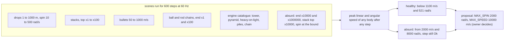

**Adopted by the owner on 2026-11-20 (card 8-41):** `MAX_SPIN` 2000 rad/s and `MAX_SPEED` 1e4 m/s. The proposal below is kept as it was written (including "a hundred times the catalogue", which is about four hundred times); the numbers measured here are the old behaviour (bounds of 1e5), which the tests of `d3_speed_scan.rs` now check the other way round (the absurd chains are refused).

## 1. Result in five lines

1. **The engine's own scenes are slow.** The six judged scenes of the catalogue peak at 24.2 m/s (the chain, fastest) and 42.1 rad/s; the piles at 7.5 m/s and 19.7 rad/s; the standing scenes below 0.4 m/s. Sleeping on or off changes nothing.
2. **Healthy scenes a game can make stay below 1100 m/s and 521 rad/s** (healthy here means: a speed given at the start of up to 500 rad/s and 1000 m/s, bodies otherwise at rest or falling; a game that starts bodies spinning at 1000 rad/s has a factor of two to the proposed bound, not four, and spins of 10 000 rad/s and bullets of 3000 m/s and more are counted as absurd starts, not healthy scenes), the largest being a 1000 m/s bullet (1004.6 m/s after the hit) and a rod chain of six links with a heavy end of density 100 (521 rad/s).
3. **Absurd but finite states exist and `step` returns `Ok` for them.** Ball and rod chains with an end 10 000 or a million times as dense as the links (far beyond the mass ratio the joint docs give) reach 1991 to 4262 m/s and **8058 to 27 778 rad/s** with no error: the bound of 1e5 does not see them. A stack of eight boxes with a top 10 000 times as dense flies apart (a body 385 m from the origin, 87 m/s): no speed bound sees that either.
4. **The spin separates healthy from absurd, the linear speed does not.** Healthy spins stop at 521 rad/s, absurd ones start at 8058: a spin bound between them (proposal 2000) has a factor of about four to each side, for the healthy scenes as defined in item 2. Healthy linear speeds reach 1005 m/s and absurd ones start at 1991 m/s: the gap is a factor of two, and a real bullet may be faster than 1000 m/s.
5. **A body given the largest allowed spin turns a 3 m fall into about 10 400 m/s** (the spin throws it off the floor), finite, allowed and absurd; a bound of 10 000 m/s refuses it.

## 2. Measurements

Peak of any dynamic body after any step, 600 steps, one thread, sleeping off, Windows x86-64. The 3D scenes are in `engine/physics/tests/d3_speed_scan.rs`; the catalogue peaks are `no_scene_blows_up` and `no_scene_spins_wildly` in `engine/tools_physics_bench/tests/scenes3d.rs`. **Which numbers are pinned by a committed test:** the healthy scenes (below half the proposed bounds), the absurd chains (before card 8-41: spin above the proposed bound and no refusal; now: refused as `Diverged`), the spin at the bound (before card 8-41: speed above half the proposed bound; now: below half the speed bound) and the catalogue spin below 100 rad/s; the other rows, the 385 m figure and the exact peaks come from a scratch version of the scan (600 steps; the committed catalogue test runs 400) and are not pinned. Numbers were identical with `cross-platform-determinism` on and off on this machine, and the catalogue with sleeping on and off (scratch); Linux x86-64 (Ubuntu under WSL2) ran the same tests green with the feature on and off. The exact numbers of the chaotic scenes were not compared across the two systems, which is why the tests use wide margins.

| scene | peak m/s | peak rad/s | step result |
|---|---|---|---|
| drop from 1, 10, 100, 1000 m | 3.1, 13.6, 44.1, 98.1 | 0.06 to 1.7 | Ok |
| drop with spin 10, 100, 1000 rad/s | 6.7, 14.0, 111 | 10, 100, 1000 | Ok |
| drop with spin 10 000 and 99 999 rad/s | 676, 10 409 | 10 000, 99 999 | Ok |
| stack of 8, top x1, x10, x100, x1000 | 2.5, 2.5, 11.3, 9.3 | 0.1, 0.3, 10.6, 12.1 | Ok |
| stack of 8, top x10 000 | 86.7 | 15.7 | Ok, a body reached 385 m from the origin |
| bullet 50, 300, 1000, 3000, 10 000 m/s | 50, 315, 1005, 3002, 10 000 | 13.7 at 50, else 0.01 | Ok |
| ball chain, 3 links, end x1, x100 | 9.7, 39.3 | 29.4, 86.5 | Ok |
| ball chain, 6 links, end x1, x100 | 15.7, 40.0 | 48.1, 107 | Ok |
| rod chain, 3 links, end x1, x100 | 10.6, 57.6 | 41.4, 251 | Ok |
| rod chain, 6 links, end x1, x100 | 17.3, 89.8 | 55.2, 521 | Ok |
| ball chain, end x10 000 and x1 000 000 (3 and 6 links) | 1991 to 4262 | 8058 to 11 535 | Ok |
| rod chain, end x10 000 and x1 000 000 (3 and 6 links) | 2360 to 3459 | 8245 to 27 778 | Ok |

Catalogue (scratch run, 600 steps): tower 0.24 m/s, pyramid 0.02, heavy-on-light (density ratio 20) 0.31, sphere pile 5.9, mixed pile 7.5, chain 24.2; spins 0.04, 0.02, 0.33, 17.6, 19.7, 42.1 rad/s. The large pyramid (not in the judged six) 0.16 m/s and 0.08 rad/s.

## 3. What the established engines use

From the search done for card 8-36 (their documentation, see that review): Jolt keeps a per-body maximum linear and angular velocity that its setters clamp (the default values were not in the search results and are **from memory, unconfirmed**: about 500 m/s and about 47 rad/s, which is an eighth of a turn per step at 60 Hz), PhysX defaults to a maximum angular velocity of 100 rad/s and an effectively unlimited linear one, Box2D and Unity 2D limit the translation per step. None of them refuses a step. Their spin limits are lower than the proposal below by a factor of twenty to forty, because they are meant to keep a game stable, while ours is meant to catch a blow-up; the data above would pass 100 rad/s for the catalogue and for chains with an end as dense as the links, but not for a chain with a heavy end of density 100, which reaches 107 to 521 (no end of density 10 was measured).

## 4. Proposal (the owner decides; nothing here changes the constants)

| constant | now | proposed | why |
|---|---|---|---|
| `MAX_SPIN` | 1e5 rad/s | **2000 rad/s** | four times the fastest healthy scene (521) and four times below the slowest absurd one (8058); 33 radians (five turns) per step at 60 Hz, which is already meaningless for a body without continuous rotation |
| `MAX_SPEED` | 1e5 m/s | **1e4 m/s** | ten times a fast bullet and a hundred times the catalogue; catches the spin-throws-the-body case (about 10 400 m/s); does not separate the chains (the linear speed is not the discriminator) |

Alternatives: keep 1e5 (catches only a blow-up that is already total), or a lower linear bound near 1500 m/s that catches every absurd chain measured but leaves a factor of 1.5 above a 1000 m/s bullet and 1.3 below the slowest absurd chain. Neither is proposed.

A change of the constants is Class 2 (public constants of a physics crate) and an ordinary card, with the tests of `d3_speed_scan.rs` then flipping: the chain scenes become `Diverged` (the second test says so), the healthy scenes stay `Ok`. Tighter bounds also refuse a body created or set above them (card 8-36), so any sample or test that sets a speed above the new bounds must change. The workspace was run with the adopted constants by card 8-41 (all tests green).

## 5. What this does not show

- **A blow-up that is not fast.** The stack with a top 10 000 times as dense ends at 87 m/s with a body 385 m away: no bound on speed sees it; a position or energy check would (card 8-39; section 12 measures where stacks fail and why a check is not recommended).
- **2D.** The core is shared and the bounds are the same; the scenes were first run in 3D only, and card 8-40 ran them in 2D (section 6).
- **Other platforms.** The 3D scan ran on one Windows machine and one Ubuntu on the same machine; the chaotic scenes differ in detail between machines, so the tests assert margins, not values. Card 8-40 added a hosted ARM64 run (section 6).
- **Contact-only blow-ups at healthy mass ratios were not found** in the scenes tried (bullets, drops, piles), and a stack with a heavy top is **not** a healthy scene beyond a small ratio: it topples from a ratio of about 20 to 50 (section 12, which corrects the earlier reading of stacks up to x100 as healthy). That is the absence of a finding in these scenes, not a proof.
- **The scenes were chosen, not drawn from a game**; a game with another scale (a flying wheel, a spinning propeller at 3000 rad/s) may need a bound above 2000, which is why the bound is a proposal.

## 6. The same scenes in 2D, and on ARM64 (card 8-40)

Measured on 2026-11-20 with `engine/physics/tests/d2_speed_scan.rs` (the scenes of section 2 in the 2D instance, 600 steps, the bounds of card 8-41), Windows x86-64. Peaks of any dynamic body; "reach" is the farthest a body got from the origin.

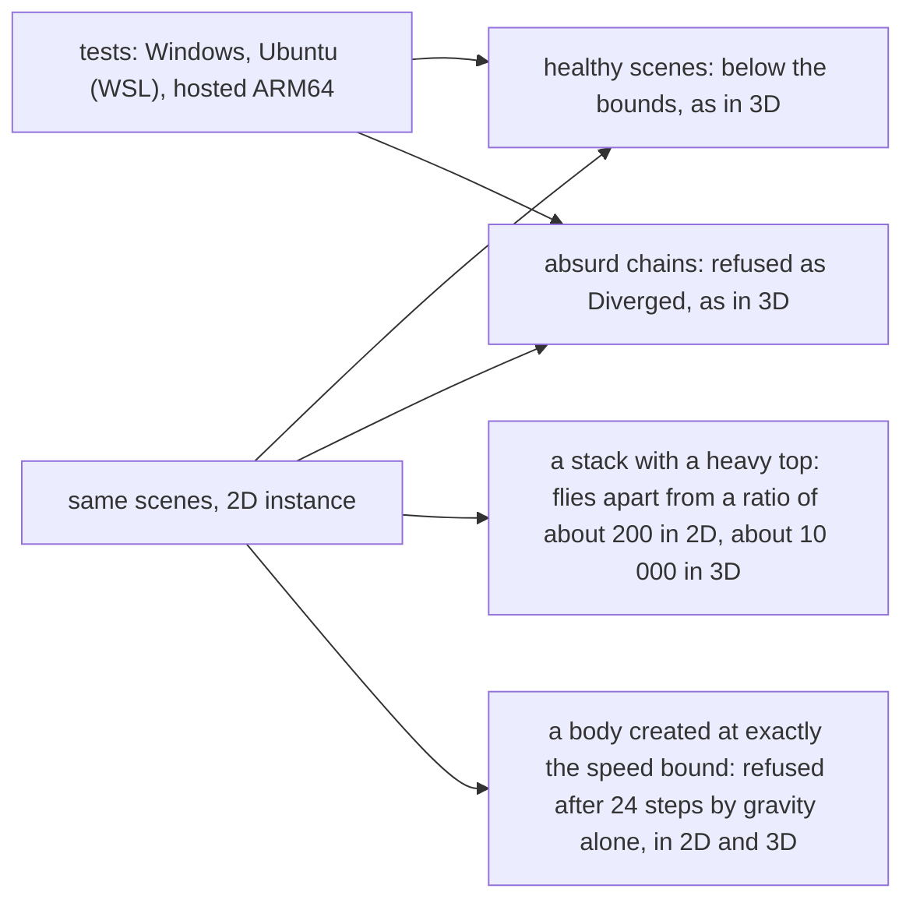

- **Healthy scenes agree.** Drops, spins up to 500 rad/s, bullets up to 1000 m/s and chains with a heavy end of 1 or 100 times stay below half of each bound, and are never refused; the largest 2D values are the bullet at 1004.6 m/s (the speed it was given) and a rod chain with six links and a heavy end of 100 at 288 rad/s (3D: 521). A body spun at the bound (2000 rad/s) ends at 353 m/s.
- **The absurd chains are refused, as in 3D.** All eight (hinge or rod, three or six links, heavy end 10 000 or a million times) end `Diverged` after 96 to 177 steps; the peaks seen before the refusal are 1174 to 1800 rad/s.
- **A difference: the stack with a heavy top.** In 2D a stack of eight squares with a top 100 times as dense falls over (a reach of 7.8 m is about the height of the stack; I first wrote that it stays together, which section 12 corrects) and at every ratio tried from 200 to 5000 it came apart or tumbled: reach 29 m at 200, 81 m at 500, 80 m at 1000, 233 m at 2000, 23 m at 5000, not growing with the ratio (a stack is 8 m high; the speed peaks stay below 45 m/s, so no speed bound sees it). In 3D the same scene stays within 18 m up to a top of 5000 times and flies apart only at 10 000 (385 m, section 2). Results at single ratios are chaotic, so the threshold is "between 100 and 200 in 2D", not a value. This belongs to card 8-39 (section 12).
- **A body created at exactly the bound is refused soon after, with no contact.** A bullet given exactly `MAX_SPEED` is accepted by `create_body`, flies past the stack without touching it, and the step is refused (`Diverged`) after 24 steps, in 2D and in 3D. The cause, found by the independent review of this card: the check compares the squared speed with the squared bound, gravity adds a small vertical speed, and in single precision the sum passes the bound by one representable step; a bullet at 9900 m/s or less is not refused. (I first wrote that the contact result was above the bound; that was wrong, there is no contact.) Resolved by card 8-46 (owner choice, 2026-11-20): `create_body` and the setters now accept at most half of each bound (`MAX_GIVEN_SPEED`, `MAX_GIVEN_SPIN`), so every speed that can be given can be stepped; the step bounds did not change.
- **ARM64.** The 2D and 3D speed scan tests ran on the hosted `ubuntu-24.04-arm` job of a hand-started `ci` run of the card's branch and passed. The tests assert margins, so this says the scenes stay inside them there, not that the values equal those of x86-64; the numbers above are from Windows. The same two test files also passed on Ubuntu x86-64 under WSL. The 2D test also asserts the reach of the healthy stacks (within 30 m); the 3D test has no such assertion.

## 7. A collision can still pass the bound, and that is kept (card 8-47)

Found by the independent review of card 8-46 and checked here in 2D and 3D by `engine/physics/tests/collision_speed_edge.rs`. The room that card 8-46 leaves between the given limits (`MAX_GIVEN_SPEED`, `MAX_GIVEN_SPIN`) and the step bounds covers gravity, damping and forces. It does not cover every collision.

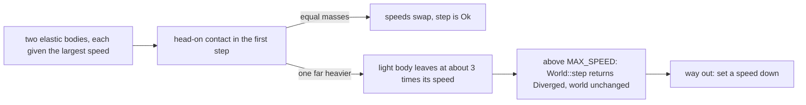

- **What happens.** Two elastic balls (restitution 1) overlapping a little, going at each other, each at the largest given speed: with equal masses the step is `Ok`; with one body 10, 1000 or a million times denser the step returns `Diverged`, in 2D and in 3D, and the world is left unchanged (state hash and step count). The same collision at 1000 m/s is `Ok` and the light body leaves at almost three times its speed (2.996 times with a 1000 times heavier partner, 2.64 with a 10 times heavier one), which is the physics of an elastic bounce off a body that hardly moves, so the refusal is the bound doing its job and not a solver fault.
- **Owner decision (2026-11-20): keep the bound as a ceiling and document it.** Rejected: a quarter instead of a half (my reasons, not the owner's: the accepted range would shrink a second time, and a chain of collisions might pass any fixed fraction, which card 8-48 then tried and did not find for spheres: see section 8) and clamping what a contact gives (it would hide the blow-up the refusal exists to show, and it changes the solver).
- **What a game does.** Keep given speeds well below the limit when bodies of very different mass can meet head-on, or keep the mass ratio moderate; when the step answers `Diverged`, set a speed down (`set_linear_velocity`, tested) or destroy a body (the rule of `PhysicsError::Diverged`, not tested here) and step again. The rustdoc of `MAX_GIVEN_SPEED` states the edge and that of `PhysicsError::Diverged` gives the way out.
- **What the tests do not show.** Only head-on spheres and circles were tried (bodies of other shapes, chains of three bodies and contacts with spin were not; the 3 times of the refused case is inferred from the lower-speed case, not observed, because the refused step leaves the world unchanged); and the scene needs the bodies to overlap at the start, because at these speeds the engine has no continuous collision detection and a body skips a contact that starts further than one step away (an effect of speed, not new, not part of this card).

## 8. Chains, boxes and spin at the top of the given range (card 8-48)

Measured on 2026-11-20 with `engine/physics/tests/collision_scenes_edge.rs` (and one more test in `collision_speed_edge.rs`), in 2D and 3D, on rows of overlapping bodies in contact from the first step. These are observations of a solver that resolves the contacts of a step together, not promises.

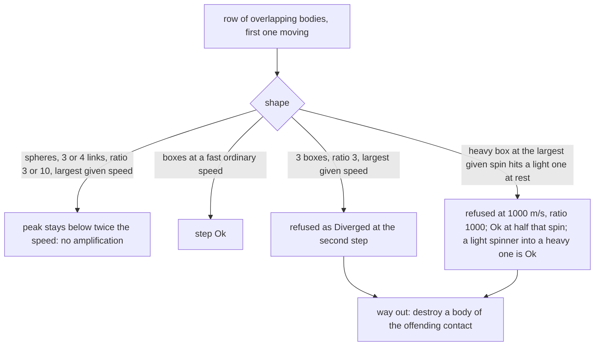

- **The chain hypothesis of section 7 is not supported for spheres.** Chains of three and four spheres, ratios 3 and 10 between neighbours, the heaviest at the largest given speed: the largest speed seen is up to about 1.8 times the starting speed (ratio 10; about 1.4 for ratio 3), asserted only as below twice it, and no step is refused. The second hit does not add to the first because all contacts of a step are solved together. A quarter of headroom was therefore not needed for these scenes; the owner's decision of section 7 stands (section 7's own list of what was not tried is the state before this card).
- **Boxes are the fragile case, and only at the top of the range.** Chains of three and four boxes at 1250 m/s step (ratios 3 and 10). At the largest given speed a chain of three boxes of ratio 3 is refused at the second step in 2D and in 3D, with the peak before it still inside the bound (so the refused step is where a contact threw a speed over); in the scan a chain of three boxes at half that speed (2500 m/s) was also refused in 2D, not pinned.
- **Spin makes it worse.** Pinned: a box 1000 times heavier than its target, spinning at the largest given spin (1000 rad/s) and moving at 1000 m/s into a light box at rest, is refused in 2D and 3D; at half that spin it steps (ratios 100 and 1000); and a light box spinning at the largest given spin into a heavy one at rest steps at 500, 1000 and 2500 m/s. **Scan only, not pinned** (a different scene: two boxes moving at each other, spinning in opposite directions, the light one at the given speed): with a partner 100 or 1000 times heavier it was refused at 1000 m/s in 2D and 3D, and at 500 m/s in 3D (2D stepped); with spin 500 or less none of the cases tried was refused. Spheres at the largest given spin do not gain spin from a hit (peak within 1% of the given spin).
- **The three times holds close to the refused speed.** At 3300 m/s with a partner 1000 times heavier the light sphere leaves at more than 2.9 times its speed and below the bound, in 2D and 3D (the 15 000 m/s of the same hit at the largest given speed cannot be seen, because the refused step leaves the world unchanged).
- **The way out needs the right body.** `Diverged` names no body. In the refused chain of three boxes, destroying the fast first body does not help (the other two already carry the speed and meet, and the step is refused again); destroying the middle or the last body does (tested, 2D and 3D). The rustdoc of `Diverged` now says so.
- **Not tried.** Hulls and capsules; a box thrown at an angle; rows with more than four links; contacts with friction set away from the default; the 2D value of the half-speed box chain is a scan result and not a test.

## 9. An opt-in clamp, and what other engines do (card 8-50)

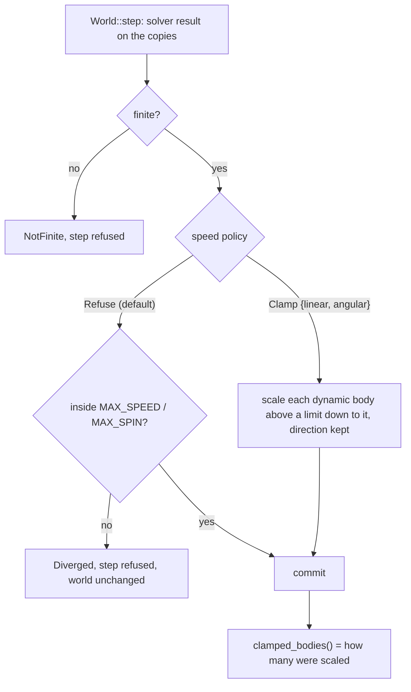

- **What other engines do** (read from their documentation on 2026-11-20; Bullet not confirmed): [Jolt](https://jrouwe.github.io/JoltPhysics/class_body_creation_settings.html) gives every body a maximum linear and angular velocity and clamps to it; [PhysX](https://nvidia-omniverse.github.io/PhysX/physx/5.4.1/_api_build/classPxRigidBody.html) clamps to a maximum linear and angular velocity before the solver, so the limit can be briefly exceeded; [Box2D](https://docs.rs/crate/box2d_sys/0.2.1/source/box2d/src/types.c) v3 has a maximum linear speed in the world definition. None of their documents says a step is refused. Their defaults are far below our bounds where they are stated (the angular defaults are tens to a hundred radians per second, against our bound of two thousand).
- **What is built.** The default stays the owner's rule of 8-25, 8-36 and 8-47: refuse. `SpeedPolicy::Clamp` is the opt-in for a game that prefers the other engines' behaviour, with limits it chooses (at most the given limits). It is chosen with a world method and not a config field, so no existing config changes, and a refusing world hashes as before (a clamping world adds its limits to the hash).
- **Limits of the clamp.** It acts on the result of the step: the contacts of the step that crossed the limit were solved with the higher speed and the bodies moved with it for that step (other engines clamp before the solver; doing that here would mean a change in each of the two solvers). Direction is kept, so the energy that was above the limit is dropped, and a clamped scene is not physically exact; the count says it happened.
- **What the tests show** (`engine/physics/tests/speed_clamp.rs`, 2D and 3D): the head-on collision of 8-47 (a light and a heavy ball at the largest given speed, refused by default) steps under the clamp in 2D and 3D; direction is kept; a body within its limits is untouched and not counted; invalid limits are `InvalidSpeedLimit` and change nothing; a value that is not finite is still refused; two runs give the same hash. a scene of twenty-four circles thrown at a floor, where the clamp fires on every body, gives the same state after every step serially and with 1, 2, 4 and 6 workers. **Not shown by a test:** the box scenes of 8-48 under the clamp, Linux and ARM64 (the hosted run), and a clamp that fires during resting contact (the independent review tried a joint chain and a stack by hand: both stepped, and a stack that never reaches the limit matched the refusing world bit for bit).

## 10. Which body crossed the bound, and how much spin room there is (card 8-49)

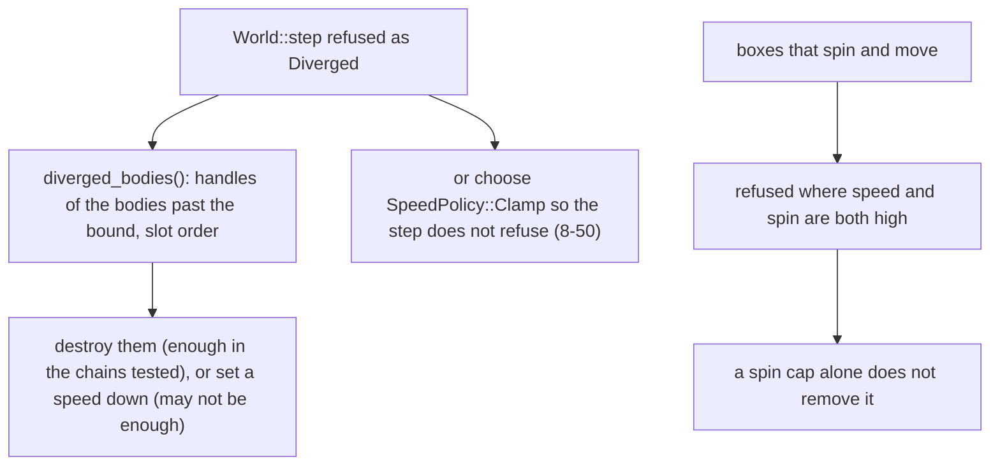

- **The query.** `World::diverged_bodies()` returns the bodies whose speed passed `MAX_SPEED` or `MAX_SPIN` in the last step when that step was refused as `Diverged`, in slot order; it is empty after any other step and unchanged by a call with a time step that is not valid. It is read-only, adds nothing to `PhysicsError` and allocates nothing (its capacity is reserved with the world). The list is a snapshot: it can name a body destroyed since, and a changed policy does not clear it. Two light and two heavy balls in two pairs name exactly the two light ones in slot order, and in the refused chain of three boxes of 8-48 destroying the body it names let the world step again, in 2D and 3D (tested). It names bodies of a `Diverged` refusal only: a `NotFinite` refusal names none.
- **The spin scan** (`engine/physics/tests/spin_room_edge.rs`, boxes, 2D and 3D, two scenes: a heavy box thrown spinning into a light one at rest, and two boxes going at each other spinning the opposite ways; mass ratio 10 and 1000; 30 steps; spins in steps of 25 rad/s). The first spin that was refused, as measured:

| speed (m/s) | first refused spin (rad/s), the range over the scenes, ratios and dimensions |
|---|---|
| 200 | none up to the largest given spin (tested at 200; a scratch scan also at 0) |
| 1000 | 850 to 925 (none for a ratio of 10) |
| 2500 | 675 to 950 (none in one case) |
| 3500 | 575 to 875 |
| 5000 | 300 to 575 |

- **What it says.** The refusals sit where speed and spin are both high: the corner of a spinning box moves faster than its centre, and a contact can throw that speed past the bound. No scene was refused at a spin of 250 or less at any speed, nor at 650 up to 1000 m/s, nor at any spin up to 1000 at 200 m/s (all tested at one point: 250, 650 at 1000 m/s, and 200 m/s; the scratch scan stepped the spin by 25); every scene was refused at the largest given speed with a spin of 600 (tested). In this scan (boxes, these two scenes) a cap on the given spin alone would have to be about 250 to remove every refusal, below the spin of the drop in the 8-37 scan; it would say nothing about other shapes, and it does not touch the refusals of 8-47, which happen with no spin at all. The default angular limits of Jolt and PhysX (tens of radians per second) are below it.
- **Decision (owner, 2026-11-20, in the owner's words "keep it documented"): the region stays as documented**, so the joint limit and the lower given spin below are not taken; a game that wants no refusal uses the clamp of 8-50.
- **Options that were put to the owner:** keep the bounds and the documented region (a game that wants no refusal chooses the clamp of 8-50 or keeps speed and spin moderate); or add a joint limit on speed and spin together at create and set; or lower the largest given spin. The first needs nothing; the other two change a public rule and move the values of 8-46.
- **Not shown here:** hulls, capsules, hits off the line of centres, longer rows, friction and other spin axes; section 11 (card 8-51) tries them.

## 11. Capsules, hulls, off-centre hits, longer rows, friction, other axes, and the clamp in a stack (card 8-51)

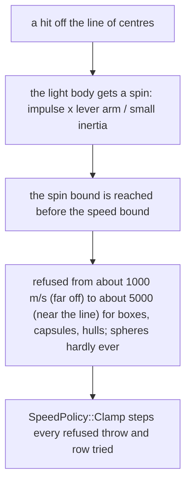

Measured on 2026-11-20 in 3D only (2D has circles and boxes, which sections 7 to 10 cover), steps of 50 m/s and 50 rad/s, a heavy body thrown at a light one at rest (30 steps), the bodies starting 0.9 apart so the contact is in the first step. Pinned at a few points in `engine/physics/tests/collision_shapes_edge.rs` (12 tests); the rest is the scratch scan, not pinned.

| scene | first refused (no spin unless said) |
|---|---|
| light body 0.2 off the line of centres, ratio 1000 | box 4200, capsule 4750, hull 4900, sphere never |
| 0.4 off | box 2550, capsule 2650, hull 2000, sphere 3450 |
| 0.6 off | box 1350, capsule 1500, hull 1050, sphere never |
| head-on, spin about z, 5000 m/s | box 300, capsule 0 (refused without spin), sphere 100, hull never |
| box, ratio 1000, 5000 m/s, spin about x or y | never (the hit runs along x; only the spin about z, across the hit and the offset, refused) |
| box, friction 0 to 3, 2500 m/s | the first refused spin does not move (750 in the scan; 700 steps and 800 is refused in the test) |

- **New finding.** Off the line of centres the light body leaves spinning, and that spin crosses the bound at speeds from about 1000 m/s, far below the head-on edge of section 7. Boxes, capsules and hulls are alike within a factor of two; the hull of eight corners is refused first at 0.4 and 0.6 off and last at 0.2 off. A ratio of 1 is refused too; at 0.6 off at a higher speed (box: 2100 against 1350 for a ratio of 1000), at 0.2 off at a lower one (3650 against 4200). The hull at 0.6 off is first refused at 1050, so the test that nothing is refused at 900 m/s keeps a margin of 150, and the pinned contrast of hull and box is at 1200.
- **Rows.** Rows of five, six and eight spheres never refused (up to 5000 m/s, ratio 3 and 10). Boxes, capsules and hulls are refused in some rows and not in others (about 20 of 72 in a re-scan), with no simple rule in length or speed that I found (a capsule row of five at 2500 is refused and at 5000 steps; hull rows of ratio 10 are refused at nearly every length and speed), so the four refused rows pinned are examples, not an edge. With the clamp, every row tried (4 forms, 3 lengths, 2 ratios, 3 speeds; 72 rows) steps and no body is above the limit afterwards; so do the three off-centre throws that are refused by default (box, capsule, hull at 0.6 off, 2500 m/s).
- **The clamp in a stack.** Eight boxes on a floor with a ball of density five dropped on top at 10 to 5000 m/s: with the default policy the world never refused in this scene at any speed tried (10, 100, 400, 1000, 3000, 5000), so the stack shows only that the clamp keeps a world finite, not that it rescues a refused one; the clamp changed nothing below the limit (positions equal bit for bit at 10 m/s, tested). The ball scatters the stack from 100 m/s (bodies end up to 8 m to the side), at 400 m/s some bodies end below the floor, at 1000 m/s they are thrown upward, and at 3000 and 5000 m/s they end far below it, with or without the clamp; the engine has no continuous collision detection (section 7). So the clamp keeps the world finite and stepping, and does not make a fast hit physical.
- **Not shown.** 2D (nothing new to try there), angled hits between two moving bodies, hulls with many vertices, friction with spin on hulls and capsules, stacks hit by a box, and the box scenes of 8-48 under the clamp beyond the rows above.

## 12. How tall a stack can be under a heavy top (card 8-39)

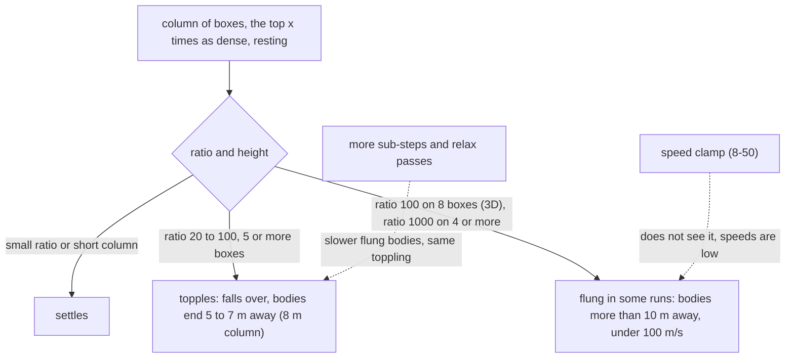

Measured on 2026-11-20 with `engine/physics/tests/stack_mass_ratio.rs` (2D and 3D, default solver, sleeping off, 600 steps, the top box resting on the stack and shifted sideways by 0, 0.001, 0.01, 0.05 or 0.2 m; the result at one offset is chaotic, so each cell is five runs). Settled means no body was ever more than 1 m from the axis. The table gives the runs that settled out of five, 2D then 3D. Five offsets are few for the cells on the edge: a finer scan (41 offsets from 0 to 0.3 m) settled x100 on two boxes, x10 on three to five boxes, x5 on six and eight boxes and x1 on eight at every offset in both dimensions, but only 32 to 41 of 41 for x20 on four or five boxes, x10 on six, x50 on three and 2D x20 on three; those are the cells that read 4 or 5 of 5 above, and the tests pin only the first group.

| boxes (top included) | x5 | x10 | x20 | x50 | x100 | x1000 |
|---|---|---|---|---|---|---|
| 2 | 5, 5 | 5, 5 | 5, 5 | 5, 5 | 5, 5 | 0, 3 |
| 3 | 5, 5 | 5, 5 | 5, 5 | 5, 5 | 4, 5 | 2, 1 |
| 4 | 5, 5 | 5, 5 | 5, 5 | 4, 4 | 2, 4 | 0, 0 |
| 5 | 5, 5 | 5, 5 | 5, 5 | 1, 4 | 0, 0 | 0, 0 |
| 6 | 5, 5 | 5, 5 | 4, 4 | 0, 0 | 0, 0 | 0, 0 |
| 8 | 5, 5 | 4, 5 | 2, 3 | 0, 0 | 0, 0 | 0, 0 |

- **The safe region is small and shrinks with height.** At every offset of the finer scan: a top 100 times as dense on two boxes, 10 times on up to five, 5 times on up to eight. At most offsets (the five-offset table; 32 to 41 of 41 in the finer scan): 10 times on six, 20 times on up to five, 50 times on three. Never in either scan: 50 times on six or eight boxes, and 100 times on five or more. The tests pin the first group and, as cases that never settled, 50 and 100 times on six and eight boxes.
- **Failures are mostly toppling, not flinging.** A column of eight with a top 50 or 100 times as dense falls over (bodies end 5 to 7 m away, an 8 m column, at 11 to 12 m/s at most). Flinging (a body more than 10 m away) came in some runs at x100 on eight boxes in 3D (2 of 5) and at x1000 from five boxes in 2D and four in 3D (not monotone: 3D five boxes were never flung), in most runs at x1000 on eight. The fastest body was 98 m/s (3D, four boxes, x1000, one run of five flung), and a 3D column of five at x1000 reached 93 m/s with none flung, so speed and distance do not go together; in 2D the largest was 43 m/s. No bound on speed, and no clamp set at a few hundred m/s (8-50), sees it.
- **The existing tests are consistent with this.** The stability columns of card 4-17 are two or three boxes (ratio 10 and 100, the heavy box on top, below or in the middle) and settle; this scan covers only the heavy box on top, and shows what happens above that height. A scratch scan of the scenes of 8-37 and 8-40 that dropped the top from 0.3 m gave the same picture (a ratio of 20 left a body more than 2 m from the axis in four of five runs in 2D, and in three of five in 3D); the earlier reading of "stacks up to x100 are healthy" there looked only at speed and at a reach under 30 m, which a stack that has fallen over also meets.
- **The solver settings do not cure it for tall stacks.** With 8 sub-steps, 16 with 2 relax passes, or the largest setting (16 and 4), a stack of eight with a top 50 times as dense still never settled in 2D or 3D, and 100 times neither at the largest setting; the speed of the flung bodies fell (2D, eight boxes, x1000: 43 m/s with the default, 21 and 18 with the first two settings) and the toppling stayed. They help a shorter stack: five boxes under a top 50 times as dense settled in 4 of 5 runs at the largest setting (1 of 5 in 2D and 4 of 5 in 3D at the default), at the price of four times the sub-steps. So a world setting moves the edge a little for short stacks and does not close it.
- **Other engines.** The documentation pages of Box2D, Jolt, PhysX and Bullet that I could read gave no maximum mass ratio and no number for what happens beyond it (Bullet's manual could not be read); what they name as remedies is per-body solver iterations, scaling of the effective mass or inertia, and dominance groups, none tied to a ratio. That is "not confirmed", not "none exists".
- **The three options of the card, and why only the first is recommended.**
  1. **Document the observed region and keep it pinned** (recommended, done here): the table above and the tests; a solver change that shrinks the region is then seen.
  2. **A runtime check** (position, energy or penetration depth): not recommended. The worst bodies stay under 100 m/s, a game's world size is not known to the engine (a position bound would be a number the game must set), and a check can report a stack that came apart but not hold it together; the clamp of 8-50 and the query of 8-49 already cover the speed side. A report of the deepest contact overlap would see the squashed stack before it topples without any bound from the game; it was not tried, and it is the one check worth a card of its own if the owner wants a warning rather than a cure.
  3. **Enforcing a limit at `create_body`:** not possible as stated, because the ratio belongs to two bodies in contact, not to one body; a world-wide range of densities (a `WorldConfig` setting rejecting a body outside a density band) would be possible but rejects harmless worlds (a heavy ball and a light crate that never touch) and still says nothing about height, which matters as much as the ratio here.
  A real fix is solver work and was tried in card 8-54: the lever is the stiffness of the contact, and an opt-in preset widens the region (section 13).
- **Not shown.** Columns with the heavy box in the middle or the bottom (the 4-17 columns are the only ones), stacks of more than eight, a heavy top dropped from a height at these ratios beyond the 0.3 m of 8-37, other shapes than boxes, sleeping on (the tests run with sleeping off), and platforms other than Windows x86-64 and Ubuntu x86-64 (WSL; the table is Windows).

## 13. Stiffer contacts widen the region, as an opt-in preset (card 8-54)

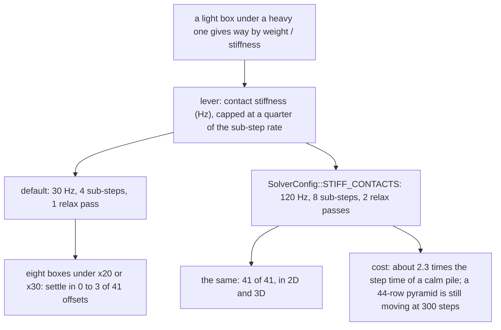

Measured on 2026-11-20 on Windows x86-64, the scene of section 12 (a column of boxes, the top box resting on it and shifted sideways; settled means no body ended more than 1 m from the axis at any step of 600). Counts at the edge change by one or two between scans of the same cell, so a cell is "about" its count.

- **The lever is the stiffness in hertz.** More sub-steps or relax passes at the default stiffness do not help (section 12, up to 16 and 4). A spike over 4, 8 and 16 sub-steps, a stiffness of one eighth or a quarter of the sub-step rate, damping 3, 10 and 30, push speed 0.5 and 3, and 1 or 4 relax passes (2D, five offsets; three hard cases: eight boxes under x50, six under x50, five under x100) gave: at 30 Hz at most 1 of 5 for the two taller cases and at most 3 of 5 for five under x100 in every setting; at 60 Hz (the cap at 4 sub-steps) none to five of five, mostly three to five with damping 10 or more (eight under x50 never settled with damping 3); at 120 Hz with 8 sub-steps all five in every setting except one (damping 3 and push speed 0.5: three of five for five under x100); at 240 Hz with 16 sub-steps all five. The stiffness cannot go above a quarter of the sub-step rate, so the sub-steps matter only because they raise that cap. Damping and push speed moved little.
- **The preset.** `SolverConfig::STIFF_CONTACTS` is the default with 8 sub-steps, 2 relax passes and a contact stiffness of 120 Hz (the cap at 8 sub-steps of 60 Hz steps). A public constant of the shared physics core, Class 2. **The default is unchanged**, so no hash, golden file or existing test moves.
- **Why two relax passes.** The first version had one: tall stacks settled, but a column with a heavy body on a light one kept creeping (heavy-on-light columns of two or three boxes, ratio 10 and 100: still moving at 0.02 to 0.24 m/s after 5 s to 40 s, drift growing to 0.22 m), which the default holds at rest. The independent review found it. With a second relax pass the same columns are at rest (speed 0, drift at most 0.007 m after 20 s). A cheaper setting with 90 Hz and one pass was also at rest but settled eight boxes under x50 in 32 of 41 offsets, against 41 and 39 with the preset.
- **The region under the preset** (settled out of five offsets, 2D then 3D; default in section 12):

| boxes (top included) | x20 | x50 | x100 | x300 | x1000 |
|---|---|---|---|---|---|
| 3 | 5, 5 | 5, 5 | 5, 5 | 5, 4 | 5, 3 |
| 5 | 5, 5 | 5, 5 | 5, 5 | 4, 3 | 1, 1 |
| 6 | 5, 5 | 5, 5 | 5, 5 | 4, 4 | 0, 0 |
| 8 | 5, 5 | 5, 5 | 5, 5 | 1, 1 | 0, 0 |

  Flinging (a body more than 10 m away) came only at x1000 on eight boxes (five of five in 2D, four in 3D), on six in 3D (four) and once at x300 on eight in 3D.
- **How firm.** A scan of 41 offsets (0 to 0.3 m, release build): at every offset in 2D and 3D, eight boxes under x20 and x30 and five under x50 and x70 (the default settled 0 to 3 of 41 on them, 10 of 41 for five under x50 in 3D); nearly always, eight under x50 (41 and 39), five under x100 (40 and 39), six under x100 (38 and 35), three under x300 (41 and 34). The tests pin only the first group.
- **Cost.** 512 boxes in 64 columns of eight, standing, 300 steps, release, best of three: 0.50 s at the default, 1.12 s with the preset (2.3 times), 0.82 s for the cheaper 90 Hz setting. A wall-clock look at one scene on one machine, not a gate; the instruction-count gate runs on the default. (A first reading of 1.7 times was for one relax pass.)
- **Ordinary scenes** (`engine/physics/tests/stability/stiff.rs`, 2D, and one pass of the whole stability suite with the default temporarily switched to the preset values):
  - Pyramids of 5, 10 and 20 rows stand, with a drift of 0.006, 0.011 and 0.029 m (the default moves 0.053 m at 20 rows, which is a finding of the catalogue), a final speed under 0.001 m/s and a penetration of at most 0.002 m; at 30 rows the drift is 0.045 m against 0.107 m.
  - **A 44-row pyramid (the shape of workload W1) settles later with the preset** (card 8-57, release scan, sleeping off): final speed 0.19 m/s at 300 steps against 0.037 at the default, 0.23 at 600, 0.05 at 1200 and 0 at 2400 (the default 0.035, 0.022 and 0.0015); with sleeping on it is asleep at step 1230 against 721. Drift 0.119 m against 0.247 and penetration 0.002 m against 0.019 at 300 steps. Pinned at 300 steps as a finding (final speed between 0.1 and 0.5 m/s).
  - Columns of ratio 10 and 100 (seven columns of two or three boxes) come to rest, and the two heavy-on-light ratio-100 columns do not creep over 40 s.
  - **Chains, whips and bridges** (card 8-57, pinned: the bodies of the catalogue's tests run with the preset, same bounds): the hanging chain of 20 links, whips of 20 and 30 links, a last link 10 and 100 times heavier, and the bridge under loads of 5 and 50 planks stay within their bounds (hinge error bounded by 0.05 m, 0.1 m for the heavy ones). The mixed scene with a chain hanging on the apex holds. Several documented findings of the catalogue do not hold any more because the preset does better (scratch pass): the column of 20 boxes no longer topples (drift 0.028 m), the four-high column 1:100:1:100 stays (0.025 m), the column of 11 and the 20-row pyramid stay within the drift bound, the load of the heavy bridge is at 0.015 m/s after 8 s instead of bouncing.
  - **Costs seen** (the 44-row pyramid above, and two more, both pinned as findings in card 8-57; neither cause was looked into): in the random bins of the property test one seed in 25 (1147) has a contact 0.030 m deep once calm, against the 0.02 m bound (0.010 m with the default; the other 24 are at most 0.0115 m); and the whip of the mixed scene: with the default it hits the pyramid on its second swing (a box first moves at step 184) and moves it 2.5 m; with the preset it never comes nearer than on its first swing (step 62, about 0.59 m centre to centre) and the pyramid moves 0.006 m, so that scene no longer shows a hit (cause not looked into; the whip itself swings down). A bouncing ball with restitution 0.8 rose to 1.71 m against 1.70 m (3D, one run, no change).
- **Switching the default.** With the default switched to the preset values, 40 tests failed in the first (one relax pass) pass, most of them pins of hashes and default values and the findings above that are now better. It is a decision of its own (golden files are governance, about 40 tests change their bounds) and is not taken here.
- **Other conditions** (pinned in card 8-57 unless said): with sleeping on, a pyramid of 10 rows, the columns 1:100 and 1:100:1 and eight boxes under a top 20 times as dense are asleep within 300 steps (measured: step 30 to 40) and moved under 0.05 m (measured: at most 0.015 m); scratch measurement, not pinned: the default puts the eight boxes to sleep at step 501 after they fell 4.4 m; at steps of 30 Hz, where the stiffness is capped at 60 Hz, the preset still settled eight boxes under x20, five under x50 and x70 and three under x100 at every one of five offsets in 2D, and the first and third in 3D (the default settled at most one in five of eight under x20 and five under x70, in both); also at 30 Hz, eight under x30 4 of 5 and eight under x50 4 of 5 in 2D, 3 of 5 in 3D, not pinned. The independent reviewer of 8-54 had seen the same in scratch runs.
- **Not tried.** The instruction-count benchmark (the gate is governance, card 8-61), other shapes than boxes and 3D joints (card 8-60), the hosted Linux and ARM64 runs (the pins ran on Windows x86-64; the release PR is the first hosted run), the causes of the three costs above (card 8-59), and a per-contact stiffness scaled by the mass ratio of the two bodies (the other idea of card 8-54, card 8-56), which would cost less than twice the sub-steps and change the hashes of any scene with a heavy contact.

## 14. Hits between two moving bodies, a hull of 24 corners, friction with spin, and a stack hit by a box (card 8-52)

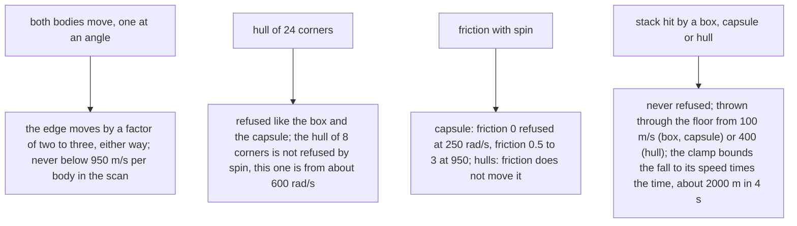

Measured on 2026-11-20 in 3D only, release scan in steps of 50 m/s (given speed capped at 4900, the given limit being 5000) and 50 rad/s (capped at 1000, the given limit), bodies 0.9 m apart, 30 steps, the thrown body of density 1 or 1000 against one of density 1 (`engine/physics/tests/collision_angled_edge.rs`, 10 tests; the table is the scratch scan, pinned at a few points with a margin of one step or more).

- **Both bodies moving, one at an angle.** The thrown body at 0, 30 or 60 degrees from the x axis, the target moving against it at the same speed, offset 0 or 0.4, ratio 1 or 1000, five forms. First refused speed (per body): nothing below 950 m/s in 60 cells (the hull of 24 corners, ratio 1, 0.4 off, straight: 950). Two equal spheres with no offset are never refused at 0 and 30 degrees (up to 4900) and from 3150 at 60 degrees; with 0.4 off they are refused from 3450 at 0 degrees and never at 30 and 60; boxes, capsules and hulls from 1000 to about 1500 at 0.4 off, and from 3000 to 4700 with no offset (a tilt of 60 degrees moves a box at ratio 1000 from 3100 to 4250, a capsule from 3250 to 4700, a hull from 3100 to 4450; the sphere the other way, from 3350 to 1600). So the edge of section 7 (a head-on hit) is not a bound for a hit between moving bodies: the closing speed is the sum, the spin comes from the offset and the angle, and the refusal speed per body is lower than for a body at rest, by a factor of two to three.
- **A hull of 24 corners** (a 12-sided prism) against the hull of 8 corners (a box shape) of section 11, a heavy body at a light one at rest: at 0.2 off, ratio 1000, never against 4900; at 0.4 off 2600 against 2000; at 0.6 off 1550 against 1050; ratio 1: 4050, 1900, 1450 against 4250, 2000, 1550. The same range as boxes and capsules; no extra danger from the number of corners. The clamp steps the hull of 24 corners at 0.6 off, 2500 m/s (tested).
- **Friction with spin** (head-on, 2500 m/s, ratio 1000, spin about z, friction 0, 0.5, 1, 3): the capsule is refused from 250 rad/s with friction 0 and from 950 with any friction from 0.5; the hull of 8 corners is never refused (up to 1000); the hull of 24 corners from 550 (friction 0) or 600. Section 11 found that friction does not move the edge for a box (700 and 800 for every friction); the capsule is the exception, the only form tried where friction decides it.
- **A stack hit by a box, a capsule or a hull of 24 corners** (eight boxes on a floor, a body of density 5 dropped from 0.05 m to the side of the axis at 10 to 4900 m/s): the world is never refused at any speed in the scan, at any of the three forms. At 10 m/s the stack stays on the floor; at 100 m/s the box and the capsule end 12 m below it (the hull of 24 corners: not measured below 400, since the lowest body in the scan was the floor itself), at 400 m/s the box 179 m, the capsule 744 m, the hull 34 m, and at 3000 m/s all three end 6000 to 12000 m below the floor. With the clamp (500 m/s) the lowest body ends at about 2000 m below (2016 to 2033 at 3000 m/s): that is the clamp speed times the 4 s of the run, so the clamp bounds the fall, it does not stop it. The clamp keeps the world finite and does not make a fast hit physical, as in section 11; this section only adds the shapes.
- **Not shown.** 2D (circles and boxes only, nothing new to try), angles about the other axes and hits between bodies of different forms, hulls with more than 24 corners or irregular, spin about the other axes with friction, stacks of more than eight, and Linux and ARM64 runs of the pins (the scan is Windows x86-64; the pins sit one scan step or more from the first refused speed, but the two cells at 0.4 off are close: hull of 24 corners 950 against the pinned 800).

## 15. The heavy box in the middle or at the bottom, taller stacks, sleeping, and a heavy top dropped (card 8-55)

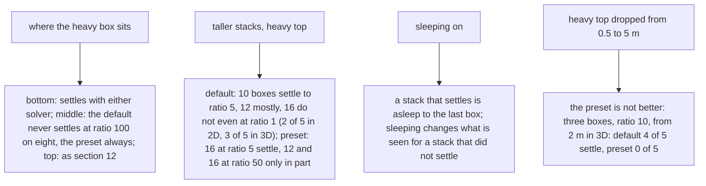

Measured on 2026-11-20, Windows x86-64 (the pinned file also passes on Ubuntu x86-64 under WSL2), release scan of 135 rows, 2D and 3D, five offsets each (0, 0.001, 0.01, 0.05, 0.2 m), 600 steps of 1/60 s, sleeping off unless said; "settled" is a drift under 1 m. The scan itself is not in the repository; `engine/physics/tests/stack_mass_ratio_more.rs` pins five points of it with margin.

- **The heavy box at the bottom** (five and eight boxes, ratios 10 and 100): settled at all five offsets with the default and with the preset, in 2D and 3D. The heavy box sits on the floor and carries the light ones.
- **The heavy box in the middle** (eight boxes, level 4, ratio 100): the default never settles (0 of 5 in 2D and in 3D; with five boxes, level 2: 4 of 5), the preset settles at all five offsets (also with ratio 10 and five boxes). Pinned: eight boxes, ratio 100.
- **Taller stacks with the heavy box on top** (default / preset):
  - 10 boxes: ratio 1 and 5 settle (5 of 5 each); ratio 50 never with the default (0 of 5), always with the preset.
  - 12 boxes: ratio 1 settles, ratio 5 in 3 to 4 of 5 with the default (one run flung), ratio 50 never (0 of 5); the preset settles ratio 1 and 5, and ratio 50 in 4 of 5 (one flung, peak 14.8 m/s).
  - 16 boxes: **the default does not settle a plain stack of 16** (ratio 1: 2 of 5 in 2D, 3 of 5 in 3D); ratio 5 never; the preset settles ratio 1 and 5 at all five offsets, ratio 50 in 3 of 5.
  - Pinned: 16 boxes, ratio 5: default 0 of 5, preset 5 of 5, in 2D and 3D.
- **Sleeping on** (five boxes ratio 10, eight boxes ratio 5 and 50): a stack that settles is asleep to the last box (25 of 25 and 40 of 40 bodies); with the preset all five offsets of eight boxes at ratio 50 settle and sleep. The default with ratio 50 settles 3 of 5 in 2D and 1 of 5 in 3D with sleeping on and 0 with it off, so **sleeping changes what is seen for a stack that did not settle** (a body can fall asleep in a tilted state; the offsets are chaotic). Pinned: eight boxes, ratio 5, default and preset, every body asleep.
- **A heavy top dropped from 0.5, 2 and 5 m** on 3 or 5 boxes (ratios 10 and 100): default and preset both topple some runs; **the preset is not better and in places worse** (peak speeds 6 to 13 m/s). Three boxes, ratio 10, dropped from 2 m, 3D: default 4 of 5 settle, preset 0 of 5 (from 5 m: default 1 of 5, preset 0 of 5; in 2D from 2 m: default 4, preset 2). Five boxes ratio 100 from 2 m: default 0 of 5 in 2D and 3D, preset 3 of 5 in both. Pinned: the three-box case in 3D (default at least 3, preset 0). The cause was not looked into (the impact of a heavy box against a soft, resting contact is the likely place); card 8-64.
- **Not shown.** Spheres, capsules and hulls in a column (a column of spheres does not stand, capsules and hulls were not tried; card 8-60 covers the preset on other shapes), a heavy box in the middle with a drop, stacks above 16, a drop at ratios below 10, 5 offsets only (the 41-offset check of section 12 was not repeated), the hosted Linux and the ARM64 runs (the Ubuntu run is WSL2 on the same machine), and the test file takes 15 s in the dev profile.

## 16. The stiff-contact preset on other tops, on a column of hulls, with the clamp, and on 3D joints (card 8-60)

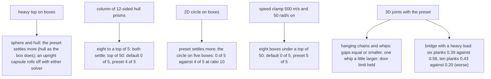

Measured on 2026-11-21, Windows x86-64 (the pinned file also passes on Ubuntu x86-64 under WSL2), release scan, five offsets (0, 0.001, 0.01, 0.05, 0.2 m), 600 steps of 1/60 s, sleeping off, "settled" is a drift under 1 m. The scan rows were not kept; the ten tests of `engine/physics/tests/stiff_preset_shapes_joints.rs` and the rows quoted here are the record.

- **Heavy tops on a column of unit boxes** (3D, default / preset, settled of five):
  - sphere: three boxes ratio 10: 3 / 5; five boxes ratio 10: 1 / 5; five boxes ratio 100: 0 / 3; eight boxes ratio 50: 0 / 3 (the box top of section 12 settles 5 of 5 at the three cells that the preset carries);
  - hull (12-sided prism): behaves as the box: three and five boxes at ratio 10: 5 / 5; five at ratio 100 and eight at 50: 0 / 5;
  - upright capsule (half length 0.25, radius 0.5): **0 of 5 at every cell with either solver**, down to three boxes at ratio 10; an upright capsule meets a flat face at its cap, one point like a sphere, which is the likely reason it rolls off at any offset (not verified); the preset does not change it.
- **A column of hull prisms** (eight, the top shifted): with a top of ratio 5 both solvers settle at all five offsets; with a top of ratio 50 the default settles none (2 toppled, 3 flung) and the preset four (one flung). Columns of three and five prisms settle with both up to ratio 10. A column of spheres, and of capsules of half length 0.0001, does not stand with either solver (two or three of them: 1 of 5); upright capsules of half length 0.25 in a column were not tried.
- **2D, a circle on boxes** (default / preset): three boxes ratio 10: 2 / 5; five boxes ratio 10: 0 / 4; ratio 100: 0 / 2; eight boxes ratio 50: 0 / 2.
- **The speed clamp on** (`SpeedPolicy::Clamp`, 500 m/s and 50 rad/s): five boxes ratio 10 and eight boxes ratio 5 settle with both; eight boxes ratio 50: default 0 of 5, preset 5 of 5. The clamp does not interfere with the preset.
- **3D joints** (default / preset, the largest distance between the two anchors of any joint over 600 steps):
  - hanging chain of ten links, the end link 1, 10, 100 times as dense: 0.0017 / 0.0012, 0.0039 / 0.0027, 0.027 / 0.023 m; twenty links: 0.0041 / 0.0030, 0.030 / 0.026 m; the chain ends in the same place (a few millimetres), the peak speed is lower with the preset;
  - whip of eight links thrown sideways and spinning, ball joints, end link 1 / 100 times: 0.018 / 0.0105 and 0.080 / 0.063 m; hinges: 0.019 / 0.0096 and 0.086 / **0.092** m (a little larger with a heavy end); no link left the scene;
  - hinge door with limits of -1 and 0.5 rad: both reach the lower limit within 0.001 rad;
  - **bridge** of 1 m planks between two posts, hinged at the ends, a box 100 times as dense dropped on the middle plank: six planks 0.58 / 0.39 m, ten planks **0.20 / 0.43 m** (the preset has twice the gap with ten planks; empty bridges 0.007 / 0.006 and 0.010 / 0.009 m); with a load of 10: 0.059 / 0.044 m. The cause was not looked into (card 8-65).
  - The scan scene had no floor; the test world has one and a 20-link chain from 10 m reached it (gap 1.7 m in the first test run), so the pinned chains hang from 25 m.
- **Not shown.** Columns of upright capsules (shown only for a half length of 0.0001), spheres in 2D, hull columns with a ratio between 5 and 50, joints with sleeping on, a clamped chain, joints with heavy bodies in the middle, other joint kinds (distance rod and rope), the hosted Linux and ARM64 runs (Ubuntu is WSL2 on the same machine), five offsets only, the file takes 18 s in the dev profile.

## 17. Hits between different forms, hulls of 32 corners and of no symmetry, spin about x and y, friction, taller stacks, a non-monotone cell (card 8-58)

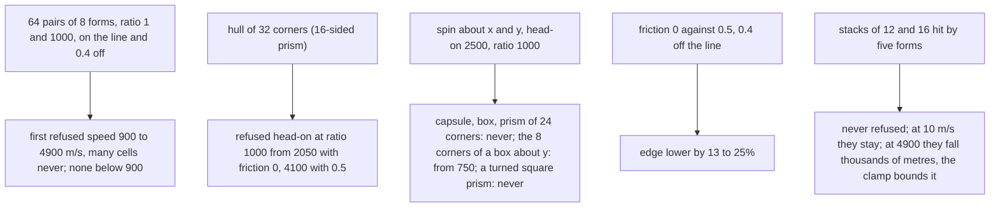

Measured on 2026-11-21, Windows x86-64 (the pinned file also passes on Ubuntu x86-64 under WSL2), 3D release scan in steps of 50 m/s (to 4900) and 50 rad/s (to 1000), bodies 0.9 m apart, 30 steps, friction 0.5 unless said, restitution 1. The eight forms: sphere, box, capsule, the 8 corners of a unit box ("Hull8"), a square prism turned 45 degrees with circumradius 0.7 ("Diamond"), a 12-sided prism (24 corners), a 16-sided prism (32 corners, the most `Hull::new` takes) and an 11-point hull of no symmetry. The scan is not in the repository; `engine/physics/tests/collision_forms_edge.rs` (11 tests) pins points of it, each 100 m/s or 100 rad/s or more from the first refused value.

- **Different forms** (the thrown body at the target, first refused speed):
  - ratio 1, head-on: sphere, box and the 8-corner hulls are never refused by each other or by a sphere (to 4900); a capsule at a box or a box-corner hull 4050; larger hulls at each other 1250 to 4550; the irregular hull from 1400 (at itself) to 4400;
  - ratio 1000, head-on: capsule at capsule 4900, capsule at the 32-corner prism **900**, the irregular hull at the box, the box-corner hull or the turned prism 900 to 950, otherwise 1000 to 4850 or never;
  - 0.4 off the line: 950 (a sphere or the irregular hull at a 24- or 32-corner prism) to 4900, none below 950 in 64 pairs times two ratios.
  - Pinned: all 64 pairs at 700 m/s in four cells step (200 m/s below the lowest); four cells at 1100 (1400 for the irregular hull at itself) are refused.
- **Hulls beyond 24 corners.** The 32-corner prism at itself, ratio 1000, head-on: 2050 m/s with friction 0, 2800 with 0.1, 4100 with 0.5 to 3; at ratio 1 only friction 0 refuses it (3850). The 24-corner prism, the box and the box-corner hull are not refused head-on at any friction. With friction 0.5 the 32-corner prism is not refused by spin up to 1000 rad/s about any axis. Pinned at 2500 m/s: friction 0 refused, friction 0.5 steps (card 8-66).
- **Spin about x and y** (head-on, 2500 m/s, ratio 1000, friction 0, 0.5, 3): the capsule, the box and the 24-corner prism are not refused at 1000 rad/s about x or y; the box-corner hull is refused about y from **750** at every friction and not about x or z; section 14's 600 about z is the 24-corner prism, which this scan confirms (refused about z from 550 to 600, not about x or y), so section 14's "a hull of eight corners is never refused by spin" holds about z only; the turned prism is not refused about any axis. The irregular hull is refused at ratio 1000 even without spin (its edge is 1250), so spin cannot be read off it.
- **Friction off the line** (0.4 m, same form, ratio 1, friction 0 / 0.1 / 0.5 / 1 / 3): box 1850 / 2050 / 2450 / 2450 / 2450; capsule 2400 / 2600 / 2750 / 2750 / 2800; box-corner hull 1600 / 1750 / 2000 / 2000 / 2000; 24-corner prism 1500 / 1600 / 1900 / 1850 / 1850; 32-corner prism 1550 / 1700 / 2050 / 2050 / 2050. Friction 0 lowers the edge by 13 to 25%; above 0.5 it changes little. Pinned: box, 2150 m/s: friction 0 refused, 0.5 steps.
- **Stacks of 12 and 16 boxes** hit by a box, a capsule, a 24- or 32-corner prism or the irregular hull (density 5, from 10 to 4900 m/s): never refused; at 10 m/s every body stays above 0.4 m; at 4900 the 12-stack ends thousands of metres below the floor with box, 32-corner prism and irregular hull (free fall, below -5000), and the clamp bounds it above -2500. A stack of 16 hit by a box at 1000 m/s stayed at the floor (the prisms and the irregular hull fell 23 to 332 m, the capsule 1418 m): not examined.
- **A non-monotone cell**: capsule, ratio 1000, 30 degrees, 0.4 off, both moving: refused at 1350, steps from 1375 to 1425, refused from 1450; at ratio 1 refused from 1750 without a gap. The pins use only 1000 (steps) and 2000 (refused); the window of steps near 1400 is not pinned (no margin).
- **A pin that moves with the last digits.** The turned prism first written with circumradius 0.7071 and then with the exact 1/sqrt(2) gave different results in two cells (a hull at a box, ratio 1000, 0.4 off, 950 m/s; a spin of 650 about y with friction 0): cells close to an edge are chaotic at this resolution (card 8-67).
- **Not shown.** 2D, spin about x and y at ratios other than 1000, a hull of 32 corners at an angle, irregular hulls of other shapes, stacks of more than 16 or hit at an angle, the hosted Linux and ARM64 runs (Ubuntu is WSL2 on the same machine), the scan rows themselves.

