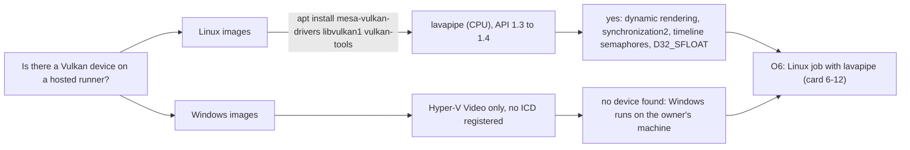

# Vulkan availability spike: what the hosted runners offer (card 6-5)

Spike (TDD exception, no engine code), run on 2026-11-10. It settles the two open items of [vulkan-and-mesh-v0](../architecture/vulkan-and-mesh-v0.md) section 1 (the Mesa and Vulkan version lavapipe offers on the runner images, and whether a hosted Windows runner has a Vulkan device) and gives the evidence for choice O6 (a Linux Vulkan job in CI).

## 1. Summary

1. **Linux: software Vulkan works on every hosted Linux image tried, after one `apt-get install`.** No Vulkan driver is preinstalled: the log shows `mesa-vulkan-drivers` and `vulkan-tools` installed as new packages on every Linux image, while the loader (`libvulkan1`) was already there. The install took 19 s on `ubuntu-latest`, 32 s on 22.04 and about 4 minutes on 24.04 (a slow package download). The device is lavapipe (`llvmpipe`), a CPU device, Vulkan conformance 1.3.1.1.
2. **`ubuntu-latest` resolved to Ubuntu 26.04 in this run** (image `ubuntu26 20261101.186.1`), not 24.04. It gives Mesa 26.0.8 and lavapipe with API 1.4.335. Ubuntu 24.04 gives Mesa 25.2.8 and API 1.4.318. Ubuntu 22.04 gives Mesa 23.2.1 and API 1.3.255.
3. **The features the adapter plans to use are there** on all three Linux images: dynamic rendering, synchronization2, timeline semaphores (Vulkan 1.2 and 1.3 core, option O3), sampler anisotropy, a 16384 maximum 2D image size, `D32_SFLOAT` as a depth format, and the X11, XCB and Wayland surface extensions. The headless surface extension exists on 24.04 and 26.04 but not on 22.04.
4. **Windows hosted runners show no Vulkan device.** All three images tried (`windows-latest`, which is Windows Server 2025 today, `windows-2022` and `windows-2025`) show only `Microsoft Hyper-V Video`. The 2025 image has a Vulkan loader (`vulkan-1.dll`) but no driver is registered under the Khronos registry key, and the 2022 image has no loader. `vkCreateInstance` was not called there (no `vulkaninfo`), so this is "none found", not a proof. The Windows Vulkan device runs on the owner's machine (NVIDIA RTX 3050 Laptop GPU 1.4.357 and Intel Iris Xe 1.4.323, instance version 1.4.357, seen with `vulkaninfo` today).
5. **Recommendation for O6 (the owner decides):** yes, a Linux job with lavapipe, added by the governance card 6-12 after the adapter passes the contract suite locally (6-9). It installs the three packages, prints the Mesa and device lines into the log, and follows the unset-device rule (a missing device is "not run: device not set up", never a pass).

## 2. What was run

A throwaway workflow on a branch that was never merged and is deleted (`push` trigger on that branch only, read-only permissions, no secrets). One run, [actions run 42820293881](https://github.com/giamat90/DuckEngine/actions/runs/42820293881) (the logs stay for the retention period), six jobs, all green:

| Job | Image | Mesa (apt) | Loader (apt) | Device | API version | LLVM | Vulkan 1.3 features |
|---|---|---|---|---|---|---|---|
| `ubuntu-24.04` | `ubuntu24 20261101.360.1` | 25.2.8-0ubuntu0.24.04.4 | 1.3.275.0 | llvmpipe, CPU | 1.4.318 | 20.1.2 | yes |
| `ubuntu-latest` | `ubuntu26 20261101.186.1` (Ubuntu 26.04.1) | 26.0.8-1ubuntu0.3 | 1.4.341.0 | llvmpipe, CPU | 1.4.335 | 21.1.8 | yes |
| `ubuntu-22.04` | `ubuntu22 20261101.347.1` | 23.2.1-1ubuntu3.1~22.04.4 | 1.3.204.1 | llvmpipe, CPU | 1.3.255 | 15.0.7 | yes (no headless surface extension; the loader logged `Failed to CreateInstance in ICD 2. Skipping ICD.` for another ICD, harmless here) |
| `windows-latest` | `win25-vs2026 20261103.298.1` | n/a | `vulkan-1.dll` present | none | n/a | n/a | n/a |
| `windows-2025` | same image | n/a | `vulkan-1.dll` present | none | n/a | n/a | n/a |
| `windows-2022` | `win22 20261101.353.1` | n/a | no loader | none | n/a | n/a | n/a |

Steps per Linux job: read the image and `apt-cache policy`, install the three packages, list the installed ICD files (`lvp_icd.json` among them), `vulkaninfo --summary` and the full `vulkaninfo` filtered for the lines above, and `xvfb-run vkcube --c 20` with the validation layer package installed. Per Windows job: the display adapters, the loader file, the registry driver list, `vulkaninfo` if present (it was not).

## 3. What this does not show

- **The contract suite on lavapipe is not known yet.** There is no Vulkan adapter. Whether it passes is decided by card 6-9 on the owner's machine and by the first run of the job added in 6-12. The claim here is only that a device exists and offers the features.
- **`vkcube` is weak evidence.** It printed `Selected GPU 0: llvmpipe` and ended; its exit status was masked by the pipe to `tail`, so a clean draw is not proven. Drawing is proven by the adapter's own image tests later.
- **The `B8G8R8A8_UNORM` format and the swapchain behaviour under `xvfb`** were not read. The adapter's swapchain card (6-7) checks formats at run time; the headless surface extension exists as a fallback.
- **Windows:** presence of the loader and the absence of a driver were read; `vkCreateInstance` was not called there (no `vulkaninfo`). A software ICD for Windows (a Mesa build) would be a downloaded third-party binary and would need a `THIRD_PARTY.md` entry and an owner decision; it is not proposed.
- **Versions move.** `ubuntu-latest` resolved to 26.04 in this run (the image page announces that move for November 2026), and its Mesa is 26.x where 24.04 has 25.x. The job in 6-12 must log the versions and not depend on one. A pin to `ubuntu-24.04` is possible if a Mesa change breaks a run.
- Cost: a whole probe job took about 35 seconds on `ubuntu-latest` and about 4 minutes on `ubuntu-24.04` (the log timestamps; on 24.04 the three-package install alone took about 4 minutes, while the validation-layer install and `vkcube` took about 4 seconds; the 22.04 job took about 2 minutes). One more Linux job on `ci` (which runs only on `main` and by hand) is small.

## 4. What changes in the plan

- O6 is answered by this evidence as above; the owner confirms it when card 6-12 is declared a governance task.
- Card 6-12 gets its inputs: install line, the version log, the unset-device rule, `ubuntu-latest` or a pin.
- The two open items of the design note are now measured (marked in section 1 of that page).
