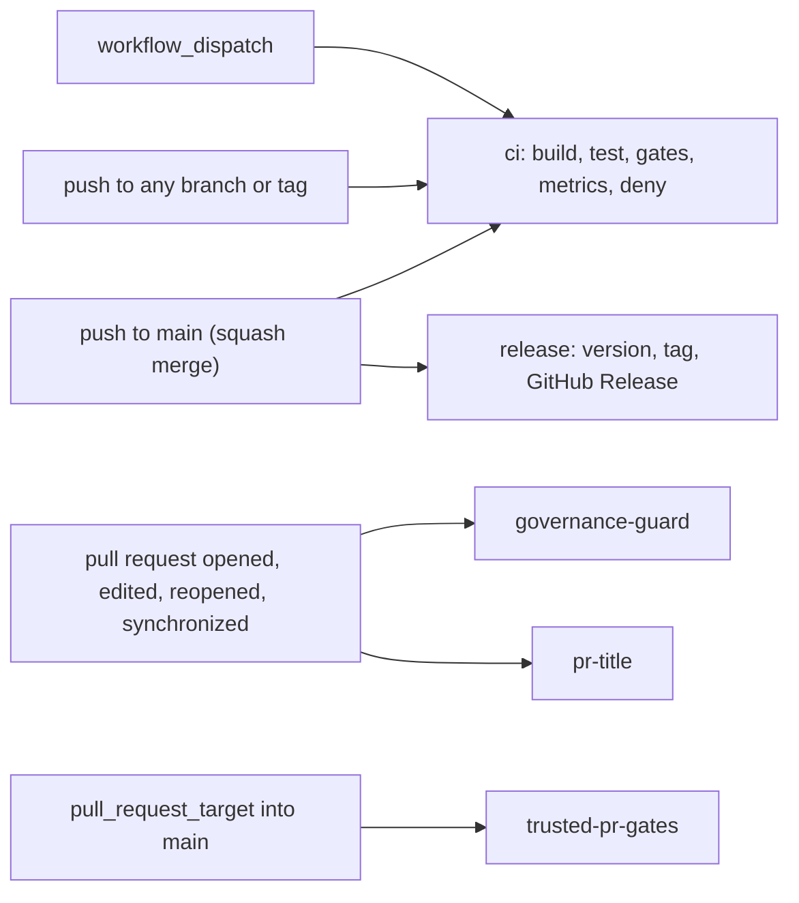
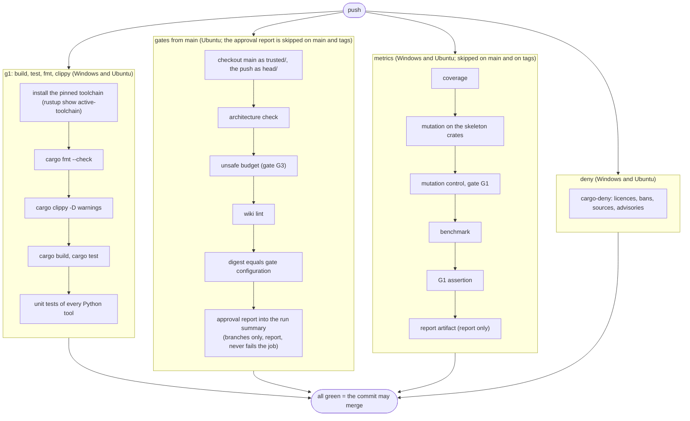
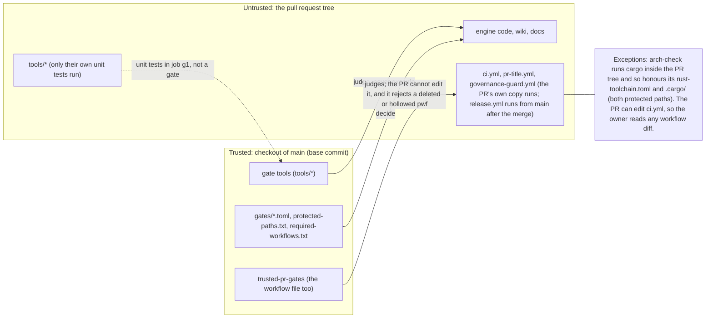
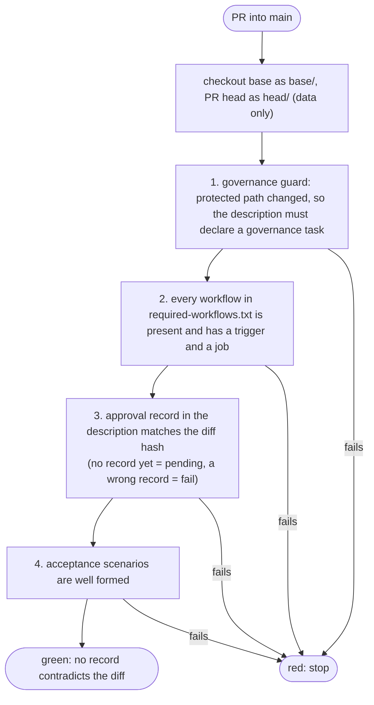
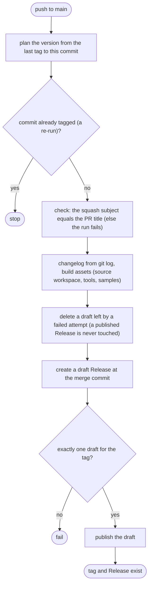
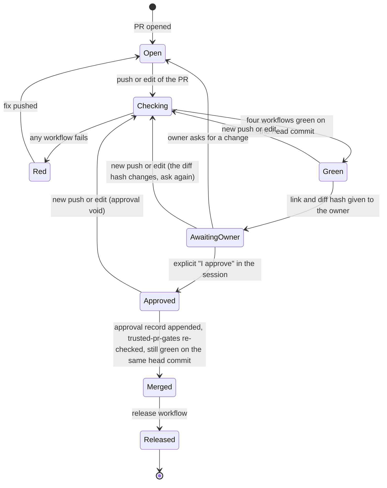

# How CI works (UML) `[P]`

All diagrams are Mermaid text, so they are versioned with the wiki and render on GitHub. They are views of the workflow files in `.github/workflows/` and of the pages named in each caption; if a diagram and a workflow disagree, the workflow wins and the diagram is fixed. Merging is policy, not enforcement, on the GitHub Free plan ([github-plan-findings](github-plan-findings.md)): no check below can be made "required", so a red check is a stop by policy.

Index: 1 Workflows and triggers (component) · 2 Jobs of the `ci` workflow (activity) · 3 Trusted and untrusted inputs (component) · 4 One task from PR to release (sequence) · 5 The `trusted-pr-gates` checks (activity) · 6 Release (activity) · 7 Verdict of a pull request (state)

---

## 1. Workflows and triggers

Source: `.github/workflows/`, [tooling-and-ci](tooling-and-ci.md), [delivery-pipeline](delivery-pipeline.md). Five workflow files; all five are listed in `gates/required-workflows.txt`, so a pull request that deletes or hollows one is rejected by `trusted-pr-gates`.



| Workflow | Tools come from | Gates the merge? | Gates the release? |
|---|---|---|---|
| `ci` | the pushed commit; its `gates` job uses the tools of `main` | by policy: the agent waits for green | no |
| `pr-title` | the base commit (the workflow file itself is the PR's own) | by policy | no |
| `governance-guard` | the base commit (the workflow file itself is the PR's own) | by policy | no |
| `trusted-pr-gates` | the base commit, and the workflow file too (`pull_request_target`) | by policy | no |
| `release` | the merged commit on `main`, after the merge | not applicable | it is the release |

---

## 2. Jobs of the `ci` workflow

Source: `.github/workflows/ci.yml`. Four independent jobs run in parallel. A new push to the same branch cancels the run in progress; a run on `main` is never cancelled.



---

## 3. Trusted and untrusted inputs

Source: [architect-review-surface](architect-review-surface.md), [rules-digest §8](../rules-digest.md). The rule: tools and thresholds come from a checkout of `main`; the pull request tree is data. Exceptions are stated, not hidden.



---

## 4. One task from PR to release

Source: [delivery-pipeline](delivery-pipeline.md), [board-management](board-management.md), `CLAUDE.md`. The owner approves once, in the session, against a diff hash; the agent merges only after that.

```mermaid
sequenceDiagram
  actor Owner
  participant Agent as Claude Code
  participant GH as GitHub
  participant CI as ci, pr-title, governance-guard, trusted-pr-gates
  participant Rel as release

  Agent->>Agent: TDD, review phase R1-R8, review report
  Agent->>GH: push branch, open PR (title = Conventional Commit, governance line if protected paths)
  GH->>CI: ci on the branch push; pr-title, governance-guard, trusted-pr-gates on the PR
  CI-->>Agent: results per commit (gh run list --commit)
  Agent->>Owner: PR link, diff hash, metric report
  Owner-->>Agent: "I approve" (in the session)
  Agent->>GH: append approval record (task, diff hash, basis, date) to the PR body
  GH->>CI: trusted-pr-gates re-checks the record against the diff
  Agent->>Agent: diff_hash check, all four green on the same commit
  Agent->>GH: squash merge (subject = PR title, head commit pinned)
  GH->>Rel: push to main
  Rel->>GH: version, tag, Release with assets
  Agent->>Agent: card to Done with a comment
```

---

## 5. The `trusted-pr-gates` checks

Source: `.github/workflows/trusted-pr-gates.yml`, [github-plan-findings](github-plan-findings.md). It runs on `pull_request_target`, so GitHub loads the workflow file from the base branch: a pull request cannot edit or delete the version that judges it. A canary pull request (#36, closed unmerged, 2026-10-25) deleted `pr-title.yml`: `trusted-pr-gates` failed at step 2 with "pr-title.yml: missing" while the governance step passed.



Green means "no approval record contradicts the diff", not "the owner approved". The agent writes the description, so the explicit in-session approval stays the only approval.

---

## 6. Release

Source: `.github/workflows/release.yml`, [delivery-pipeline](delivery-pipeline.md). Every merge releases at least a patch version, docs-only included. One release at a time; a queued run waits.



---

## 7. Verdict of a pull request

Source: sections 1 to 6. This is the policy view; GitHub itself does not enforce it on the Free plan.



A card move, a comment, silence or a background notification is never an approval.
