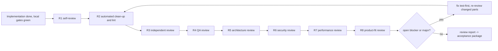
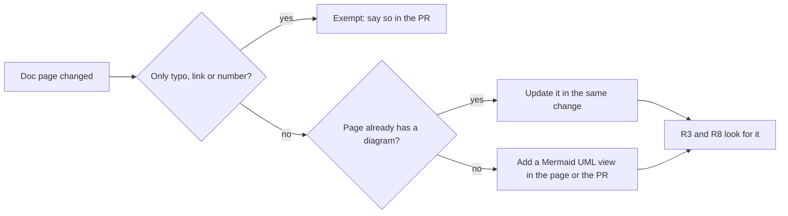

# Clean Code, TDD Style, and the Review Phase `[P]`

Owner requirement (v0.4): Claude Code must follow **clean code** and **TDD style**, and when the implementation is done there must be a **review phase** before anything reaches the product owner.

**Owner decision (v0.10, Q24):** keep the **measurable** clean-code rules, drop the subjective ones. The owner does not read the code, so a rule that no tool can check cannot be governed. Rule of thumb for this page: *if a tool cannot measure it, it is not a rule.*

Sources for the practices below (Robert C. Martin's *Clean Code*, Kent Beck's TDD, the Rust API Guidelines) were **not retrieved in this session**: everything here is background knowledge **[K]** adapted by judgement **[P]**.

## 1. What "clean" means in DuckEngine (measurable rules only)

Every rule below is enforced by a tool in CI or by a scan, except where the row says it is not enforced yet; thresholds live in [quality-metrics](quality-metrics.md). Failing one fails the gate.

| Area | Rule | Enforced by |
|---|---|---|
| **Function size** | warn > 60 lines | Clippy `too_many_lines`, rust-code-analysis |
| **Complexity** | cyclomatic warn > 10, fail > 15; cognitive fail > 20 | Clippy `cognitive_complexity`, rust-code-analysis |
| **Nesting depth** | <= 3 (Clippy counts the function body as level 1: two nested blocks inside a function; see [clean-code-lint-profile](../../docs/gates/clean-code-lint-profile.md)) | Clippy `excessive_nesting` / rust-code-analysis |
| **Parameters** | warn > 3, fail > 5 | Clippy `too_many_arguments` (fail tier 5; the warn tier needs rust-code-analysis) |
| **Duplication** | <= 3% | duplication detector |
| **Dead code** | none | `dead_code` lint, `-D warnings` |
| **Magic numbers** | none new | not enforced yet: Clippy has no such lint ([clean-code-lint-profile](../../docs/gates/clean-code-lint-profile.md)) |
| **Commented-out code, TODO without issue link** | none | scan |
| **Errors** | explicit `Result` returns; no `unwrap`/`expect` in engine code; panics abort; no silent failures | Clippy `unwrap_used`/`expect_used`, tests on error paths |
| **`unsafe`** | only in allowlisted modules, every block has a `// SAFETY:` comment | scan, Miri |
| **Formatting** | automated | rustfmt (check-only) |
| **Layers and dependencies** | exactly as in [architecture/overview](../architecture/overview.md), no cycles | arch-check |
| **Public API surface** | no unplanned public items | API diff in the classifier |

**Dropped (subjective, not measurable):** naming taste, "do one thing" and single-responsibility judgements, Law of Demeter, comment style, boy-scout refactors, cohesion arguments. The reviewer may still flag a *measurable* symptom (for example a function that grew past the limit), but taste alone is never a finding.

### 1.1 Clean code in a performance-first, data-oriented engine

Classic clean-code advice is object-oriented; this engine's core is data-oriented. The measurable limits above apply by default. A deviation in a hot path is allowed only with a `PERF:` comment naming the benchmark that justifies it. The number of waivers is reported in the metric report; a waiver without an existing benchmark is a review finding and fails the check.

## 2. TDD style (how Claude Code works inside a task)

1. **Write the test list first** (a short list of behaviours and edge cases), then take one item at a time.
2. **One failing test at a time.** Run it and see it fail *for the right reason* (red evidence).
3. **Smallest step to green**: fake it, then triangulate with a second example, or implement the obvious solution when it is truly obvious.
4. **Refactor only on green**, in small steps, running the tests after each; behaviour and structure never change in the same step.
5. **Commit at green** (`test:` then `feat:`/`fix:`, then `refactor:`).
6. **Characterization tests** before refactoring or changing legacy-style code.
7. **Bug fix = failing regression test first.**
8. Hot-path code: add the benchmark with the first green, record the baseline.
9. Never write production code that no failing test demands; never delete or weaken a test to get to green.

## 3. Tests: the checkable rules

- **Fast and independent:** no test depends on another or on shared mutable state; test time is tracked.
- Test behaviour through the public interface; do not mock what a Null adapter can fake.
- One failing test first, with red evidence (checked in the TDD workflow).
- No skipped, disabled or expected-fail tests without a linked issue (gate).
- Test quality is measured by **mutation score and coverage**, not by naming or layout conventions.

## 4. The review phase

**Position:** after the implementation is complete and the local gates are green, **before** the branch is pushed for acceptance. No task is "done" without a review report.



| Step | Role | What is checked | Tools **[K]** |
|---|---|---|---|
| **R1 Self-review** | developer | read the whole diff top to bottom against the checklist below; remove debug code, dead code, stray changes | - |
| **R2 Automated clean-up** | developer | reuse, simplification, efficiency and altitude cleanups on the changed code; format, lint, full local gates | the `simplify` skill, rustfmt, Clippy |
| **R3 Independent review** | reviewer (separate session/agent, not the author's context) | for documentation changes: the UML view is present and matches the code (section 7); correctness bugs, measurable clean-code violations, test quality; it receives the task card, the diff and the wiki rules, **not** the author's reasoning | the `code-review` skill at an effort level matching the class |
| **R4 QA review** | QA | test adequacy: mutation survivors triaged, edge cases, property/golden/contract tests, determinism, flakiness | mutation tool, coverage |
| **R5 Architecture review** | architect | layers, ports, banned imports, ADR conformance, public API surface, design note accurate and present | arch-check, classifier |
| **R6 Security review** | security | memory safety, untrusted input (asset parsers, decoders), integer overflow, secrets, new dependencies and licences | the `security-review` skill, sanitizers, fuzz corpus |
| **R7 Performance review** | performance | benchmark delta vs baseline, allocations per frame, port-call frequency, scaling; every `PERF:` waiver has a benchmark | benchmark compare |
| **R8 Product-fit review** | PM | acceptance criteria of the task card met, scope creep removed, product view shows the result | task card, product view |

**Depth by class:** Class 1 = R1-R4 (+R7 on hot paths); Class 2 = R1-R8; Class 3 = R1-R8, and the governance diff goes to the PO.

**Trial (M7):** during the first 10 tasks, record for each review step the defects it found that no earlier step found. Steps with zero unique findings are candidates to drop or merge (a Class 3 change). "Independent" means a different context and, where available, a different model; the mutation score stays the objective backstop.

### 4.1 Findings and the fix loop

| Severity | Meaning | Rule |
|---|---|---|
| **Blocker** | incorrect behaviour, architecture/security/gate violation, data race, missing test for new behaviour | must be fixed |
| **Major** | exceeded measurable limit, weak tests (surviving mutants), performance regression, unjustified `PERF:` waiver | must be fixed |
| **Minor** | small measurable issue below the gate | fix, or list with a reason |

Fixes that change behaviour are made test-first. After fixes, R2-R4 run again on the changed parts. The loop ends when there are **zero open blockers or majors**. After **3 loops** without convergence, Claude Code stops and reports the unresolved findings to the PO instead of looping or lowering a standard.

### 4.2 Independence rules

- The reviewer must not be the session or context that wrote the code.
- The reviewer may not edit production code; it only reports (findings are fixed by the developer role).
- Review output is a file in the repo, not chat prose: `reviews/<task-id>.md`.

### 4.3 Review report template (`reviews/<task-id>.md`)

```
Task: <id>   SHA reviewed: <sha>   Class: 1|2|3   Loops: <n>
## Summary verdict            ready | not ready, one paragraph
## Checklist (each item: pass | fail | n/a, with evidence)
  Measurable rules  function size/complexity/nesting/params, duplication, errors, magic numbers, dead code, unsafe
  TDD            test list, red evidence, test-first commits, tests clean, no weakened tests
  Architecture   layers, ports, banned imports, ADRs, public API delta, design note
  Security       input handling, memory safety, dependencies/licences, secrets
  Performance    benchmark delta, allocations/frame, PERF waivers (each with benchmark)
  Product fit    acceptance criteria met, no scope creep
## Findings                   id | severity | location | description | status (fixed / accepted with reason / open)
## Not verified               what could not be checked, and why
## Metrics snapshot           mutation score, coverage, complexity top-5, duplication
```

The report is part of the acceptance package ([delivery-pipeline](delivery-pipeline.md)); the PO reads its summary verdict and "Not verified" section, not the line-level findings.

## 5. Measurable proxies

Only measurable rules are governed (owner decision, Q24). These are enforced as gates (thresholds in [quality-metrics](quality-metrics.md)); the review phase checks what tools cannot: correctness, test adequacy, architecture, security, product fit.

| Proxy | Source |
|---|---|
| cyclomatic and cognitive complexity, function length, nesting depth, parameter count | Clippy, rust-code-analysis |
| duplication | duplication detector |
| magic numbers, dead code | Clippy lints, `dead_code` |
| red-first compliance, no weakened/skipped tests, mutation score | CI scripts, mutation tool |
| review report present, **0 open blocker/major**, reviewer session differs from author session | CI check on `reviews/<task-id>.md` (traceable, not unforgeable) |
| `PERF:` waiver count and justification | scan + benchmark link check |

**Limits:** every proxy can be gamed (Goodhart, risk R-19). The review phase and the PO's product review are the counterweight.

## 6. Open points

- **Q24:** resolved (owner): measurable rules only, `PERF:` waivers accepted.

## 7. Documentation changes carry a UML view (owner rule, task 1-8)

Every time a documentation page is changed, the change is covered by a UML view in Mermaid: a class, sequence, state, activity or component diagram of what the change describes. "Documentation page" means a page in `wiki/`, an ADR, a design note, or a review report that describes structure or behaviour. The diagram sits in the changed page; when the page is a pure list or table (a changelog, an index), it sits in the PR description instead. A change that only fixes a typo, a link or a number is exempt (say so in the PR). A change that only mirrors a rule or a changelog line elsewhere (the digest, `CLAUDE.md`, `wiki/README.md`) is covered by the diagram of the change it mirrors. If the page already has a diagram, update it in the same change. If a diagram and the code or a page disagree, the page wins and the diagram is fixed. There is no automatic check yet: the independent reviewer (R3) and the product-fit reviewer (R8) look for the diagram, and a lint is a later governance task.


