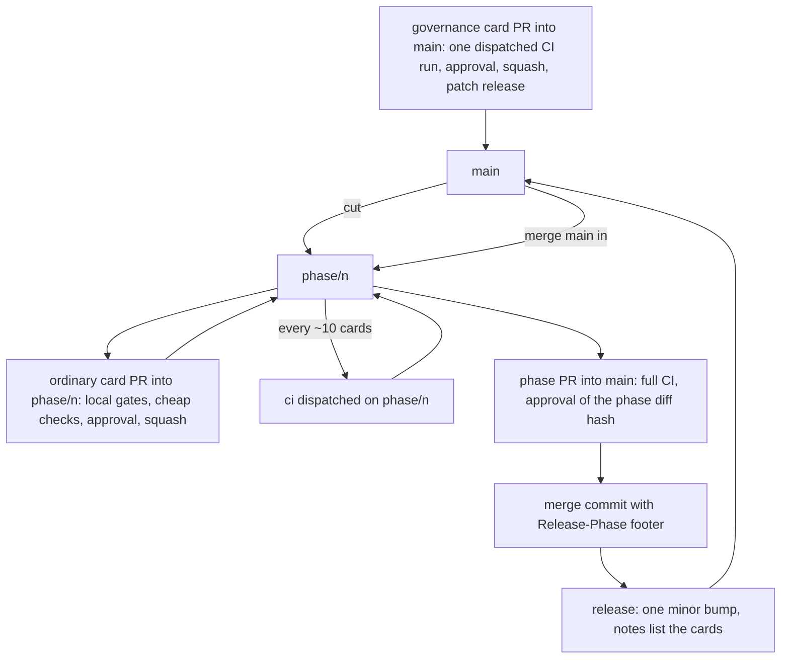
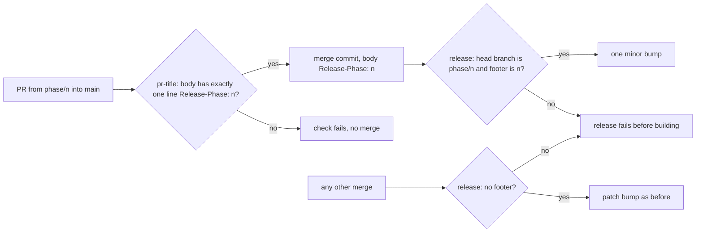
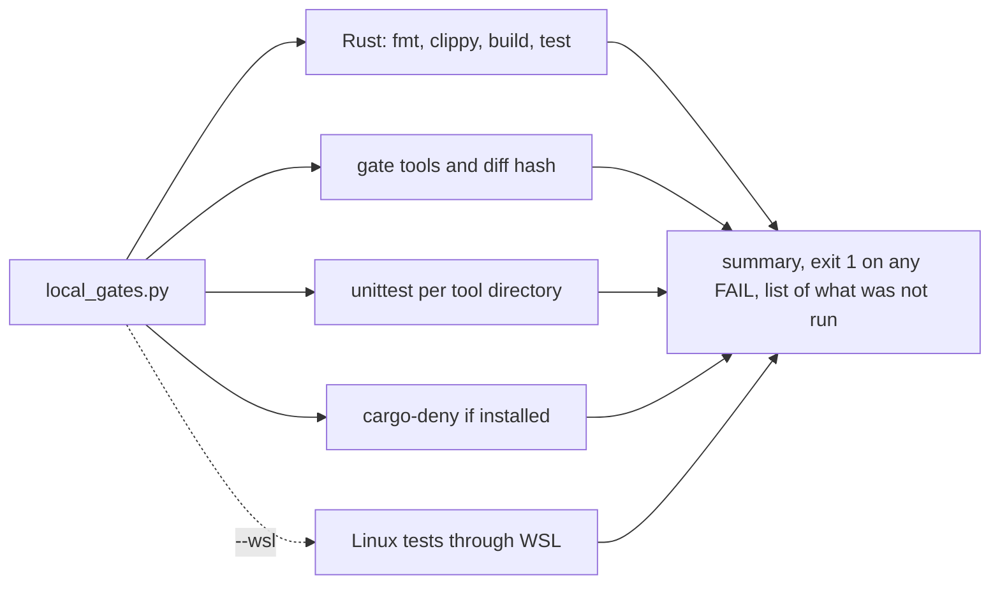
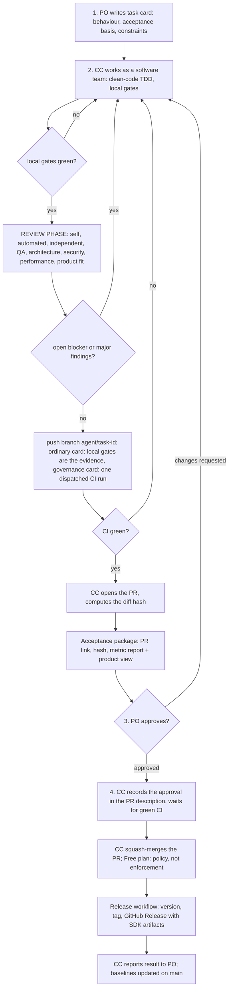

# Delivery Pipeline: from task to deployed version `[P]` (v0.4, simplified per owner)

## The flow, in four steps (owner definition)

1. **PO defines the task.** (Product owner = you.)
2. **CC does the work of a software team.** (Claude Code acting as PM, architect, developer, QA, security reviewer, DevOps and reviewer.) It implements in **clean-code, test-first (TDD) style**, and when the implementation is done a mandatory **review phase** runs before anything reaches the PO ([clean-code-and-review](clean-code-and-review.md)).
3. **PO approves the work**, based on the **metric report and the product view**. This is the **only** human approval.
4. **CC deploys through a PR on GitHub**: opens the PR, waits for green CI, merges, and the release workflow tags a new version and publishes the versioned SDK artifacts. All automatic; no further clicks, approvals or reviews.

Everything below only makes those four steps safe and repeatable. Feature names and plan-dependent limits marked **[K]** come from background knowledge; verify during phase 0.

**Plan constraint (verified 2026-10-24, [github-plan-findings](github-plan-findings.md)):** the repository is private on the GitHub **Free** plan, which has no branch protection, rulesets, auto-merge, merge queue or environments. Wherever this page says auto-merge, ruleset, required check enforcement or protected environment, read the fallback in section 5: Claude Code runs `gh pr merge` itself after the owner's approval and a green `gh run watch <run-id> --exit-status`, and merging is policy, not enforcement.

**Built in phase 0b (verified end to end in card 0b-7; hardened in 0b-8):** PR title check (`pr-title`), `governance-guard`, `ci` also on `main`, squash-subject check in the release, diff hash and approval record (`tools/diff-hash`, run by the agent, not by a workflow), squash merge by the agent after a green `gh run watch`, release workflow (`release.yml`: draft Release, assets, publish). **Not built:** auto-merge, rulesets, required checks, the package smoke test and per-platform tool/sample archives. Control by control, see [pipeline-runbook](../../docs/gates/pipeline-runbook.md).

## Phase-branch workflow (owner decision 2026-10-27, card 1-38; reason: the 2,000 free Actions minutes per month)

Measured cost before this change: one `ci` run bills about 15 minutes (Windows counted twice) and ran on every push of every branch, so a phase of about 40 cards used most of a month. Now:

1. **A phase has one long branch `phase/<n>`** (for phase 1: `phase/1`), cut from `main`. Ordinary cards are PRs **into the phase branch** (`agent/<id>-<slug>` -> `phase/<n>`), squash-merged there after the owner's approval, as before: PR link, diff hash (base = `origin/phase/<n>`), approval record, `diff_hash.py check`. On such a PR only the cheap workflows run (`pr-title`, `governance-guard`); `ci` does not run on branch pushes and `trusted-pr-gates` only fires for PRs into `main`. **The evidence for an ordinary card is the local gate run** (fmt, clippy, tests on Windows and, through WSL, Linux; the Python gate tools; the review report), written into `reviews/<id>.md`.
2. **Governance cards go to `main` first**, by their own PR, with one `ci` run started by hand on the commit to approve (`gh workflow run ci.yml --ref <branch>`, then `gh run watch`). Reason: the gate tools and configuration come from `main`, so a change to them must already be on `main` when the phase PR is judged. A card that touches a protected path is a governance card. After it merges, `phase/<n>` merges `main` in (no CI run on that push).
3. **Checkpoints.** About every 10 cards, and before the phase PR, the agent starts `ci` by hand on `phase/<n>` and fixes what is red, so a failure is small to find.
4. **The phase ends** with one PR `phase/<n>` -> `main`: title `feat(phase-<n>): 
`, the full CI on the head commit, the owner's approval against the diff hash of the phase (the card approvals are the manifest, listed in the PR body), merged with a **merge commit** (history of the cards stays): `gh pr merge N --merge --subject "<PR title> (#N)" --body "Release-Phase: <n>" --match-head-commit <sha>`. The footer `Release-Phase: <n>` makes the release workflow bump the **minor** number once for the phase (`next_version.py`); every governance PR merged to `main` in between still gets its patch number. The release notes list all cards of the phase.
5. **Gaps closed by card 1-40:** `pr-title` fails a PR from `phase/<n>` whose description lacks exactly one line `Release-Phase: <n>`; the `release` workflow fails (before building anything) if the merge of a `phase/<n>` PR does not carry that footer, or if any other merge carries it; `governance-guard` and `pr-title` take their tools from `main`, also for PRs into a phase branch. The phase PR description must itself contain the line `Release-Phase: <n>` (the merge body is passed with `--body`; the PR check reads the description as its proxy). No other commit may start a line with `Release-Phase:` (the version tool reads every commit since the last tag, so a card squash body that does would bump the minor number or fail the release); card squashes use `--body ""`. Still true: the approval report of a dispatched run on a branch computes the hash against `main`, so a per-card hash is checked locally with `diff_hash.py` (base `origin/phase/<n>`). For an ordinary card, "after green checks" in the steps below means: cheap checks green and local gates green.
6. **Not weakened:** no push to `main`, the owner's approval against a diff hash for every card and for the phase, a red check is a stop, governance diffs are read by the owner. **Weakened and said so:** an ordinary card is no longer checked by CI before its merge into the phase branch; the first independent run is the checkpoint or the phase PR.

The task lifecycle below is the mechanics of one card. Where it says "push branch; CI on the branch" read: ordinary card = local gates are the evidence; governance card = one dispatched CI run on the commit to approve.

### Local gates (card 1-39)

`python tools/local-gates/local_gates.py [--base origin/phase/<n>] [--wsl]` runs, in one go and without stopping at the first failure: Rust format, Clippy, build and tests (also `app_runtime` without the mimalloc feature), the gate tools on the working tree (architecture, unsafe budget, wiki lint, digest), the diff hash, the unit tests of every Python tool (found by scanning `tools/*` and `acceptance/` for `test_*.py`, so a new tool is picked up without editing the script), cargo-deny when installed, and with `--wsl` the Linux test run. Exit code 1 if a step failed; the summary lists what is **not** run locally (Miri, coverage, mutation, benchmarks, metrics): those wait for the checkpoint or the phase PR. The gate tools run from the working tree, not from a trusted checkout of `main`; that guarantee stays with `ci`. Its unit tests run in `ci` (card 1-40).

## 1. Task lifecycle

| # | Stage | Who | Exit condition |
|---|---|---|---|
| 1 | **Task card** (module, layer, given/when/then, **acceptance basis**, perf expectation, allowed files; `governance task: yes/no`) | PO (CC can draft it with `/task`) | card given to the session |
| 2 | **Software-team work**: plan, design, **clean-code test-first implementation** (TDD style), design note | Claude Code (roles below) | implementation complete, local gates green |
| 3 | **REVIEW PHASE** (R1-R8: self, automated clean-up, independent, QA, architecture, security, performance, product fit) with a fix loop | Claude Code reviewer roles, separate sessions ([clean-code-and-review §4](clean-code-and-review.md)) | review report `reviews/<task-id>.md` with **0 open blocker/major** (max 3 loops, else stop and report to PO) |
| 4 | **Push** branch `agent/<task-id>`; ordinary card: **local gates** green and recorded in the review report; governance card: **CI started by hand** on this commit | CC / GitHub Actions | gates green on this SHA |
| 5 | **Acceptance package** (includes the review report) | CC | delivered to PO |
| 6 | **PO approval** (in the session, a plain "approved"); the PR is already open and its full link and hash were given with the package | PO | approval recorded against this **diff hash** (content hash of the proposed change against `main`) |
| 7 | **Record and merge**: approval section in the PR description, `diff_hash.py check`, `gh run watch --exit-status`, `gh pr merge N --squash --subject "<PR title> (#N)" --body "" --match-head-commit <sha>` | CC | on `main` (Free plan: no auto-merge) |
| 8 | **Verify the merge** the head that was approved and checked is the one merged | CC | merge commit contains exactly the approved head |
| 9 | **Release**: version, tag, GitHub Release, SDK artifacts | GitHub Actions | Release exists |
| 10 | **Report** | CC | PO told the version, the Release link and the metric delta |

### Claude Code as a software team (stage 2)

Claude Code's role set follows the `software-team` skill (PM, architect, developer, QA, security, DevOps, reviewer). Mapping to this project (details in [tooling-and-ci §7](tooling-and-ci.md)):

| Role | Responsibility in this project |
|---|---|
| PM | turns the task card into a plan and the acceptance package; keeps scope to the card |
| Architect | enforces layers, ports and ADRs; writes/updates the design note |
| Developer | implements test-first inside the rules in [tdd-workflow](tdd-workflow.md) |
| QA | independent tests (test independence), property/golden/contract tests, mutation score |
| Security | dependency/licence check, memory-safety and sanitizer findings, secrets hygiene |
| DevOps | CI, release workflow, build matrix |
| Reviewer | independent review of the diff, classifier verdict, "what I could NOT verify" |

### Acceptance basis (set in the task card)

| Basis | When | What the PO looks at |
|---|---|---|
| **Product view** | anything product-visible (rendering, audio, physics feel, samples) | run the "try it" command, look/listen/play, check the product view |
| **Metrics** | internal refactors, performance, tooling | metric report delta (gates, mutation score, benchmarks, architecture) |
| **Both** | default when unsure; always for phase-exit tasks | both |

### Acceptance package (stage 5)

Formats are in [architect-review-surface](architect-review-surface.md):

1. Task card and the **commit SHA** being proposed.
2. Gate summary: local run + CI G1 on that SHA.
3. **Metric report delta** versus `main` (generated by `tools/metrics`).
4. **Product view** with the one-command "try it".
5. **Design note** if a module/port changed; for Class 2/3 changes also the diff summary with the "what I could NOT verify" line, since those diffs are part of what the PO reads before approving.
6. **Review report** (`reviews/<task-id>.md`): summary verdict, "Not verified" section, loop count, and the classifier's verdict. You read the verdict and the "Not verified" list, not the line-level findings.

## 2. Approval and what happens after it

- **Approval is the PO's explicit "approved" in the session**, tied to the **diff hash** of the package (N-7). Mechanical changes that leave the diff hash unchanged (rebase onto a newer `main` without conflicts, formatting that the formatter already applied) keep the approval. There is no second approval anywhere: no click on a permission prompt, no GitHub review, no CODEOWNERS approval.
- Claude Code writes the approval into the PR description (task id, diff hash, basis, the PO's words) as an audit trail. `diff_hash.py check` verifies that the recorded diff hash equals the PR's diff hash; the agent runs it before merging (on the Free plan it is not a required check, see [diff-hash-and-approval-check](../../docs/gates/diff-hash-and-approval-check.md)).
- **After approval everything is automatic**: PR, wait for CI, merge, tag, publish, report.
- **The one case where the flow can pause:** if, after approval, a failing check forces a change that alters product-visible behaviour or moves metrics outside tolerance (decided by the classifier, not by the author), Claude Code stops and asks again, because the PO approved one result and the change would ship another. Mechanical fixes (formatting, flaky-test retry, conflict-free rebase) continue automatically. This is the only exception.

## 3. Governance changes

Gate configuration, thresholds, the classifier, contract-suite semantics, CI/release workflows, ADRs and `THIRD_PARTY.md` structure are protected paths. They change only in a task the PO **declares as a governance task** in the card; for that task the protection is unlocked, and the governance diff is part of the acceptance package the PO reads. The `governance-guard` check (built in 0b-8; tool and list from the base commit, PR tree as data only; the workflow file itself comes from the PR, so a PR that edits it can switch the check off, which the owner sees in the governance diff) fails any PR that touches a path in `gates/protected-paths.txt` without a `Governance task: yes (card <id>)` line in its description (traceable, not unforgeable - an accepted residual risk). On the Free plan it cannot be a required check, so the agent treats a red `governance-guard` as a stop. The `ci` steps that run from the PR tree are not a trusted-base control.

## 4. Credentials and blast radius (recommended, one-time, no per-task steps)

No approvals are involved, so this is purely about limiting damage if a session goes wrong (a bug, or a hostile instruction hidden in a file it reads):

| Setup | Effect |
|---|---|
| **Fine-grained token for Claude Code, scoped to this repository only**: contents (read/write on branches), pull requests (read/write), actions (read). **No** administration, no secrets/environments access; the owner keeps the Workflows permission on permanently (card 0c-8) and reads every workflow diff (scope names verified 2026-10-25, see [agent-token-setup](../../docs/gates/agent-token-setup.md)) | agent can push `agent/*`, open and merge PRs, read CI logs; cannot change rulesets or read secrets |
| Rulesets on `main` that also bind admins: PR required, required status checks, no direct push (**paid plan only; not available on Free**, see section 5 for the fallbacks) | nobody, including the PO's own token, can push straight to `main` by accident |
| Release/publish credentials exist only as GitHub Actions secrets or OIDC, in a protected environment | the agent never holds them |

A separate GitHub account or a GitHub App is optional (better attribution and isolation), but not needed for this flow: a scoped token under the PO's own account gives most of the benefit.

## 5. GitHub features doing the work

The first table is the target design (it needs a paid plan). What actually runs on the Free plan is in the fallback table below.

| Need | GitHub feature **[K]** |
|---|---|
| Nobody pushes to `main` | repository **ruleset** or branch protection: PR required, required status checks (G1), admins included |
| "Wait for green CI, then merge" | **auto-merge** (repo setting + `gh pr merge --auto --squash`); optional **merge queue** so the tested commit is what merges. The session does not have to stay open polling |
| Governance guard | a required check (`governance-guard`) running the classifier |
| Reuse CI results | checks attach to the head SHA; matching names let PR checks reuse the branch-push run, saving private-repo minutes **[K - verify]** |
| Version, tag, Release | workflow on `push` to `main` |
| Publish with guardrails | **Environment** `release` with protection and environment-scoped secrets, **OIDC** for short-lived credentials |
| Serialised releases | `concurrency` group so two merges cannot compute the same version |
| Notify the PO | Claude Code's report (stage 10) plus GitHub notifications |

Rulesets, merge queue, auto-merge and environment protection are **not available** on the Free plan (verified 2026-10-24). Fallbacks (risk R-20), as decided by the owner (stay on Free):

| Need | Fallback on Free |
|---|---|
| Nobody pushes to `main` | policy only: the agent opens a PR from a branch and never pushes to `main` after the bootstrap commit; git history and PR list are the audit trail |
| Wait for green CI, then merge | the session stays open: `gh run watch <run-id> --exit-status` (run id from `gh run list --commit <sha>`; `gh pr checks` does not work with the scoped token), then `gh pr merge N --squash --subject "<PR title> (#N)" --body "" --match-head-commit <sha>` (no `--auto`; the PR title is the Conventional Commit message that decides the version, checked by the `pr-title` workflow); a failing or missing check means no merge |
| Governance guard as a required check | built in 0b-8; runs as a check, cannot be made required, so the agent treats a red `governance-guard` as a stop; since 0c-14 the same guard, the approval-record check and a check that the enforcement workflows still exist also run from the base branch in `trusted-pr-gates` (`pull_request_target`), which a PR cannot edit or delete |
| Protected environment `release` | repository-level Actions secrets or OIDC; the release workflow is the only consumer and is a Class 3 file |
| Rulesets that bind admins | none; the fine-grained token (section 4) limits what the agent can do |

## 6. Release workflow (every merge to `main` -> new version -> SDK artifacts)

1. **Compute the version** with SemVer from the Conventional Commit types already in use: `feat:` minor, `fix:`/`perf:` patch, `!` or `BREAKING CHANGE:` major; all other types (`refactor:`, `docs:`, `test:`, `chore:`) bump patch, because every merge produces a version (owner). Pre-1.0 (`0.y.z`, owner decision of 2026-10-25, implemented in `tools/release/next_version.py`): `feat` bumps patch and breaking changes bump `y`. Queued merges can share one release (see [release-workflow](../../docs/gates/release-workflow.md)). A port or ABI change counts as breaking. Tooling (release-please, semantic-release, or a small in-repo script) is a dev-time T2 choice for phase 0.
2. **Build the release artifacts (D-1; phase 0b builds only a source archive plus placeholder artifact, report and baselines):** the **tagged, versioned source workspace** (consumed by Cargo through a git tag or a private registry; Rust has no stable ABI, so prebuilt engine libraries are not the delivery unit), prebuilt **tools** (shader/asset tools, arch-check, metrics) and **samples** on the CI matrix (Windows and Linux first), and a **C ABI + headers only for plug-ins or non-Rust consumers**.
3. **Smoke-test the package (not built yet):** build a minimal sample from the tagged workspace as an external Cargo consumer, run it headless with the replay hash check, and run the prebuilt tools.
4. **Tag** `vX.Y.Z` and create the **GitHub Release** (private repo): generated changelog, tool and sample archives per platform, source archive, checksums, the metric report, and `THIRD_PARTY.md`.
5. **Deploy** = these Release assets are the deployment (Q22, owner: deploy means versioned SDK artifacts). No server involved.
6. **Update baselines** (benchmarks, metrics) **outside git** (N-7): stored as workflow artifacts/cache or in a dedicated data branch written only by the release job (ruleset bypass for that job); the workflow never commits to `main`, so rulesets stay strict and no extra release is triggered. **Every merge still produces a version, docs-only merges included (owner decision); a docs-only merge bumps patch.**

Known GitHub behaviour **[K]**: a tag pushed with the default `GITHUB_TOKEN` does not trigger other workflows, so tag, Release and publish run as jobs in the **same** workflow.

## 7. Failure handling

| Situation | Behaviour |
|---|---|
| CI red on the branch (dispatched run of a governance card, or a phase checkpoint) | CC fixes and re-runs; the PO is asked only once CI is green |
| CI red on the phase PR | CC fixes on `phase/<n>` with fix commits (small, since checkpoints ran earlier); a fix that changes behaviour or metrics is shown to the PO before the phase merge |
| CI red after approval | mechanical fix: continue automatically; behaviour/metric-changing fix: pause and ask again (section 2) |
| Merge blocked or checks not green | PR stays open; CC investigates; it never bypasses rules (on Free there is no auto-merge: CC merges by hand after the checks pass) |
| Release job fails | stops, no retry loops, CC reports; fix is a new task |
| Bad version shipped | revert through the same pipeline -> new patch version; mark the bad Release as yanked/pre-release |
| Flaky test | quarantine within one day (quality gate); "re-run until green" is never the policy |

## 8. Open points

- Release cadence: **every merge produces a version** (confirmed by the PO).
- Review phase and coding standard: [clean-code-and-review](clean-code-and-review.md); open point Q24.
- Credentials: confirm the scoped-token setup in section 4 (a one-time setup, not a workflow step).
