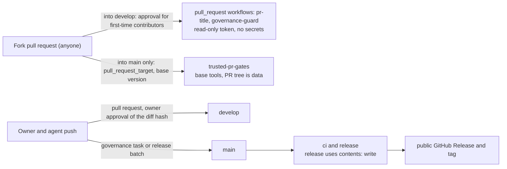

# GitHub plan findings (V1) `[F]`

> **Public repository update (2026-11-07, card 4-26).** Sections 1 to 4 are the findings of 2026-10-24 for a **private** repository and are kept as a dated record. The repository is public since at most 2026-11-07; what changed is in section 5. Where a sentence below says the plan "cannot" do something, read it as "could not while the repository was private".

Checked 2026-10-24 for card 0a-1. Account `giamat90`, GitHub Free, private repository `giamat90/DuckEngine`. Owner decision: stay on the free plan, no upgrade ([tooling-and-ci](tooling-and-ci.md) section on branch protection).

Method: `gh api` probes against the real repository, then GitHub docs for what a probe cannot show. "Probed" = observed on this repo; "docs" = from GitHub documentation, not observed.

## 1. Findings

| Feature | Free, private repo | Evidence |
|---|---|---|
| Branch protection (required checks, no direct push, admins included) | **Not available** | probed: HTTP 403 "Upgrade to GitHub Pro or make this repository public" |
| Rulesets | **Not available** | probed: same 403 on the rulesets endpoint |
| Required status checks | **Not enforceable** (they are a protection/ruleset setting) | follows from the two rows above |
| Auto-merge | **Not available** | probed: setting `allow_auto_merge=true` is accepted by the API but reads back `false`; restored to `false` afterwards |
| Merge queue | **Not available** (needs branch protection or a ruleset) | docs: enabled through protection or ruleset; not tested directly |
| Environments, environment secrets, deployment protection rules | **Not available** | docs: Free can configure environments for public repositories only; probed: environments list is empty |
| Repository-level Actions secrets | **Available** | probed: the secrets endpoint answers (0 secrets) |
| GitHub Actions | **Enabled**, all actions allowed | probed |
| Actions minutes | **2,000 per month**, artifact storage 500 MB, cache 10 GB per repository; without a payment method, runs are blocked when the quota is used | docs |
| Runner cost | Linux 2-core x64 $0.006/min, Windows 2-core $0.010/min (about 1.67x), Linux arm64 $0.005/min, macOS $0.062/min (about 10x). Treat Windows as 2x for budgeting | docs (rates; ratios computed) |
| Fine-grained token scope names | **Verified** (2026-10-25, card 0b-1) | probed: [agent-token-setup](../../docs/gates/agent-token-setup.md), `tools/token-probe`. Contents rw, Pull requests rw, Actions read, Metadata read; Administration and Secrets are refused; Workflows is allowed on purpose (card 0c-8) and not probed. `gh pr checks` does not work (check runs need a Checks permission a personal fine-grained token does not offer); `gh run watch --exit-status` does |
| arm64 hosted runner availability on Free private repos | **Verified** (2026-11-01, card 2-10): the label `ubuntu-24.04-arm` is served for this private repository on the Free plan; a probe job started in 2 seconds and `uname -m` printed `aarch64`. Rate in the docs: Linux arm64 $0.005/min; the run-timing API showed no arm64 line for a 2-second job, so the billing is unmeasured; assume at most Linux 1x (the docs rate is below x64) | probed: card 2-10, ci run 41335316800 |

Not checked: the exact plan name and billing page (the API needs the `user` scope; the owner stays on Free anyway).

## 2. What this changes in the design

- Merging is **policy, not enforcement**. Claude Code merges only after `gh run watch --exit-status` is green, and only after the owner's approval against the diff hash. Nothing in GitHub stops a direct push to `main`, so the audit trail (git history, PR list, card comments) is the control.
- The target flow in [delivery-pipeline](delivery-pipeline.md) (`gh pr merge --auto`, merge queue, rulesets, environment protection) is replaced by the fallback: the agent runs `gh pr merge` itself after the checks pass. The session stays open while the checks run.
- Release credentials live as repository-level Actions secrets or OIDC, not as environment secrets. Because there is no environment protection, the release workflow is the only consumer and is a Class 3 file.
- Gate tools should run from a trusted checkout of `main` ([rules-digest](../rules-digest.md) section 8): built for `pr-title`, `governance-guard` and the `ci` `gates` job (arch-check still runs cargo inside the push, so it honours the push's toolchain file and cargo config, both protected paths); only the tools' own unit tests run from the PR tree in `ci`. With no protection on `main`, the rest rests on the policy above.
- A PR can edit or delete a workflow that runs from its own tree, which switches that check off. The `trusted-pr-gates` workflow (card 0c-14) runs on `pull_request_target`, so GitHub always loads it from the base branch; it treats the PR tree as data only, and from the base it runs the governance guard, a check that every workflow in `gates/required-workflows.txt` is still present, the owner approval record against the diff hash (no record yet is reported as pending, a wrong record fails) and the acceptance validator. The list is read from the base, so removing or renaming an enforcement workflow takes two merges. The workflow serves only PRs into `main`, and the presence check also rejects a hollowed-out file (no trigger or no job). It cannot be made a required check on this plan, so a red `trusted-pr-gates` is a stop by policy. A green run means "no approval record contradicts the diff", not "the owner approved": the agent writes the PR description, so the explicit in-session approval stays the only approval.
- ARM64 queue stall (card 2-10): the job waits for a runner for up to about 24 hours before GitHub cancels it. If GitHub withdraws or throttles the ARM label for private repositories and `arm64` stays queued, cancel that job and report `not run: runner unavailable`, never green; the other jobs still decide. The job proves unit tests and clippy on AArch64 only: no Miri, no mutation run, no adapters, no Windows on ARM, no `--no-default-features` allocator path, and no cross-platform determinism claim (ARM64 is not gated for D2).
- Cross-platform jobs: a test or job that fails only because its device or runner is not set up yet (for example a job on a runner or device that is not set up; the ARM64 job of card 2-10 runs on a hosted runner that is set up, so it counts like any other job) does not count towards CI pass or fail (owner decision, 2026-10-25). It is reported as `not run: device not set up`, never as green. A failure on a device that is set up counts as always.

## 3. Budget (gate G5)

2,000 minutes per month, Linux 1x, Windows 2x (conservative). One PR run of 15 minutes wall on Linux plus 15 on Windows bills about 45 minutes. At 20 PRs per month that is about 900 minutes, inside the allowance with room for reruns. Heavy jobs (mutation on full runs, long benchmarks; the ARM64 job of card 2-10 is a full workspace compile on every `main` push and manual run, counted as Linux 1x) do not fit on top of that every PR: keep them nightly or on a self-hosted runner, as [tooling-and-ci](tooling-and-ci.md) already says. This is an estimate: billed minutes round up per job. Measured later (2026-10-27): one `ci` run bills about 15 minutes and it ran on every branch push, which used most of a month in a few days; card 1-38 moves `ci` to `main` and to manual runs, with work in phase branches ([delivery-pipeline](delivery-pipeline.md)).

## 4. Options (owner decides; current decision: stay on Free)

1. **Stay on Free** (current). Policy-only merging, no auto-merge, minutes budgeted as above.
2. **GitHub Pro** (paid, personal account): branch protection, 3,000 minutes, environments on private repos per the docs. Whether auto-merge and rulesets then work on a personal private repo, and whether merge queue is possible at all (it may need an organisation), is not verified here.
3. **Public repository**: unlocks branch protection, rulesets and environments; rejected by the owner on 2026-10-24 (private, proprietary), adopted in November 2026 by company policy (section 5).

## 5. Public repository (update 2026-11-07, card 4-26)

Probed on 2026-11-07 (`gh api`): the repository answers `private: false`; `branches/main/protection` answers `404 Branch not protected` (it answered 403 "Upgrade to GitHub Pro or make this repository public" while private); the rulesets, environments and secrets endpoints answer (0 rules, 0 environments, 0 secrets). Secret scanning and push protection read `disabled`. Fork pull-request approval reads `first_time_contributors`; the default token permission reads `read`; the workflow token cannot approve pull requests (`can_approve_pull_request_reviews: false`).

| Feature | Public repo on Free | Evidence |
|---|---|---|
| Branch protection, rulesets, required checks | **Reachable**; not configured | probed (404 and a rulesets answer instead of 403) |
| Environments and deployment protection | **Reachable**; none created | probed (empty list); behaviour of protection rules [K] |
| Auto-merge, merge queue | Auto-merge setting reachable [K, not re-tested]; merge queue not for a personal-account repository [K] | docs, not verified |
| Standard hosted runner minutes | **Free** for public repositories (Linux and Windows x64) | docs.github.com "About billing for GitHub Actions", read 2026-11-07 |
| Linux arm64 standard runner (`ubuntu-24.04-arm`) | Free for public repositories [K]: the page read does not address it | not verified |
| Secret scanning, push protection, Dependabot alerts, private vulnerability reporting | Free for public repositories [K] | docs, not verified here; the owner switches them on ([public-repository-settings](#public-repository-settings-the-owner-keeps) below) |
| Artifact and cache quotas | Apply to private repositories only [K] | docs, not verified |

What the owner chose (card 4-26, 2026-11-07): enforcement stays **policy, not enforcement**, and the develop-branch workflow with no CI on `develop` pull requests stays. These are now **choices**, no longer limits of the plan: a ruleset on `main` and `develop` could be switched on later without changing any tool. If one is, note that `ci` runs only on `main` and by hand, so a required check named `ci` would block every pull request for ever; only checks that report on pull requests (`title`, `guard`, `gates` of `pr-title`, `governance-guard`, `trusted-pr-gates`) could be required.

Sections 2 and 3 above keep their reasoning as history. The minutes budget (section 3) no longer binds for hosted standard runners; the remaining reasons to keep `ci` off `develop` are the wall clock of the long jobs (`tsan` about 29 minutes in the card 4-21 hosted run; `physics_icount` has a 40-minute limit, its run time [K]) and concurrency limits.

Workflow-file changes and the agent token: the owner is dropping the Workflows scope from the agent's fine-grained token (owner decision of card 4-26; that it is done is the owner's to-do and not verified here [K]; a leaked token on a public repository could rewrite workflows). A pull request that changes a file under `.github/workflows/` therefore cannot be pushed by the agent until the owner enables the scope for that push; the agent says so in the report and stops, the owner enables the scope, the agent pushes, the owner drops the scope again.

## Public repository: settings the owner keeps

Settings are the owner's, in the GitHub UI; the agent cannot set them (the token has no Administration scope). The repository is a trust boundary now:

| Setting | Value | Why |
|---|---|---|
| Fork pull-request workflows | keep "Require approval for first-time contributors" | owner decision; "all outside collaborators" is stricter and can be chosen later |
| Secret scanning and push protection | on | free for public repositories; second line next to the history scan |
| Private vulnerability reporting | on | the channel named in `SECURITY.md` |
| Default workflow token | read | already so; workflows that write declare it |
| Allow Actions to approve pull requests | off | already so |
| Branch protection and rulesets | not configured (policy, owner choice) | section 5 above |
| Collaborators | the owner only | outside contributions come as fork pull requests |
| Issues | the owner's choice | `CONTRIBUTING.md` points bugs to issues and vulnerabilities to private reporting |
