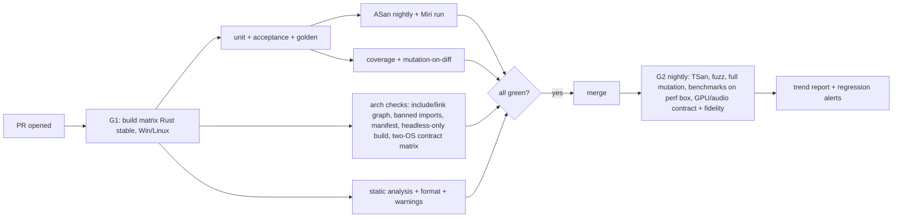

# Tooling and CI Proposal `[P]` (tool names are `[K]` unless linked)

## 1. Toolchain

| Concern | Proposal | Notes |
|---|---|---|
| Language | **Rust** (stable, pinned in `rust-toolchain.toml`; nightly only for Miri and sanitizers) | ADR-0001, decided by owner (Q1) |
| Build | Cargo workspace, one crate per module/adapter | the crate graph (`cargo metadata`) makes the link-graph rule checkable |
| Compiler | `rustc` (LLVM backend); Windows target `x86_64-pc-windows-msvc` (needs the MSVC linker/Build Tools), Linux `x86_64-unknown-linux-gnu`; ARM64 later | no clang requirement; mutation testing works with the normal toolchain ([Q7](../open-questions-and-risks.md)) |
| Platforms (v1) | Windows 11 (dev machine) + Linux (CI, WSL locally) = **two different OS families**, which is what proves the platform ports (rule of two); headless platform always | TSan is not available on MSVC; Linux gives us TSan and broader CI. macOS/Android/Web/consoles: design constraints now, adapters later (Q14) |
| Banned-import enforcement | dedicated CI job + denylist script | proves L0-L2 contain no OS/vendor/third-party dependency (standard library allowed) |
| CPU architectures | x86-64 first; ARM64 added to the CI matrix early (cloud ARM runner or emulation) so the `simd` scalar/ISA split is exercised (Q15) | |
| Formatting | rustfmt (check-only in CI) | |
| Static analysis | Clippy (default + selected `pedantic`/`nursery` lints, `-D warnings`), `cargo-deny` (advisories, licences, bans) | |
| Unit test framework | built-in `cargo test` (plus `cargo-nextest` for speed) | no external framework needed ([Q6](../open-questions-and-risks.md)) |
| Property-based | `proptest` (dev-only, T2) or in-house generator on our RNG | |
| Benchmarks | `criterion` or `divan` (T2) | CSV/JSON output compared with main (Box2D practice [S](https://box2d.org/posts/2024/08/releasing-box2d-3.0)) |
| Profiling | Tracy adapter (T2) via our profiling hook | |
| Coverage | `cargo-llvm-cov` | |
| Mutation | `cargo-mutants` `[K, verify in phase 0]` | slower and younger than Mull, works on Windows and Linux; see [quality-metrics](quality-metrics.md) |
| Complexity / duplication | Clippy `cognitive_complexity` and size lints, `rust-code-analysis` `[K]`, jscpd | |
| Architecture checks | in-house script (Python or a Rust tool) reading `cargo metadata` + `use` statements; `unsafe` scan | part of the repo, itself unit-tested |
| Fuzzing | `cargo-fuzz` (libFuzzer) | |
| Version control | git; private GitHub repository `giamat90/DuckEngine`, `main` since 2026-10-24 | GitHub Free plan, no upgrade (owner): see [github-plan-findings](github-plan-findings.md) |

## 2. Repository layout (proposal)

```
DuckEngine/
  wiki/                 <- this documentation
  docs/adr/             <- accepted ADRs (moved from wiki/decisions when accepted)
  THIRD_PARTY.md
  Cargo.toml            <- workspace; rust-toolchain.toml pins the compiler
  engine/
    base/               L0
    platform/           L1 interfaces
    jobs/ ecs/ modules/ L1
    physics/ render/ audio/ assets/ scene/ input/   L2  (each crate: src/, tests/, benches/)
  adapters/
    render_null/ render_gl/ render_vk/ render_d3d12/
    audio_null/ audio_offline/ audio_wasapi/
    platform_win32/ platform_posix/ platform_headless/   (later: cocoa, android, web)
    (ISA backends live in `base` behind `cfg(target_arch)`; `cpu_*` crates only if the N-6 spike chooses the generic top-down design)
  contracts/            <- shared port contract test suites
  apps/                 <- samples, composition roots
  tools/                <- shader tooling, asset pipeline, arch-check, metrics
  metrics/              <- generated reports (ignored or archived)
```

## 3. CI pipeline



Hosting (decided by owner, Q11): **private GitHub repository**, not open source. GitHub Actions is the CI. Consequences of a *private* repo:

- **Usage limits apply.** Verified 2026-10-24 ([github-plan-findings](github-plan-findings.md)): the Free plan gives 2,000 Actions minutes per month for private repos; Windows bills at about 1.67x (budget 2x) and macOS at about 10x. Our G1 matrix (Rust x Windows/Linux, sanitizers, mutation-on-diff) and nightly jobs can burn this quickly, so: keep G1 lean (diff-based mutation, caching with ccache/sccache), push heavy jobs (full mutation, fuzz, benchmarks) to nightly or to a self-hosted runner, and measure minutes per run as a process metric. Since card 1-38 `ci` runs only on `main` and by hand; since card 2-9 ordinary cards go through the permanent branch `develop` (develop-branch workflow, [delivery-pipeline](delivery-pipeline.md)).
- **Runners (D-3):** start with **GitHub-hosted runners**. GPU/audio contract tests and golden-image tests use **software rasterizers** (Mesa llvmpipe for OpenGL, lavapipe for Vulkan, WARP for D3D) `[K, verify V7]`; real-GPU checks run on demand on the owner's machine. Any **self-hosted runner** runs in a VM or under a separate Windows user with no access to the parent workspace or the owner's keys, never under the owner's own account.
- **Gate tools run from the trusted base (N-2):** the classifier, arch-check, `governance-guard` and the threshold configuration are executed from a trusted checkout of `main` (or a pinned release); the PR tree is only data. A change to these tools therefore takes effect for later PRs, never for the PR that changes them. Mechanism chosen: a base-commit checkout step, the PR tree checked out separately as data (`pr-title`, `governance-guard`, card 0b-8). The `ci` tool tests still run from the PR tree; moving them is phase 0c.
- **PR performance gate on deterministic instruction counts** (iai-style tools, Linux `[K]`); wall-clock benchmarks run nightly on a dedicated machine for the trend report.
- Actions minutes and AI usage cost per run are tracked as process metrics from the first week.
- No secrets in the repo or logs; CI secrets only on protected branches. (Note: the `GiaMat90` workspace contains key and SSH files; the DuckEngine repo root must be the `DuckEngine` folder only, never the parent.)

## 7. Claude Code operating setup (Q21c: Claude Code drives development)

Feature names below are from background knowledge of Claude Code **[K]**; verify against the current Claude Code docs when setting up in phase 0. Principle: *instructions are advisory, hooks and CI are enforcement.*

| Mechanism | Use |
|---|---|
| `CLAUDE.md` at the repo root | Thin file that imports [rules-digest](../rules-digest.md) (layers, wrapped vs not wrapped, determinism rules, measurable limits, TDD loop, gate commands, protected paths). The wiki remains canonical; a CI check compares the digest numbers with the gate configuration (D-11) |
| Project `.claude/settings.json` permissions | **Current state (2026-10-24, owner decisions):** denies reads and edits of the key files in the parent folder (`Api-keys*`, `GiaMat90_ssh*`), `~/.ssh` and `.env*`, plus `cat`/`type`/`Get-Content` of the key files; allows every `git *` and `gh *` command; the deny rules for push to `main`, `--no-verify` and force push were removed. No direct push to `main`, no hook bypass and no force push are now rules the agent follows, not rules the tool enforces. Deny-rule test: a Read of the `Api-keys.txt` path is refused and shows no content. Under `--dangerously-skip-permissions` (bypassPermissions mode) the deny rules still apply: the official permission-modes page says "Deny rules block in every mode, including `bypassPermissions`" (read 2026-10-24; documentation only, not tested in a flagged session). A deny rule matches a Bash command as written, so it does not stop every way a shell can read a file. Planned but not done: deny edits to protected paths (gate config, thresholds, arch-check, classifier, contract suites, CI, ADRs, the rules digest). Sessions start with `DuckEngine` as the working directory |
| Isolation (owner decision, 2026-10-24) | **One Windows user, no VM.** The deny rules above are the only barrier to the key files in the parent folder; they cover the file tools and the listed shell patterns, not every way a shell could read a file. `run_claude.bat` keeps `--dangerously-skip-permissions` (owner decision; `tech_lead.bat` is not in the repo). A self-hosted runner, if one is added, still needs its own isolation (see section 3) |
| Hooks (run by the harness, not by the model) | Block edits to protected paths and attempts to bypass checks (`--no-verify`, disabling tests); after edits run the fast gates (format, build, touched-module tests) so failures reach the agent immediately |
| `software-team` mode and subagents (`.claude/agents/`) | Claude Code works as a software team (PM, architect, developer, QA, security, DevOps, reviewer; mapping in [delivery-pipeline §1](delivery-pipeline.md)), with restricted tools per role, e.g. `qa`/`test-author`, `developer`, `reviewer` (read-only), `design-note-checker`, `auditor` |
| Skills / slash commands | `/task` (task card), `/gates` (local G0/G1), `/metrics` (generate report), `/review` (runs the review phase and writes `reviews/<task-id>.md`), built-in skills used by the review phase: `simplify`, `code-review`, `security-review` ([clean-code-and-review §4](clean-code-and-review.md)) |
| **CI on GitHub Actions** | **Authoritative.** The same gates run server-side, because local hooks can be bypassed by a misbehaving session. Branch protection cannot require G1 on the Free plan: merging is policy (section 6) |
| Run mode (**confirmed by owner**) | **Per task, autonomous until all checks pass;** then the owner accepts via manual product test or metrics; then the PR is opened, approved and squash-merged by the agent (into `main` for a governance card, into the branch `develop` for an ordinary card, which reaches `main` by one merge commit per release the owner asks for) -> tag -> Release via GitHub Actions ([delivery-pipeline](delivery-pipeline.md)). One approval only (the PO's, given against the open PR and its diff hash); no permission-prompt gesture and no GitHub review. Agent token scoped to this repo ([delivery-pipeline §4](delivery-pipeline.md)). No unattended/scheduled runs |

## 6. Private-repo hygiene (phase 0)

- `git init` inside `DuckEngine/`, private GitHub remote, `.gitignore`/`.gitattributes`, `CONTRIBUTING.md` renamed in practice to a `WORKFLOW.md` for yourself (TDD workflow + gates + self-review checklist), PR template with the checklist. Governance paths (gate config, thresholds, arch-check, contract suites, CI, ADRs, `THIRD_PARTY.md`) are protected by Claude Code permissions/hooks, rulesets and the `governance-guard` check, not by a GitHub review step ([tdd-workflow §10](tdd-workflow.md)). Add an agent instruction file (`CLAUDE.md`/`AGENTS.md`) and a task-card template in phase 0. Vulkan/D3D/GL validation tooling is added as dev-time tools when those adapters appear.
- Branch protection on `main` is **not available** on the Free private repo (verified 2026-10-24, [github-plan-findings](github-plan-findings.md)). The owner stays on Free and accepted that **merging is policy, not enforcement**: Claude Code merges only after the owner's approval against the diff hash and, once CI exists, after `gh run watch --exit-status` is green. A local pre-push hook is not enforcement against an agent. The first commit went to `main` directly (owner decision, bootstrap only); every later change goes through a branch and a PR.
- `LICENSE`/copyright header: proprietary "all rights reserved" notice (Q18), no public license.
- `THIRD_PARTY.md` has a **license column**; CI check that every vendored dependency's license permits closed-source redistribution (no GPL/AGPL in the tree; LGPL such as OpenAL Soft only as an optional dynamically-linked adapter, never required), so commercialisation stays possible.
- Keep copyright notices and authorship clean from commit 1; if anyone else contributes, obtain written IP assignment first.

## 4. Local developer experience

- `tools/check` runs the G0 subset (format, build, fast tests, arch checks) in seconds.
- Watch mode for the inner TDD loop on the module being worked on.
- One-command `tools/metrics` produces the same report as CI.

## 5. Phase-0 deliverables (tooling only, no engine features)

1. Repo + Cargo workspace skeleton, one trivial crate with a test, a benchmark and a mutation run to prove the whole chain works end-to-end ("walking skeleton" of the *workflow*). This slice validates gates G1, G2 and G5 of [ADR-0001 evaluation §6](../decisions/adr-0001-language-evaluation.md); G3 and G4 are validated in phase 1, G6 in phase 2.
2. CI running G1 on that module.
3. Arch-check script with its own tests (including a deliberately-violating fixture that must fail).
4. Baseline metrics report.
